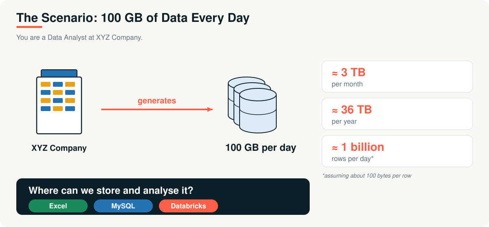
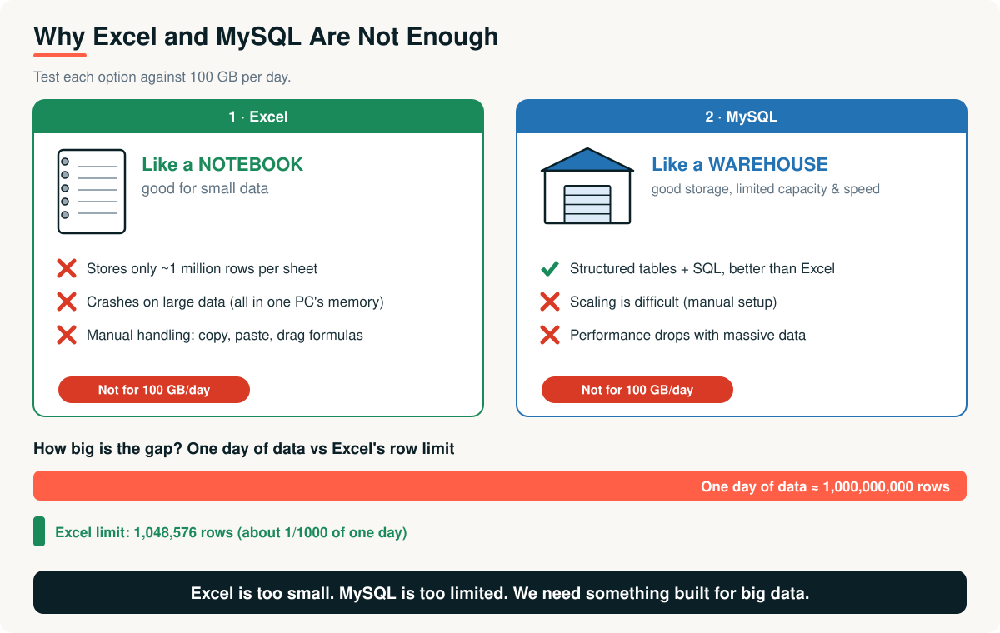
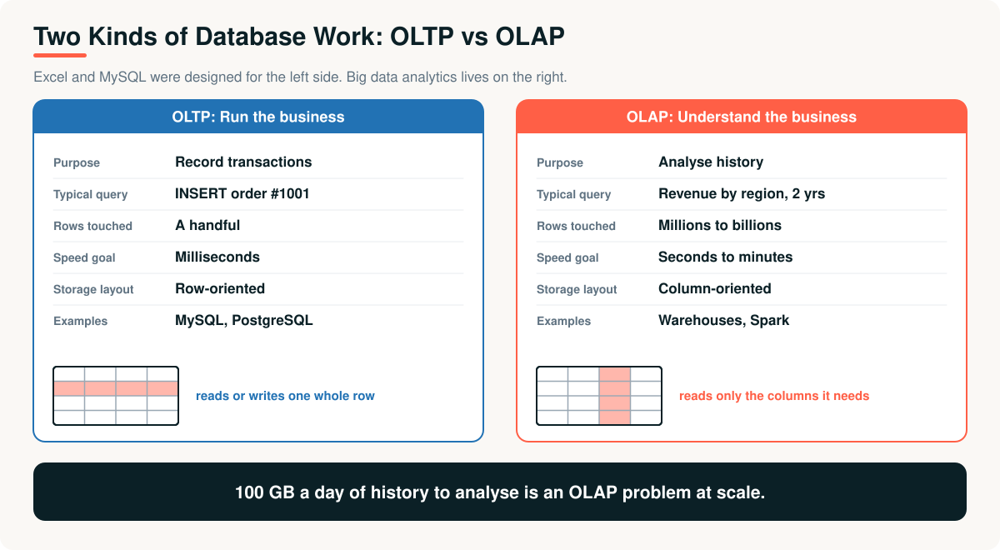

# 01 · The Data Problem

> **Module 01 · Topic 01 of 10** &nbsp;|&nbsp; Reading time: ~25 min &nbsp;|&nbsp; Level: Beginner

[Module home](README.md) &nbsp;·&nbsp; [Contents](README.md#topics-covered) &nbsp;·&nbsp; [Next: What Is Big Data? →](02-what-is-big-data.md)



## What you will learn

- Why a company's data outgrows spreadsheets and single databases
- The difference between **OLTP** and **OLAP** workloads
- How to do the back-of-the-envelope maths that sizes a data problem
- What a solution must provide, which leads directly to big data technology

---

## 1. The business problem

**XYZ Company** is an online retailer. Every day its website, mobile app, payment system and warehouse systems produce about **100 GB of data**: page views, searches, orders, payments, delivery scans and app logs.

**Asha** has just joined as a data analyst. On her first day the head of sales asks:

> "Which regions grew fastest last quarter, and which products are returned most often?"

That sounds like a simple question. Here is how Asha's week goes.

| Attempt | What she tries | What happens | Why |
|---|---|---|---|
| 1 | Open the order export in **Excel** | The file refuses to open, or Excel freezes and crashes | Excel holds everything in one computer's memory and stops at about 1 million rows |
| 2 | Ask engineering to load it into **MySQL** | The query runs for hours and slows down the live website | MySQL was built for many small transactions, not scans over billions of rows |
| 3 | Ask for a bigger server | It helps for a few months, then the data doubles | One machine always has a ceiling, and cost rises faster than capacity |

The question is not hard. The **tools** are the problem. This is the problem that big data technology was created to solve.

---

## 2. How big is the problem?

Before choosing any tool, engineers do the arithmetic. Run [`examples/01_capacity_calculator.py`](examples/01_capacity_calculator.py):

```text
Data per day     : 100 GB
Data per month   : 2.9 TB
Data per year    : 35.6 TB
Rows per day     : 1,073,741,824  (at 100 bytes per row)
Excel row limit  : 1,048,576
One day / Excel  : 1,024x the Excel limit

Read 100 GB on 1 machine   : 683 s  (11.4 min)
Read 100 GB on 100 machines : 6.8 s  (ideal, no overhead)
```

> [!NOTE]
> The 100 bytes per row and 150 MB/s disk speed are **assumptions** for illustration. The point is the order of magnitude: one day of data is about a thousand times what Excel can hold, and just *reading* it once on a single disk takes minutes.

---

## 3. Option 1: Excel



Excel is a superb tool. It is like a **notebook**: perfect for small data, quick analysis and one-off calculations.

| Limit | Detail |
|---|---|
| **Row limit** | 1,048,576 rows per sheet (older versions: 65,536) |
| **Memory** | The whole file is loaded into one computer's RAM, so large files freeze or crash |
| **Manual work** | Copy, paste and drag formulas. There is no scheduling and results are hard to reproduce |
| **Collaboration** | Many versions of the same file circulate by email. Nobody knows which is right |
| **Data shapes** | Poor for JSON, logs, images and other non-tabular data |

> [!TIP]
> **Excel is still the right tool** for small, one-off, human-scale analysis. A good data engineer knows when *not* to use a cluster.

---

## 4. Option 2: MySQL

MySQL (like PostgreSQL) is a **relational database**. It stores structured data in tables, supports SQL and is far better than Excel for shared, reliable data.

**Strengths:** structured tables · SQL queries · transactions · multiple users at once.

**Problems at 100 GB per day:**

| Problem | Explanation |
|---|---|
| **Scaling is difficult** | The usual fix is a bigger server (*vertical scaling*). Spreading one table across servers (**sharding**) needs manual design, and copying data to read-only servers (**replication**) helps reads, not huge scans |
| **Performance drops** | Analytical queries scan millions or billions of rows. Indexes help lookups, but not "sum everything for two years" |
| **Wrong workload** | It is built for many small, fast transactions, not a few huge analytical queries |
| **Shared with production** | A giant report on the live database can slow down customers placing orders |
| **Data shapes** | Awkward for unstructured and semi-structured data |

> MySQL is like a **warehouse**: good storage, but limited capacity and speed.

---

## 5. Two kinds of work: OLTP and OLAP

The deeper reason is that databases are built for one of two jobs.



| | OLTP (transactions) | OLAP (analytics) |
|---|---|---|
| **Purpose** | Run the business | Understand the business |
| **Example** | "Insert order #1001" | "Revenue by region for two years" |
| **Rows touched** | A handful | Millions to billions |
| **Speed goal** | Milliseconds | Seconds to minutes |
| **Storage layout** | Row-oriented (whole rows together) | Column-oriented (columns together, read only what is needed) |
| **Typical systems** | MySQL, PostgreSQL | Data warehouses, Spark, lakehouses |

Asha's question is **OLAP**, and at 100 GB per day it is OLAP at a scale that a single server cannot serve.

---

## 6. What a solution must provide

Turn the failures into requirements:

| Requirement | Why | Where you will learn it |
|---|---|---|
| Store more than one disk can hold | Data grows without limit | [Topic 04](04-distributed-computing-fundamentals.md), [05](05-hadoop-and-mapreduce.md) |
| Process data in parallel | One CPU is too slow | [Topic 04](04-distributed-computing-fundamentals.md), [06](06-apache-spark.md) |
| Survive machine failures | With many machines, failures are routine | [Topic 05](05-hadoop-and-mapreduce.md) |
| Handle any data shape | Logs, JSON, images, tables | [Topic 02](02-what-is-big-data.md) |
| Scale cheaply | Add ordinary machines, not one giant one | [Topic 04](04-distributed-computing-fundamentals.md) |
| Be easy to use | Analysts know SQL and Python | [Topic 07](07-pyspark.md) |
| Be reliable and governed | Trusted numbers, controlled access | [Topic 09](09-modern-data-platforms-and-databricks.md) |

---

## 7. Advantages and limitations

| | Excel | MySQL |
|---|---|---|
| **Best for** | Small data, quick analysis | Application data, transactions, moderate analytics |
| **Strengths** | Instant, visual, no setup | SQL, reliability, concurrency |
| **Limits** | ~1M rows, memory, manual | Hard to scale, slow on huge scans |
| **Analogy** | A notebook | A warehouse |
| **100 GB/day?** | No | No |

## 8. Real-world applications (where they still win)

- **Excel:** a finance team's monthly budget, a one-off survey analysis, a quick chart for a meeting.
- **MySQL / PostgreSQL:** an e-commerce site's live orders, user accounts, inventory, a small reporting database.
- **Both** remain *sources* feeding larger data platforms. The platform reads from them rather than replacing them.

---

## Key takeaways

1. 100 GB a day is about 36 TB a year, and about **1,000 times** Excel's row limit for a single day.
2. **Excel** is a notebook: great for small data, but limited by rows, memory and manual work.
3. **MySQL** is a warehouse: structured and fast for transactions, but hard to scale for analytics.
4. Databases are built for **OLTP** (run the business) or **OLAP** (understand the business). Big analytics is OLAP at scale.
5. The solution must **store, process, scale and survive failures** across many machines. That is the road to Hadoop, Spark and Databricks.

## Interview questions

<details><summary><b>1.</b> Why can't Excel handle 100 GB of data a day?</summary>

It has a limit of about 1 million rows per sheet (100 GB is roughly a billion rows), it loads the entire file into one computer's memory so large files crash it, and the work is manual and hard to automate or reproduce.
</details>

<details><summary><b>2.</b> Why does MySQL struggle with large analytical workloads?</summary>

It is an OLTP system designed for many small transactions on a single node. Analytical queries scan huge numbers of rows, row-oriented storage reads unneeded columns, and scaling beyond one server requires manual sharding or replication. A heavy report can also compete with production traffic.
</details>

<details><summary><b>3.</b> Explain OLTP vs OLAP with an example of each.</summary>

OLTP handles many small, fast transactions, such as inserting an order. OLAP runs a few large queries over lots of history, such as total revenue by region over two years. OLTP is usually row-oriented and optimised for latency; OLAP is usually column-oriented and optimised for throughput.
</details>

<details><summary><b>4.</b> What is the difference between sharding and replication?</summary>

Sharding splits one dataset across several servers (each holds part of the data) to scale storage and writes. Replication keeps copies of the same data on several servers to improve availability and read capacity. Sharding divides; replication duplicates.
</details>

<details><summary><b>5.</b> When is Excel or MySQL still the right choice?</summary>

Excel for small, one-off, human-scale analysis. MySQL for application data and transactions, and moderate reporting. Using a big data cluster for small data adds cost and complexity for no benefit.
</details>

---

| Previous | Contents | Next |
|:---|:---:|:---|
| [← Module home](README.md) | [Module home](README.md#topics-covered) | [What Is Big Data? →](02-what-is-big-data.md) |
