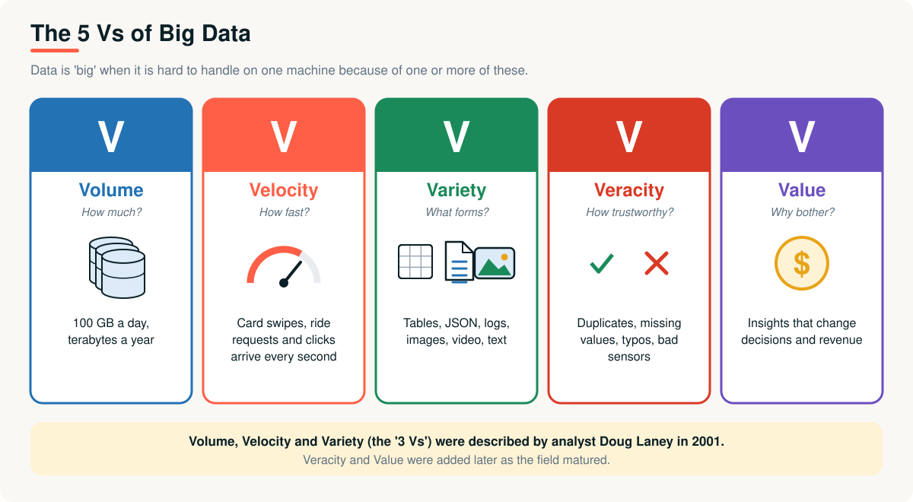
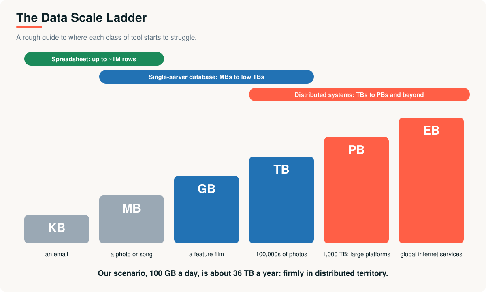
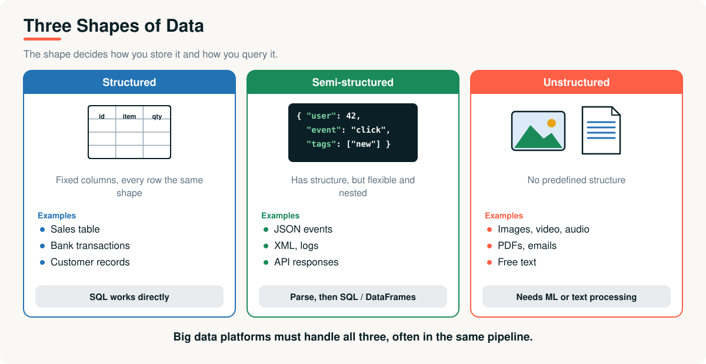
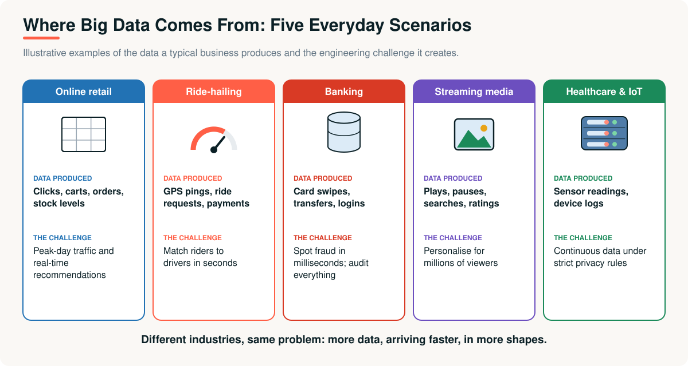

# 02 · What Is Big Data?

> **Module 01 · Topic 02 of 10** &nbsp;|&nbsp; Reading time: ~25 min &nbsp;|&nbsp; Level: Beginner

[Module home](README.md) &nbsp;·&nbsp; [← Previous: The Data Problem](01-the-data-problem.md) &nbsp;·&nbsp; [Next: What Is Data Engineering? →](03-what-is-data-engineering.md)

## What you will learn

- A practical definition of big data, and why "big" is relative
- The **5 Vs**: Volume, Velocity, Variety, Veracity, Value
- Structured, semi-structured and unstructured data
- Where big data comes from, and the challenges it creates

---

## 1. The business problem

At the quarterly meeting, XYZ Company's CEO announces: *"We are now a big data company."*

The data team looks at each other. Is 100 GB a day "big data"? What about 5 TB? What would make the answer *yes*?

---

## 2. A practical definition

> **Big data** is data that is too large, too fast, or too varied to be stored and processed with traditional single-machine tools in an acceptable time and at an acceptable cost.

Notice what the definition does **not** say: it gives no number. "Big" is **relative to your tools**.

- 5 GB is "big" for Excel and trivial for a database server.
- 5 TB can be routine for a data warehouse and painful for a laptop.
- Hundreds of terabytes, or millions of events per second, push you into distributed systems.

> [!IMPORTANT]
> Ask "can one machine do this job in the time and budget I have?" If not, you have a big data problem.

---

## 3. The 5 Vs

| V | Question | Example | Why engineers care |
|---|---|---|---|
| **Volume** | How much? | 100 GB a day, terabytes a year | Needs storage and processing that scale beyond one machine |
| **Velocity** | How fast? | Card swipes, ride requests and clicks arriving every second | Needs streaming or very frequent processing |
| **Variety** | What forms? | Tables, JSON, logs, images, video, text | Needs flexible storage and parsing |
| **Veracity** | How trustworthy? | Duplicates, missing values, typos, faulty sensors | Needs validation and cleaning, or results mislead |
| **Value** | Why bother? | Insights that change decisions and revenue | Without value, the whole effort is just cost |

The first three (Volume, Velocity, Variety) were described by analyst **Doug Laney in 2001**. Veracity and Value were added later as the field matured.

---

## 4. Three shapes of data

| | Structured | Semi-structured | Unstructured |
|---|---|---|---|
| **Shape** | Fixed rows and columns | Flexible, nested, self-describing | No predefined structure |
| **Examples** | Sales table, bank transactions | JSON events, XML, logs, API responses | Images, video, audio, PDFs, emails |
| **Storage** | Relational databases, CSV, Parquet | Files or document stores | Object storage |
| **Query** | SQL directly | Parse, then SQL / DataFrames | Needs ML or text processing |

A single XYZ order touches all three: the **order record** (structured), the **app event** (semi-structured JSON) and the **product photo and customer review** (unstructured).

### Schema-on-write vs schema-on-read

| | Schema-on-write | Schema-on-read |
|---|---|---|
| **When structure is applied** | Before storing (the database rejects bad data) | When reading (store first, interpret later) |
| **Typical system** | Relational database, data warehouse | Data lake, Hadoop, Spark |
| **Benefit** | Clean, consistent data | Flexible, store anything quickly |
| **Risk** | Slow to change; hard for new data types | Messy data if nobody enforces quality |

### File formats you will meet

| Format | Layout | Size | Best for |
|---|---|---|---|
| **CSV** | Row, plain text | Large | Simple exchange, small data |
| **JSON** | Nested text | Large | APIs, events, semi-structured data |
| **Parquet** | **Columnar**, binary, compressed | Small | Analytics: reads only the columns it needs |
| **Avro** | Row, binary, schema included | Medium | Streaming and data exchange |

> [!TIP]
> For analytics at scale, prefer **Parquet** (or Delta, which builds on Parquet) over CSV. It is smaller and much faster to query.

---

## 5. Where does big data come from?

Different industries, the same pattern: **more data, arriving faster, in more shapes**.

| Source | Typical data | Typical shape |
|---|---|---|
| Web and mobile apps | Clicks, searches, sessions | Semi-structured events |
| Transactional databases | Orders, payments, accounts | Structured |
| IoT and sensors | Temperature, location, device health | Time-series streams |
| Logs | Server and application logs | Semi-structured text |
| Social and media | Posts, images, video | Unstructured |
| Third-party / SaaS | CRM, ads, payments exports | Structured / JSON via APIs |

---

## 6. Benefits and challenges

| Benefits | Challenges |
|---|---|
| Better decisions from complete data, not samples | **Cost** of storage, compute and people |
| Personalisation and recommendations | **Quality** (veracity): garbage in, garbage out |
| Fraud and anomaly detection | **Privacy and security**: laws, consent, access control |
| Operational efficiency (predictive maintenance) | **Complexity**: many tools, many failure modes |
| New products built on data | **Skills** gap: data engineering is hard |

---

## Key takeaways

1. **Big data** means a problem too large, fast or varied for traditional single-machine tools. There is no magic number.
2. The **5 Vs**: Volume, Velocity, Variety, Veracity, Value.
3. Data is **structured**, **semi-structured** or **unstructured**, and real platforms handle all three.
4. Prefer **columnar formats** like Parquet for analytics.
5. Big data only pays off if the **value** exceeds the cost, and only if the data is **trustworthy**.

## Interview questions

<b>1.</b> What is big data? Is 1 TB big data?

Data too large, fast or varied for traditional single-machine tools to handle in acceptable time and cost. Whether 1 TB qualifies depends on the workload and tools: it is routine for a warehouse, but it can overwhelm a spreadsheet or a laptop.

<b>2.</b> Explain the 5 Vs with an example.

Volume: terabytes of order history. Velocity: ride requests arriving every second. Variety: tables, JSON logs and images. Veracity: duplicate or missing values that reduce trust. Value: insights that improve decisions.

<b>3.</b> Structured vs semi-structured vs unstructured data?

Structured has a fixed schema (a sales table). Semi-structured is self-describing but flexible, like JSON or logs. Unstructured has no predefined structure, like images, video and free text.

<b>4.</b> What is the difference between schema-on-write and schema-on-read?

Schema-on-write validates and structures data before storing it (databases and warehouses). Schema-on-read stores data as it is and applies structure when reading it (data lakes, Hadoop, Spark), which is more flexible but needs quality discipline.

<b>5.</b> Why is Parquet preferred over CSV for analytics?

Parquet is columnar, compressed and stores the schema, so queries read only the needed columns from smaller files. CSV is row-based text, larger, and has no stored types.

---

| Previous | Contents | Next |
|:---|:---:|:---|
| [← The Data Problem](01-the-data-problem.md) | [Module home](README.md#topics-covered) | [What Is Data Engineering? →](03-what-is-data-engineering.md) |
