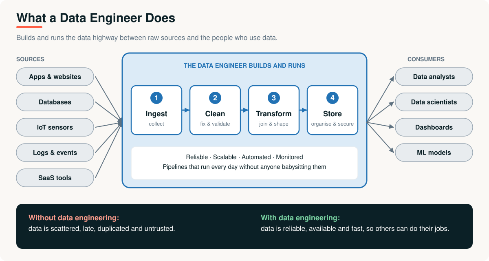
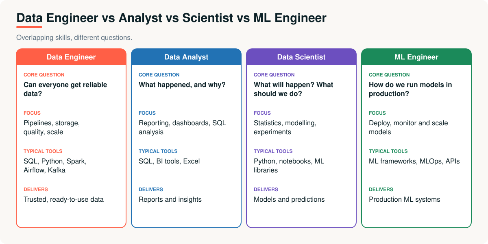
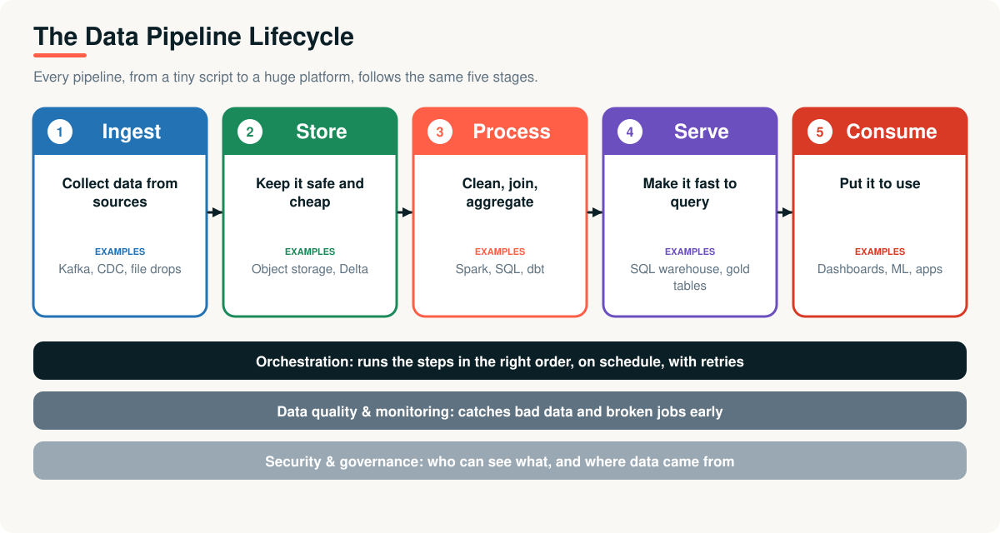
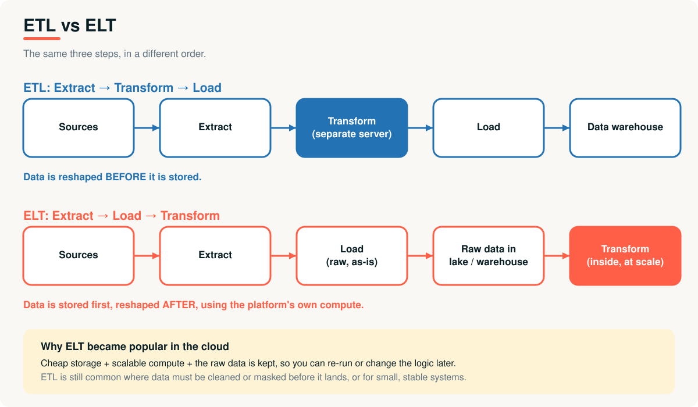
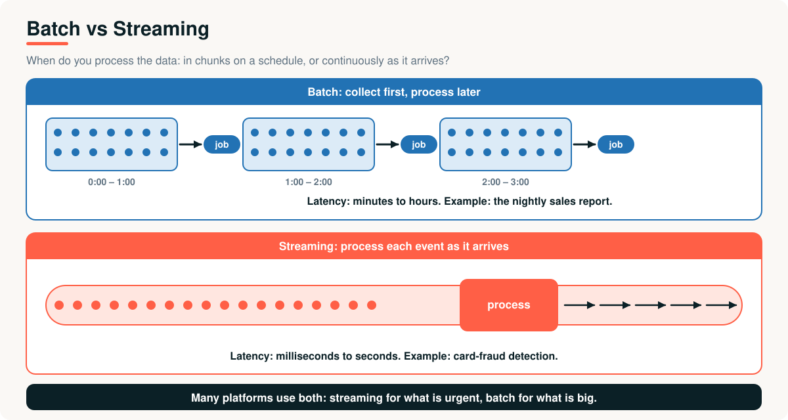

# 03 · What Is Data Engineering?

> **Module 01 · Topic 03 of 10** &nbsp;|&nbsp; Reading time: ~40 min &nbsp;|&nbsp; Level: Beginner

[Module home](README.md) &nbsp;·&nbsp; [← Previous: What Is Big Data?](02-what-is-big-data.md) &nbsp;·&nbsp; [Next: Distributed Computing Fundamentals →](04-distributed-computing-fundamentals.md)



## What you will learn

- What data engineering is, and why companies need it
- How a data engineer differs from an analyst, a scientist and an ML engineer
- The stages of a data pipeline
- **ETL vs ELT**, and **batch vs streaming**
- The skills to build, in a sensible order

---

## 1. The business problem

Six months after Asha joined XYZ Company, the data situation looks like this:

- Three teams each keep their own copy of the "sales" numbers, and the totals disagree.
- Every Monday someone emails a CSV export, then re-does the same cleaning by hand.
- The revenue dashboard broke last Thursday. Nobody noticed until the CFO did.
- The data scientists say they spend most of their time finding and cleaning data, not modelling.

Nobody is bad at their job. What is missing is **someone who owns the plumbing**: the systems that collect, clean, store and deliver data reliably, every day, automatically. That person is the **data engineer**.

---

## 2. Why the role exists

Data has to travel a long way before it is useful: from many messy **sources**, through cleaning and transformation, into storage, and out to the **people and programs** that use it. If that journey is manual, it is slow, error-prone and does not scale.

> **Data engineering** is the practice of designing, building and operating the systems that move, store and prepare data so that it is **reliable, available and fast** for everyone who uses it.

A useful analogy: a city needs **water engineers** so that every home gets clean water without thinking about reservoirs and pipes. Data engineers do the same for data.

---

## 3. What a data engineer does

| Responsibility | Example |
|---|---|
| **Build pipelines** | Load yesterday's orders from MySQL into the data platform every night |
| **Ingest data** | Collect app events from Kafka, files from partners, APIs from SaaS tools |
| **Clean and validate** | Remove duplicates, fix types, reject impossible values |
| **Transform and model** | Join orders with customers, build tables analysts can query |
| **Store and organise** | Choose formats, partitioning and layout for cost and speed |
| **Orchestrate** | Run steps in order, on schedule, with retries and alerts |
| **Monitor quality** | Detect late, missing or suspicious data before users do |
| **Secure and govern** | Control who can see what, and track data lineage |
| **Optimise** | Make slow jobs fast and expensive jobs cheap |

---

## 4. Data engineer vs analyst vs scientist vs ML engineer



| | Data Engineer | Data Analyst | Data Scientist | ML Engineer |
|---|---|---|---|---|
| **Core question** | Can everyone get reliable data? | What happened, and why? | What will happen? | How do we run models in production? |
| **Main output** | Pipelines, trusted tables | Reports, dashboards | Models, experiments | Deployed ML systems |
| **Typical tools** | SQL, Python, Spark, Airflow, Kafka | SQL, BI tools, Excel | Python, notebooks, ML libraries | ML frameworks, MLOps, APIs |

> [!NOTE]
> In small companies one person may do several of these jobs. In large ones, each is a team. The data engineer is usually the **foundation** the others stand on.

---

## 5. The data pipeline lifecycle



Every pipeline, from a ten-line script to a company-wide platform, has the same five stages:

1. **Ingest:** collect data from sources (databases, apps, files, streams).
2. **Store:** keep it safe and cheap, usually in object storage or a warehouse.
3. **Process:** clean, join and aggregate it.
4. **Serve:** shape it so queries are fast (gold tables, a SQL warehouse, APIs).
5. **Consume:** dashboards, ML models and applications use it.

Three **cross-cutting concerns** run underneath all stages: **orchestration** (scheduling and dependencies), **quality and monitoring**, and **security and governance**.

### Worked example: a tiny ETL pipeline

Run [`examples/05_simple_etl_pipeline.py`](examples/05_simple_etl_pipeline.py). It extracts messy CSV text, removes duplicates and invalid rows, standardises values, and loads the result into SQLite:

```text
extracted 6 rows | loaded 4 | rejected 2: [('1002', 'duplicate'), ('1003', 'invalid quantity')]

Revenue by region (the kind of question an analyst asks):
  NORTH      120.00
  SOUTH      150.00
  UNKNOWN    100.00

Rows in table after running the load twice: 4
```

Three habits of good pipelines are visible even here:

| Habit | In the example |
|---|---|
| **Validate and reject, don't silently drop** | Rejected rows are collected with a reason |
| **Standardise** | `" East "`, `"south"`, `""` become `EAST`, `SOUTH`, `UNKNOWN` |
| **Idempotent** | Running the load twice still gives 4 rows, not 8 |

> [!IMPORTANT]
> **Idempotency** (safe to re-run) is the most important property of a production pipeline. Jobs fail and get retried. A re-run must never create duplicates.

---

## 6. ETL vs ELT



| | ETL | ELT |
|---|---|---|
| **Order** | Extract → **Transform** → Load | Extract → **Load** → Transform |
| **Where transformation runs** | A separate processing server | Inside the warehouse or lakehouse |
| **Raw data kept?** | Often not | Yes, so you can reprocess later |
| **Best when** | Data must be cleaned or masked before landing; small, stable systems | Cheap storage and scalable compute are available (the cloud) |
| **Typical era** | Traditional data warehouses | Cloud data platforms, lakehouses |

---

## 7. Batch vs streaming



| | Batch | Streaming |
|---|---|---|
| **Processing** | Collect first, process on a schedule | Process each event as it arrives |
| **Latency** | Minutes to hours | Milliseconds to seconds |
| **Example** | Nightly sales report | Card-fraud detection |
| **Complexity** | Simpler | Harder (ordering, late data, state) |
| **Cost** | Usually lower | Usually higher |

> [!TIP]
> Don't stream because it sounds modern. Ask: *does the business lose money if this data is an hour old?* If not, batch is simpler and cheaper.

---

## 8. Data quality: what "good data" means

| Dimension | Question | Example check |
|---|---|---|
| **Completeness** | Is anything missing? | No null `order_id` |
| **Uniqueness** | Any duplicates? | `order_id` appears once |
| **Validity** | Does it follow the rules? | `quantity > 0` |
| **Consistency** | Does it agree across systems? | Revenue matches finance |
| **Timeliness** | Is it fresh enough? | Loaded before 7 a.m. |
| **Accuracy** | Is it true? | Prices match the catalogue |

---

## 9. Skills roadmap

| Order | Skill | Why |
|---|---|---|
| 1 | **SQL** | The universal language of data |
| 2 | **Python** | Pipelines, glue code, automation |
| 3 | **Linux, Git** | Everyday tools |
| 4 | **Data modelling** | Designing tables people can use |
| 5 | **Distributed processing (Spark)** | Data that outgrows one machine |
| 6 | **Cloud storage and warehouses** | Where data lives today |
| 7 | **Orchestration (Airflow, Jobs)** | Reliable scheduling |
| 8 | **Streaming (Kafka)** | Real-time pipelines |

This module covers the foundations of items 5 and 6. Later modules of this repository go deeper.

---

## Advantages and challenges

| Benefits of good data engineering | Challenges |
|---|---|
| One trusted version of the truth | Pipelines break silently if not monitored |
| Analysts and scientists spend time analysing, not cleaning | Schema changes in sources break downstream jobs |
| Fast, repeatable, automated delivery | Cost control in the cloud |
| Auditable and secure data | Balancing speed, cost and quality |

## Real-world applications

- **Retail:** nightly sales pipelines, real-time inventory, recommendation features.
- **Banking:** streaming fraud detection, regulatory reporting with full lineage.
- **Healthcare:** merging records from many systems under strict privacy rules.
- **Ride-hailing and logistics:** streaming location data for matching and ETAs.

---

## Key takeaways

1. A **data engineer** builds and runs the systems that make data reliable, available and fast.
2. A pipeline has five stages: **ingest, store, process, serve, consume**, supported by orchestration, quality and governance.
3. **ETL** transforms before loading. **ELT** loads raw data first and transforms inside the platform, which suits the cloud.
4. **Batch** is simpler and cheaper. **Streaming** is faster and harder. Choose by business need.
5. Make every pipeline **idempotent** and **validated**.

## Interview questions

<details><summary><b>1.</b> What does a data engineer do, and how is it different from a data scientist?</summary>

A data engineer builds and operates pipelines and storage so data is reliable and available. A data scientist uses that data to build models and run experiments. Engineers focus on the data's journey; scientists focus on insight and prediction.
</details>

<details><summary><b>2.</b> Explain ETL vs ELT. Why did ELT become popular?</summary>

ETL transforms data on a separate server before loading; ELT loads raw data first and transforms it inside the warehouse or lakehouse. ELT rose with cheap cloud storage and scalable compute, and because keeping raw data lets you reprocess when logic changes.
</details>

<details><summary><b>3.</b> What is idempotency and why does it matter?</summary>

An idempotent job gives the same result no matter how many times it runs. Pipelines fail and are retried, so without idempotency a retry could create duplicate or inconsistent data.
</details>

<details><summary><b>4.</b> Batch or streaming? How do you choose?</summary>

Choose by the cost of delay. If an hour-old answer is fine, use batch (simpler, cheaper). If decisions must be made in seconds, such as fraud detection, use streaming, accepting more complexity.
</details>

<details><summary><b>5.</b> Name the dimensions of data quality and give a check for each.</summary>

Completeness (no null keys), uniqueness (no duplicate IDs), validity (quantity above zero), consistency (matches another system), timeliness (loaded before the deadline), accuracy (matches the real world).
</details>

<details><summary><b>6.</b> A dashboard shows wrong numbers. How do you investigate as a data engineer?</summary>

Work backwards through the pipeline: check the serving table, then the transformation logic, then the ingested raw data and the source. Compare row counts and key totals at each stage, check for schema changes, late or duplicate loads, and failed jobs. Then add a test or monitor so it is caught earlier next time.
</details>

---

| Previous | Contents | Next |
|:---|:---:|:---|
| [← What Is Big Data?](02-what-is-big-data.md) | [Module home](README.md#topics-covered) | [Distributed Computing Fundamentals →](04-distributed-computing-fundamentals.md) |
