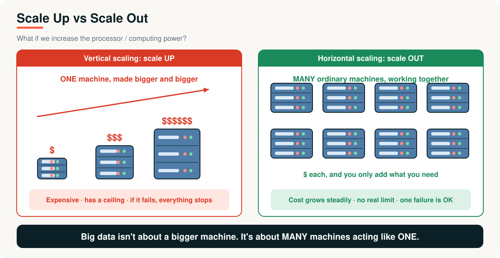
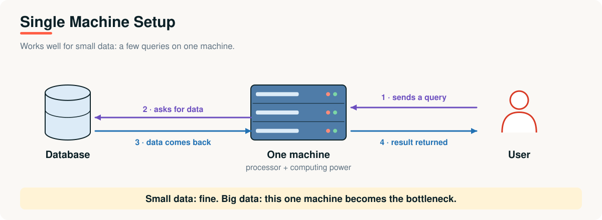
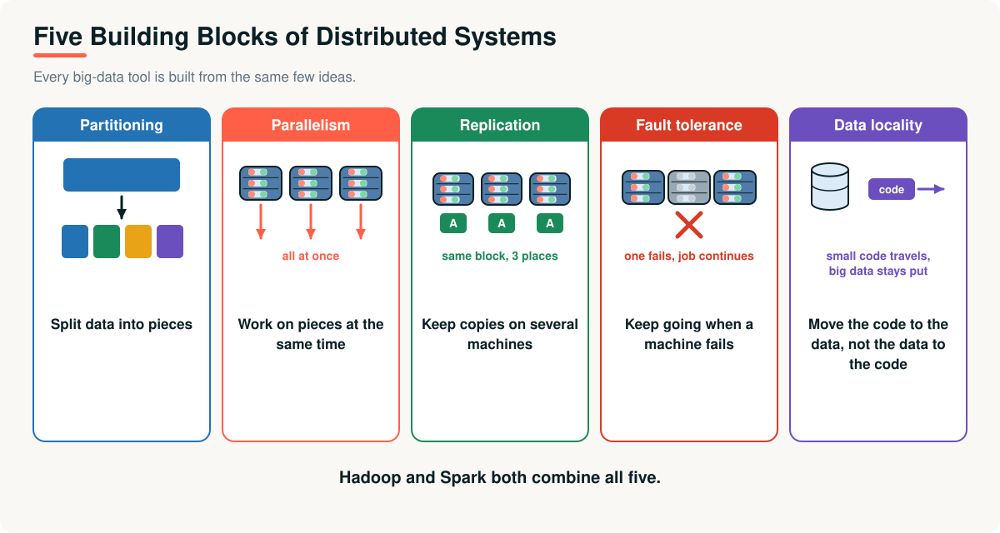
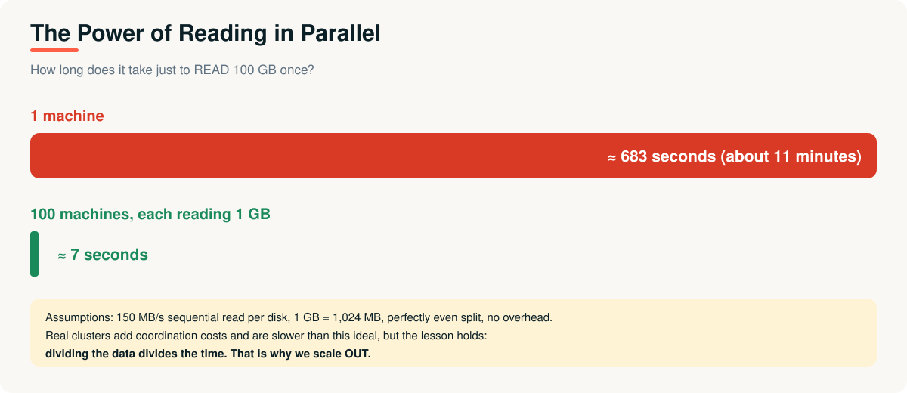

# 04 · Distributed Computing Fundamentals

> **Module 01 · Topic 04 of 10** &nbsp;|&nbsp; Reading time: ~35 min &nbsp;|&nbsp; Level: Beginner

[Module home](README.md) &nbsp;·&nbsp; [← Previous: What Is Data Engineering?](03-what-is-data-engineering.md) &nbsp;·&nbsp; [Next: Hadoop and MapReduce →](05-hadoop-and-mapreduce.md)



## What you will learn

- Why a single machine eventually fails, and the three ways it hits its limits
- **Vertical vs horizontal** scaling
- The five building blocks every big data tool uses
- Why parallel processing helps, and what limits it
- The new problems distribution creates

---

## 1. The business problem

It is Black Friday. XYZ Company's nightly job that builds the sales summary normally takes 4 hours on one large server. This year it takes **26 hours**. The morning report is late, the pricing team is making decisions on yesterday's numbers, and the server is at its maximum size.

Buying the next bigger server is possible, but it costs four times as much and the data will double again next year.

---

## 2. Why a single machine runs out



A single machine has four finite resources:

| Resource | Limit | What breaks |
|---|---|---|
| **CPU** | A fixed number of cores | Jobs take longer as data grows |
| **Memory (RAM)** | Gigabytes to a few terabytes | Data that does not fit forces slow disk use or crashes |
| **Disk** | One machine's storage and read speed | Capacity and throughput cap |
| **Network** | One connection | Data cannot arrive faster |

And one more risk: **it is a single point of failure**. If it dies, everything stops.

---

## 3. Two ways to grow

| | Vertical (scale **up**) | Horizontal (scale **out**) |
|---|---|---|
| **What** | One bigger machine | Many ordinary machines |
| **Cost curve** | Rises steeply: top-end hardware is priced at a premium | Roughly linear: add what you need |
| **Ceiling** | Hard hardware limit | Practically none |
| **Failure** | Everything stops | Others continue |
| **Complexity** | Low: same software, bigger box | High: software must coordinate machines |

> **Analogy:** to move a huge pile of bricks you can hire one superhuman worker or 100 ordinary workers. The 100 are cheaper, faster, and the job continues if one is absent. The price is **coordination**.

Big data technology chooses **scale out**. Everything in the next topics follows from that choice.

---

## 4. The five building blocks



| Block | Meaning | Used by |
|---|---|---|
| **Partitioning** | Split data into pieces that can live on, and be processed by, different machines | HDFS blocks, Spark partitions |
| **Parallelism** | Process the pieces at the same time | MapReduce tasks, Spark tasks |
| **Replication** | Keep copies of data on several machines | HDFS (3 copies by default) |
| **Fault tolerance** | Detect failures and recover automatically | HDFS re-replication, Spark lineage |
| **Data locality** | Send the (small) code to where the (big) data is | Hadoop and Spark schedulers |

### Partitioning strategies

| Strategy | How | Good for | Watch out for |
|---|---|---|---|
| **Hash** | `hash(key) mod N` | Even spread, key lookups | Range queries are scattered |
| **Range** | Key ranges per partition (A-F, G-M, ...) | Range scans, sorted data | **Hot spots** if some ranges are busier |
| **Round-robin** | Deal rows out in turn | Perfectly even sizes | Related rows end up apart |

> [!WARNING]
> **Data skew:** if one customer produces 40% of all events, the partition holding that customer does 40% of the work and the whole job waits for it. Skew is one of the most common causes of slow big data jobs.

---

## 5. The payoff: reading in parallel



Reading 100 GB at 150 MB/s takes about **683 seconds** on one machine. Split across 100 machines it takes about **7 seconds** (ideal case). The idea in miniature is in [`examples/02_parallel_vs_serial.py`](examples/02_parallel_vs_serial.py): partition a job, run the partitions in parallel, combine the results.

```python
with Pool(workers) as pool:
    parallel = sum(pool.map(work, partition(N, workers)))   # split -> process in parallel -> combine
```

> [!NOTE]
> The measured speed-up depends on how many CPU cores you have. On a one- or two-core machine you will see little gain. Try it on a laptop with four or more cores.

### The limit: Amdahl's law

Not every part of a job can be parallelised. If a fraction **p** of the work is parallel and **n** machines are used:

```
speed-up = 1 / ((1 - p) + p / n)
```

If 95% of a job is parallel (p = 0.95) and you use 100 machines, the speed-up is `1 / (0.05 + 0.0095)` ≈ **16.8×**, not 100×. Even with infinite machines the cap is 1 / 0.05 = **20×**. The sequential part becomes the bottleneck, which is why good distributed design minimises coordination and shuffling.

---

## 6. How a distributed job runs, step by step

1. **Split:** the data is already partitioned across machines (or is split on read).
2. **Plan:** a coordinator decides which machine handles which partition, preferring machines that already hold the data (**locality**).
3. **Execute in parallel:** each machine processes its own partition.
4. **Exchange (if needed):** operations like "group by customer" require moving data between machines (a **shuffle**). This is the expensive step.
5. **Combine:** partial results are merged into the final answer.
6. **Recover:** if a machine fails, the coordinator re-runs its work elsewhere using replicated data.

---

## 7. New problems that distribution creates

| Problem | Why | Typical answer |
|---|---|---|
| **Partial failure** | Some machines fail while others continue | Retries, replication, re-scheduling |
| **Network cost** | Moving data between machines is slow | Locality, fewer shuffles |
| **Coordination** | Machines must agree on state | A manager node, consensus services |
| **Consistency vs availability** | During a network split you cannot have both (**CAP theorem**) | Choose per system |
| **Skew** | Uneven partitions slow the whole job | Better keys, salting, adaptive execution |
| **Debugging** | Logs and errors are spread over many machines | Central logs, job UIs |

**Failure is routine at scale.** If one machine fails on average once in about 1,000 days, a cluster of 1,000 machines sees roughly **one failure every day**. Systems must treat failure as normal, not exceptional.

---

## Advantages and limitations

| Advantages | Limitations |
|---|---|
| Handles data larger than any single machine | Much more complex to build and operate |
| Cost grows roughly linearly | Network and coordination overheads |
| No single point of failure | Harder consistency and debugging |
| Faster through parallelism | Gains limited by the sequential part (Amdahl) |

## Real-world applications

- **Web search indexing** and **log analytics** over terabytes of data.
- **Recommendation systems** trained on millions of users.
- **Financial risk simulations** run in parallel on thousands of cores.
- **Genomics and scientific computing** split across clusters.

---

## Key takeaways

1. A single machine is limited in CPU, memory, disk and network, and is a **single point of failure**.
2. **Scale out** (many ordinary machines) beats **scale up** for big data: cheaper growth, no ceiling, resilient.
3. Five building blocks: **partitioning, parallelism, replication, fault tolerance, data locality**.
4. Parallelism is limited by the sequential part of the job (**Amdahl's law**), and by **shuffles** and **skew**.
5. At scale, **failure is normal**. Systems must expect it.

## Interview questions

<details><summary><b>1.</b> Vertical vs horizontal scaling: what are the trade-offs?</summary>

Vertical is simple but expensive, has a hardware ceiling and is a single point of failure. Horizontal adds many ordinary machines with near-linear cost and fault tolerance, but requires software to coordinate machines and handle network and partial failures.
</details>

<details><summary><b>2.</b> What is the difference between partitioning and replication?</summary>

Partitioning splits data so different machines hold different pieces (for scale and parallelism). Replication keeps copies of the same data on several machines (for fault tolerance and read availability).
</details>

<details><summary><b>3.</b> What is data locality and why does it matter?</summary>

Scheduling computation on the machine that already stores the data. Moving a small program is much cheaper than moving terabytes across the network.
</details>

<details><summary><b>4.</b> What is data skew and how can it be reduced?</summary>

Uneven distribution of data across partitions so a few tasks do most of the work. Reduce it with better partition keys, salting hot keys, broadcasting small tables, or adaptive query execution.
</details>

<details><summary><b>5.</b> A job uses 95% parallel code. What speed-up do 100 machines give?</summary>

By Amdahl's law: 1 / (0.05 + 0.95/100) ≈ 16.8×. The maximum possible with unlimited machines is 20×.
</details>

<details><summary><b>6.</b> State the CAP theorem in plain words.</summary>

When a network partition splits a distributed system, it must choose between staying consistent (all nodes agree) and staying available (every request gets a response). You cannot guarantee both during the partition.
</details>

---

| Previous | Contents | Next |
|:---|:---:|:---|
| [← What Is Data Engineering?](03-what-is-data-engineering.md) | [Module home](README.md#topics-covered) | [Hadoop and MapReduce →](05-hadoop-and-mapreduce.md) |
