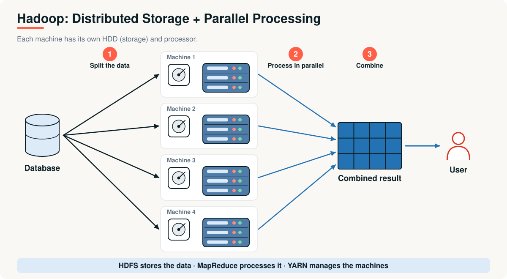
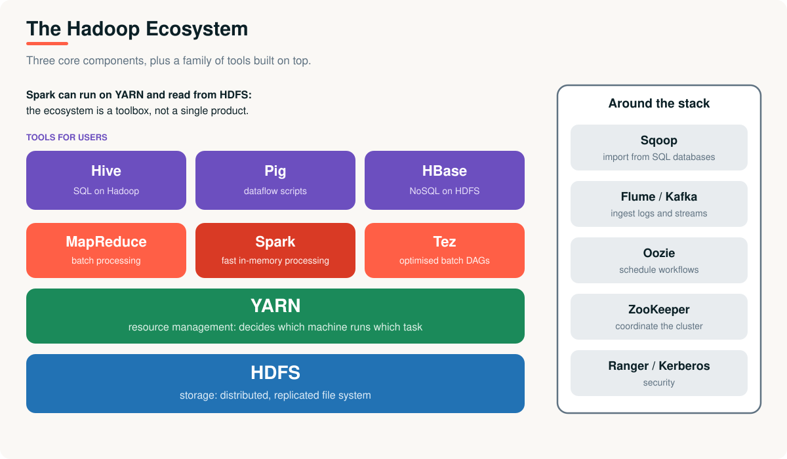
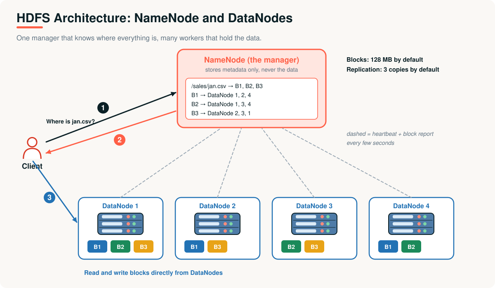
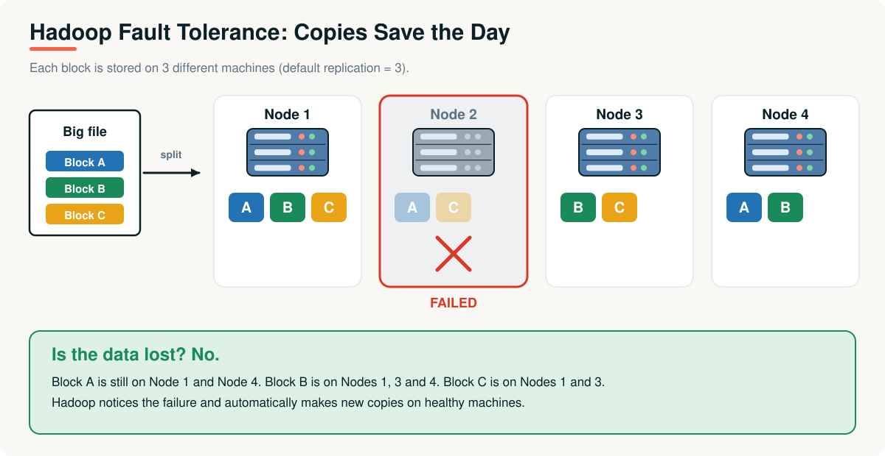
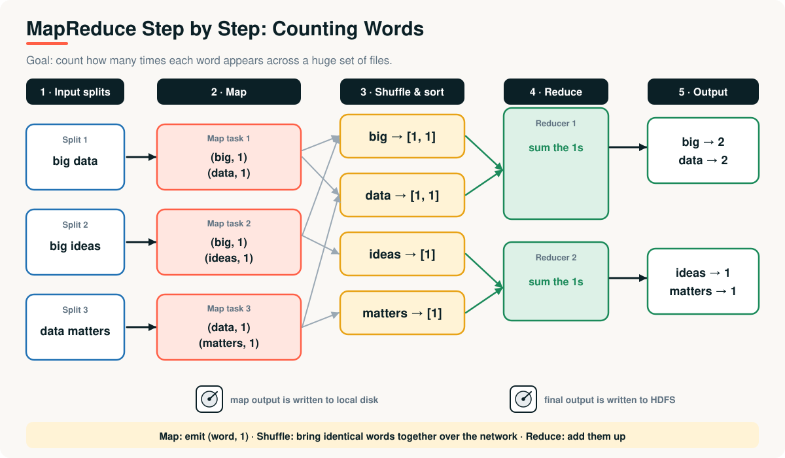

# 05 · Hadoop and MapReduce

> **Module 01 · Topic 05 of 10** &nbsp;|&nbsp; Reading time: ~50 min &nbsp;|&nbsp; Level: Beginner

[Module home](README.md) &nbsp;·&nbsp; [← Previous: Distributed Computing Fundamentals](04-distributed-computing-fundamentals.md) &nbsp;·&nbsp; [Next: Apache Spark →](06-apache-spark.md)



## What you will learn

- Why Hadoop was created and the problems it solved
- **HDFS**: how files are split, replicated and protected from failure
- **MapReduce**: the programming model, step by step with a word-count example
- **YARN** and the wider Hadoop ecosystem
- Hadoop's limitations, which led to Spark

---

## 1. The business problem

In the early 2000s, web companies faced the exact problem XYZ Company has today, only bigger: **index and analyse terabytes of web pages and logs**.

- A big enough server cost a fortune, and still was not big enough.
- Buying thousands of **cheap ordinary machines** was affordable, but nobody had good software to make them act as one.
- With thousands of machines, **something is always broken**.

Google described its answers in two research papers: the **Google File System (2003)** and **MapReduce (2004)**. Doug Cutting and Mike Cafarella built an open-source implementation, which became **Apache Hadoop** (2006).

---

## 2. Why Hadoop was needed

| Problem | Traditional issue | Hadoop solution | Component |
|---|---|---|---|
| **Huge data** | Storage on one hard disk | **Distributed storage** | HDFS |
| **Slow processing** | A single machine | **Parallel processing** | MapReduce |
| **High cost** | Expensive servers | **Cheap scaling** on commodity hardware | The cluster |
| **Failures** | Data loss | **Fault tolerance** via replication | HDFS replicas |
| **Unstructured data** | Not supported | **Fully supported**, schema-on-read | Files as-is |

> Hadoop solves the problem of **storing and processing huge data reliably and affordably**.

---

## 3. The architecture

Hadoop has three core components:

| Component | Job | Analogy |
|---|---|---|
| **HDFS** (Hadoop Distributed File System) | Store data across many machines | A shared filing cabinet spread over many rooms |
| **YARN** (Yet Another Resource Negotiator) | Decide which machine runs which task | The building manager allocating rooms |
| **MapReduce** | The programming model to process data in parallel | The work procedure everyone follows |



In the cluster picture at the top, the database's data is **split** across machines. Each machine has its own **HDD** and **processor**, works on its own piece **in parallel**, and the partial results are **combined** into one answer.

---

## 4. HDFS in depth



| Concept | Detail |
|---|---|
| **Block** | Files are split into large blocks, **128 MB by default**. Large blocks keep metadata small and make reads mostly sequential |
| **NameNode** | The manager. Keeps the **metadata**: which files exist, which blocks make up each file, and which DataNodes hold each block. It does not store the data itself |
| **DataNode** | A worker that stores blocks and sends **heartbeats** and block reports to the NameNode |
| **Replication** | Each block is copied to **3 DataNodes** by default, placed across racks so a whole rack failure does not lose data |

### Writing a file

1. The client asks the **NameNode** to create the file.
2. The NameNode checks permissions and returns, for each block, a list of DataNodes.
3. The client sends the block to the **first DataNode**, which forwards it to the second, which forwards it to the third (a **pipeline**).
4. Acknowledgements flow back; the client moves to the next block.
5. When finished, the NameNode records the file as complete.

### Reading a file

1. The client asks the NameNode for the block locations.
2. The client reads each block **directly from the nearest DataNode**. Data never flows through the NameNode.

### Fault tolerance in action



When a DataNode stops sending heartbeats, the NameNode marks it dead, notices that some blocks now have fewer than 3 copies, and **instructs other DataNodes to make new copies**. No data is lost and no human is involved.

> [!WARNING]
> **The small files problem.** The NameNode keeps all metadata in memory. Millions of tiny files overwhelm it, even if the total size is small. Prefer fewer, larger files.

---

## 5. MapReduce in depth

MapReduce processes data in three phases. The classic example is **counting words**.



| Phase | What happens | Word-count example |
|---|---|---|
| **Input splits** | Input is divided into splits (roughly one per HDFS block), each processed by one map task | `"big data"`, `"big ideas"`, `"data matters"` |
| **Map** | Each map task turns records into `(key, value)` pairs | `(big, 1) (data, 1)` ... |
| **Shuffle and sort** | Pairs are grouped by key and sent across the network to the right reducer | `big → [1, 1]` |
| **Reduce** | Each reducer combines the values for each key | `big → 2` |
| **Output** | Results are written to HDFS | `big 2`, `data 2`, `ideas 1`, `matters 1` |

### Run the simulation

[`examples/03_mapreduce_word_count.py`](examples/03_mapreduce_word_count.py) runs these phases in plain Python on the same input as the diagram:

```text
map task 1     : [('big', 1), ('data', 1)]
map task 2     : [('big', 1), ('ideas', 1)]
map task 3     : [('data', 1), ('matters', 1)]
after shuffle   : {'big': [1, 1], 'data': [1, 1], 'ideas': [1], 'matters': [1]}
final output    : {'big': 2, 'data': 2, 'ideas': 1, 'matters': 1}
```

### A real Hadoop job (Hadoop Streaming)

Hadoop can run any program that reads standard input and writes standard output. See [`examples/hadoop_streaming/`](examples/hadoop_streaming/) for a `mapper.py` and `reducer.py`. You can test them without Hadoop, because Hadoop does the same thing: map, sort, reduce.

```bash
printf 'big data\nbig ideas\ndata matters\n' \
  | python examples/hadoop_streaming/mapper.py | sort \
  | python examples/hadoop_streaming/reducer.py
```
```text
big	2
data	2
ideas	1
matters	1
```

On a cluster the same scripts run as (the jar path varies by installation):

```bash
hadoop jar $HADOOP_HOME/share/hadoop/tools/lib/hadoop-streaming-*.jar \
  -files mapper.py,reducer.py \
  -input /data/books -output /out/wordcount \
  -mapper "python3 mapper.py" -reducer "python3 reducer.py"
```

### What really happens inside a job

1. Each map task reads its split, ideally from a **local** block (data locality).
2. Map output is buffered in memory, **spilled to local disk**, partitioned by key and sorted.
3. Reducers **fetch** their partitions from every mapper over the network (the **shuffle**).
4. Each reducer merges, runs the reduce function, and writes the result to **HDFS** (replicated again).
5. An optional **combiner** does a mini-reduce on the map side (for word count, summing locally) to cut network traffic.

> [!IMPORTANT]
> Notice how many times data touches **disk**: map spill, shuffle, reduce output to HDFS. For a chain of jobs, every job reads its input from HDFS and writes its output back. This is the central weakness that Spark fixes.

---

## 6. YARN: sharing the cluster

| Piece | Role |
|---|---|
| **ResourceManager** | One per cluster. Allocates resources among applications |
| **NodeManager** | One per machine. Launches and monitors **containers** (slices of CPU and memory) |
| **ApplicationMaster** | One per application. Negotiates containers and tracks the job's tasks |

YARN (introduced with Hadoop 2) separated *resource management* from *MapReduce*, so other engines, including **Spark**, can run on the same cluster.

---

## 7. The ecosystem

| Tool | Purpose |
|---|---|
| **Hive** | SQL queries over data in HDFS |
| **Pig** | Dataflow scripting language |
| **HBase** | NoSQL database on HDFS for fast random reads and writes |
| **Sqoop** | Import and export between Hadoop and relational databases |
| **Flume / Kafka** | Ingest logs and event streams |
| **Oozie** | Workflow scheduling |
| **ZooKeeper** | Coordination between cluster services |

---

## 8. Advantages and limitations

| Advantages | Limitations |
|---|---|
| Scales to petabytes on cheap hardware | **Disk-heavy**: slow for multi-step and iterative jobs |
| Fault tolerant by design | **High latency**: minutes to hours, not interactive |
| Schema-on-read: store anything | Batch only (no native streaming) |
| Data locality saves network | Verbose, low-level programming (Java MapReduce) |
| Mature, open source | Operating clusters is hard; small-files problem; storage and compute tightly coupled |

## 9. Real-world applications

- **Log and clickstream analysis** at web scale.
- **Large batch ETL** loading data warehouses overnight.
- **Archival storage** of raw data on cheap disks.
- Many organisations later moved from on-premises Hadoop to **cloud object storage with Spark**. HDFS and YARN are still used, and the **ideas** (partitioning, replication, locality, map and reduce) are everywhere in modern tools.

---

## Key takeaways

1. Hadoop made **scale out** practical: cheap machines, distributed storage, parallel processing, automatic recovery.
2. **HDFS** splits files into 128 MB blocks, replicated 3 times. The **NameNode** keeps metadata, **DataNodes** hold data.
3. **MapReduce** = map (emit pairs) → shuffle and sort (group by key) → reduce (combine).
4. **YARN** allocates cluster resources and lets other engines share the cluster.
5. Hadoop's weakness is **disk I/O between steps**, which makes it slow for iterative and interactive work.

## Interview questions

<details><summary><b>1.</b> What problem did Hadoop solve?</summary>

Storing and processing data too big for one machine, reliably and affordably: distributed storage (HDFS), parallel processing (MapReduce), cheap scaling on commodity hardware, fault tolerance through replication, and support for unstructured data.
</details>

<details><summary><b>2.</b> What are the roles of the NameNode and DataNode?</summary>

The NameNode stores metadata (the file system tree and block locations) and coordinates access. DataNodes store the actual blocks and report to the NameNode with heartbeats and block reports. Clients read and write data directly with DataNodes.
</details>

<details><summary><b>3.</b> Why is the HDFS block size so large (128 MB)?</summary>

Large blocks reduce the amount of metadata the NameNode must hold and make reads mostly sequential, minimising disk seek overhead relative to transfer time.
</details>

<details><summary><b>4.</b> What happens when a DataNode fails?</summary>

The NameNode stops receiving its heartbeats, marks it dead, finds blocks with fewer than the required replicas, and has other DataNodes copy those blocks. Running tasks are re-scheduled on other nodes.
</details>

<details><summary><b>5.</b> Explain the shuffle phase and why it is expensive.</summary>

After mapping, all values for the same key must reach the same reducer. This moves data across the network between machines, involving disk writes, network transfer and sorting, which is usually the slowest part of a job.
</details>

<details><summary><b>6.</b> What is a combiner?</summary>

A map-side mini-reducer that pre-aggregates output before the shuffle (for example, summing counts locally), reducing the data sent over the network. It must be safe to apply multiple times, such as sums and counts.
</details>

<details><summary><b>7.</b> Why is MapReduce slow for iterative algorithms?</summary>

Each iteration is a separate job that reads its input from HDFS and writes its output back, so data goes through disk every iteration. Algorithms such as machine learning loops repeat this many times.
</details>

<details><summary><b>8.</b> What is the "small files problem"?</summary>

The NameNode keeps metadata for every file and block in memory, so millions of small files exhaust its memory and slow the cluster, even if the total data volume is small.
</details>

---

| Previous | Contents | Next |
|:---|:---:|:---|
| [← Distributed Computing Fundamentals](04-distributed-computing-fundamentals.md) | [Module home](README.md#topics-covered) | [Apache Spark →](06-apache-spark.md) |
