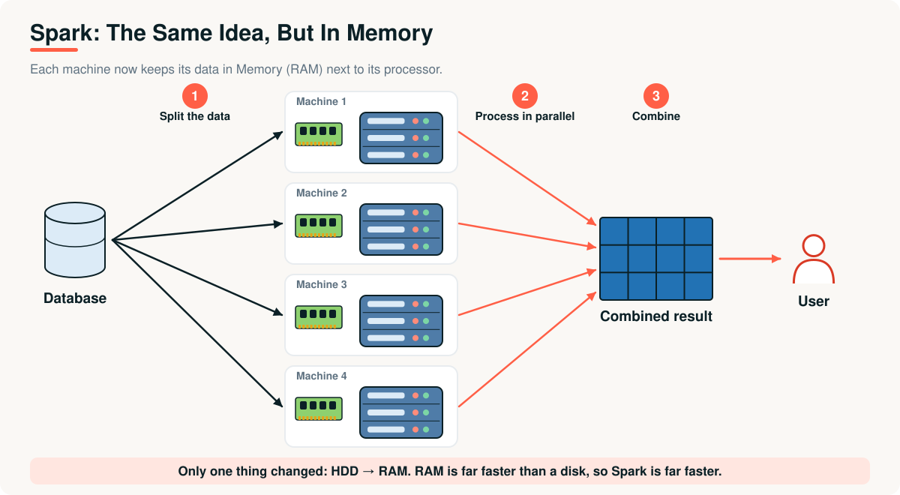
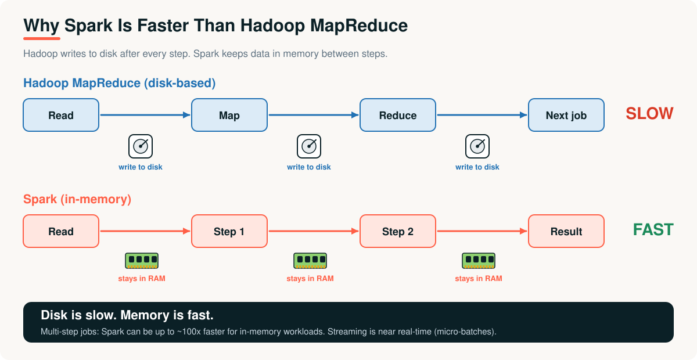
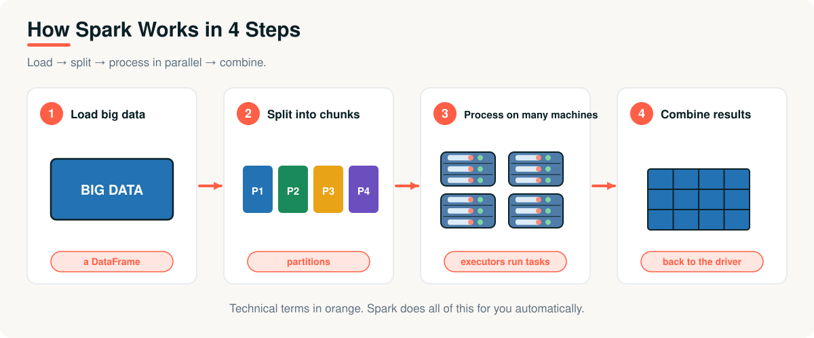
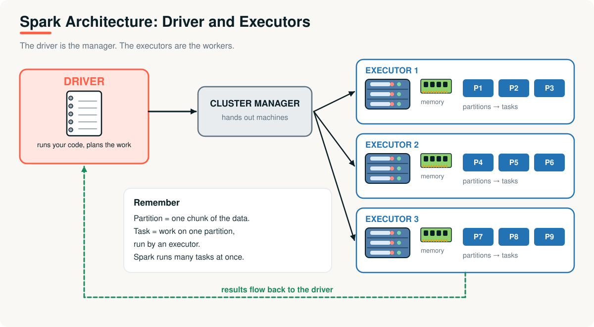
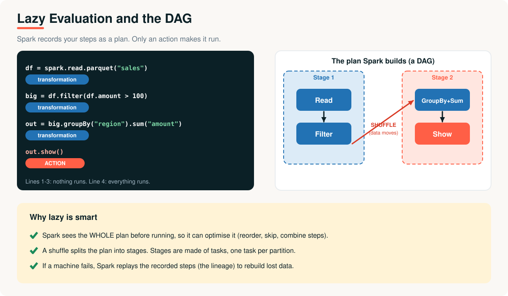
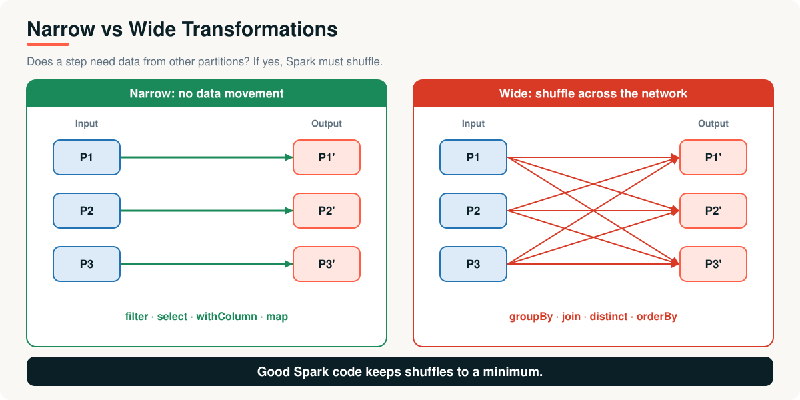
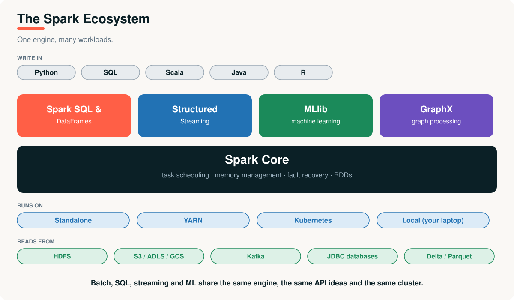

# 06 · Apache Spark

> **Module 01 · Topic 06 of 10** &nbsp;|&nbsp; Reading time: ~50 min &nbsp;|&nbsp; Level: Beginner

[Module home](README.md) &nbsp;·&nbsp; [← Previous: Hadoop and MapReduce](05-hadoop-and-mapreduce.md) &nbsp;·&nbsp; [Next: PySpark →](07-pyspark.md)



## What you will learn

- Why Spark was created and why it is faster than MapReduce
- Spark's architecture: **driver, cluster manager, executors**
- How Spark runs a job: **jobs, stages, tasks**
- **Lazy evaluation**, **transformations vs actions**, **narrow vs wide**
- Where Spark fits, and where it does not

---

## 1. The business problem

XYZ Company's data science team is building a product-recommendation model. The algorithm loops over the same dataset **50 times**, improving the model each pass.

On Hadoop MapReduce, each pass is a separate job that **reads from disk and writes back to disk**. One pass takes 20 minutes, so a full training run takes **over 16 hours**. Experimenting with ideas is impossible: the team can try one change a day.

Analysts have a similar complaint: every interactive question costs minutes of waiting.

---

## 2. Why Spark was needed

The Hadoop picture and the Spark picture are almost identical. **One thing changes: the disk is replaced by memory.**



Researchers at **UC Berkeley's AMPLab** (led by Matei Zaharia) started Spark in **2009** to fix MapReduce's weakness with iterative and interactive work. It was open-sourced in 2010, joined the Apache Software Foundation in 2013, and became a top-level Apache project in 2014.

> **Spark is a tool used to process large data very fast using multiple machines.**

---

## 3. How Spark works



| Step | In plain words | Technical term |
|---|---|---|
| 1 | Load big data | Read it into a **DataFrame** |
| 2 | Split into chunks | **Partitions** |
| 3 | Process on multiple machines | **Executors** run **tasks** |
| 4 | Combine results | Results return to the **driver** (or are written out) |

> **Analogy:** a teacher has 1,000 answer sheets. She splits them among 10 teachers (steps 2 and 3). Each sends back a total, and she adds them up (step 4).

---

## 4. Architecture



| Component | Role |
|---|---|
| **Driver** | Runs your program, builds the execution plan, schedules tasks and collects results |
| **Cluster manager** | Hands out machines: Spark Standalone, **YARN**, or **Kubernetes** (or local mode on your laptop) |
| **Executor** | A worker process on a machine. Runs tasks on partitions and keeps data in memory |
| **Partition** | One chunk of the data |
| **Task** | The unit of work: one operation on one partition |

### Job, stage, task

- An **action** (like `show()` or `write()`) triggers a **job**.
- A job is split into **stages** at every **shuffle** boundary.
- Each stage is split into **tasks**, one per partition. Tasks run in parallel across executors.

> [!NOTE]
> If a DataFrame has 200 partitions and the cluster has 50 cores available, Spark runs 50 tasks at a time. Partitions that are too few waste cores; too many add overhead.

---

## 5. Lazy evaluation and the DAG



Spark separates **describing** work from **doing** it.

| | Transformations | Actions |
|---|---|---|
| **What** | Build a plan; return a new DataFrame | Run the plan and return a result or write output |
| **When they run** | Never by themselves (lazy) | Immediately |
| **Examples** | `select`, `filter`, `withColumn`, `groupBy`, `join` | `show`, `count`, `collect`, `write` |

Spark records the steps as a **DAG** (directed acyclic graph). Because it sees the whole plan before running, the **Catalyst optimizer** can reorder, combine and skip steps, for example pushing a filter down to the file reader so unneeded data is never read.

### Narrow vs wide transformations



| | Narrow | Wide |
|---|---|---|
| **Needs data from** | One input partition | Many input partitions |
| **Data movement** | None | **Shuffle** across the network |
| **Examples** | `filter`, `select`, `map`, `withColumn` | `groupBy`, `join`, `distinct`, `orderBy` |
| **Cost** | Cheap | Expensive, creates a **stage boundary** |

### Fault tolerance without replication

Spark remembers the **lineage**, the recipe of transformations that produced each partition. If an executor dies and a partition is lost, Spark **recomputes** it from the original data by replaying the recorded steps.

---

## 6. See it run

[`examples/04_pyspark_quickstart.py`](examples/04_pyspark_quickstart.py) builds a small DataFrame and asks: *orders over 100, by region*. The physical plan below is real output from Spark:

```text
== Physical Plan ==
*(2) HashAggregate(keys=[region#1], functions=[count(1), sum(amount#2)])
+- Exchange hashpartitioning(region#1, 4), ENSURE_REQUIREMENTS, [plan_id=66]
   +- *(1) HashAggregate(keys=[region#1], functions=[partial_count(1), partial_sum(amount#2)])
      +- *(1) Project [region#1, amount#2]
         +- *(1) Filter (isnotnull(amount#2) AND (amount#2 > 100.0))
            +- *(1) Scan ExistingRDD[order_id#0L,region#1,amount#2]
```

Read it **bottom to top**:

1. `Scan` reads the data. `Filter` and `Project` are **narrow** and happen together in **stage 1** (`*(1)`).
2. `HashAggregate (partial_...)` pre-aggregates inside each partition, like a MapReduce combiner.
3. **`Exchange`** is the **shuffle** (caused by `groupBy`). It is the **stage boundary**.
4. The final `HashAggregate` combines the partial results in **stage 2** (`*(2)`).

> [!TIP]
> When tuning, look for `Exchange` in `explain()`. Fewer exchanges usually means a faster job.

---

## 7. The ecosystem



| Library | Purpose |
|---|---|
| **Spark SQL & DataFrames** | Structured data with SQL and DataFrame APIs, optimised by Catalyst |
| **Structured Streaming** | Streams treated as an ever-growing table; processed in micro-batches by default |
| **MLlib** | Distributed machine learning |
| **GraphX** | Graph processing |

Spark also includes **Tungsten** (efficient memory and code generation) and, since Spark 3, **Adaptive Query Execution**, which re-optimises plans at runtime using real statistics.

---

## 8. Hadoop vs Spark

| Feature | Hadoop MapReduce | Spark |
|---|---|---|
| **Processing** | Disk-based | **In-memory** (spills to disk if needed) |
| **Speed** | Slow | **Fast**: the Spark project reports up to ~100× faster in memory and ~10× on disk for some workloads |
| **Iterative / interactive** | Poor | **Good** |
| **Real-time** | No | Near real-time (micro-batches) |
| **Ease of use** | Verbose Java | Concise APIs in Python, SQL, Scala, Java, R |
| **Fault tolerance** | Replicated data on disk | **Lineage** recomputation |
| **Storage** | Brings its own (HDFS) | **None**: reads HDFS, S3, ADLS, GCS, Kafka, JDBC... |
| **One engine for** | Batch | Batch, SQL, streaming, ML, graphs |

> [!IMPORTANT]
> Spark does **not** replace Hadoop's *storage*. It replaces **MapReduce** as the processing engine. Spark can run on YARN and read from HDFS, or run on Kubernetes against cloud storage with no Hadoop at all. Speed-up figures depend heavily on the workload: treat "100×" as a best case, not a promise.

---

## 9. Advantages and limitations

| Advantages | Limitations |
|---|---|
| Much faster than MapReduce for multi-step and iterative work | **Memory is expensive**; undersized memory spills to disk and slows down |
| One engine for SQL, streaming and ML | Shuffles, skew and small files need tuning |
| Rich, concise APIs; works in Python | Not for OLTP or single-record low-latency lookups |
| Runs anywhere: laptop, YARN, Kubernetes, cloud | Streaming is micro-batch, so latency is seconds rather than milliseconds |
| Strong optimiser (Catalyst, AQE) | Overkill for small data that fits on one machine |

## 10. Real-world applications

- **Large-scale ETL** and data preparation.
- **Machine learning** on big datasets (MLlib and other libraries).
- **Interactive analytics** with Spark SQL.
- **Streaming** analytics: clickstream, IoT, monitoring.
- The engine behind managed platforms such as **Databricks** ([Topic 09](09-modern-data-platforms-and-databricks.md)).

---

## Key takeaways

1. Spark is **Hadoop's idea with memory instead of disk**, which makes iterative and interactive work practical.
2. Architecture: **driver** plans, **cluster manager** allocates, **executors** run **tasks** on **partitions**.
3. **Lazy evaluation**: transformations build a DAG; an **action** runs it.
4. **Wide transformations** cause **shuffles** and **stage boundaries**. Minimise them.
5. Spark replaces **MapReduce**, not HDFS. It also adds SQL, streaming and ML in one engine.

## Interview questions

<details><summary><b>1.</b> Why is Spark faster than MapReduce?</summary>

Spark keeps intermediate data in memory rather than writing to disk after every step, plans the whole job as a DAG so it can optimise and pipeline steps, and avoids the overhead of launching a new job for every stage.
</details>

<details><summary><b>2.</b> Explain driver, executor, cluster manager.</summary>

The driver runs the application, builds the plan and schedules tasks. The cluster manager (Standalone, YARN, Kubernetes) allocates machines. Executors are worker processes that run tasks and cache data.
</details>

<details><summary><b>3.</b> Transformation vs action?</summary>

Transformations lazily build a plan and return a new DataFrame (`filter`, `groupBy`). Actions trigger execution and return results or write data (`count`, `show`, `write`).
</details>

<details><summary><b>4.</b> Narrow vs wide transformation?</summary>

Narrow: each output partition depends on one input partition (`filter`), no shuffle. Wide: output depends on many input partitions (`groupBy`, `join`), requiring a shuffle and creating a new stage.
</details>

<details><summary><b>5.</b> Job, stage and task: how do they relate?</summary>

An action creates a job. The job is divided into stages at shuffle boundaries. Each stage is divided into tasks, one per partition.
</details>

<details><summary><b>6.</b> How does Spark recover from a lost executor?</summary>

It uses lineage: the recorded chain of transformations. Lost partitions are recomputed from source data on other executors.
</details>

<details><summary><b>7.</b> Does Spark need Hadoop?</summary>

No. Spark is a processing engine. It can read from HDFS and run on YARN, but it can equally run standalone or on Kubernetes using cloud object storage.
</details>

<details><summary><b>8.</b> What is dangerous about <code>collect()</code>?</summary>

It pulls all results to the driver's memory. On large data this can crash the driver. Use `show()`, `limit()`, aggregate first, or write results to storage.
</details>

<details><summary><b>9.</b> When would you <em>not</em> use Spark?</summary>

When data fits comfortably on one machine (a database or pandas is simpler and faster), for OLTP workloads, or for single-record low-latency lookups.
</details>

---

| Previous | Contents | Next |
|:---|:---:|:---|
| [← Hadoop and MapReduce](05-hadoop-and-mapreduce.md) | [Module home](README.md#topics-covered) | [PySpark →](07-pyspark.md) |
