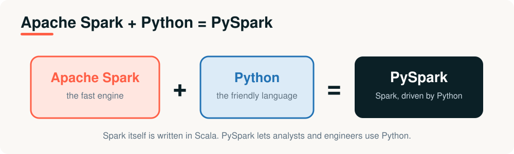
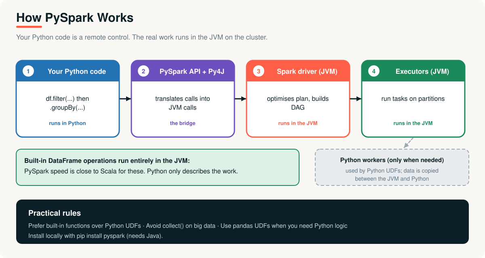

# 07 · PySpark

> **Module 01 · Topic 07 of 10** &nbsp;|&nbsp; Reading time: ~45 min &nbsp;|&nbsp; Level: Beginner

[Module home](README.md) &nbsp;·&nbsp; [← Previous: Apache Spark](06-apache-spark.md) &nbsp;·&nbsp; [Next: The Evolution of Big Data Processing →](08-evolution-of-big-data-processing.md)



## What you will learn

- What PySpark is and why it became the most popular way to use Spark
- How PySpark works under the hood (Py4J and the JVM)
- The core DataFrame API: read, transform, aggregate, join, write
- When to use PySpark, and when pandas is enough
- Performance rules every beginner should know

---

## 1. The business problem

XYZ Company's analysts and engineers know **SQL and Python**. Almost none know **Scala**, the language Spark itself is written in. If using Spark required Scala, hiring would be slow and most of the team could not contribute.

The business needs the whole team to use the fast distributed engine **in the language they already know**.

---

## 2. What is PySpark?

> **Apache Spark + Python = PySpark.** PySpark is the Python API for Apache Spark. You write Python; Spark runs the work, in parallel, on a cluster.

PySpark lets you:

- Use **DataFrames**, a table-like API similar in spirit to pandas, but distributed.
- Run **SQL** on the same data.
- Combine with the Python ecosystem (pandas, NumPy, ML libraries).

---

## 3. How PySpark works



1. You write **Python code**, such as `df.filter(...).groupBy(...)`.
2. The **PySpark API** passes your calls to the JVM through **Py4J**, a bridge between Python and Java.
3. The **Spark driver** (a JVM process) optimises the plan and builds the DAG.
4. **Executors** (JVM processes) run the tasks on partitions.

The key insight: for built-in DataFrame operations, **Python only describes the work**. The data never passes through Python, so performance is close to Scala. Data moves into Python only when you use **Python UDFs** (custom Python functions), and that costs extra.

---

## 4. Setup

**Option A: your laptop** (needs a supported Java, 17 or newer is a safe choice):

```bash
pip install pyspark
python examples/04_pyspark_quickstart.py
```

**Option B: Databricks.** `spark` is already created in every notebook. See [Topic 09](09-modern-data-platforms-and-databricks.md).

```python
from pyspark.sql import SparkSession
spark = SparkSession.builder.master("local[*]").appName("demo").getOrCreate()
```

`SparkSession` is the entry point to everything. `local[*]` means "use all cores on this machine".

---

## 5. The core API

### Create and inspect

```python
rows = [(1, "South", 120.0), (2, "North", 80.0), (3, "South", 300.0)]
df = spark.createDataFrame(rows, ["order_id", "region", "amount"])
df.printSchema()
```
```text
root
 |-- order_id: long (nullable = true)
 |-- region: string (nullable = true)
 |-- amount: double (nullable = true)
```

### Read and write files

```python
sales = spark.read.parquet("/data/sales")                       # preferred: columnar, typed
sales = spark.read.csv("/data/sales.csv", header=True, inferSchema=True)
events = spark.read.json("/data/events.json")

result.write.mode("overwrite").parquet("/data/out/sales_by_region")
```

> [!TIP]
> `inferSchema=True` scans the data an extra time and may guess wrong. In production, supply an explicit schema.

### Transform and aggregate (lazy), then act

```python
from pyspark.sql import functions as F

result = (df.filter(F.col("amount") > 100)                      # transformation
            .groupBy("region")                                  # transformation
            .agg(F.count("*").alias("orders"),
                 F.sum("amount").alias("revenue")))             # transformation: nothing has run
result.orderBy("region").show()                                 # ACTION: runs now
```
```text
+------+------+-------+
|region|orders|revenue|
+------+------+-------+
|  East|     1|  150.0|
| North|     2|  620.0|
| South|     2|  420.0|
+------+------+-------+
```

(This is real output from [`examples/04_pyspark_quickstart.py`](examples/04_pyspark_quickstart.py), which uses eight sample orders.)

### The same question in SQL

```python
df.createOrReplaceTempView("sales")
spark.sql("""
    SELECT region, COUNT(*) AS orders, SUM(amount) AS revenue
    FROM sales WHERE amount > 100 GROUP BY region ORDER BY region
""").show()
```

SQL and the DataFrame API compile to the **same plan**. Use whichever is clearer for the task.

---

## 6. Common operations at a glance

| Task | PySpark | pandas equivalent |
|---|---|---|
| Select columns | `df.select("a", "b")` | `df[["a", "b"]]` |
| Filter rows | `df.filter(F.col("a") > 1)` | `df[df.a > 1]` |
| New column | `df.withColumn("c", F.col("a") * 2)` | `df["c"] = df.a * 2` |
| Group and aggregate | `df.groupBy("k").agg(F.sum("v"))` | `df.groupby("k")["v"].sum()` |
| Join | `a.join(b, "key", "left")` | `a.merge(b, on="key", how="left")` |
| Sort | `df.orderBy(F.desc("v"))` | `df.sort_values("v", ascending=False)` |
| Remove duplicates | `df.dropDuplicates()` | `df.drop_duplicates()` |
| Fill nulls | `df.fillna({"a": 0})` | `df.fillna({"a": 0})` |
| Row count | `df.count()` (action) | `len(df)` |

| Transformations (lazy) | Actions (run now) |
|---|---|
| `select`, `filter`, `withColumn`, `groupBy`, `join`, `orderBy`, `distinct` | `show`, `count`, `collect`, `take`, `write`, `toPandas` |

---

## 7. UDFs: use sparingly

A **Python UDF** applies your own Python function to each row. Spark must ship the rows from the JVM to a Python process and back, and the optimiser cannot see inside the function.

```python
@udf(StringType())
def band_udf(amount):
    return "large" if amount >= 200 else "small"

df.withColumn("band_udf", band_udf("amount")) \
  .withColumn("band_builtin", F.when(F.col("amount") >= 200, "large").otherwise("small"))
```
```text
+--------+------+------+--------+------------+
|order_id|region|amount|band_udf|band_builtin|
+--------+------+------+--------+------------+
|       1| South| 120.0|   small|       small|
|       2| North|  80.0|   small|       small|
|       3| South| 300.0|   large|       large|
|       4|  East| 150.0|   small|       small|
+--------+------+------+--------+------------+
```

Same answer, but the built-in version stays inside the JVM and is optimised. **Order of preference:**

> built-in functions → `when/otherwise` and SQL expressions → pandas UDFs → Python UDFs (last resort)

---

## 8. pandas or PySpark?

| | pandas | PySpark |
|---|---|---|
| **Data size** | Fits in one machine's memory | Larger than one machine |
| **Speed on small data** | Faster (no overhead) | Slower (startup and coordination) |
| **Runs on** | One machine | A cluster (or locally for learning) |
| **Execution** | Eager | **Lazy** |
| **Best for** | Exploration, small and medium data | Pipelines and big data |

> [!NOTE]
> A common pattern: use PySpark to reduce billions of rows to a small summary, then call `toPandas()` **on the small result** for plotting or modelling.

---

## 9. Performance rules for beginners

1. **Never `collect()` or `toPandas()` big data.** It pulls everything into the driver's memory.
2. **Prefer built-in functions** over Python UDFs.
3. **Filter early** and **select only the columns you need**.
4. **Use Parquet or Delta**, not CSV, for data you read repeatedly.
5. **Avoid unnecessary shuffles:** every `groupBy`, `join` and `orderBy` shuffles.
6. **Avoid many tiny files.** Write fewer, larger ones.
7. Check `df.explain()` and the **Spark UI** instead of guessing.

### Beginner mistakes

| Mistake | Fix |
|---|---|
| `df.filter(df.col == None)` | Use `isNull()` / `isNotNull()` |
| `A > 1 & B < 2` | Parenthesise: `(A > 1) & (B < 2)` |
| Expecting `df.withColumn(...)` to change `df` | DataFrames are immutable. Assign the result |
| Wondering why nothing runs | Nothing runs until an action |

---

## Advantages and limitations

| Advantages | Limitations |
|---|---|
| Python skills transfer directly | Python UDFs are slower than built-ins |
| Distributed scale with familiar code | Debugging spans Python and the JVM; error messages can be long |
| SQL and DataFrames interchangeable | Overhead makes it slower than pandas for small data |
| Huge ecosystem and community | Needs Java and a cluster (or Databricks) for real scale |

## Real-world applications

- **ETL pipelines** that clean and transform terabytes nightly.
- **Feature engineering** for machine learning at scale.
- **Interactive analysis** in Databricks notebooks.
- **Streaming jobs** processing events from Kafka.

---

## Key takeaways

1. **PySpark = Spark driven from Python.** It lets analysts and engineers use distributed processing in a familiar language.
2. Python code **describes** the work; the **JVM** does it, so built-in operations run near Scala speed.
3. DataFrames are **lazy** and **immutable**. Nothing runs until an action.
4. SQL and the DataFrame API compile to the same plan.
5. Avoid `collect()` on big data, and prefer built-ins over Python UDFs.

## Interview questions

<details><summary><b>1.</b> What is PySpark and how does it work?</summary>

PySpark is the Python API for Spark. Python code uses Py4J to send commands to the JVM-based Spark driver, which optimises the plan and distributes tasks to JVM executors. Built-in operations run entirely in the JVM.
</details>

<details><summary><b>2.</b> Why are Python UDFs slower than built-in functions?</summary>

Rows must be serialised and transferred from the JVM to Python workers and back, and the Catalyst optimiser cannot optimise inside the UDF. Built-ins stay in the JVM and are fully optimised. Pandas UDFs reduce the cost by transferring data in columnar batches.
</details>

<details><summary><b>3.</b> pandas vs PySpark: how do you choose?</summary>

Use pandas when data fits in one machine's memory (faster, simpler). Use PySpark when data or computation exceeds one machine, or when building scheduled pipelines on a cluster.
</details>

<details><summary><b>4.</b> What does "DataFrames are immutable and lazy" mean?</summary>

Transformations never change a DataFrame; they return a new one, and they only record a plan. Execution happens when an action is called.
</details>

<details><summary><b>5.</b> Why avoid <code>inferSchema</code> in production?</summary>

It requires an extra pass over the data, can guess types incorrectly, and makes the schema depend on the data's current content. An explicit schema is faster and safer.
</details>

<details><summary><b>6.</b> How can you reduce shuffles in a PySpark job?</summary>

Filter and select early, avoid unnecessary `groupBy`/`distinct`/`orderBy`, broadcast small tables in joins, partition data sensibly, and use adaptive query execution.
</details>

---

| Previous | Contents | Next |
|:---|:---:|:---|
| [← Apache Spark](06-apache-spark.md) | [Module home](README.md#topics-covered) | [The Evolution of Big Data Processing →](08-evolution-of-big-data-processing.md) |
