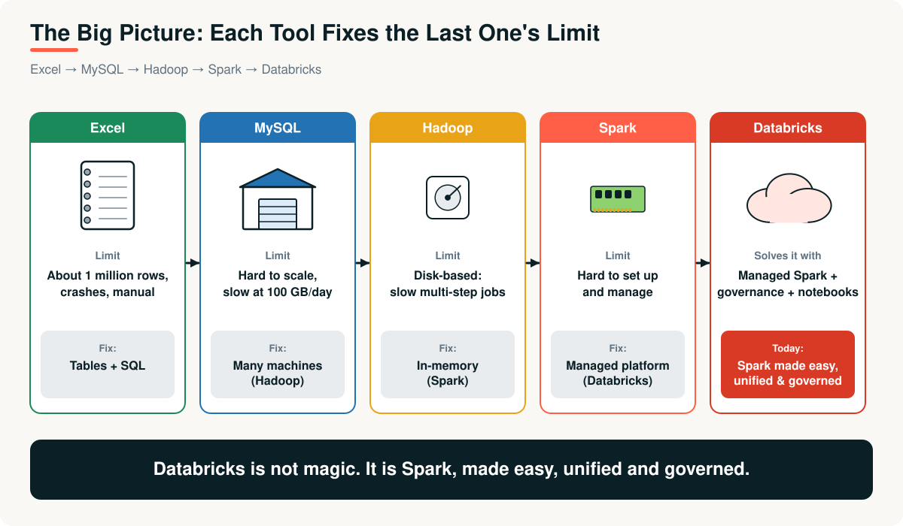
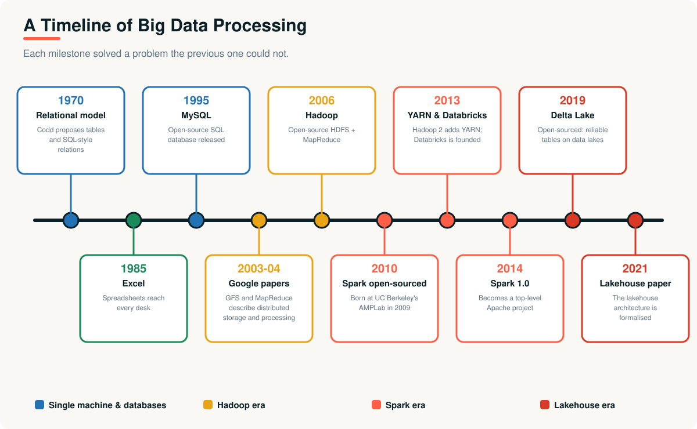
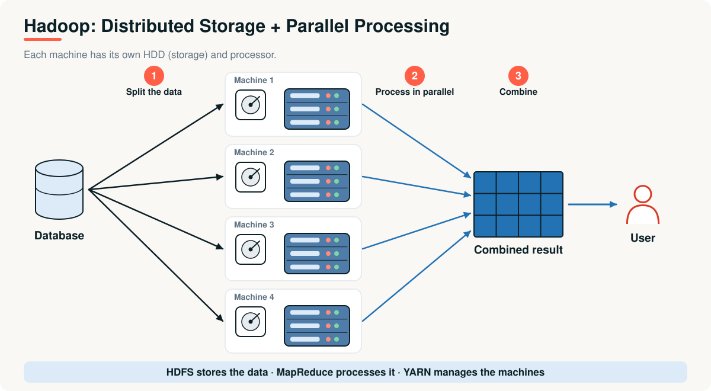
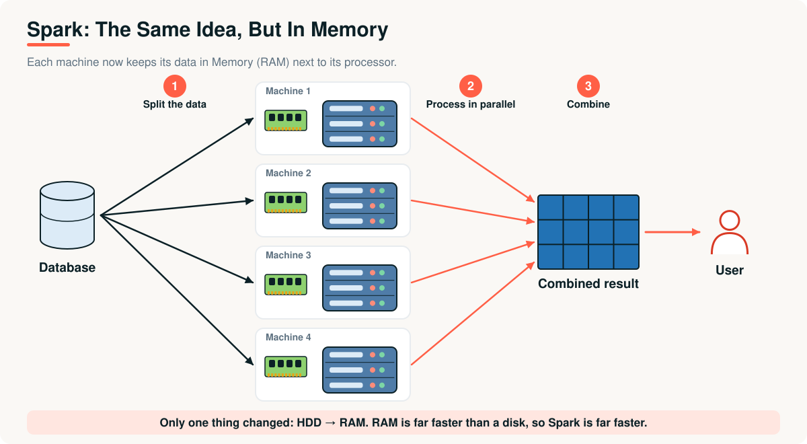
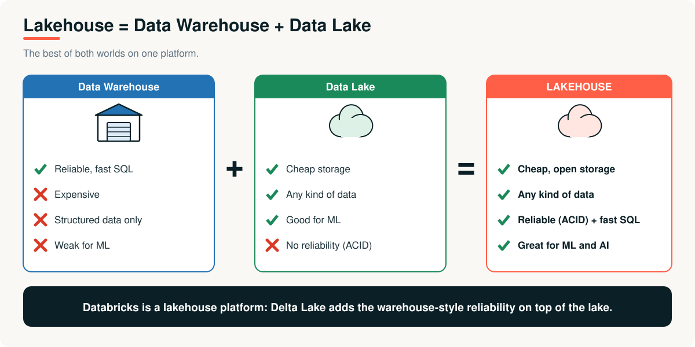

# 08 · The Evolution of Big Data Processing

> **Module 01 · Topic 08 of 10** &nbsp;|&nbsp; Reading time: ~30 min &nbsp;|&nbsp; Level: Beginner

[Module home](README.md) &nbsp;·&nbsp; [← Previous: PySpark](07-pyspark.md) &nbsp;·&nbsp; [Next: Modern Data Platforms and Databricks →](09-modern-data-platforms-and-databricks.md)

## What you will learn

- The story of how data processing evolved, and **why** each step happened
- The recurring pattern: *the bottleneck moves*
- A side-by-side comparison of single-machine, database, Hadoop, Spark and lakehouse eras
- Where the field is heading

---

## 1. The business problem

Instead of one question, this topic follows **XYZ Company over several years**. Each year the company's data grows, something breaks, and a new technology arrives to fix it.

---

## 2. Generation 1: the single machine

**Year 1.** XYZ is a start-up. A few hundred orders a day live in **Excel**. Everything works. Then the file reaches a million rows and starts crashing.

| | |
|---|---|
| **Tools** | Spreadsheets (Excel and similar), scripts on one computer |
| **Strength** | Instant, visual, no setup |
| **Wall** | About 1 million rows, one machine's memory, manual work |

## 3. Generation 2: relational databases and data warehouses

**Year 2.** The company moves orders into a **relational database**, a model proposed by Edgar Codd in 1970, with open-source systems such as **MySQL** (1995) making it accessible. SQL, tables and transactions bring order.

**Year 3.** Analytics queries slow down the live system, so XYZ adds a **data warehouse**: a separate database designed for analysis (OLAP), loaded nightly with **ETL**, organised with star schemas.

| | |
|---|---|
| **Tools** | MySQL, PostgreSQL, then warehouse systems |
| **Strength** | Reliable, structured, SQL |
| **Wall** | Scaling out is hard; mostly structured data; expensive at huge volumes |

## 4. Generation 3: Hadoop and MapReduce

**Year 4.** Data hits 100 GB a day, with logs and JSON that do not fit neat tables. Inspired by Google's **GFS (2003)** and **MapReduce (2004)** papers, XYZ builds a **Hadoop** cluster (2006 onward): HDFS stores everything, MapReduce processes it, cheap machines scale it, replication protects it.

| | |
|---|---|
| **Tools** | HDFS, MapReduce, YARN, Hive, Pig, HBase |
| **Strength** | Petabyte scale, cheap hardware, fault tolerant, any data type |
| **Wall** | **Disk-based, so slow** for iterative and interactive work; hard to write and run |

## 5. Generation 4: Apache Spark

**Year 5.** The data science team needs fast iteration. **Spark** (started 2009, open-sourced 2010, Apache top-level project 2014) keeps data **in memory**, adds friendly APIs, and handles SQL, streaming and ML in one engine. It often runs on the existing Hadoop cluster.

| | |
|---|---|
| **Tools** | Spark Core, Spark SQL, Structured Streaming, MLlib |
| **Strength** | Fast, in-memory, one engine for many workloads |
| **Wall** | Clusters are still hard to set up, tune and govern |

### Generation 4b: PySpark

The team knows Python, not Scala. **PySpark** (Spark's Python API) opens distributed processing to analysts, data scientists and engineers, and becomes the most common way to use Spark.

## 6. Generation 5: cloud and the lakehouse

**Year 6.** Running clusters consumes the team's time. Cloud object storage (S3, ADLS, GCS) becomes cheap and durable, so **storage and compute separate**. Raw files in a **data lake** are cheap but unreliable, while warehouses are reliable but costly. The **lakehouse** idea combines them: open files in cloud storage plus a transaction layer (**Delta Lake**, open-sourced in 2019) for reliability, with SQL performance and governance on top. **Databricks**, founded in 2013 by Spark's original creators, popularised the lakehouse, and a 2021 research paper formalised the architecture.

| | |
|---|---|
| **Tools** | Cloud storage, Delta Lake and similar table formats, managed Spark, SQL warehouses |
| **Strength** | Managed, scalable, reliable, governed, open formats |
| **Wall (today)** | Cost control, data quality and governance discipline, skills |

---

## 7. The comparison

| | Single machine | Database / warehouse | Hadoop MapReduce | Spark / PySpark | Lakehouse platform |
|---|---|---|---|---|---|
| **Typical data size** | MBs to ~GBs | GBs to low TBs | TBs to PBs | TBs to PBs | TBs to PBs |
| **Data shapes** | Tables | Mostly structured | Anything | Anything | Anything |
| **Speed** | Fast on small data | Fast for SQL | Slow (disk) | **Fast (memory)** | Fast, optimised |
| **Scaling** | Up only | Mostly up | **Out** | **Out** | **Out, elastic** |
| **Fault tolerance** | None | Backups, replicas | **Replication** | **Lineage** | Managed |
| **Ease of use** | Very easy | Easy (SQL) | Hard (Java) | Moderate (Python/SQL) | **Easy** |
| **Operations burden** | Low | Medium | **High** | High | **Low (managed)** |
| **Reliability of data** | Low | **High (ACID)** | Low | Low (raw files) | **High (ACID via Delta)** |
| **Typical tools** | Excel | MySQL, PostgreSQL | HDFS, MapReduce | Spark, PySpark | Databricks, Delta Lake |

---

## 8. The pattern behind the story

Each generation fixed the previous bottleneck, and exposed the next one:

| Bottleneck | Fixed by | Created a new problem |
|---|---|---|
| One machine's size | Distribution (Hadoop) | Slow disk-based processing |
| Disk I/O | In-memory processing (Spark) | Hard-to-operate clusters |
| Operating clusters | Managed cloud platforms | Cost control and governance |
| Unreliable raw files | Table formats such as Delta | Choosing and governing the platform |

> [!IMPORTANT]
> Technologies come and go, but the **ideas persist**: partition the data, process in parallel, replicate for safety, move code to data, and keep data reliable. Learn the ideas and every new tool becomes easier.

## 9. Where it is heading

- **Streaming-first** designs, as businesses want fresher data.
- **Open table formats** (Delta Lake, Apache Iceberg, Apache Hudi) for reliable lakehouses.
- **Serverless** compute, so teams manage data rather than clusters.
- **Data for AI**: pipelines that feed machine learning and generative AI.
- Stronger **governance, lineage and quality** as regulation and trust matter more.

---

## Key takeaways

1. Single machine → database → Hadoop → Spark → PySpark → lakehouse: each step fixed the previous step's bottleneck.
2. **Hadoop** made scale-out and fault tolerance practical; **Spark** made it fast; **PySpark** made it accessible; the **lakehouse** made it reliable and managed.
3. The **ideas** (partitioning, parallelism, replication, locality, lazy planning) outlive any single tool.

## Interview questions

<b>1.</b> Walk me through the evolution from a single machine to the lakehouse.

Single machines hit memory and row limits; relational databases and warehouses added structure and SQL but were hard to scale out; Hadoop distributed storage and processing on commodity hardware but was disk-bound; Spark added in-memory speed and unified APIs; PySpark opened it to Python users; cloud storage plus table formats like Delta created the lakehouse, combining lake flexibility with warehouse reliability.

<b>2.</b> Did Spark replace Hadoop?

Spark largely replaced MapReduce as the processing engine, but not HDFS or YARN directly. Many clusters ran Spark on YARN with HDFS. Today many teams run Spark against cloud object storage with no Hadoop at all.

<b>3.</b> Why did on-premises Hadoop decline?

Operating clusters was complex and costly, MapReduce was slow compared with Spark, and tightly coupling storage with compute was inflexible. Cloud object storage with elastic compute offered simpler operations and independent scaling.

<b>4.</b> Data warehouse vs data lake vs lakehouse?

A warehouse is structured, reliable and fast for SQL but costly and rigid. A lake is cheap and holds any data but lacks reliability. A lakehouse combines open, cheap storage with warehouse-like reliability (ACID), governance and SQL performance.

<b>5.</b> What principle repeats across every generation?

The bottleneck moves: each technology removes one limit (size, speed, operations, reliability) and exposes the next.

---

| Previous | Contents | Next |
|:---|:---:|:---|
| [← PySpark](07-pyspark.md) | [Module home](README.md#topics-covered) | [Modern Data Platforms and Databricks →](09-modern-data-platforms-and-databricks.md) |
