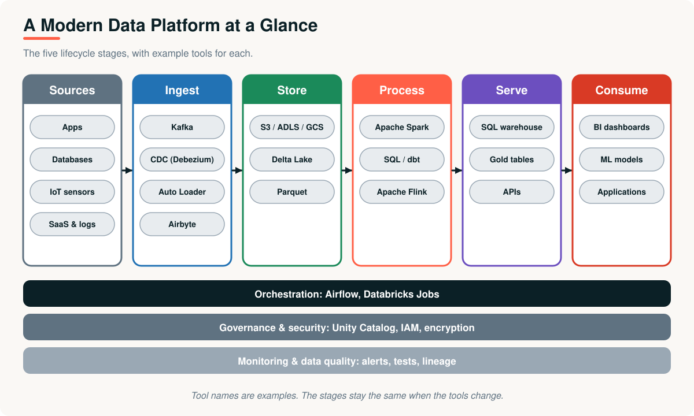
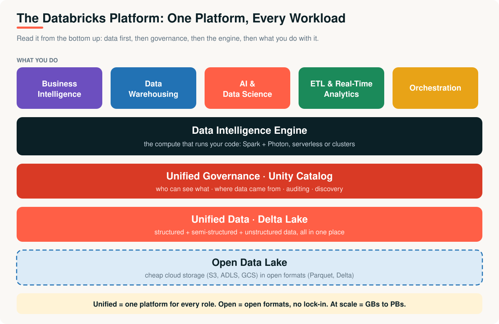
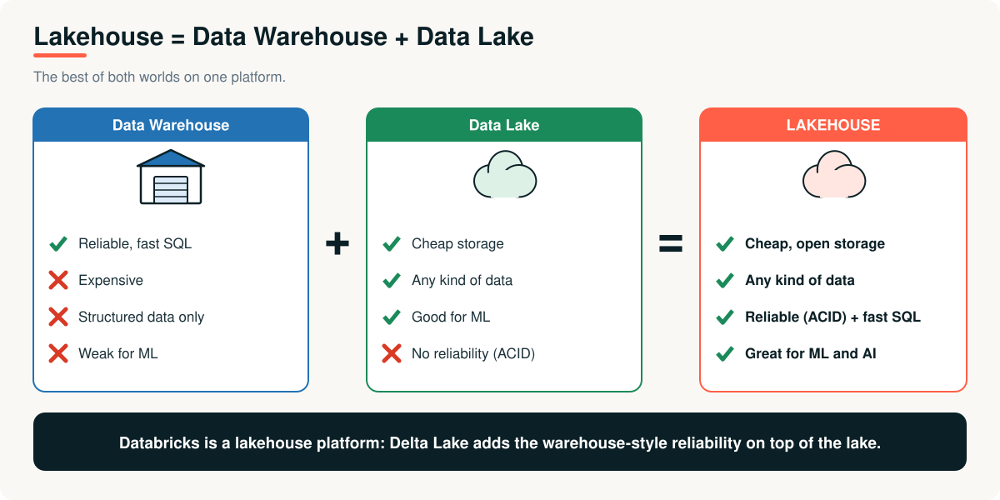
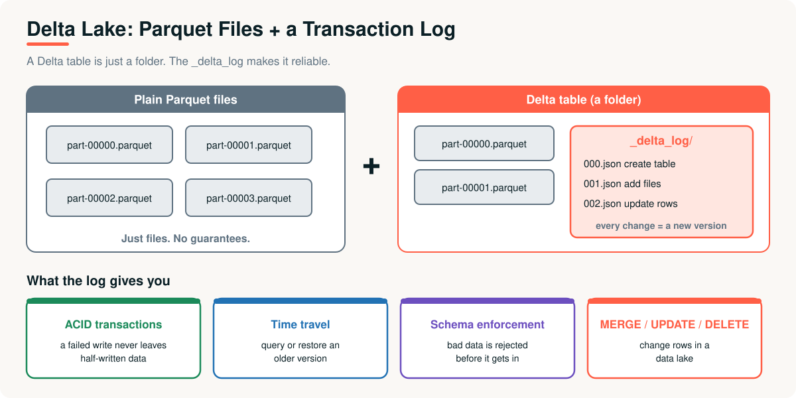
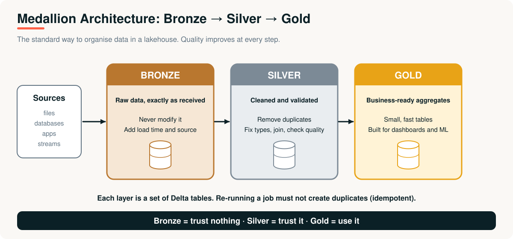
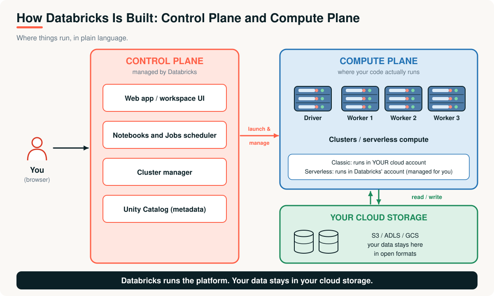

# 09 · Modern Data Platforms and Databricks

> **Module 01 · Topic 09 of 10** &nbsp;|&nbsp; Reading time: ~40 min &nbsp;|&nbsp; Level: Beginner

[Module home](README.md) &nbsp;·&nbsp; [← Previous: The Evolution of Big Data Processing](08-evolution-of-big-data-processing.md) &nbsp;·&nbsp; [Next: Module Review and Interview Prep →](10-module-review-and-interview-prep.md)



## What you will learn

- Why managed platforms exist
- What **Databricks** is, using the platform layers
- The **lakehouse**, **Delta Lake** and the **medallion architecture**
- How Databricks is built: control plane and compute plane
- Which roles use it and for what

---

## 1. The business problem

By year six, XYZ Company's data team spends **more time managing clusters than analysing data**: installing Spark, tuning machines, patching versions, fixing permissions, and answering "who can see this table?"

The engines work. The *operating burden* is the problem. The team wants Spark's power without running it.

---

## 2. What is Databricks?

> **Databricks is a unified, open analytics platform for building pipelines, and for deploying, sharing and maintaining enterprise-grade data, analytics and AI solutions at scale.**

It was founded by the original creators of Apache Spark. In one sentence: **Databricks is Spark, made easy, unified and governed.**



Read it **from the bottom up**:

| Layer | Meaning | Databricks feature |
|---|---|---|
| **Open Data Lake** | Cheap cloud storage in open formats, so you are not locked in | S3 / ADLS / GCS, Parquet, Delta |
| **Unified Data** | Structured, semi-structured and unstructured data together | Delta Lake, tables, volumes |
| **Unified Governance** | Who can see what, lineage, auditing | **Unity Catalog** |
| **Data Intelligence Engine** | The compute that runs your code | Spark + Photon, serverless |
| **What you do** | BI, data warehousing, AI and data science, ETL and real-time analytics, orchestration | AI/BI dashboards, Databricks SQL, MLflow, Lakeflow, Jobs |

**Unified** = one platform for every role. **Open** = open formats and open-source foundations. **At scale** = gigabytes to petabytes.

---

## 3. The lakehouse



| | Data warehouse | Data lake | Lakehouse |
|---|---|---|---|
| **Data types** | Structured | Anything | Anything |
| **Cost** | High | Low | Low |
| **Reliability (ACID)** | Yes | No | **Yes** |
| **Machine learning** | Weak | Good | **Good** |

---

## 4. Delta Lake



Plain Parquet files are just files. **Delta Lake** adds a **transaction log** (`_delta_log`) beside them, and that log gives:

| Feature | What it means |
|---|---|
| **ACID transactions** | A failed job never leaves half-written data |
| **Time travel** | Query or restore an earlier version of a table |
| **Schema enforcement** | Bad data is rejected |
| **MERGE / UPDATE / DELETE** | Change rows in a data lake |

```sql
SELECT * FROM sales VERSION AS OF 3;      -- the table as it was three versions ago
```

## 5. Medallion architecture



| Layer | Contains | Rule |
|---|---|---|
| **Bronze** | Raw data exactly as received | Never modify. Add load time and source |
| **Silver** | Cleaned, validated, de-duplicated, joined | Fix types, remove bad rows, check quality |
| **Gold** | Business-ready aggregates | Small, fast tables for dashboards and ML |

Because bronze is kept, you can **always rebuild** silver and gold if the logic changes.

---

## 6. How Databricks is built



- The **control plane** (run by Databricks) is what you log in to: the web app, notebooks, jobs scheduler, cluster manager and Unity Catalog metadata.
- The **compute plane** is where Spark runs your code. With **classic compute** it runs in *your* cloud account; with **serverless** it is managed by Databricks.
- Your **data** stays in your own cloud storage, in open formats.

> **Analogy:** a taxi app. The app (control plane) is run by the company. The car (compute plane) moves you. Your luggage (data) stays in your own bag (cloud storage).

### Key building blocks

| Concept | What it is |
|---|---|
| **Workspace** | Your environment: notebooks, jobs, data, permissions |
| **Compute** | Machines that run code: **serverless** (managed) or **classic clusters** (you configure) |
| **Notebook** | Cells of Python, SQL, Scala, R or Markdown |
| **Unity Catalog** | Governance, with the three-level name `catalog.schema.table` |
| **Volume** | A governed folder for files |
| **Jobs** | Scheduled tasks and pipelines |

---

## 7. Try it

[`examples/06_databricks_platform_tour.py`](examples/06_databricks_platform_tour.py) is a Databricks notebook (import it into a workspace). In about 20 minutes it shows 50 million rows beyond Excel's limit, partitions, lazy evaluation, `Exchange` in a plan, catalogs and schemas, a Delta table with time travel, and a volume.

> [!NOTE]
> Databricks offers a free tier for learning, and its menus and product names change often. Check the current sign-up page, and expect labels to differ slightly from any screenshots.

---

## 8. Who uses Databricks?

| Role | Typical use |
|---|---|
| **Data Analyst** | SQL queries, dashboards |
| **Data Scientist** | ML models, experiments in notebooks |
| **Data Engineer** | ETL pipelines, Delta tables, scheduled jobs |
| **Business Analyst** | Reads dashboards and reports |

## Advantages and limitations

| Advantages | Limitations |
|---|---|
| No cluster management, so teams focus on data | **Cost** needs active monitoring (idle or oversized compute) |
| One platform for SQL, ETL, streaming and ML | Platform-specific features can create dependence, even though formats are open |
| Built-in governance and collaboration | Learning curve for the whole ecosystem |
| Open formats keep data portable | Overkill for small workloads |

## Real-world applications

- **Retail:** unify sales, web and supply-chain data for forecasting.
- **Finance:** governed pipelines for risk and regulatory reporting.
- **Healthcare:** combine records and imaging data for analytics under access controls.
- **Media and telecom:** streaming analytics and recommendation models.

---

## Key takeaways

1. Managed platforms exist because **running big data engines is hard**.
2. **Databricks** = Spark made easy, unified (one platform, all roles), open (open formats) and governed (Unity Catalog).
3. The **lakehouse** = lake storage + warehouse reliability, delivered by **Delta Lake**.
4. **Medallion** organises data as **bronze (raw) → silver (clean) → gold (business-ready)**.
5. The **control plane** is run by Databricks; the **compute plane** runs your code; **your data stays in your storage**.

## Interview questions

<details><summary><b>1.</b> What is Databricks and what problem does it solve?</summary>

A unified, open analytics platform built around Spark and Delta Lake. It removes the burden of installing and operating clusters and adds notebooks, governance, orchestration and SQL on one platform, so teams focus on data rather than infrastructure.
</details>

<details><summary><b>2.</b> What is a lakehouse?</summary>

An architecture combining a data lake's cheap, open, flexible storage with a data warehouse's reliability (ACID), governance and SQL performance on one platform.
</details>

<details><summary><b>3.</b> What does Delta Lake add on top of Parquet?</summary>

A transaction log that provides ACID transactions, schema enforcement, time travel and MERGE/UPDATE/DELETE operations.
</details>

<details><summary><b>4.</b> Explain bronze, silver and gold.</summary>

Bronze holds raw data as received; silver holds cleaned, validated and joined data; gold holds aggregated, business-ready tables. Keeping bronze allows reprocessing.
</details>

<details><summary><b>5.</b> Control plane vs compute plane?</summary>

The control plane (managed by Databricks) provides the UI, notebooks, scheduler and cluster management. The compute plane runs Spark workloads, in your cloud account for classic compute or in Databricks' account for serverless. Data stays in your cloud storage.
</details>

<details><summary><b>6.</b> Serverless vs classic compute: when to choose which?</summary>

Start with serverless for simplicity and fast start-up. Choose classic when you need custom libraries, specific Spark configuration or particular machine types. Set auto-termination on classic clusters to control cost.
</details>

---

| Previous | Contents | Next |
|:---|:---:|:---|
| [← The Evolution of Big Data Processing](08-evolution-of-big-data-processing.md) | [Module home](README.md#topics-covered) | [Module Review and Interview Prep →](10-module-review-and-interview-prep.md) |
