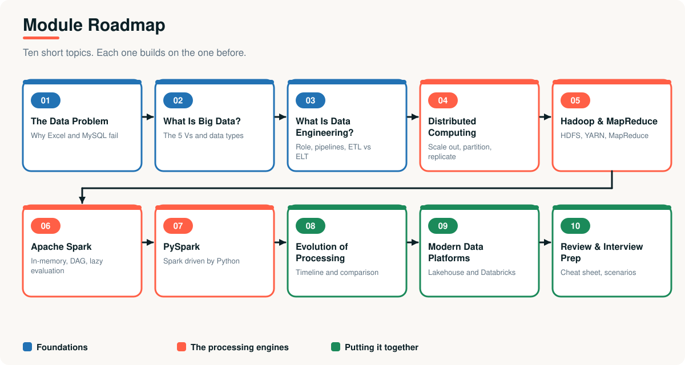
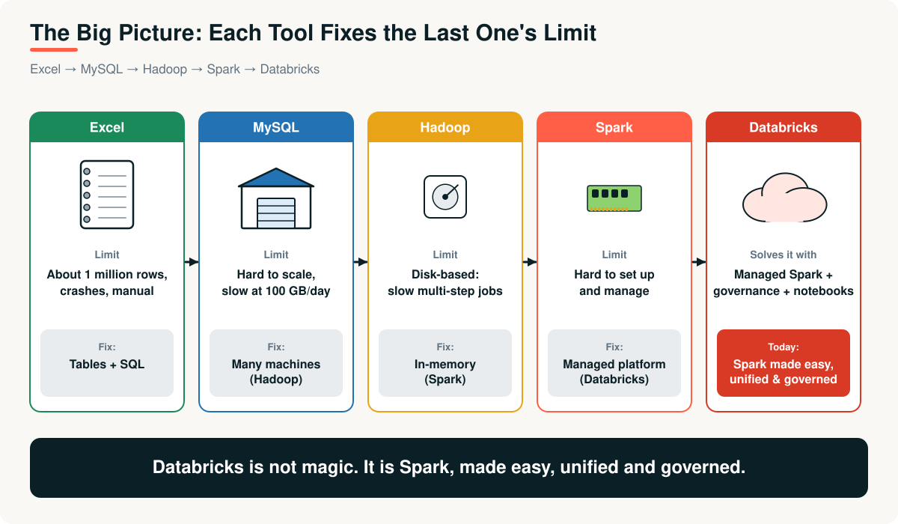

# 10 · Module Review and Interview Prep

> **Module 01 · Topic 10 of 10** &nbsp;|&nbsp; Reading time: ~45 min &nbsp;|&nbsp; Level: Beginner

[Module home](README.md) &nbsp;·&nbsp; [← Previous: Modern Data Platforms and Databricks](09-modern-data-platforms-and-databricks.md) &nbsp;·&nbsp; [Back to module home](README.md)

## What you will do

- Consolidate the whole module on one page
- Practise with rapid-fire and scenario-based interview questions
- Complete hands-on exercises using the example scripts
- Check your own readiness

---

## 1. The module in one page

| Topic | Core idea | One-line memory hook |
|---|---|---|
| 01 Data problem | 100 GB/day breaks Excel and MySQL | Excel is a notebook, MySQL is a warehouse |
| 02 Big data | The 5 Vs; structured, semi, unstructured | Too big, fast or varied for one machine |
| 03 Data engineering | Pipelines: ingest, store, process, serve, consume | The plumbing that makes data trustworthy |
| 04 Distributed computing | Scale out; partition, parallelise, replicate | Many machines acting like one |
| 05 Hadoop and MapReduce | HDFS + YARN + MapReduce | Distributed, fault tolerant, disk-bound |
| 06 Spark | In-memory, DAG, lazy, driver and executors | Hadoop's idea with memory instead of disk |
| 07 PySpark | Spark driven from Python via Py4J | Python describes, the JVM does |
| 08 Evolution | Each tool fixed the last one's bottleneck | The bottleneck moves |
| 09 Platforms | Lakehouse, Delta, medallion, Databricks | Spark made easy, unified and governed |

---

## 2. Cheat sheet

### Hadoop vs Spark

| | Hadoop MapReduce | Spark |
|---|---|---|
| Processing | Disk | Memory |
| Best at | Huge batch jobs on cheap hardware | Iterative, interactive, streaming, ML |
| Fault tolerance | Replication | Lineage |
| Storage | HDFS | None (uses HDFS, S3, ADLS...) |

### Vocabulary pairs people mix up

| Pair | Difference |
|---|---|
| Partitioning vs replication | Split for scale vs copy for safety |
| Transformation vs action | Builds a plan vs runs it |
| Narrow vs wide | No shuffle vs shuffle |
| ETL vs ELT | Transform before load vs after |
| Batch vs streaming | On a schedule vs as it arrives |
| Data lake vs warehouse vs lakehouse | Cheap raw vs structured reliable vs both |
| Driver vs executor | Manager vs worker |
| Table vs volume | Structured data vs files |

### Numbers worth remembering

| Fact | Value |
|---|---|
| Excel row limit | 1,048,576 |
| HDFS block size (default) | 128 MB |
| HDFS replication (default) | 3 |
| 100 GB a day | ≈ 3 TB a month, ≈ 36 TB a year |

---

## 3. Rapid-fire questions

Show all 20 questions and answers

1. **Why not Excel for 100 GB/day?** ~1M row limit, single-machine memory, manual work.
2. **Why not MySQL?** OLTP and single node; analytics scans are slow and hard to scale out.
3. **OLTP vs OLAP?** Run the business vs understand the business.
4. **Define big data.** Too large, fast or varied for traditional single-machine tools.
5. **Name the 5 Vs.** Volume, Velocity, Variety, Veracity, Value.
6. **Scale up vs out?** Bigger machine vs more machines.
7. **What is HDFS?** Hadoop's distributed, replicated file system.
8. **NameNode vs DataNode?** Metadata manager vs block storage.
9. **Default HDFS replication?** 3.
10. **Three MapReduce phases?** Map, shuffle and sort, reduce.
11. **What is YARN?** Hadoop's cluster resource manager.
12. **Why is MapReduce slow for iteration?** Disk read and write between every job.
13. **Why is Spark fast?** In-memory data and whole-plan optimisation.
14. **What is lazy evaluation?** Spark builds a plan and runs only on an action.
15. **Give two actions.** `show`, `count`, `collect`, `write`.
16. **What causes a shuffle?** Wide transformations such as `groupBy` and `join`.
17. **What is PySpark?** Spark's Python API, bridging to the JVM via Py4J.
18. **Why avoid Python UDFs?** Serialisation to Python and no optimisation.
19. **What is Delta Lake?** Parquet plus a transaction log: ACID, time travel, MERGE.
20. **Bronze, silver, gold?** Raw, cleaned, business-ready.

---

## 4. Scenario-based questions

<b>S1.</b> A nightly job that took 2 hours now takes 9 because data tripled. Where do you look first?

Check whether the job is distributed and how many partitions it has; look at the Spark UI for the slowest stage; check for **skew** (a few tasks much slower than others), excessive **shuffles**, small files, and CSV instead of Parquet. Fix the biggest bottleneck first (for example, filter earlier, broadcast a small table, or repartition on a better key) and re-measure.

<b>S2.</b> The business wants "real-time dashboards." How do you respond?

Ask what latency is genuinely needed and what delay costs. If minutes are fine, frequent batch is simpler and cheaper. If seconds matter (fraud, operations), design a streaming pipeline, accepting added complexity for late data, ordering and state.

<b>S3.</b> A pipeline fails halfway and is retried. How do you ensure no duplicates?

Make it **idempotent**: overwrite the target partition or use `MERGE` on a business key, write with atomic table formats (Delta), and track processed batches so a retry produces the same result.

<b>S4.</b> Analysts report two dashboards disagree on revenue. What do you do?

Trace both back through lineage to the source, compare definitions (gross vs net, time zones, returns), compare row counts and key totals at each stage, then fix the logic once in a shared gold table and add tests so definitions cannot drift.

<b>S5.</b> Your team has 2 GB of data. Someone proposes a Spark cluster. Thoughts?

Probably unnecessary: 2 GB fits in one machine, and pandas or a database is simpler, faster to start and cheaper. Choose distributed tools when data or computation outgrows one machine, or when you need shared scheduled pipelines.

<b>S6.</b> A DataNode in your Hadoop cluster dies at 3 a.m. What happens?

The NameNode stops receiving heartbeats, marks it dead, finds under-replicated blocks and orders new copies on healthy nodes. Running tasks are re-scheduled. No data is lost because each block had other replicas, and nobody needs to wake up unless many nodes fail.

<b>S7.</b> Why keep a bronze layer if silver is cleaner?

Bronze is the immutable record of what arrived. If cleaning logic has a bug or requirements change, you rebuild silver and gold from bronze. Without it, bad transformations would destroy information permanently.

<b>S8.</b> You must choose between ETL and ELT for a new cloud platform. How do you decide?

Prefer ELT when cheap storage and scalable compute are available: land raw data, keep it, transform inside the platform. Choose ETL when data must be masked, filtered or minimised before it can legally or technically land, or when the destination has limited compute.

---

## 5. Practice exercises

| # | Exercise | Skills |
|---|---|---|
| 1 | Edit `01_capacity_calculator.py` for **500 GB/day** at **200 bytes per row**. How many times Excel's limit is one day? | Capacity maths |
| 2 | Run `02_parallel_vs_serial.py` on your machine. Change `N` and the number of workers. Explain the result using **Amdahl's law** | Parallelism |
| 3 | Change the input in `03_mapreduce_word_count.py` to a paragraph of your own. Add a **combiner** step before the shuffle | MapReduce |
| 4 | Pipe the Hadoop Streaming `mapper.py` and `reducer.py` over a text file with `sort` in between | Hadoop Streaming |
| 5 | In `04_pyspark_quickstart.py`, add a `join` with a small `regions` DataFrame and read the new `explain()`. Where is the shuffle? Try `F.broadcast()` | Spark plans |
| 6 | Extend `05_simple_etl_pipeline.py` to reject rows with a negative `unit_price` and print the reject reasons. Confirm re-running still gives the same row count | Pipelines, idempotency |
| 7 | Import `06_databricks_platform_tour.py` into Databricks and run it. Find the table it creates in the **Catalog** | Databricks |

---

## 6. Self-assessment checklist

I can explain, in my own words and with a diagram:

- [ ] why Excel and MySQL fail at 100 GB per day
- [ ] OLTP vs OLAP
- [ ] the 5 Vs and the three data shapes
- [ ] what a data engineer does and the five pipeline stages
- [ ] ETL vs ELT and batch vs streaming
- [ ] scale up vs scale out and the five building blocks
- [ ] HDFS (blocks, NameNode, DataNodes, replication)
- [ ] the MapReduce phases, using word count
- [ ] why Spark is faster, and driver, executors, jobs, stages, tasks
- [ ] lazy evaluation, transformations vs actions, narrow vs wide
- [ ] what PySpark is and why UDFs are costly
- [ ] the lakehouse, Delta Lake and bronze, silver, gold

---

## 7. What next?

You now understand **why** the modern data stack exists and the ideas it is built on. The following modules of this repository build on this foundation with hands-on skills (SQL, Python for data, Spark in depth, data modelling, orchestration and streaming).

## Key takeaways for the whole module

1. **Scale out** beats scale up, and everything in big data follows from that choice.
2. **Hadoop** made it possible, **Spark** made it fast, **PySpark** made it accessible, the **lakehouse** made it reliable and manageable.
3. The recurring lesson: **the bottleneck moves**, and the **ideas outlive the tools**.
4. A data engineer's job is trustworthy, automated, idempotent **pipelines**.

---

| Previous | Contents | Next |
|:---|:---:|:---|
| [← Modern Data Platforms and Databricks](09-modern-data-platforms-and-databricks.md) | [Module home](README.md#topics-covered) | [Module home →](README.md) |
