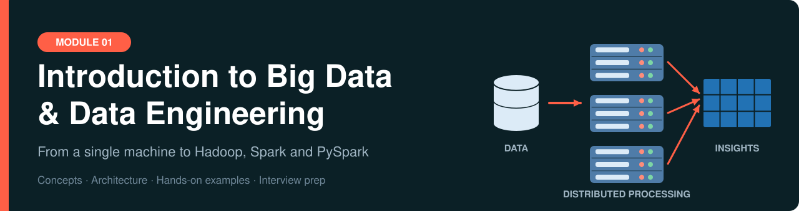
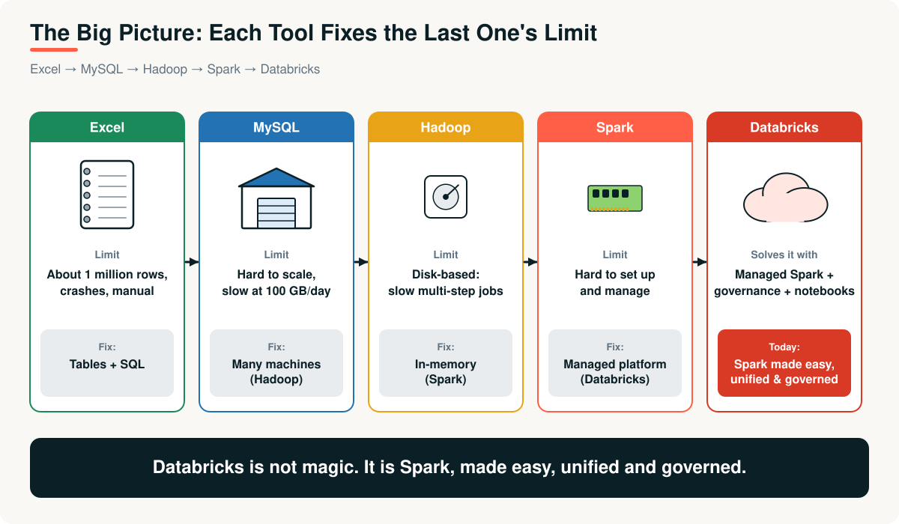
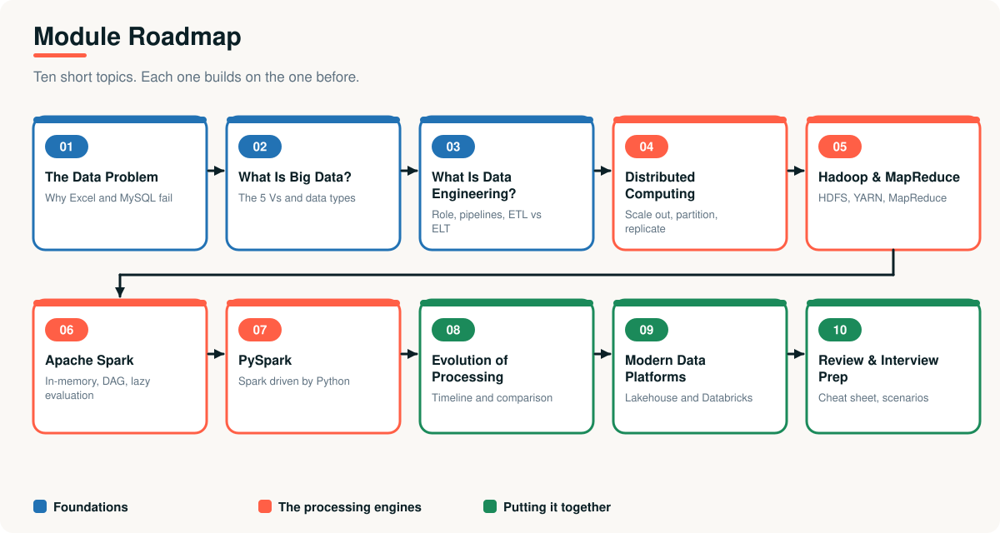

<div align="center">




</div>

# Introduction to Big Data and Data Engineering

**Module 01 of the Data Engineering learning path.**

Why can't a spreadsheet or a database handle a company's data? How do Hadoop, Spark and PySpark solve it? And what does a data engineer actually do? This module answers those questions through **real business scenarios, architecture diagrams, runnable examples and interview practice**, following one story:

> **Excel → MySQL → Hadoop → Spark → PySpark → the lakehouse.**
> Each tool exists because the previous one hit a wall.



---

## Introduction

Every topic follows the same professional structure, so you always know where you are:

1. **The business problem:** a realistic scenario that motivates the technology
2. **Why it was needed:** what failed before
3. **The concept and architecture:** with diagrams
4. **How it works, step by step**
5. **Examples:** real, runnable code with real output
6. **Advantages, limitations and real-world applications**
7. **Key takeaways and interview questions**

## Who is this for?

| Audience | What you get |
|---|---|
| **Students and career changers** | A gentle, visual path into data engineering with no prior big data knowledge |
| **Developers and analysts** | The mental model behind Hadoop, Spark and the lakehouse |
| **Interview candidates** | Dozens of questions with answers, plus scenario-based practice |
| **Trainers** | A ready-made, diagram-rich curriculum for 2-3 sessions |

**Prerequisites:** none required. Basic SQL and Python help for the examples.

## Learning objectives

After completing this module you will be able to:

- **Explain** why Excel and relational databases fail at big-data scale, using OLTP vs OLAP
- **Define** big data using the 5 Vs and classify structured, semi-structured and unstructured data
- **Describe** the role of a data engineer, the pipeline lifecycle, ETL vs ELT, and batch vs streaming
- **Compare** vertical and horizontal scaling, and apply partitioning, replication and data locality
- **Trace** how HDFS stores data and how MapReduce processes it, using word count
- **Explain** Spark's architecture, lazy evaluation, DAG, stages and shuffles
- **Write** basic PySpark and avoid common performance mistakes
- **Narrate** the evolution of big data processing and justify each step
- **Position** Databricks, Delta Lake and the medallion architecture in a modern platform

---

## Topics covered

| # | Topic | Key concepts | Time |
|---|---|---|---|
| 01 | [The Data Problem](01-the-data-problem.md) | Excel and MySQL limits, OLTP vs OLAP, capacity maths | 25 min |
| 02 | [What Is Big Data?](02-what-is-big-data.md) | 5 Vs, data types, schema-on-read, Parquet | 25 min |
| 03 | [What Is Data Engineering?](03-what-is-data-engineering.md) | Role, pipelines, ETL vs ELT, batch vs streaming, data quality | 40 min |
| 04 | [Distributed Computing Fundamentals](04-distributed-computing-fundamentals.md) | Scale out, partitioning, replication, Amdahl's law, CAP | 35 min |
| 05 | [Hadoop and MapReduce](05-hadoop-and-mapreduce.md) | HDFS, NameNode, YARN, map-shuffle-reduce | 50 min |
| 06 | [Apache Spark](06-apache-spark.md) | Driver and executors, DAG, lazy evaluation, shuffles | 50 min |
| 07 | [PySpark](07-pyspark.md) | Py4J, DataFrames, UDFs, performance rules | 45 min |
| 08 | [The Evolution of Big Data Processing](08-evolution-of-big-data-processing.md) | Timeline, generations, comparison | 30 min |
| 09 | [Modern Data Platforms and Databricks](09-modern-data-platforms-and-databricks.md) | Lakehouse, Delta Lake, medallion, control vs compute plane | 40 min |
| 10 | [Module Review and Interview Prep](10-module-review-and-interview-prep.md) | Cheat sheet, scenarios, exercises, checklist | 45 min |

**Reference:** [Glossary](resources/glossary.md) · [Further reading](resources/further-reading.md) · [Examples guide](examples/README.md)

## Learning roadmap



### Choose your path

| Path | Time | Do this |
|---|---|---|
| **Express** | ~3 hours | Topics 01, 05, 06, 08, then the quick-answers in 10 |
| **Standard** | ~6-8 hours | All ten topics in order, run examples 01-05 |
| **Deep dive** | ~10+ hours | Standard path, plus the exercises in topic 10 and the Databricks tour |

---

## Repository structure

```text
01-introduction-to-big-data-and-data-engineering/
├── README.md                              <- you are here
├── 01-the-data-problem.md
├── 02-what-is-big-data.md
├── 03-what-is-data-engineering.md
├── 04-distributed-computing-fundamentals.md
├── 05-hadoop-and-mapreduce.md
├── 06-apache-spark.md
├── 07-pyspark.md
├── 08-evolution-of-big-data-processing.md
├── 09-modern-data-platforms-and-databricks.md
├── 10-module-review-and-interview-prep.md
├── examples/                              runnable code
│   ├── 01_capacity_calculator.py
│   ├── 02_parallel_vs_serial.py
│   ├── 03_mapreduce_word_count.py
│   ├── 04_pyspark_quickstart.py
│   ├── 05_simple_etl_pipeline.py
│   ├── 06_databricks_platform_tour.py
│   └── hadoop_streaming/ (mapper.py, reducer.py)
├── resources/                             glossary, further reading
└── assets/diagrams/
    ├── svg/                               40 diagrams (used in the docs)
    ├── png/                               same diagrams for slides
    └── src/                               Python that draws them
```

## Running the examples

| Example | Needs | Command |
|---|---|---|
| 01, 02, 03, 05 | Python 3.8+ only | `python examples/01_capacity_calculator.py` |
| Hadoop Streaming | Python 3, a shell | See [topic 05](05-hadoop-and-mapreduce.md#a-real-hadoop-job-hadoop-streaming) |
| 04 | `pip install pyspark`, Java 17+ | `python examples/04_pyspark_quickstart.py` |
| 06 | A Databricks workspace | Import the file as a notebook |

## Conventions used in these documents

| Element | Meaning |
|---|---|
| **Business problem** section | Every topic opens with a realistic scenario |
| `> [!NOTE]` / `[!TIP]` / `[!IMPORTANT]` / `[!WARNING]` | Callouts for context, advice, must-knows and pitfalls |
| Output blocks labelled `text` | **Real output** captured from the example scripts |
| Collapsible **Interview questions** | Try answering before expanding |
| Diagram colours | Blue = foundations, orange = engines, green = results, red = problems |

## Using the diagrams in your own material

All diagrams are in [`assets/diagrams/png`](assets/diagrams/png) (slides) and [`assets/diagrams/svg`](assets/diagrams/svg) (sharp at any size). To edit one, change the Python in [`assets/diagrams/src`](assets/diagrams/src) and run `python build.py` (needs `pip install cairosvg`).

---

## Navigation

[Start with Topic 01: The Data Problem →](01-the-data-problem.md)
