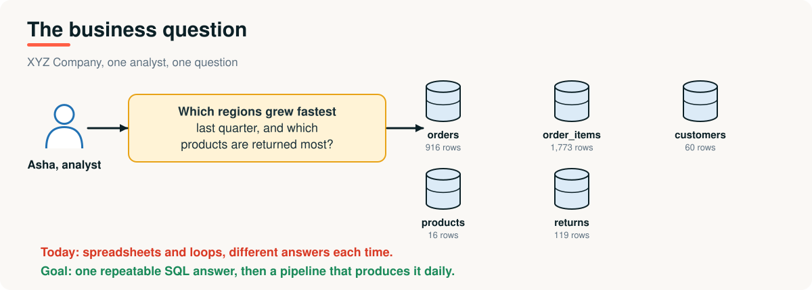
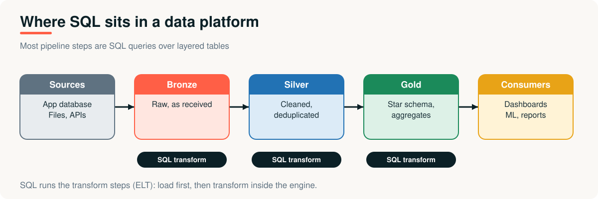
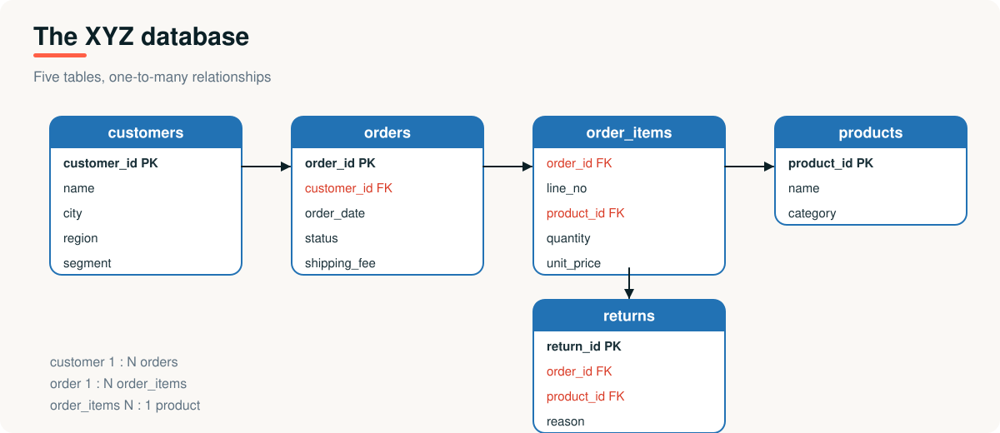

# 01 · Why SQL Still Matters

> **Module 02 · Topic 01 of 10** &nbsp;|&nbsp; Reading time: ~30 min &nbsp;|&nbsp; Level: Beginner

[Module home](README.md) &nbsp;·&nbsp; [Contents](README.md#topics-covered) &nbsp;·&nbsp; [Next: Querying Fundamentals →](02-querying-fundamentals.md)



## What you will learn

- Why SQL is still the main language of data work, five decades after it was created
- The difference between **declarative** SQL and a loop that says *how* to compute
- Where SQL sits in a data pipeline, and why ELT made it more important, not less
- How one language runs on many engines, and where the dialects differ
- The **XYZ database** that every example in this module uses

---

## 1. The business problem

In [Module 01](../01_Foundations_of_Big_Data_and_Data_Engineering/README.md), XYZ Company outgrew Excel and MySQL and moved to a modern data platform. **Asha**, the new analyst, now has access to clean tables. The head of sales is still waiting for the answer to her first question:

> "Which regions grew fastest last quarter, and which products are returned most often?"

The data is ready. The question is how Asha gets at it.

| Attempt | What she tries | What happens | Why |
|---|---|---|---|
| 1 | Ask an engineer for a CSV export each time | Slow, and the files go stale. Two exports disagree and nobody knows which is right | The answer lives in a file, not in a repeatable query |
| 2 | Write a Python loop over every row | It works on a sample, then becomes long, slow and hard to review | She has told the computer *how* to compute, so she must also handle scale and speed herself |
| 3 | Write **one SQL query** | A few readable lines. The engine decides how to run it | SQL describes *what* she wants. The engine does the rest |

Attempt 3 is why almost every data team, from a three-person start-up to a bank, runs on SQL. This module teaches the SQL a **data engineer** needs: not only to answer questions, but to build, check and load the tables that other people's questions depend on.

---

## 2. What SQL is

**SQL** (Structured Query Language) is the standard language for working with data held in **tables**. It is **declarative**: you describe the result you want, and the database engine works out the steps.

| | Imperative (a Python loop) | Declarative (SQL) |
|---|---|---|
| **You write** | The steps: open, loop, look up, add up | The result: these columns, these rows, grouped like this |
| **Who chooses the method** | You | The engine's **optimiser** |
| **When data grows 100 times** | You rewrite for speed and memory | The same query runs on a bigger engine |
| **Reviewing it** | Read every step to learn the intent | Read the query to see the intent |

Run [`examples/01_sql_vs_python_loop.py`](examples/01_sql_vs_python_loop.py). It answers one question, *revenue of completed orders by region*, with a loop and with a query:

```text
region     python loop           sql
East      1,179,726.90  1,179,726.90
North       775,357.20    775,357.20
South     1,682,979.60  1,682,979.60
West      1,566,381.80  1,566,381.80

Same answer: True
```

Both give the same answer. The loop needs two lookup tables and a running total that you maintain yourself. The query states the intent in seven lines.

> [!NOTE]
> SQL is not always shorter or faster to *write*. Its advantage is that the intent is visible and that the engine, not you, owns the execution strategy.

---

## 3. A short history

| Year (approx.) | Milestone |
|---|---|
| 1970 | Edgar Codd proposes the relational model: data as tables with keys |
| Early 1970s | IBM researchers build the first SQL-style language (originally called SEQUEL) |
| 1979 | The first commercial SQL database products appear (Oracle) |
| 1986-87 | SQL becomes an ANSI, then ISO, standard |
| 1995-96 | MySQL and PostgreSQL arrive as open-source databases |
| Late 2000s | Big data tools launch without SQL. Then **Hive** (around 2008) puts SQL on top of Hadoop, because analysts need it |
| 2010s | **Spark SQL** and cloud warehouses make SQL the front door to distributed engines |
| Today | Lakehouse platforms such as Databricks run SQL as a first-class language |

The pattern is the same one from Module 01: a new storage or compute model appears, and SQL is placed on top of it, because the people who need the data already speak SQL.

---

## 4. Where SQL sits in a data pipeline



Recall the five pipeline stages and the **ELT** pattern from [Module 01, Topic 03](../01_Foundations_of_Big_Data_and_Data_Engineering/03-what-is-data-engineering.md). In ELT, raw data is loaded first and transformed **inside** the warehouse or lakehouse. Those transformations are mostly SQL.

| Pipeline stage | Typical tools | What SQL does here |
|---|---|---|
| **Ingest** | Connectors, Python, streaming tools | Little. Sometimes a query extracts from a source database |
| **Store** | Object storage, warehouse, Delta tables | Defines tables and their types |
| **Process** | SQL, Spark | Cleans, joins, deduplicates and aggregates: most of the work |
| **Serve** | Gold tables, SQL warehouse | Builds the tables dashboards read |
| **Consume** | BI tools, notebooks, applications | Analysts and BI tools send SQL |

Cutting across these stages, a data engineer uses SQL for six jobs. Each has a topic in this module:

| Job | Example | Topic |
|---|---|---|
| **Explore** | What is in this table? How many nulls? | 02, 03 |
| **Combine** | Join orders to customers and products | 04, 05 |
| **Analyse** | Rank, compare periods, running totals | 06 |
| **Clean and validate** | Fix text, remove duplicates, test quality | 07 |
| **Model and load** | Build fact and dimension tables, load incrementally | 08 |
| **Tune** | Read a query plan and make a slow query fast | 09 |

---

## 5. One language, many engines

SQL is a standard, but every engine adds its own features and spellings. The core is shared. The edges differ.

| Family | Examples | Typical use |
|---|---|---|
| **Embedded** | SQLite | Local files, apps, learning |
| **Transactional (OLTP)** | MySQL, PostgreSQL | Application data (see [Module 01, Topic 01](../01_Foundations_of_Big_Data_and_Data_Engineering/01-the-data-problem.md)) |
| **Cloud warehouses** | BigQuery, Snowflake, Redshift | Analytics (OLAP) on managed storage |
| **Distributed engines** | Spark SQL, Databricks SQL, Trino, Hive | Analytics across a cluster, over files in a data lake |

**The same ideas, different spellings.** The query below is identical everywhere in logic, but the function for "first day of the month" is not:

| Task | SQLite (this module) | PostgreSQL | Spark SQL / Databricks |
|---|---|---|---|
| First day of the month | `date(d, 'start of month')` | `date_trunc('month', d)` | `trunc(d, 'MM')` |
| Today's date | `date('now')` | `CURRENT_DATE` | `current_date()` |
| Upsert a row | `INSERT ... ON CONFLICT DO UPDATE` | `INSERT ... ON CONFLICT`, or `MERGE` from version 15 | `MERGE INTO` (Delta tables) |

> [!IMPORTANT]
> Learn the **concepts** (joins, grouping, windows, grain) and look up the **spelling** per engine. Where an example in this module is SQLite-specific, a note shows the Spark SQL or Databricks equivalent.

**Why SQLite for learning?** It needs no installation (Python includes it as the `sqlite3` module), it runs from a single file, and every example here runs on your laptop with the same results as ours. It supports the features data engineers use daily: joins, CTEs, window functions (3.25+) and upserts (3.24+). Check your version with `python -c "import sqlite3; print(sqlite3.sqlite_version)"`.

> [!WARNING]
> SQLite is **dynamically typed** and has no date type: dates are stored as text such as `'2025-12-01'`. ISO-format dates sort and compare correctly as text, which is why we use them, but warehouses have real `DATE` and `TIMESTAMP` types.

---

## 6. Meet the XYZ database

Every example in this module uses one deterministic database, built by [`examples/xyz_data.py`](examples/xyz_data.py). It is XYZ Company's online-retail data for July to December 2025.



Data engineers always ask the same first question about a table: **what is its grain?** The grain says what one row means. Get it wrong and every total is wrong.

| Table | Grain (one row per...) | Key |
|---|---|---|
| `customers` | customer | `customer_id` |
| `products` | product | `product_id` |
| `orders` | order | `order_id` |
| `order_items` | product line within an order | `order_id` + `line_no` |
| `returns` | returned order line | `return_id` |

```sql
-- How big is the XYZ database?  (UNION ALL stacks results: see Topic 05)
SELECT 'customers' AS table_name, COUNT(*) AS row_count FROM customers
UNION ALL SELECT 'products',    COUNT(*) FROM products
UNION ALL SELECT 'orders',      COUNT(*) FROM orders
UNION ALL SELECT 'order_items', COUNT(*) FROM order_items
UNION ALL SELECT 'returns',     COUNT(*) FROM returns;
```

```text
table_name   row_count
-----------  ---------
customers           60
products            16
orders             916
order_items       1773
returns            119
```

Now a first real query, the building block of Asha's question. It joins three tables and totals revenue for each region:

```sql
-- Revenue by region, completed orders only
SELECT c.region,
       ROUND(SUM(oi.quantity * oi.unit_price), 2) AS revenue
FROM orders AS o
JOIN customers AS c    ON c.customer_id = o.customer_id
JOIN order_items AS oi ON oi.order_id   = o.order_id
WHERE o.status = 'completed'
GROUP BY c.region
ORDER BY revenue DESC;
```

```text
region  revenue
------  ---------
South   1682979.6
West    1566381.8
East    1179726.9
North    775357.2
```

Do not worry about every keyword yet. Reading it as a sentence: *from orders, attach each order's customer and its lines, keep completed orders, group by region, add up quantity times price, and show the biggest first.* Topics 02 to 04 take it apart piece by piece, and Topic 05 finishes Asha's full question.

---

## 7. How the engine runs your query

You wrote *what*. The engine decides *how*, in stages:

| Stage | What happens |
|---|---|
| **Parse** | Check the syntax and build a tree of the query |
| **Validate** | Check that tables and columns exist and that types make sense |
| **Optimise** | Choose join order, which indexes to use, and how to group |
| **Execute** | Run the chosen plan and return rows |

You can ask the engine to show its plan. In SQLite the command is `EXPLAIN QUERY PLAN`; Spark SQL and Databricks use `EXPLAIN`, which you met in [Module 01, Topic 06](../01_Foundations_of_Big_Data_and_Data_Engineering/06-apache-spark.md).

```sql
-- The plan the engine chose for the revenue query
EXPLAIN QUERY PLAN
SELECT c.region,
       ROUND(SUM(oi.quantity * oi.unit_price), 2) AS revenue
FROM orders AS o
JOIN customers AS c    ON c.customer_id = o.customer_id
JOIN order_items AS oi ON oi.order_id   = o.order_id
WHERE o.status = 'completed'
GROUP BY c.region
ORDER BY revenue DESC;
```

```text
QUERY PLAN
|--SCAN o
|--SEARCH c USING INTEGER PRIMARY KEY (rowid=?)
|--SEARCH oi USING INDEX sqlite_autoindex_order_items_1 (order_id=?)
|--USE TEMP B-TREE FOR GROUP BY
`--USE TEMP B-TREE FOR ORDER BY
```

Read it top to bottom as the engine's recipe:

| Plan line | Meaning |
|---|---|
| `SCAN o` | Read every row of `orders` (alias `o`), keeping only completed ones |
| `SEARCH c USING INTEGER PRIMARY KEY` | For each order, jump straight to its customer by key. No scan needed |
| `SEARCH oi USING INDEX ...` | For each order, find its lines using the index behind the primary key `(order_id, line_no)` |
| `USE TEMP B-TREE FOR GROUP BY` | Sort the joined rows so each region's rows sit together, then total them |
| `USE TEMP B-TREE FOR ORDER BY` | Sort the four result rows by revenue |

The vocabulary is the one to remember: **SCAN** reads everything, **SEARCH** uses a key to jump to the matching rows.

> [!NOTE]
> Plan wording changes between SQLite versions, and every engine prints plans differently. Learn to read the *shape* (what is scanned, what is looked up, where data is regrouped), not the exact text. Topic 09 returns to this.

---

## 8. Limitations and engineering considerations

| Limitation | What it means in practice |
|---|---|
| **Not for every job** | Calling APIs, complex procedural logic, machine learning and unstructured data usually need Python or Spark code |
| **Silent wrong answers** | A bad join or a NULL can return plausible, wrong numbers with no error. Topics 03, 04 and 07 show how |
| **Readability at scale** | One 300-line query is hard to review and test. Break work into steps (CTEs, Topic 05) and layers (Topic 08) |
| **Dialect differences** | Moving between engines means translating functions and loading syntax |
| **Performance is not automatic** | The optimiser helps, but table design, data layout and query shape still decide speed (Topic 09) |

> [!TIP]
> In Spark, SQL and the DataFrame API are two front ends to the same optimiser, **Catalyst**. A query written in either runs through the same engine, so choose whichever is clearer for the task.

## 9. Real-world applications

- **Retail:** revenue, returns and stock reports built from order and product tables, the XYZ scenario.
- **Finance:** reconciling two systems by joining their records and checking that totals agree.
- **Product analytics:** funnels and retention measured with windows and aggregates over event tables.
- **Data platforms:** transformation tools generate and run SQL in layers (raw, cleaned, business-ready), and quality checks are SQL queries that must return zero rows.

---

## Key takeaways

1. SQL is **declarative**: you describe the result, and the engine's optimiser chooses the method.
2. It lasts because every new data technology, from Hadoop to the lakehouse, gets a SQL layer.
3. In **ELT**, the transformation step happens inside the platform, so most pipeline logic is SQL.
4. The core language is shared across engines. Date, string and upsert functions differ, so learn concepts first and look up spellings.
5. Always ask for a table's **grain** before you aggregate it.

## Interview questions

<details><summary><b>1.</b> Why do data engineers still use SQL when they can write Python or Spark code?</summary>

SQL states the intent of a transformation clearly, is understood by analysts and engineers alike, and lets the engine optimise execution. It runs on almost every data platform, so the logic is portable and reviewable. Python or Spark code is better for procedural logic, API calls and machine learning, and the two are often combined.
</details>

<details><summary><b>2.</b> What does "declarative" mean in the context of SQL?</summary>

You specify the result you want, not the steps to compute it. The engine's optimiser picks the join order, the access paths and the aggregation method. An imperative program, such as a Python loop, specifies each step itself.
</details>

<details><summary><b>3.</b> Where does SQL fit in an ELT pipeline?</summary>

Raw data is extracted and loaded into the platform first. SQL then transforms it inside the warehouse or lakehouse: cleaning, joining and aggregating it into layers, with the final tables serving dashboards and models.
</details>

<details><summary><b>4.</b> SQL is a standard. Why can't you copy a query between engines unchanged?</summary>

The core (SELECT, JOIN, GROUP BY, window functions) is shared, but each engine has its own functions, types and extensions, such as date truncation, string handling and upsert syntax (`ON CONFLICT` versus `MERGE INTO`). Queries usually need small translations.
</details>

<details><summary><b>5.</b> What is the grain of a table, and why does it matter?</summary>

The grain is what one row represents, for example one order line. It matters because aggregating or joining at the wrong grain double counts or drops data, giving wrong totals without any error.
</details>

<details><summary><b>6.</b> Why does the same SQL logic run on SQLite and on Spark?</summary>

Both implement the same relational ideas and a large common subset of the SQL standard. A query using only standard constructs, such as joins, grouping and windows, runs on both, although the engines execute it very differently (one process on one file versus a cluster).
</details>

## Official documentation

- [SQLite documentation](https://www.sqlite.org/docs.html) · [SQLite datatypes](https://www.sqlite.org/datatype3.html)
- [Python `sqlite3` module](https://docs.python.org/3/library/sqlite3.html)
- [Spark SQL reference](https://spark.apache.org/docs/latest/sql-ref.html)
- [PostgreSQL documentation](https://www.postgresql.org/docs/current/)

---

| Previous | Contents | Next |
|:---|:---:|:---|
| [← Module home](README.md) | [Module home](README.md#topics-covered) | [Querying Fundamentals →](02-querying-fundamentals.md) |
