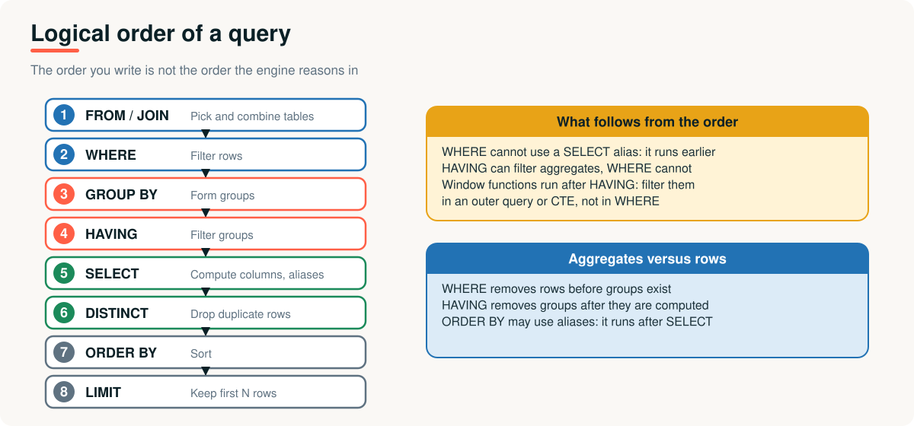

# 02 · Querying Fundamentals

> **Module 02 · Topic 02 of 10** &nbsp;|&nbsp; Reading time: ~40 min &nbsp;|&nbsp; Level: Beginner

[Module home](README.md) &nbsp;·&nbsp; [← Previous: Why SQL Still Matters](01-why-sql-still-matters.md) &nbsp;·&nbsp; [Next: Aggregation and Grouping →](03-aggregation-and-grouping.md)



## What you will learn

- The relational model in five terms: table, row, column, primary key, foreign key
- How to select, filter, sort and limit rows
- Why **NULL** is not a value, and how it silently removes rows from your results
- How types and text comparison can change an answer
- The **logical order of execution** that explains most SQL errors

---

## 1. The business problem

Asha has her first afternoon with the XYZ tables. She expects the easy part to be easy. It goes like this.

| Attempt | What she tries | What happens | Why |
|---|---|---|---|
| 1 | `SELECT * FROM orders` | Hundreds of rows scroll past and nothing is answered | No columns chosen, no filter |
| 2 | `WHERE status = 'Completed'` | **Zero rows** | Text comparison is case-sensitive, and the data says `completed` |
| 3 | `WHERE city = NULL` to find customers with an unknown city | **Zero rows** | NULL is not equal to anything, not even NULL |
| 4 | `WHERE city <> 'Pune'` to list everyone outside Pune | Customers with an unknown city are **missing** | A comparison with NULL is neither true nor false, so the row is dropped |

None of these raise an error. Each returns a plausible, wrong result. Most of this topic is about seeing why.

---

## 2. The relational model in five terms

A relational database stores data in **tables**. You met the idea in [Module 01, Topic 01](../01_Foundations_of_Big_Data_and_Data_Engineering/01-the-data-problem.md); here is the vocabulary SQL uses.

| Term | Meaning | XYZ example |
|---|---|---|
| **Table** | A named set of rows with the same columns | `customers` |
| **Row** (record) | One instance of the thing the table describes | One customer |
| **Column** (field) | One attribute, with a type | `region` |
| **Primary key** | A column (or set) that uniquely identifies each row | `customer_id` |
| **Foreign key** | A column that points to another table's primary key | `orders.customer_id` |

Foreign keys are how tables connect without repeating data: an order stores only a `customer_id`, not the customer's name and city. [Topic 04](04-joins.md) shows how to follow those links.

```sql
-- Look at a few rows first
SELECT * FROM customers LIMIT 5;
```

```text
customer_id  name           city       region  segment   signup_date
-----------  -------------  ---------  ------  --------  -----------
          1  Tarun Khan     Jaipur     North   Premium   2024-06-10
          2  Isha Bose      Hyderabad  South   Business  2024-08-15
          3  Nikhil Das     Pune       West    Premium   2025-07-06
          4  Lakshmi Gupta  Chennai    South   Premium   2025-01-24
          5  Imran Shah     Hyderabad  South   Retail    2024-04-12
```

---

## 3. SELECT, FROM and WHERE

The three clauses behind most queries:

| Clause | Question it answers |
|---|---|
| `SELECT` | **Which columns** do I want? |
| `FROM` | **Which table** holds them? |
| `WHERE` | **Which rows** qualify? |

Name the columns you need instead of using `SELECT *`. Explicit columns survive schema changes, make the intent clear, and in columnar storage such as Parquet and Delta they let the engine read only those columns (see [Module 01, Topic 02](../01_Foundations_of_Big_Data_and_Data_Engineering/02-what-is-big-data.md)).

```sql
-- Choose columns and filter rows: completed app orders in December, newest first
SELECT order_id, customer_id, order_date, channel
FROM orders
WHERE status = 'completed'
  AND channel = 'app'
  AND order_date >= '2025-12-01'
ORDER BY order_date DESC, order_id DESC
LIMIT 5;
```

```text
order_id  customer_id  order_date  channel
--------  -----------  ----------  -------
     898           51  2025-12-29  app
     897           15  2025-12-29  app
     891            1  2025-12-28  app
     888           10  2025-12-27  app
     883           29  2025-12-26  app
```

### Filter operators

| Operator | Example | Notes |
|---|---|---|
| `=`, `<>` (or `!=`), `<`, `<=`, `>`, `>=` | `quantity >= 2` | Standard comparisons |
| `AND`, `OR`, `NOT` | `a AND (b OR c)` | `AND` binds tighter than `OR`. Use brackets |
| `IN (...)` | `category IN ('Home', 'Grocery')` | Short for several `OR` tests |
| `BETWEEN x AND y` | `list_price BETWEEN 1000 AND 4500` | **Inclusive** of both ends |
| `LIKE` | `name LIKE '%er%'` | `%` is any run of characters, `_` is one character |
| `IS NULL`, `IS NOT NULL` | `city IS NULL` | The only correct test for NULL |

```sql
-- IN, BETWEEN and LIKE together
SELECT product_id, name, category, list_price
FROM products
WHERE category IN ('Electronics', 'Home')
  AND list_price BETWEEN 1000 AND 4500
  AND name LIKE '%er%'
ORDER BY list_price;
```

```text
product_id  name               category     list_price
----------  -----------------  -----------  ----------
         3  Power Bank         Electronics      1499.0
         4  Bluetooth Speaker  Electronics      3299.0
         5  Air Fryer          Home             4499.0
```

> [!WARNING]
> `AND` is evaluated before `OR`. The two queries below differ only in brackets, and they count different things:

```sql
-- Same words, different meaning
SELECT COUNT(*) AS without_brackets
FROM orders
WHERE channel = 'web' OR channel = 'app' AND status = 'cancelled';

SELECT COUNT(*) AS with_brackets
FROM orders
WHERE (channel = 'web' OR channel = 'app') AND status = 'cancelled';
```

```text
without_brackets
----------------
             334

with_brackets
-------------
           43
```

The first reads as *every web order, plus cancelled app orders*. The second reads as *cancelled orders from web or app*. Write the brackets you mean.

---

## 4. Sorting, limiting and distinct values

- `ORDER BY` sorts the result. List several keys to break ties, and add `DESC` for descending.
- `LIMIT n` keeps the first `n` rows of the *sorted* result.
- `DISTINCT` removes duplicate rows from the result.

> [!IMPORTANT]
> Without `ORDER BY`, a table has **no guaranteed order**, so `LIMIT` returns *some* rows, not the "first" ones. The engine may return different rows next time, especially on a distributed engine. Always pair `LIMIT` with `ORDER BY` when the choice of rows matters.

```sql
-- Which values does a column hold? A first step in exploring any table
SELECT DISTINCT status
FROM orders
ORDER BY status;
```

```text
status
---------
cancelled
completed
pending
```

**Text comparison is case-sensitive** with `=` in SQLite, PostgreSQL and Spark SQL. Some engines (MySQL, with its default settings) are not, so a query can change behaviour when you move it.

```sql
-- Attempt 2 from the business problem
SELECT COUNT(*) AS exact_match FROM orders WHERE status = 'completed';
SELECT COUNT(*) AS wrong_case   FROM orders WHERE status = 'Completed';
```

```text
exact_match
-----------
        852

wrong_case
----------
         0
```

When the case is uncertain, normalise it: `WHERE LOWER(status) = 'completed'`. Topic 07 turns this into a habit.

---

## 5. NULL: the value that is not a value

**NULL means "unknown or missing".** It is not zero, not an empty string, and not equal to anything, including another NULL. Any comparison with NULL gives a third result, **UNKNOWN**, and `WHERE` keeps only rows where the condition is **TRUE**.

| Expression | Result |
|---|---|
| `NULL = NULL` | UNKNOWN (not TRUE) |
| `NULL <> 5` | UNKNOWN |
| `NULL + 10` | NULL |
| `TRUE AND UNKNOWN` | UNKNOWN |
| `TRUE OR UNKNOWN` | TRUE |
| `city IS NULL` | TRUE or FALSE, never UNKNOWN |

Attempt 3 from the business problem, and the right way:

```sql
-- = NULL never matches. IS NULL does.
SELECT COUNT(*) AS wrong_way FROM customers WHERE city = NULL;
SELECT COUNT(*) AS right_way FROM customers WHERE city IS NULL;
```

```text
wrong_way
---------
        0

right_way
---------
        4
```

Attempt 4 is subtler. Every customer is either in Pune, not in Pune, or has no city recorded. The three groups should add up to the total, but `<>` does not see the third group:

```sql
-- Do the groups add up? (the CASE counts each group; Topic 03 explains the pattern)
SELECT SUM(CASE WHEN city = 'Pune'  THEN 1 ELSE 0 END) AS in_pune,
       SUM(CASE WHEN city <> 'Pune' THEN 1 ELSE 0 END) AS not_pune,
       SUM(CASE WHEN city IS NULL   THEN 1 ELSE 0 END) AS city_unknown,
       COUNT(*)                                        AS all_customers
FROM customers;
```

```text
in_pune  not_pune  city_unknown  all_customers
-------  --------  ------------  -------------
      3        53             4             60
```

The `<>` test and the `= 'Pune'` test together miss the customers with no city. If "everyone outside Pune" should include them, say so:

```sql
-- Test for NULL explicitly to include the unknowns
SELECT COUNT(*) AS everyone_outside_pune
FROM customers
WHERE city <> 'Pune' OR city IS NULL;
```

```text
everyone_outside_pune
---------------------
                   57
```

Or replace NULL with a label while you read the data. `COALESCE(a, b, ...)` returns the first argument that is not NULL, and it is one of the most-used functions in data engineering:

```sql
SELECT customer_id, name, COALESCE(city, 'Unknown') AS city
FROM customers
WHERE customer_id BETWEEN 14 AND 16;
```

```text
customer_id  name         city
-----------  -----------  -----------
         14  Anika Bose   Bhubaneswar
         15  Karan Das    Unknown
         16  Tanvi Gupta  Chandigarh
```

**Where NULLs sort differs by engine.** SQLite treats NULL as smaller than any value, so it comes first in ascending order:

```sql
SELECT customer_id, segment
FROM customers
ORDER BY segment, customer_id
LIMIT 4;
```

```text
customer_id  segment
-----------  -------
         10  NULL
         20  NULL
         30  NULL
         40  NULL
```

| Engine | NULLs in `ORDER BY ... ASC` |
|---|---|
| SQLite | First |
| Spark SQL, Databricks | First (by default) |
| PostgreSQL | **Last** (by default) |

Write `NULLS FIRST` or `NULLS LAST` (supported by PostgreSQL, Spark SQL, and SQLite 3.30+) when the position matters.

---

## 6. Types and comparison

Every column has a type, and comparisons depend on it. Comparing *text that looks like numbers* is a classic trap:

```sql
-- As text, '10' sorts before '9'. As numbers, it does not.
SELECT '10' < '9'                           AS text_compare,
       CAST('10' AS INTEGER) < CAST('9' AS INTEGER) AS number_compare;
```

```text
text_compare  number_compare
------------  --------------
           1               0
```

`1` means true. As text, `'1'` comes before `'9'`, so `'10' < '9'`.

> [!NOTE]
> SQLite is flexible about types and stores dates as text. `typeof()` shows what a value really is. Warehouses enforce types strictly and have true `DATE`, `TIMESTAMP` and `DECIMAL` types. Use `CAST(x AS type)` to convert explicitly.

```sql
SELECT typeof(order_id)     AS id_type,
       typeof(order_date)   AS date_type,
       typeof(shipping_fee) AS fee_type
FROM orders
LIMIT 1;
```

```text
id_type  date_type  fee_type
-------  ---------  --------
integer  text       real
```

---

## 7. The logical order of execution

You write `SELECT` first, but the engine **conceptually** evaluates it nearly last. Reading a query in this order explains most surprises.

| Step | Clause | What it does |
|---|---|---|
| 1 | `FROM` / `JOIN` | Build the set of rows to work on |
| 2 | `WHERE` | Keep only rows where the condition is TRUE |
| 3 | `GROUP BY` | Collapse rows into groups ([Topic 03](03-aggregation-and-grouping.md)) |
| 4 | `HAVING` | Keep only groups that qualify |
| 5 | `SELECT` | Compute the output columns, including window functions ([Topic 06](06-window-functions.md)) |
| 6 | `DISTINCT` | Remove duplicate rows |
| 7 | `ORDER BY` | Sort |
| 8 | `LIMIT` | Keep the first rows |

Two consequences you will meet often:

- `WHERE` runs **before** `SELECT`, so it cannot use a column alias or an aggregate that `SELECT` creates. SQLite happens to allow aliases in `WHERE`, but PostgreSQL and Spark SQL do not, so do not rely on it.
- `ORDER BY` runs **after** `SELECT`, so it *can* use aliases.

```sql
-- Portable: repeat the expression (or move it into a subquery or CTE, Topic 05)
SELECT order_id, quantity * unit_price AS line_total
FROM order_items
WHERE quantity * unit_price > 5000;     -- an alias would fail on PostgreSQL and Spark
```

This is **logical** order. The optimiser is free to reorder steps physically, for example by applying filters as early as possible, as long as the result is the same. That freedom is the benefit of a declarative language.

---

## 8. How the engine filters rows

For `WHERE status = 'completed'`, the engine can do one of two things:

| Method | When | Cost |
|---|---|---|
| **Scan** | No useful index or sort order | Read every row and test the condition |
| **Seek** (index or partition lookup) | An index, or partitioned or sorted files, match the filter | Jump straight to matching rows |

On a distributed engine like Spark, the same idea appears as **predicate pushdown** and **partition pruning**: filters are sent down to the file reader so that unneeded files and columns are never read. You saw the `Filter` step sit next to the `Scan` in [Module 01, Topic 06](../01_Foundations_of_Big_Data_and_Data_Engineering/06-apache-spark.md). [Topic 09](09-query-performance-and-execution.md) shows how to see and use this.

---

## 9. Common mistakes

| Mistake | Effect | Fix |
|---|---|---|
| `col = NULL` | Zero rows | `col IS NULL` |
| `col <> 'x'` with NULLs present | NULL rows silently excluded | Add `OR col IS NULL`, or `COALESCE` first |
| `OR` mixed with `AND` and no brackets | Wrong rows | Brackets |
| `LIMIT` without `ORDER BY` | Arbitrary rows | Always sort first |
| `SELECT *` in production queries | Fragile, wasteful | Name the columns |
| Comparing text that holds numbers or dates in mixed formats | Wrong ordering and matches | `CAST`, and standardise formats (Topic 07) |
| Using a `SELECT` alias in `WHERE` | Works in SQLite only | Repeat the expression or use a CTE |

## 10. Real-world applications

- **Data exploration:** `SELECT DISTINCT`, `LIMIT`, and `COUNT` are the first queries on any new table.
- **Extracts:** selecting exactly the columns and rows a downstream system needs.
- **Data quality triage:** finding rows with NULL or unexpected values before building on them (Topic 07).
- **Filters in dashboards:** every dashboard filter becomes a `WHERE` clause, so NULL and case rules decide what the chart shows.

---

## Key takeaways

1. A **table** is rows and columns. A **primary key** identifies a row, and a **foreign key** points to another table.
2. `SELECT` chooses columns, `FROM` the table, `WHERE` the rows. Name your columns.
3. **NULL is unknown.** Use `IS NULL`, and remember that `=`, `<>` and `NOT IN` all drop NULL rows without warning.
4. Text comparison is case-sensitive in most engines, and text that looks like numbers sorts as text.
5. Learn the **logical order**: `FROM`, `WHERE`, `GROUP BY`, `HAVING`, `SELECT`, `ORDER BY`, `LIMIT`.

## Interview questions

<details><summary><b>1.</b> What is the difference between a primary key and a foreign key?</summary>

A primary key uniquely identifies each row in its own table. A foreign key is a column in one table that holds the primary key of another table, linking the two. For example, `orders.customer_id` refers to `customers.customer_id`.
</details>

<details><summary><b>2.</b> Why does <code>WHERE city = NULL</code> return no rows?</summary>

NULL means unknown, so `city = NULL` evaluates to UNKNOWN, not TRUE, and `WHERE` keeps only TRUE rows. Use `city IS NULL`.
</details>

<details><summary><b>3.</b> A query for <code>city &lt;&gt; 'Pune'</code> returns fewer rows than expected. Why?</summary>

Rows where `city` is NULL give UNKNOWN for the comparison and are dropped. Add `OR city IS NULL`, or replace NULLs first with `COALESCE`.
</details>

<details><summary><b>4.</b> What is the logical order of execution of a SQL query?</summary>

`FROM` and `JOIN`, then `WHERE`, `GROUP BY`, `HAVING`, `SELECT`, `DISTINCT`, `ORDER BY`, and finally `LIMIT`. This is why `WHERE` cannot reference a `SELECT` alias, while `ORDER BY` can.
</details>

<details><summary><b>5.</b> Why is <code>LIMIT 10</code> without <code>ORDER BY</code> risky?</summary>

Tables have no inherent order, so the engine may return any 10 rows, and a different 10 on another run or after the data is reorganised. Add `ORDER BY` with enough columns to make the order deterministic.
</details>

<details><summary><b>6.</b> What does <code>BETWEEN 1000 AND 4500</code> include?</summary>

Both end points: it is equivalent to `>= 1000 AND <= 4500`.
</details>

<details><summary><b>7.</b> Why can a query change results when moved from MySQL to PostgreSQL?</summary>

Defaults differ. MySQL's usual collation is case-insensitive while PostgreSQL's comparisons are case-sensitive, NULL ordering differs, and some engines allow things (like aliases in `WHERE`) that others reject.
</details>

## Official documentation

- [SQLite: SELECT](https://www.sqlite.org/lang_select.html) · [Expressions](https://www.sqlite.org/lang_expr.html) · [NULL handling](https://www.sqlite.org/nulls.html)
- [Spark SQL: SELECT syntax](https://spark.apache.org/docs/latest/sql-ref-syntax-qry-select.html) · [NULL semantics](https://spark.apache.org/docs/latest/sql-ref-null-semantics.html)

---

| Previous | Contents | Next |
|:---|:---:|:---|
| [← Why SQL Still Matters](01-why-sql-still-matters.md) | [Module home](README.md#topics-covered) | [Aggregation and Grouping →](03-aggregation-and-grouping.md) |
