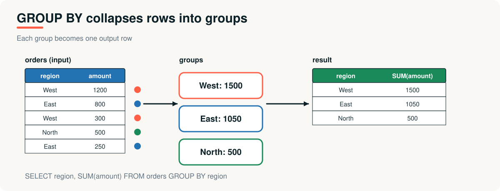

# 03 · Aggregation and Grouping

> **Module 02 · Topic 03 of 10** &nbsp;|&nbsp; Reading time: ~40 min &nbsp;|&nbsp; Level: Beginner

[Module home](README.md) &nbsp;·&nbsp; [← Previous: Querying Fundamentals](02-querying-fundamentals.md) &nbsp;·&nbsp; [Next: Joins →](04-joins.md)



## What you will learn

- The aggregate functions, and how each one treats **NULL**
- `GROUP BY`: collapsing many rows into one row per group
- `WHERE` versus `HAVING`
- **Conditional aggregation** with `CASE`, the most useful pattern in reporting SQL
- How the engine groups rows, and why grouping is expensive on a cluster

---

## 1. The business problem

The head of sales has seen Asha's first query and wants a monthly view: orders per month, split by channel, with cancellation rates. Asha's first attempts show how easily aggregates go wrong.

| Attempt | What she tries | What happens | Why |
|---|---|---|---|
| 1 | `WHERE SUM(quantity) > 200` | An **error** | `WHERE` runs before rows are grouped, so no total exists yet |
| 2 | `COUNT(segment)` to count customers | Returns **54**, not 60 | `COUNT(column)` skips NULLs |
| 3 | Average of the monthly averages | A number that matches no real average | Groups of different sizes need weighting |
| 4 | `SELECT region, city ... GROUP BY region` | SQLite returns a result. Stricter engines raise an error | `city` is neither grouped nor aggregated, so which city would it be? |

---

## 2. Aggregate functions

An **aggregate function** reads many rows and returns **one value**.

| Function | Returns | NULL handling |
|---|---|---|
| `COUNT(*)` | Number of rows | Counts every row |
| `COUNT(col)` | Number of rows where `col` is not NULL | Skips NULL |
| `COUNT(DISTINCT col)` | Number of different non-NULL values | Skips NULL |
| `SUM(col)` | Total | Skips NULL. Returns NULL if there are no non-NULL values |
| `AVG(col)` | Mean of the non-NULL values | Skips NULL |
| `MIN(col)`, `MAX(col)` | Smallest, largest | Skip NULL |

```sql
-- COUNT(*) versus COUNT(column) versus COUNT(DISTINCT column)
SELECT COUNT(*)                AS total_customers,
       COUNT(segment)          AS with_segment,
       COUNT(DISTINCT region)  AS regions,
       COUNT(DISTINCT segment) AS segments
FROM customers;
```

```text
total_customers  with_segment  regions  segments
---------------  ------------  -------  --------
             60            54        4         3
```

Six customers have no `segment`, so `COUNT(segment)` is 54 while `COUNT(*)` is 60. That is attempt 2.

```sql
-- Summary statistics for the order lines
SELECT COUNT(*)                     AS line_count,
       SUM(quantity)                AS units,
       ROUND(AVG(unit_price), 2)    AS avg_price,
       MIN(unit_price)              AS min_price,
       MAX(unit_price)              AS max_price
FROM order_items;
```

```text
line_count  units  avg_price  min_price  max_price
----------  -----  ---------  ---------  ---------
      1773   3157    1968.93      349.0     5999.0
```

**An aggregate over zero rows** is a common source of surprises: `COUNT` returns 0, but `SUM` and `AVG` return NULL. Wrap with `COALESCE` when a report needs a zero.

```sql
-- Nothing matches: COUNT gives 0, SUM gives NULL
SELECT COUNT(*)                     AS line_count,
       SUM(quantity)                AS total_units,
       COALESCE(SUM(quantity), 0)   AS total_units_or_zero
FROM order_items
WHERE quantity > 100;
```

```text
line_count  total_units  total_units_or_zero
----------  -----------  -------------------
         0  NULL                           0
```

---

## 3. GROUP BY

`GROUP BY` splits the rows into groups that share the same values in the listed columns, then applies the aggregates to each group. The result has **one row per group**.

```sql
-- One row per status
SELECT status,
       COUNT(*)                   AS orders,
       ROUND(AVG(shipping_fee), 2) AS avg_shipping_fee
FROM orders
GROUP BY status
ORDER BY orders DESC;
```

```text
status     orders  avg_shipping_fee
---------  ------  ----------------
completed     852             15.27
cancelled      50             13.56
pending        14             19.64
```

**The rule:** every column in `SELECT` must either appear in `GROUP BY` or be inside an aggregate function. This is the question the engine asks about attempt 4: if you group by `region` and also select `city`, which of a region's many cities should it show?

```sql
-- Rejected by PostgreSQL, Spark SQL and most engines
SELECT region, city, COUNT(*) FROM customers GROUP BY region;
```

> [!WARNING]
> SQLite accepts the query above and returns the `city` of *some* row in each group. That is a "bare column" extension, and it hides a bug: the result is arbitrary. Treat any `SELECT` column that is not grouped or aggregated as an error, whichever engine you use.

### Grouping by an expression

Group by the *result* of an expression to bucket values, for example turning dates into months:

```sql
-- Orders per month. strftime('%Y-%m', ...) is SQLite's way to cut a date down to year-month
SELECT strftime('%Y-%m', order_date) AS month,
       COUNT(*)                      AS orders
FROM orders
GROUP BY strftime('%Y-%m', order_date)
ORDER BY month;
```

```text
month    orders
-------  ------
2025-07     123
2025-08     122
2025-09     117
2025-10     169
2025-11     219
2025-12     166
```

> [!NOTE]
> Many engines also accept the alias (`GROUP BY month`) or the column position (`GROUP BY 1`). Repeating the expression is the portable form. In Spark SQL the month would be `date_format(order_date, 'yyyy-MM')` or `trunc(order_date, 'MM')`.

### Several grouping keys

List more than one column to get one row per **combination**:

```sql
-- Completed orders per month and channel, November and December only
SELECT strftime('%Y-%m', order_date) AS month,
       channel,
       COUNT(*)                      AS orders
FROM orders
WHERE status = 'completed'
  AND order_date >= '2025-11-01'
GROUP BY strftime('%Y-%m', order_date), channel
ORDER BY month, channel;
```

```text
month    channel      orders
-------  -----------  ------
2025-11  app              99
2025-11  marketplace      38
2025-11  web              70
2025-12  app              69
2025-12  marketplace      16
2025-12  web              56
```

### NULL forms its own group

`GROUP BY` treats all NULLs as one group, even though `NULL = NULL` is not true in a `WHERE` clause.

```sql
SELECT segment, COUNT(*) AS customers
FROM customers
GROUP BY segment
ORDER BY segment;
```

```text
segment   customers
--------  ---------
NULL              6
Business         15
Premium          25
Retail           14
```

---

## 4. WHERE versus HAVING

Both filter, but at different moments in the [logical order](02-querying-fundamentals.md#7-the-logical-order-of-execution).

| | `WHERE` | `HAVING` |
|---|---|---|
| **Filters** | Individual **rows**, before grouping | **Groups**, after aggregation |
| **Can use aggregates?** | No | Yes |
| **Use it for** | `status = 'completed'`, date ranges | `SUM(...) > 500000`, `COUNT(*) > 1` |

Filter rows with `WHERE` whenever you can. It shrinks the data **before** the expensive grouping.

```sql
-- Products with more than 500,000 of gross sales (a condition on a total, so HAVING)
SELECT product_id,
       SUM(quantity)                      AS units,
       ROUND(SUM(quantity * unit_price), 2) AS gross_sales
FROM order_items
GROUP BY product_id
HAVING SUM(quantity * unit_price) > 500000
ORDER BY gross_sales DESC;
```

```text
product_id  units  gross_sales
----------  -----  -----------
         2    153     917847.0
         5    171     769329.0
         4    173     570727.0
         9    165     567187.9
```

---

## 5. Conditional aggregation

Put a `CASE` expression *inside* an aggregate to count or total only the rows that match a condition. One pass over the data then produces several columns, which is how most reports are built.

```sql
-- Monthly orders with one column per channel
SELECT strftime('%Y-%m', order_date) AS month,
       SUM(CASE WHEN channel = 'web'         THEN 1 ELSE 0 END) AS web,
       SUM(CASE WHEN channel = 'app'         THEN 1 ELSE 0 END) AS app,
       SUM(CASE WHEN channel = 'marketplace' THEN 1 ELSE 0 END) AS marketplace,
       COUNT(*)                                                 AS total
FROM orders
GROUP BY strftime('%Y-%m', order_date)
ORDER BY month;
```

```text
month    web  app  marketplace  total
-------  ---  ---  -----------  -----
2025-07   33   69           21    123
2025-08   42   63           17    122
2025-09   38   61           18    117
2025-10   54   86           29    169
2025-11   73  107           39    219
2025-12   64   81           21    166
```

The same pattern turns counts into **rates**. Multiply by `100.0`, not `100`: in SQLite, PostgreSQL and many other engines, dividing two integers gives an integer and silently discards the fraction.

```sql
-- Cancellation rate by channel
SELECT channel,
       COUNT(*) AS orders,
       ROUND(100.0 * SUM(CASE WHEN status = 'cancelled' THEN 1 ELSE 0 END) / COUNT(*), 1) AS cancel_pct
FROM orders
GROUP BY channel
ORDER BY cancel_pct DESC;
```

```text
channel      orders  cancel_pct
-----------  ------  ----------
app             467         6.4
marketplace     145         4.8
web             304         4.3
```

> [!TIP]
> SQLite 3.30+ and PostgreSQL also offer `COUNT(*) FILTER (WHERE status = 'cancelled')`, which reads more clearly. `CASE` inside the aggregate works everywhere, so learn that form first.

---

## 6. The average-of-averages trap

An average of group averages is only correct when the groups are the same size.

| Group | Orders | Average order value | Total |
|---|---|---|---|
| A | 1 | 1,000 | 1,000 |
| B | 9 | 100 | 900 |
| **Correct overall average** | 10 | **190** | 1,900 |
| **Average of the two averages** | | **550** | |

To combine groups, carry the **sum and the count** forward, and divide at the end: `SUM(total) / SUM(count)`. This matters for pipelines, too. A summary table that stores only averages cannot be re-aggregated correctly. Store sums and counts.

---

## 7. How the engine groups rows

There are two classic strategies.

| Strategy | How it works | Where you see it |
|---|---|---|
| **Sort aggregate** | Sort the rows by the group key. Equal keys become neighbours, so each group is totalled in one pass | SQLite (`USE TEMP B-TREE FOR GROUP BY`) |
| **Hash aggregate** | Keep a hash table with one entry per group and update it as rows stream past | Spark (`HashAggregate`), PostgreSQL, most warehouses |

```sql
-- SQLite's plan for a simple GROUP BY
EXPLAIN QUERY PLAN
SELECT channel, COUNT(*) AS orders
FROM orders
GROUP BY channel;
```

```text
QUERY PLAN
|--SCAN orders
`--USE TEMP B-TREE FOR GROUP BY
```

The plan shows a scan of the whole table, then a sort to bring each channel's rows together.

**On a cluster, grouping means a shuffle.** Rows with the same key live on different machines and must be brought together. This is the shape of the Spark plan you read in [Module 01, Topic 06](../01_Foundations_of_Big_Data_and_Data_Engineering/06-apache-spark.md), shortened:

```text
HashAggregate(keys=[region], functions=[count(1), sum(amount)])        <- final: combine partials
+- Exchange hashpartitioning(region, 4)                                 <- the shuffle
   +- HashAggregate(keys=[region], functions=[partial_count(1), ...])   <- partial: inside each partition
```

Each partition first aggregates its own rows (the `partial_` step), so only small partial results cross the network. The `Exchange` is the shuffle, and it is the expensive part. Two practical consequences:

- **Filter first.** `WHERE` before `GROUP BY` means fewer rows to shuffle.
- **Skew hurts.** If one key holds most of the rows, for example one very large customer, one task does most of the work while the others wait.

---

## 8. A data profile: the first query on any new table

Data engineers use aggregates to *describe* a table before trusting it. This one query shows row count, missing values, uniqueness and range:

```sql
-- A profile of the customers table
SELECT COUNT(*)                     AS total_rows,
       COUNT(city)                  AS non_null_city,
       COUNT(*) - COUNT(city)       AS null_city,
       COUNT(DISTINCT customer_id)  AS distinct_ids,
       MIN(signup_date)             AS first_signup,
       MAX(signup_date)             AS last_signup
FROM customers;
```

```text
total_rows  non_null_city  null_city  distinct_ids  first_signup  last_signup
----------  -------------  ---------  ------------  ------------  -----------
        60             56          4            60  2024-01-26    2025-07-29
```

`distinct_ids` equals `total_rows`, so the key is unique. Four cities are missing. [Topic 07](07-cleaning-and-validating-data.md) turns checks like these into automated tests.

---

## 9. Limitations and engineering considerations

| Issue | Detail |
|---|---|
| **Non-grouped columns** | Always an error in strict engines. In SQLite it is an arbitrary value, so avoid it |
| **Integer division** | `COUNT(a) / COUNT(b)` may return 0. Multiply by `100.0` or cast |
| **Grouping at the wrong grain** | Summing a value after a join can count it many times. [Topic 04](04-joins.md) shows this trap |
| **Rollups and subtotals** | `ROLLUP`, `CUBE` and `GROUPING SETS` exist in PostgreSQL and Spark SQL but not in SQLite |
| **High-cardinality groups** | Millions of distinct keys need a large hash table and can spill to disk |
| **Approximate answers** | `COUNT(DISTINCT)` is costly on huge data. Engines such as Spark offer `approx_count_distinct` when a small error is acceptable |

## 10. Real-world applications

- **Operational KPIs:** daily orders, revenue and cancellation rate for dashboards.
- **Data profiling and quality:** counts, null counts and ranges on every incoming table.
- **Aggregate tables:** pre-computed daily or monthly totals so dashboards read thousands of rows rather than billions ([Topic 08](08-modelling-and-loading-with-sql.md)).
- **Anomaly checks:** comparing today's row count to the average of recent days.

---

## Key takeaways

1. An aggregate turns many rows into one value. `COUNT(*)` counts rows, `COUNT(col)` skips NULLs.
2. `GROUP BY` gives one row per group. Every selected column must be grouped or aggregated.
3. `WHERE` filters rows **before** grouping. `HAVING` filters groups **after**.
4. `SUM(CASE WHEN ... THEN 1 ELSE 0 END)` is the portable way to build several measures in one pass.
5. Never average averages. Carry sums and counts, and divide at the end.
6. On a cluster, `GROUP BY` triggers a shuffle: filter early and watch for skew.

## Interview questions

<details><summary><b>1.</b> What is the difference between <code>COUNT(*)</code>, <code>COUNT(col)</code> and <code>COUNT(DISTINCT col)</code>?</summary>

`COUNT(*)` counts all rows. `COUNT(col)` counts rows where `col` is not NULL. `COUNT(DISTINCT col)` counts the different non-NULL values of `col`.
</details>

<details><summary><b>2.</b> What is the difference between <code>WHERE</code> and <code>HAVING</code>?</summary>

`WHERE` filters individual rows before grouping and cannot use aggregates. `HAVING` filters groups after aggregation and can. Use `WHERE` for row conditions so less data is grouped.
</details>

<details><summary><b>3.</b> Why does a <code>SELECT</code> column have to appear in <code>GROUP BY</code> or an aggregate?</summary>

Each output row represents a whole group. A column that is neither grouped nor aggregated has several values within the group, and the engine cannot know which one to show. SQLite returns an arbitrary one, which is a bug waiting to happen.
</details>

<details><summary><b>4.</b> What does <code>SUM</code> return on an empty set, and how do you get zero?</summary>

NULL. Use `COALESCE(SUM(x), 0)`. `COUNT` returns 0 on an empty set.
</details>

<details><summary><b>5.</b> How would you compute the cancellation rate per channel in one query?</summary>

Group by channel and divide a conditional count by the total count: `100.0 * SUM(CASE WHEN status = 'cancelled' THEN 1 ELSE 0 END) / COUNT(*)`. Use `100.0` to avoid integer division.
</details>

<details><summary><b>6.</b> Why is averaging pre-computed averages wrong?</summary>

It gives every group equal weight regardless of size. The correct overall average is total sum divided by total count, so summary tables should store sums and counts, not just averages.
</details>

<details><summary><b>7.</b> Why is <code>GROUP BY</code> expensive in Spark, and how do you reduce the cost?</summary>

Rows with the same key sit on different machines, so grouping needs a shuffle across the network. Reduce it by filtering early, selecting only needed columns, relying on partial aggregation, and fixing data skew on hot keys.
</details>

<details><summary><b>8.</b> How does <code>GROUP BY</code> treat NULL?</summary>

All NULLs form a single group, even though `NULL = NULL` is not true in a `WHERE` clause.
</details>

## Official documentation

- [SQLite: aggregate functions](https://www.sqlite.org/lang_aggfunc.html) · [date and time functions](https://www.sqlite.org/lang_datefunc.html)
- [Spark SQL: GROUP BY](https://spark.apache.org/docs/latest/sql-ref-syntax-qry-select-groupby.html) · [built-in functions](https://spark.apache.org/docs/latest/api/sql/index.html)

---

| Previous | Contents | Next |
|:---|:---:|:---|
| [← Querying Fundamentals](02-querying-fundamentals.md) | [Module home](README.md#topics-covered) | [Joins →](04-joins.md) |
