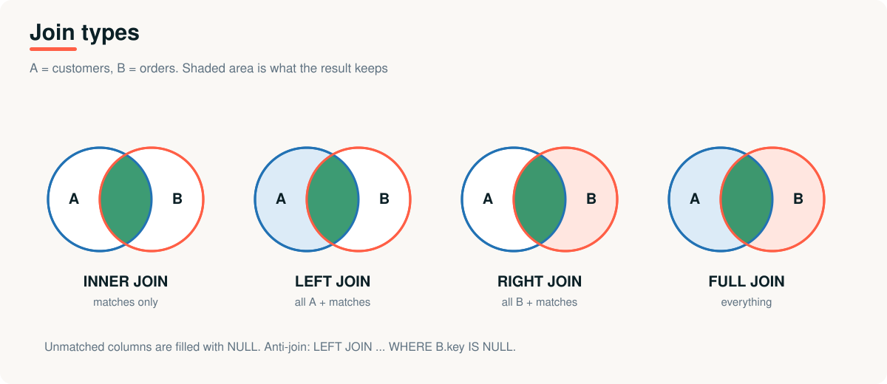
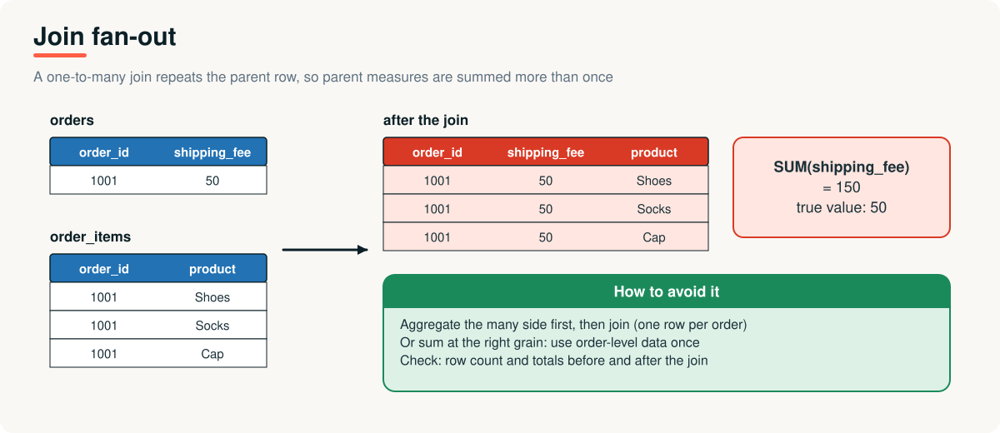

# 04 · Joins

> **Module 02 · Topic 04 of 10** &nbsp;|&nbsp; Reading time: ~50 min &nbsp;|&nbsp; Level: Beginner to intermediate

[Module home](README.md) &nbsp;·&nbsp; [← Previous: Aggregation and Grouping](03-aggregation-and-grouping.md) &nbsp;·&nbsp; [Next: Subqueries, CTEs and Set Operations →](05-subqueries-ctes-and-set-operations.md)



## What you will learn

- Why data is split across tables, and how a join puts it back together
- `INNER`, `LEFT`, `FULL` and `CROSS` joins, plus the **anti-join** and **semi-join** patterns
- **Fan-out**: how a join silently double counts, and how to catch it
- How engines execute joins: nested loops, hash joins and sort-merge joins
- Why a join on a cluster means a **shuffle**, and how a **broadcast** avoids it

---

## 1. The business problem

Asha's question needs facts from three tables: the **region** lives in `customers`, the **status** in `orders`, and the **price and quantity** in `order_items`. No single table has all of it, so she has to join. This is where analysts most often produce numbers that look right and are not.

| Attempt | What she tries | What happens | Why |
|---|---|---|---|
| 1 | Join `customers` to `orders` to list every customer's orders | Six customers who **never ordered** are missing | An `INNER JOIN` keeps only rows that match on both sides |
| 2 | Join `orders` to `order_items`, then `SUM(shipping_fee)` | The shipping total is about **24% too high** | The fee is stored once per order, but a join repeats it once per order line |
| 3 | Forget the `ON` condition | **54,960** rows appear from 60 customers and 916 orders | Every row paired with every row: a cartesian product |
| 4 | Join `returns` to `order_items` on `order_id` only | **264** rows, though only 119 lines were returned | The key is `(order_id, line_no)`. Half a key matches too much |

All four run without an error, and all four return a believable number. The skill in this topic is to expect each of them.

---

## 2. Why data is split across tables

Instead of repeating a customer's name, city and region on every order, a database stores each customer **once** and refers to them by `customer_id`. This is **normalisation**.

| Benefit | Example |
|---|---|
| **No repetition** | A customer's city is stored once, not on each of their orders |
| **One place to update** | When a customer moves, one row changes |
| **Fewer inconsistencies** | There cannot be two spellings of the same customer's city |

A **join** reconnects the tables by matching a foreign key to a primary key. Analytics platforms often go the other way and pre-join data into wide tables for speed ([Topic 08](08-modelling-and-loading-with-sql.md)), but the source systems you read from are normalised, so you must join.

---

## 3. The join types

A join takes two tables and a condition (`ON`) and produces a new set of rows. The types differ in what they do with rows that **do not match**.

| Join | Keeps | Unmatched rows |
|---|---|---|
| `INNER JOIN` | Rows that match on both sides | Dropped |
| `LEFT JOIN` | All rows from the left table | Right side filled with NULL |
| `RIGHT JOIN` | All rows from the right table | Left side filled with NULL |
| `FULL OUTER JOIN` | All rows from both tables | Missing side filled with NULL |
| `CROSS JOIN` | Every left row paired with every right row | Not applicable: no condition |

### INNER JOIN

```sql
-- Each order with its customer's name and region
SELECT o.order_id, o.order_date, c.name, c.region
FROM orders AS o
INNER JOIN customers AS c ON c.customer_id = o.customer_id
ORDER BY o.order_id
LIMIT 5;
```

```text
order_id  order_date  name         region
--------  ----------  -----------  ------
       1  2025-07-01  Asha Rao     South
       2  2025-07-01  Sameer Khan  West
       3  2025-07-01  Ravi Joshi   South
       4  2025-07-02  Rohan Reddy  East
       5  2025-07-02  Diya Gupta   South
```

Give every table a short **alias** (`o`, `c`) and prefix every column with it. It removes ambiguity when two tables share a column name, and it shows the reader where each column comes from. When both tables use the same column name for the key, `USING (customer_id)` is a shorter form of the same condition.

### LEFT JOIN: keep everything on the left

```sql
-- Every customer with an order count, including customers who never ordered
SELECT c.customer_id, c.name, COUNT(o.order_id) AS orders
FROM customers AS c
LEFT JOIN orders AS o ON o.customer_id = c.customer_id
GROUP BY c.customer_id, c.name
ORDER BY orders, c.customer_id
LIMIT 8;
```

```text
customer_id  name         orders
-----------  -----------  ------
          9  Kiran Reddy       0
         18  Sneha Patil       0
         27  Rohan Das         0
         36  Neha Rao          0
         45  Karan Reddy       0
         54  Riya Patil        0
         57  Rohan Reddy       7
         22  Diya Iyer         8
```

Six customers appear with 0 orders. With an `INNER JOIN` they would have disappeared, which was attempt 1.

> [!WARNING]
> After a `LEFT JOIN`, count a column from the **right** table, `COUNT(o.order_id)`, not `COUNT(*)`. An unmatched customer produces one row with NULLs, and `COUNT(*)` counts that row as 1.

```sql
-- Customer 9 has never ordered
SELECT COUNT(*)          AS count_star,
       COUNT(o.order_id) AS count_orders
FROM customers AS c
LEFT JOIN orders AS o ON o.customer_id = c.customer_id
WHERE c.customer_id = 9;
```

```text
count_star  count_orders
----------  ------------
         1             0
```

### RIGHT and FULL OUTER JOIN

A `RIGHT JOIN` is a `LEFT JOIN` with the tables swapped, so most people write `LEFT JOIN` only. A `FULL OUTER JOIN` keeps unmatched rows from **both** sides, which makes it the natural tool for **reconciling two lists**. SQLite supports both from version 3.39; PostgreSQL and Spark SQL support them.

```sql
-- Not run here (illustrative tables): what exists in one system but not the other?
SELECT COALESCE(w.order_id, s.order_id) AS order_id,
       CASE WHEN w.order_id IS NULL THEN 'missing in warehouse'
            ELSE 'missing in source' END AS problem
FROM warehouse_orders AS w
FULL OUTER JOIN source_orders AS s ON s.order_id = w.order_id
WHERE w.order_id IS NULL OR s.order_id IS NULL;
```

### CROSS JOIN and the accidental cartesian product

A `CROSS JOIN` pairs every left row with every right row. It is useful on purpose, for example to build every combination of date and product, and a disaster by accident. Listing two tables with a comma and no condition is a cross join too.

```sql
-- 60 customers x 916 orders: a missing ON condition
SELECT COUNT(*) AS accidental_rows FROM customers, orders;

-- 60 customers x 16 products: on purpose, every customer-product combination
SELECT COUNT(*) AS combinations FROM customers CROSS JOIN products;
```

```text
accidental_rows
---------------
          54960

combinations
------------
         960
```

Always use the explicit `JOIN ... ON` syntax. A missing condition is then a syntax error, not a silent cartesian product.

### Self join

A table can be joined to itself by using it twice with different aliases. This finds pairs of customers in the same city:

```sql
-- a.customer_id < b.customer_id removes self-pairs and mirrored duplicates
SELECT a.name AS customer_a, b.name AS customer_b, a.city
FROM customers AS a
JOIN customers AS b ON a.city = b.city AND a.customer_id < b.customer_id
ORDER BY a.city, a.customer_id, b.customer_id
LIMIT 5;
```

```text
customer_a    customer_b    city
------------  ------------  ---------
Shreya Nair   Lakshmi Iyer  Ahmedabad
Shreya Nair   Dev Menon     Ahmedabad
Shreya Nair   Arjun Khan    Ahmedabad
Lakshmi Iyer  Dev Menon     Ahmedabad
Lakshmi Iyer  Arjun Khan    Ahmedabad
```

Customers with a NULL city never match, because `NULL = NULL` is not true.

---

## 4. Finding what is missing: anti-joins and semi-joins

Two patterns come up constantly in data engineering.

| Pattern | Question | Typical SQL |
|---|---|---|
| **Anti-join** | Which rows have **no** match? | `LEFT JOIN ... WHERE right.key IS NULL`, or `NOT EXISTS` |
| **Semi-join** | Which rows have **at least one** match, without multiplying them? | `EXISTS` |

```sql
-- Anti-join: customers who have never placed an order
SELECT c.customer_id, c.name, c.region
FROM customers AS c
LEFT JOIN orders AS o ON o.customer_id = c.customer_id
WHERE o.order_id IS NULL
ORDER BY c.customer_id;
```

```text
customer_id  name         region
-----------  -----------  ------
          9  Kiran Reddy  South
         18  Sneha Patil  North
         27  Rohan Das    North
         36  Neha Rao     East
         45  Karan Reddy  North
         54  Riya Patil   East
```

```sql
-- Semi-join: customers with at least one returned item. Each customer counts once
SELECT COUNT(*) AS customers_with_a_return
FROM customers AS c
WHERE EXISTS (SELECT 1
              FROM orders AS o
              JOIN returns AS r ON r.order_id = o.order_id
              WHERE o.customer_id = c.customer_id);
```

```text
customers_with_a_return
-----------------------
                     47
```

`EXISTS` stops at the first match and never multiplies rows, so it is safer than joining and then using `DISTINCT`. Anti-joins are also how you find **orphans**: order lines whose product no longer exists, or facts without a dimension row ([Topic 07](07-cleaning-and-validating-data.md)).

### ON versus WHERE in a LEFT JOIN

The position of a filter on the **right** table changes the meaning:

```sql
-- Condition in ON: still lists every customer (60), matching only cancelled orders
SELECT COUNT(DISTINCT c.customer_id) AS customers_in_on
FROM customers AS c
LEFT JOIN orders AS o ON o.customer_id = c.customer_id AND o.status = 'cancelled';

-- Condition in WHERE: customers without a cancelled order are filtered out again
SELECT COUNT(DISTINCT c.customer_id) AS customers_in_where
FROM customers AS c
LEFT JOIN orders AS o ON o.customer_id = c.customer_id
WHERE o.status = 'cancelled';
```

```text
customers_in_on
---------------
             60

customers_in_where
------------------
                32
```

`WHERE` runs after the join. Unmatched rows have `o.status` NULL, which fails the test, so the `LEFT JOIN` quietly turns into an `INNER JOIN`. Put conditions on the right-hand table in `ON` when you want to keep the left rows.

---

## 5. Cardinality and fan-out

How many rows match? Three relationships:

| Relationship | Meaning | XYZ example |
|---|---|---|
| **One-to-one** | Each row matches at most one row | A customer and their profile |
| **One-to-many** | One row on one side matches many on the other | One order has many `order_items` |
| **Many-to-many** | Many on both sides | Products and orders (through `order_items`) |



When you join the **one** side to the **many** side, every value from the one side is **repeated** once per matching row. That is **fan-out**. Counting rows is fine afterwards, but summing a value that belongs to the *one* side is not.

```sql
-- Right answer: the shipping fee is charged once per order
SELECT ROUND(SUM(shipping_fee), 2) AS shipping_total, COUNT(*) AS orders
FROM orders
WHERE status = 'completed';

-- Wrong answer: after joining to the lines, each order's fee repeats once per line
SELECT ROUND(SUM(o.shipping_fee), 2) AS shipping_after_join, COUNT(*) AS rows_joined
FROM orders AS o
JOIN order_items AS oi ON oi.order_id = o.order_id
WHERE o.status = 'completed';
```

```text
shipping_total  orders
--------------  ------
       13010.0     852

shipping_after_join  rows_joined
-------------------  -----------
            16108.0         1653
```

The same 852 orders now appear as 1,653 rows, and the total is too high. There is no error, so only a reviewer who checks the grain would notice.

**Fix: reduce the many side to the grain of the one side before joining.**

```sql
-- order_items becomes one row per order first, so the join no longer repeats orders
SELECT ROUND(SUM(o.shipping_fee), 2) AS shipping_total, COUNT(*) AS orders
FROM orders AS o
JOIN (SELECT order_id, SUM(quantity * unit_price) AS items_total
      FROM order_items
      GROUP BY order_id) AS t ON t.order_id = o.order_id
WHERE o.status = 'completed';
```

```text
shipping_total  orders
--------------  ------
       13010.0     852
```

(The inner query in brackets is a **derived table**. [Topic 05](05-subqueries-ctes-and-set-operations.md) shows a cleaner way to write it.)

### Composite keys: use all of the key

`returns` identifies a line by **two** columns. Joining on one of them matches too much:

```sql
SELECT COUNT(*) AS both_key_columns
FROM order_items AS oi
JOIN returns AS r ON r.order_id = oi.order_id AND r.line_no = oi.line_no;

SELECT COUNT(*) AS order_id_only
FROM order_items AS oi
JOIN returns AS r ON r.order_id = oi.order_id;
```

```text
both_key_columns
----------------
             119

order_id_only
-------------
          264
```

119 returns exist. Joining on `order_id` alone pairs each return with *every* line of the same order, giving 264 rows.

### The join audit

Before trusting any join, check three things:

1. **Is the key unique on the "one" side?** This must return no rows:

```sql
SELECT customer_id, COUNT(*) AS n
FROM customers
GROUP BY customer_id
HAVING COUNT(*) > 1;
```

```text
customer_id  n
-----------  -
```

2. **Did the row count change as you expect?** Compare `COUNT(*)` before and after. An `INNER JOIN` that shrinks the data or a join that grows it needs an explanation.
3. **Am I summing at the right grain?** A total that belongs to the one side must not be summed after a join to the many side.

---

## 6. How the engine executes a join

The engine picks a **join algorithm**. You do not write it, but you should recognise the three.

| Algorithm | How it works | Good when |
|---|---|---|
| **Nested loop** | For each left row, find matching right rows. With an index, each lookup is a quick search | One side is small, or the other side has an index on the join key |
| **Hash join** | Load one side into a hash table, then stream the other side and look up each row | Large, unsorted inputs and an equality condition |
| **Sort-merge join** | Sort both sides by the key, then walk through them together | Both sides are large, or already sorted |

SQLite uses nested loops with an index lookup:

```sql
-- SCAN the orders, then SEARCH customers by primary key for each one
EXPLAIN QUERY PLAN
SELECT o.order_id, c.name
FROM orders AS o
JOIN customers AS c ON c.customer_id = o.customer_id
WHERE o.order_date >= '2025-12-01';
```

```text
QUERY PLAN
|--SCAN o
`--SEARCH c USING INTEGER PRIMARY KEY (rowid=?)
```

For each qualifying order, the engine jumps to its customer by primary key. That is cheap because `customer_id` is indexed.

### Joins on a cluster

On a distributed engine such as Spark, the rows being joined may be on different machines, so the matching rows must be brought together. In the vocabulary of [Module 01, Topic 06](../01_Foundations_of_Big_Data_and_Data_Engineering/06-apache-spark.md), a join is a **wide transformation**.

| Strategy | What happens | When |
|---|---|---|
| **Shuffle join** (sort-merge or shuffled hash) | **Both** tables are repartitioned by the join key and sent across the network | Both tables are large |
| **Broadcast hash join** | The **small** table is copied to every executor. The large table is not moved | One side is small enough to fit in memory |

A broadcast avoids shuffling the large table, which is usually the biggest saving available:

```sql
-- Spark SQL / Databricks (not run here): hint that the small customers table should be broadcast
SELECT /*+ BROADCAST(c) */ o.order_id, c.region
FROM orders AS o
JOIN customers AS c ON c.customer_id = o.customer_id;
```

Spark often chooses a broadcast by itself when the small side is below a size threshold (`spark.sql.autoBroadcastJoinThreshold`), and **Adaptive Query Execution** can switch strategy at runtime using real data sizes. **Skew** can still hurt: if one key, such as a single huge customer, owns most of the rows, one task does most of the work.

---

## 7. Common mistakes

| Mistake | Effect | Prevention |
|---|---|---|
| `INNER JOIN` when unmatched rows matter | Rows silently disappear | Use `LEFT JOIN` and check counts |
| Filter on the right table in `WHERE` after a `LEFT JOIN` | Behaves as an `INNER JOIN` | Move it to `ON` |
| `COUNT(*)` after a `LEFT JOIN` | Unmatched rows counted as 1 | `COUNT(right_table.column)` |
| Joining one-to-many, then summing the "one" side | Totals inflated | Aggregate to the right grain first |
| Joining on part of a composite key | Rows multiplied | Join on the whole key |
| Missing `ON` condition | Cartesian product | Always write `JOIN ... ON` |
| `NULL` join keys | Never match, even each other | Clean the keys, or handle NULL deliberately |
| `SELECT DISTINCT` to "fix" duplicates | Hides the real bug and costs a sort | Find why the join multiplies |

## 8. Real-world applications

- **Enrichment:** attaching customer, product and date attributes to events, the heart of building reports ([Topic 08](08-modelling-and-loading-with-sql.md)).
- **Reconciliation:** a `FULL OUTER JOIN` between source and warehouse shows what is missing on each side.
- **Data quality:** anti-joins find orphan records and unmatched keys.
- **Inactive-user analysis:** `LEFT JOIN` plus `IS NULL` finds customers with no activity in a period.

---

## Key takeaways

1. A join matches a foreign key to a primary key. `INNER` drops unmatched rows, `LEFT` keeps the left side, `FULL` keeps both.
2. `LEFT JOIN ... WHERE right.key IS NULL` is the **anti-join**. `EXISTS` is the **semi-join**.
3. Conditions on the right table belong in `ON`, not `WHERE`, when you want to keep unmatched left rows.
4. **Fan-out** is the most common cause of wrong totals: joining one-to-many repeats the one side. Aggregate to the right grain first.
5. Join on the **whole** key, and **audit** every join: key uniqueness, row counts, grain.
6. On a cluster a join is a shuffle. Broadcasting the small table avoids moving the large one.

## Interview questions

<details><summary><b>1.</b> What is the difference between <code>INNER JOIN</code> and <code>LEFT JOIN</code>?</summary>

`INNER JOIN` returns only rows that match on both sides. `LEFT JOIN` returns every row from the left table, with NULLs for the right-hand columns when there is no match.
</details>

<details><summary><b>2.</b> How do you find customers who have never placed an order?</summary>

Use an anti-join: `LEFT JOIN orders` and keep rows where the order's key `IS NULL`, or use `WHERE NOT EXISTS (SELECT 1 FROM orders ...)`. Be careful with `NOT IN` when the subquery can return NULL (Topic 05).
</details>

<details><summary><b>3.</b> Joining orders to order lines inflated the total shipping fee. Why, and how do you fix it?</summary>

It is fan-out: each order appears once per line, so an order-level value is repeated. Aggregate the lines to one row per order before joining, or compute the order-level total from the orders table alone.
</details>

<details><summary><b>4.</b> What is the difference between a filter in <code>ON</code> and in <code>WHERE</code> for a <code>LEFT JOIN</code>?</summary>

A condition on the right table in `ON` decides which rows match, so unmatched left rows are kept. The same condition in `WHERE` runs after the join, removes the NULL-filled rows, and turns the query into an inner join.
</details>

<details><summary><b>5.</b> Why does <code>COUNT(*)</code> mislead after a <code>LEFT JOIN</code>?</summary>

An unmatched left row still produces one output row, so `COUNT(*)` counts it as 1. `COUNT(right.column)` ignores the NULLs and returns 0 for unmatched rows.
</details>

<details><summary><b>6.</b> How can you tell whether a join has multiplied your rows?</summary>

Check that the join key is unique on the "one" side with `GROUP BY key HAVING COUNT(*) > 1`, and compare the row count before and after the join, and check whether any sum is at the wrong grain.
</details>

<details><summary><b>7.</b> Explain nested-loop, hash and sort-merge joins.</summary>

A nested loop looks up matches for each row of one side, which is fast with an index. A hash join builds a hash table from one side and probes it with the other. A sort-merge join sorts both sides by the key and merges them. The optimiser chooses based on table sizes, indexes and the join condition.
</details>

<details><summary><b>8.</b> What is a broadcast join, and why is it faster in Spark?</summary>

The small table is copied to every executor, so each executor joins its local part of the large table without moving it. That avoids shuffling the large table across the network. It only works when the small side fits in executor memory.
</details>

## Official documentation

- [SQLite: SELECT and joins](https://www.sqlite.org/lang_select.html) · [Query planner](https://www.sqlite.org/queryplanner.html)
- [Spark SQL: JOIN](https://spark.apache.org/docs/latest/sql-ref-syntax-qry-select-join.html) · [Join hints](https://spark.apache.org/docs/latest/sql-ref-syntax-qry-select-hints.html) · [Performance tuning and join strategies](https://spark.apache.org/docs/latest/sql-performance-tuning.html)

---

| Previous | Contents | Next |
|:---|:---:|:---|
| [← Aggregation and Grouping](03-aggregation-and-grouping.md) | [Module home](README.md#topics-covered) | [Subqueries, CTEs and Set Operations →](05-subqueries-ctes-and-set-operations.md) |
