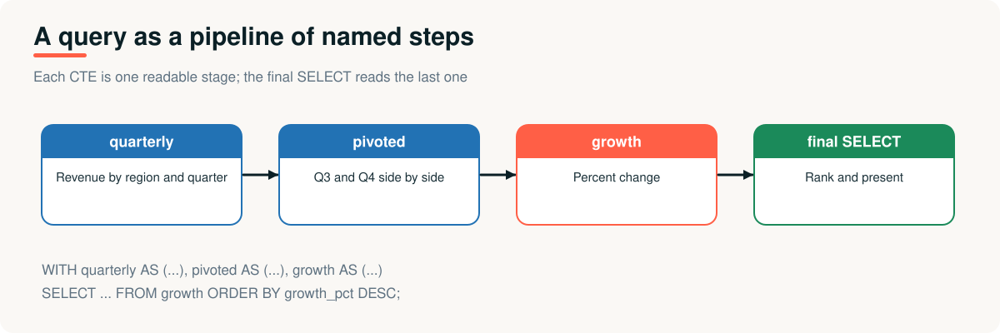

# 05 · Subqueries, CTEs and Set Operations

> **Module 02 · Topic 05 of 10** &nbsp;|&nbsp; Reading time: ~45 min &nbsp;|&nbsp; Level: Intermediate

[Module home](README.md) &nbsp;·&nbsp; [← Previous: Joins](04-joins.md) &nbsp;·&nbsp; [Next: Window Functions →](06-window-functions.md)



## What you will learn

- **Subqueries**: scalar, `IN`, `EXISTS`, correlated, and derived tables
- **CTEs** (`WITH`): writing a long query as a chain of named, readable steps
- **Recursive CTEs**, and how to build a calendar so that empty days still appear
- **Set operations**: `UNION`, `UNION ALL`, `INTERSECT`, `EXCEPT`
- The `NOT IN` trap, and why `NOT EXISTS` is safer
- How to finally answer **Asha's full question** from Topic 01

---

## 1. The business problem

Asha now knows enough to answer the head of sales: *which regions grew fastest last quarter, and which products are returned most often?* Each half needs several steps (filter, join, total, compare), and her first drafts show why single-statement SQL needs structure.

| Attempt | What she tries | What happens | Why |
|---|---|---|---|
| 1 | One query with three levels of nested subqueries | It works, but nobody (including Asha a week later) can review it | Logic reads inside-out and cannot be checked one step at a time |
| 2 | `WHERE city NOT IN (SELECT city ...)` | **Zero rows**, with no error | One NULL in the list makes every `NOT IN` test UNKNOWN |
| 3 | `UNION` to stack two result sets | Rows silently disappear, and the query is slower | `UNION` removes duplicates. `UNION ALL` does not |
| 4 | Joins `returns` straight to `order_items` and `orders` for return rates | Numbers that move when she adds a join | Joining before aggregating repeats rows ([Topic 04](04-joins.md)) |

The fixes are a handful of habits: one step per CTE, `NOT EXISTS`, `UNION ALL` by default, and aggregating to the right grain first.

---

## 2. Subqueries

A **subquery** is a query inside another query. It comes in four shapes.

| Shape | Returns | Used in | Example |
|---|---|---|---|
| **Scalar** | One value | `WHERE`, `SELECT` | `price > (SELECT AVG(price) ...)` |
| **List** | One column, many rows | `IN (...)` | `customer_id IN (SELECT ...)` |
| **Table** (derived table) | Rows and columns | `FROM` | `FROM (SELECT ...) AS t` |
| **Existence** | True or false | `EXISTS (...)` | `WHERE EXISTS (SELECT 1 ...)` |

```sql
-- Scalar subquery: products priced above the average list price
SELECT name, list_price
FROM products
WHERE list_price > (SELECT AVG(list_price) FROM products)
ORDER BY list_price DESC;
```

```text
name               list_price
-----------------  ----------
Smart Watch            5999.0
Air Fryer              4499.0
Running Shoes          3499.0
Bluetooth Speaker      3299.0
Denim Jacket           2799.0
Wireless Earbuds       2499.0
```

### Correlated subqueries

A subquery that refers to the **outer** query's row is **correlated**. Conceptually it runs once per outer row.

```sql
-- Each customer's most recent order date
SELECT c.name,
       (SELECT MAX(o.order_date)
        FROM orders AS o
        WHERE o.customer_id = c.customer_id) AS last_order
FROM customers AS c
ORDER BY c.customer_id
LIMIT 5;
```

```text
name           last_order
-------------  ----------
Tarun Khan     2025-12-28
Isha Bose      2025-11-29
Nikhil Das     2025-12-17
Lakshmi Gupta  2025-12-23
Imran Shah     2025-12-26
```

Read literally, that is "run a query for each customer". In practice the optimiser often rewrites a correlated subquery as a join (**decorrelation**), but not always, so on large data compare it with an explicit `GROUP BY` join.

### The NOT IN trap

`x NOT IN (a, b, NULL)` can never be TRUE. It expands to `x <> a AND x <> b AND x <> NULL`, and the last test is UNKNOWN, so no row passes. This is attempt 2.

```sql
-- Customers whose city is not a city used by a North-region customer
-- One North customer has a NULL city, so NOT IN returns nothing at all
SELECT COUNT(*) AS not_in_result
FROM customers
WHERE city NOT IN (SELECT city FROM customers WHERE region = 'North');
```

```text
not_in_result
-------------
            0
```

`NOT EXISTS` has no such problem, because it asks only whether *any row* matches:

```sql
SELECT COUNT(*) AS not_exists_result
FROM customers AS c
WHERE NOT EXISTS (SELECT 1
                  FROM customers AS n
                  WHERE n.region = 'North' AND n.city = c.city);
```

```text
not_exists_result
-----------------
               49
```

> [!IMPORTANT]
> Prefer `NOT EXISTS` (or a `LEFT JOIN ... IS NULL` anti-join from [Topic 04](04-joins.md)) over `NOT IN` unless you are certain the subquery cannot return NULL. The 49 above are the 45 customers with a known non-North city, plus the 4 with an unknown city. Decide whether unknown should count, and say so in the query.

---

## 3. Common table expressions (CTEs)

A **CTE** gives a subquery a name, defined with `WITH` before the main query. You can chain several, and each can use the ones before it.

```sql
WITH step_one AS (
    SELECT ...
),
step_two AS (
    SELECT ... FROM step_one ...
)
SELECT ... FROM step_two;
```

| Subquery in `FROM` | CTE |
|---|---|
| Written inside-out | Written top to bottom, in the order of the logic |
| Cannot be reused | Can be referenced several times in the same statement |
| Hard to test alone | Each step can be run on its own by selecting from it |

A CTE is **not** a table: it exists only for one statement and has no index. Whether the engine computes it once or inlines it at each use depends on the engine and version. If a costly step is reused many times, materialise it into a temporary or intermediate table ([Topic 09](09-query-performance-and-execution.md)).

### Answering Asha's question, part 1: regional growth

Three steps: pick the completed lines with their region and quarter, total each region by quarter, then compare the quarters.

```sql
WITH completed_lines AS (
    -- Grain: one row per completed order line, with its region and quarter
    SELECT c.region,
           CASE WHEN o.order_date < '2025-10-01' THEN 'Q3' ELSE 'Q4' END AS quarter,
           oi.quantity * oi.unit_price AS line_revenue
    FROM orders AS o
    JOIN customers AS c    ON c.customer_id = o.customer_id
    JOIN order_items AS oi ON oi.order_id   = o.order_id
    WHERE o.status = 'completed'
),
by_region AS (
    -- Grain: one row per region
    SELECT region,
           SUM(CASE WHEN quarter = 'Q3' THEN line_revenue ELSE 0 END) AS q3_revenue,
           SUM(CASE WHEN quarter = 'Q4' THEN line_revenue ELSE 0 END) AS q4_revenue
    FROM completed_lines
    GROUP BY region
)
SELECT region,
       ROUND(q3_revenue, 2) AS q3_revenue,
       ROUND(q4_revenue, 2) AS q4_revenue,
       ROUND(100.0 * (q4_revenue - q3_revenue) / q3_revenue, 1) AS growth_pct
FROM by_region
ORDER BY growth_pct DESC, region;
```

```text
region  q3_revenue  q4_revenue  growth_pct
------  ----------  ----------  ----------
West      368579.0   1197802.8       225.0
North     372889.0    402468.2         7.9
South     809421.0    873558.6         7.9
East      596778.0    582948.9        -2.3
```

**West** grew fastest by a wide margin, more than tripling its revenue from Q3 to Q4 (+225%). North and South grew by about 8%, and East declined slightly. The comment at the top of each step states its **grain**, the habit from [Topic 01](01-why-sql-still-matters.md).

### Part 2: the most returned products

Each CTE reduces its table to **one row per product** *before* any join, so there is no fan-out.

```sql
WITH sold AS (
    -- Grain: one row per product, completed orders only
    SELECT oi.product_id,
           COUNT(*) AS lines_sold
    FROM order_items AS oi
    JOIN orders AS o ON o.order_id = oi.order_id
    WHERE o.status = 'completed'
    GROUP BY oi.product_id
),
returned AS (
    -- Grain: one row per product
    SELECT oi.product_id,
           COUNT(*) AS lines_returned
    FROM returns AS r
    JOIN order_items AS oi ON oi.order_id = r.order_id AND oi.line_no = r.line_no
    GROUP BY oi.product_id
)
SELECT p.name,
       p.category,
       s.lines_sold,
       COALESCE(r.lines_returned, 0) AS lines_returned,
       ROUND(100.0 * COALESCE(r.lines_returned, 0) / s.lines_sold, 1) AS return_rate_pct
FROM sold AS s
JOIN products AS p      ON p.product_id = s.product_id
LEFT JOIN returned AS r ON r.product_id = s.product_id
ORDER BY return_rate_pct DESC, p.name
LIMIT 6;
```

```text
name              category  lines_sold  lines_returned  return_rate_pct
----------------  --------  ----------  --------------  ---------------
Running Shoes     Fashion          111              19             17.1
Cotton T-Shirt    Fashion          106              18             17.0
Denim Jacket      Fashion          111              16             14.4
Backpack          Fashion          106              11             10.4
Olive Oil 1L      Grocery           99               8              8.1
Basmati Rice 5kg  Grocery          112               9              8.0
```

The four **Fashion** products are returned most often, at 10% to 17% of lines sold, while the other categories sit near 8% or below. The `LEFT JOIN` and `COALESCE` keep a product with no returns in the list, showing 0 instead of dropping out.

> [!NOTE]
> **Define your metrics.** This return rate is *returned lines divided by lines sold on completed orders*. Another team may divide units by units, or include cancelled orders. Document the definition next to the query, or two dashboards will disagree.

---

## 4. Recursive CTEs

A **recursive CTE** refers to itself: a starting query, then a step that is repeated until it returns no rows. The classic data-engineering use is generating a **calendar**, so that days with no data still appear in a report.

```sql
-- Orders per day, with a row for every day. Jan 1 and 2 have no orders and still appear
WITH RECURSIVE calendar(day) AS (
    SELECT '2025-12-29'                                  -- start
    UNION ALL
    SELECT date(day, '+1 day')                           -- repeat: add a day
    FROM calendar
    WHERE day < '2026-01-02'                             -- stop condition
)
SELECT cal.day, COUNT(o.order_id) AS orders
FROM calendar AS cal
LEFT JOIN orders AS o ON o.order_date = cal.day
GROUP BY cal.day
ORDER BY cal.day;
```

```text
day         orders
----------  ------
2025-12-29       6
2025-12-30       7
2025-12-31       7
2026-01-01       0
2026-01-02       0
```

Without the calendar, a plain `GROUP BY order_date` would simply omit the empty days, and a chart would draw a misleading line across the gap.

> [!NOTE]
> `WITH RECURSIVE` is standard and works in SQLite and PostgreSQL. Support in Spark SQL and Databricks depends on version, so check your platform. The usual Spark approach is a range function: `explode(sequence(to_date('2025-12-29'), to_date('2026-01-02'), interval 1 day))`.

Always include a **stop condition**, or the recursion never ends.

---

## 5. Set operations

Set operations combine the **rows** of two queries, while joins combine columns. Both queries must return the same number of columns with compatible types, and the column names come from the first query.

| Operator | Returns | Duplicates |
|---|---|---|
| `UNION ALL` | All rows from both | Kept |
| `UNION` | All rows from both | **Removed** |
| `INTERSECT` | Rows found in **both** | Removed |
| `EXCEPT` | Rows in the first and **not** in the second | Removed |

```sql
-- UNION ALL stacks two tables into one long list: orders and returns per month
SELECT strftime('%Y-%m', order_date) AS month, 'orders' AS metric, COUNT(*) AS value
FROM orders
GROUP BY strftime('%Y-%m', order_date)
UNION ALL
SELECT strftime('%Y-%m', return_date), 'returns', COUNT(*)
FROM returns
GROUP BY strftime('%Y-%m', return_date)
ORDER BY month, metric;
```

```text
month    metric   value
-------  -------  -----
2025-07  orders     123
2025-07  returns     13
2025-08  orders     122
2025-08  returns     21
2025-09  orders     117
2025-09  returns     17
2025-10  orders     169
2025-10  returns     24
2025-11  orders     219
2025-11  returns     22
2025-12  orders     166
2025-12  returns     22
```

### UNION or UNION ALL?

`UNION` has to find and remove duplicates, which means sorting or hashing all the rows. `UNION ALL` just appends. **Default to `UNION ALL`** and use `UNION` only when you need duplicates removed. That was attempt 3.

```sql
SELECT COUNT(*) AS with_union_all
FROM (SELECT region FROM customers UNION ALL SELECT region FROM customers);

SELECT COUNT(*) AS with_union
FROM (SELECT region FROM customers UNION SELECT region FROM customers);
```

```text
with_union_all
--------------
           120

with_union
----------
         4
```

You can see the extra work in the plan. `UNION` needs a temporary structure to remove duplicates, and `UNION ALL` does not:

```sql
EXPLAIN QUERY PLAN
SELECT customer_id FROM orders UNION SELECT customer_id FROM customers;

EXPLAIN QUERY PLAN
SELECT customer_id FROM orders UNION ALL SELECT customer_id FROM customers;
```

```text
QUERY PLAN
`--MERGE (UNION)
   |--LEFT
   |  |--SCAN orders
   |  `--USE TEMP B-TREE FOR ORDER BY
   `--RIGHT
      `--SCAN customers

QUERY PLAN
`--COMPOUND QUERY
   |--LEFT-MOST SUBQUERY
   |  `--SCAN orders
   `--UNION ALL
      `--SCAN customers
```

### INTERSECT and EXCEPT

These answer "who is in both?" and "who is in one but not the other?" `EXCEPT` is called `MINUS` in Oracle.

```sql
-- INTERSECT: customers who ordered on the app and on the web
SELECT COUNT(*) AS app_and_web
FROM (SELECT customer_id FROM orders WHERE channel = 'app'
      INTERSECT
      SELECT customer_id FROM orders WHERE channel = 'web');

-- EXCEPT: customers who ordered but have never had a return
SELECT COUNT(*) AS never_returned
FROM (SELECT customer_id FROM orders
      EXCEPT
      SELECT o.customer_id FROM orders AS o JOIN returns AS r ON r.order_id = o.order_id);
```

```text
app_and_web
-----------
         54

never_returned
--------------
             7
```

Unlike `=` in a `WHERE` clause, set operators treat two NULLs as **the same** value when they compare rows.

---

## 6. How the engine handles subqueries and CTEs

| Construct | What the optimiser typically does |
|---|---|
| Subquery in `FROM` or a simple CTE | **Flattens** it into the outer query, so it is optimised as one statement |
| `IN` / `EXISTS` subquery | Rewrites as a semi-join |
| `NOT EXISTS` | Rewrites as an anti-join |
| Correlated scalar subquery | **Decorrelates** into a join when it can. Otherwise it runs per row |
| CTE used several times | Computed once or repeated, depending on the engine and version |
| `UNION` | Append, then deduplicate (sort or hash) |

The practical rule: **write for clarity first**, then read the plan. CTEs cost nothing to read and rarely cost anything to run, so a readable chain of steps is normally the right starting point. On Spark the same CTEs and subqueries are planned by Catalyst, which pushes filters down and prunes columns across the steps.

---

## 7. Writing readable SQL

| Guideline | Why |
|---|---|
| **One transformation per CTE** | Each step can be checked on its own |
| **Name a CTE after what it holds** (`completed_lines`, `by_region`) | The query reads like a recipe |
| **Comment the grain** of every step | It prevents fan-out mistakes |
| **Aggregate to the right grain before joining** | Avoids repeated rows |
| **Avoid more than two levels of nesting** | Flatten into CTEs |
| **Prefer `UNION ALL`, `NOT EXISTS`, explicit column lists** | Predictable and fast |

## 8. Limitations and engineering considerations

| Issue | Detail |
|---|---|
| **CTEs are not tables** | No indexes, and not shared between statements. Persist expensive intermediate results |
| **Possible repeated work** | A CTE referenced three times may be computed three times on some engines |
| **Recursion** | Needs a stop condition, and depth limits vary by engine |
| **Correlated subqueries** | Can be very slow on large data if not decorrelated |
| **Set operations need matching columns** | Same count, compatible types, and the same meaning in each position |
| **`NOT IN` with NULLs** | Silently returns nothing |

## 9. Real-world applications

- **Multi-step reports:** the regional growth and return-rate queries above, one CTE per business step.
- **Calendar tables:** filling gaps so that dashboards show zero rather than missing days.
- **Churn and retention:** `EXCEPT` and `INTERSECT` between customer lists of two periods.
- **Pipeline layers:** a chain of CTEs mirrors raw, cleaned and business-ready stages ([Topic 08](08-modelling-and-loading-with-sql.md)).

---

## Key takeaways

1. A **subquery** nests one query in another. A **CTE** names it and lets you read the logic top to bottom.
2. Write long queries as a chain of CTEs, **one step each**, and comment each step's grain.
3. Prefer **`NOT EXISTS`** to `NOT IN`: a single NULL makes `NOT IN` return nothing.
4. **`UNION ALL`** appends. `UNION` also deduplicates, which costs a sort or hash, so use it deliberately.
5. `INTERSECT` and `EXCEPT` answer "in both" and "in one but not the other".
6. **Recursive CTEs** generate calendars and walk hierarchies. Always add a stop condition.
7. Define every metric (for example, return rate) in the query or its documentation.

## Interview questions

<details><summary><b>1.</b> What is a CTE, and when would you use one instead of a subquery?</summary>

A common table expression is a named query defined with `WITH` that exists for one statement. Use it to break a complex query into readable, testable steps, or to reference the same result more than once. Engines usually optimise a CTE the same way as an equivalent subquery.
</details>

<details><summary><b>2.</b> What is a correlated subquery?</summary>

A subquery that references a column of the outer query, so it is evaluated in the context of each outer row. Optimisers often rewrite it as a join, but on large data it can be slow if they cannot.
</details>

<details><summary><b>3.</b> Why can <code>NOT IN</code> return no rows even when it should return many?</summary>

If the subquery returns any NULL, `x NOT IN (...)` evaluates to UNKNOWN for every `x` that is not matched, so no row passes. Use `NOT EXISTS`, or filter NULLs out of the subquery.
</details>

<details><summary><b>4.</b> What is the difference between <code>UNION</code> and <code>UNION ALL</code>?</summary>

`UNION ALL` returns all rows including duplicates. `UNION` removes duplicates, which requires sorting or hashing and is slower. Use `UNION ALL` unless you need deduplication.
</details>

<details><summary><b>5.</b> How do you find customers who ordered in one period but not the next?</summary>

Use `EXCEPT` between the two periods' customer lists, or a `LEFT JOIN` anti-join, or `NOT EXISTS`. Choose `NOT EXISTS` or `EXCEPT` over `NOT IN`.
</details>

<details><summary><b>6.</b> How would you make a report show zero for days with no orders?</summary>

Generate a calendar with a recursive CTE (or a date table, or `sequence` in Spark) and `LEFT JOIN` the orders onto it, using `COUNT(o.order_id)` so empty days count as 0.
</details>

<details><summary><b>7.</b> Is a CTE materialised?</summary>

It depends on the engine and version. Some inline the CTE at every reference, some compute it once and reuse it, and some let you choose. If a costly CTE is used many times, write it to a temporary or intermediate table.
</details>

<details><summary><b>8.</b> Two dashboards show different return rates for the same product. What do you check first?</summary>

The metric definitions: lines versus units, whether cancelled orders are included, and the period boundaries. Then check the grain of each query for fan-out. Agree on one documented definition.
</details>

## Official documentation

- [SQLite: WITH clause (CTEs, recursive)](https://www.sqlite.org/lang_with.html) · [SELECT and compound operators](https://www.sqlite.org/lang_select.html)
- [Spark SQL: CTE](https://spark.apache.org/docs/latest/sql-ref-syntax-qry-select-cte.html) · [Set operators](https://spark.apache.org/docs/latest/sql-ref-syntax-qry-select-setops.html)

---

| Previous | Contents | Next |
|:---|:---:|:---|
| [← Joins](04-joins.md) | [Module home](README.md#topics-covered) | [Window Functions →](06-window-functions.md) |
