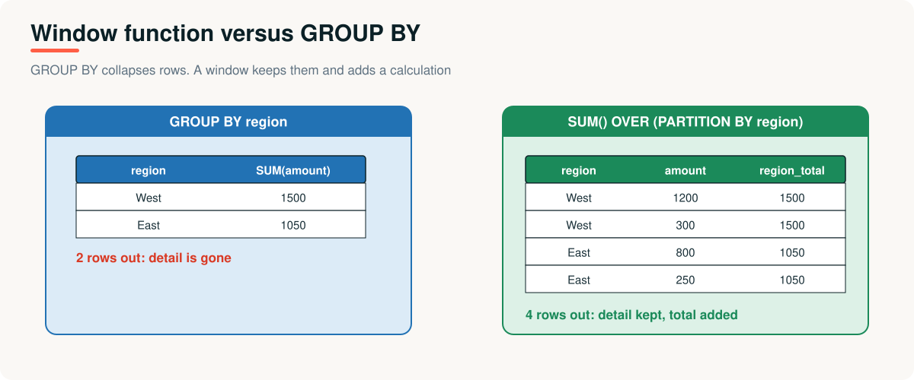

# 06 · Window Functions

> **Module 02 · Topic 06 of 10** &nbsp;|&nbsp; Reading time: ~55 min &nbsp;|&nbsp; Level: Intermediate

[Module home](README.md) &nbsp;·&nbsp; [← Previous: Subqueries, CTEs and Set Operations](05-subqueries-ctes-and-set-operations.md) &nbsp;·&nbsp; [Next: Cleaning and Validating Data →](07-cleaning-and-validating-data.md)



## What you will learn

- What a **window function** is, and how it differs from `GROUP BY`
- `PARTITION BY`, `ORDER BY` and the **frame**: the three parts of `OVER (...)`
- Ranking: `ROW_NUMBER`, `RANK`, `DENSE_RANK`, and the **top-N per group** pattern
- Comparing rows: `LAG` and `LEAD` for period-over-period change
- Running totals, moving averages, shares of a total and quartiles
- How windows run internally, and why they can be costly on a cluster

---

## 1. The business problem

The head of sales liked the regional answer and now asks follow-ups. Each one needs a detail row **and** a calculation across other rows.

| Follow-up question | Attempt with `GROUP BY` | What goes wrong |
|---|---|---|
| "Top 2 products in each category" | `GROUP BY category ... LIMIT 2` | `LIMIT` applies to the whole result, giving 2 rows in total, not 2 per category |
| "How did each month compare with the one before?" | Self-join each month to the previous one | Long, fragile, and breaks on gaps |
| "What share of revenue does each region hold?" | Group by region, then divide by a second query's total | Two queries to keep in step |
| "Each customer's latest order, with its details" | `MAX(order_date)`, then join back on the date | Returns two rows when a customer ordered twice that day |

`GROUP BY` **collapses** rows, so the detail is gone by the time you want it. A window function calculates across related rows while **keeping every row**.

---

## 2. What a window function is

```sql
function(...) OVER (
    PARTITION BY ...     -- split rows into groups (optional)
    ORDER BY ...         -- order rows inside each group (optional)
    frame                -- which neighbouring rows to include (optional)
)
```

| Part | Job | Compare with |
|---|---|---|
| `PARTITION BY` | Divides the rows into independent groups. The calculation restarts for each group | `GROUP BY`, without collapsing |
| `ORDER BY` | Orders the rows within each partition. Needed for ranking, `LAG` and running totals | `ORDER BY`, but only inside the partition |
| **Frame** | The rows around the current row that the function looks at | A sliding window over the ordered rows |

The result has **the same number of rows as the input**, plus a new column.

| | `GROUP BY` | Window function |
|---|---|---|
| **Output rows** | One per group | One per input row |
| **Detail columns** | Lost, unless grouped | Kept |
| **Typical use** | Totals, counts | Ranks, running totals, comparisons, shares |

---

## 3. Ranking: ROW_NUMBER, RANK and DENSE_RANK

| Function | Ties get | Sequence |
|---|---|---|
| `ROW_NUMBER()` | Different numbers (arbitrary order unless you break the tie) | 1, 2, 3, 4, 5 |
| `RANK()` | The same rank, then **a gap** | 1, 2, 2, 4, 5 |
| `DENSE_RANK()` | The same rank, **no gap** | 1, 2, 2, 3, 4 |

Customers tied on their number of completed orders show the difference:

```sql
-- Customers ranked by completed orders, three ways
WITH n AS (
    SELECT customer_id, COUNT(*) AS orders
    FROM orders
    WHERE status = 'completed'
    GROUP BY customer_id
)
SELECT customer_id,
       orders,
       ROW_NUMBER() OVER (ORDER BY orders DESC, customer_id) AS row_num,
       RANK()       OVER (ORDER BY orders DESC)              AS rnk,
       DENSE_RANK() OVER (ORDER BY orders DESC)              AS dense_rnk
FROM n
ORDER BY orders DESC, customer_id
LIMIT 8;
```

```text
customer_id  orders  row_num  rnk  dense_rnk
-----------  ------  -------  ---  ---------
         58      39        1    1          1
         37      30        2    2          2
          8      29        3    3          3
         30      28        4    4          4
         47      28        5    4          4
         34      22        6    6          5
         49      22        7    6          5
         53      22        8    6          5
```

Customers 30 and 47 tie on 28 orders, and so do 34, 49 and 53 on 22. `RANK` gives the tie the same number and skips the next (4, 4, then 6). `DENSE_RANK` does not skip (4, 4, then 5). `ROW_NUMBER` always counts up, so add a tie-breaker (here `customer_id`) or the order of tied rows is not guaranteed.

### Top-N per group

Rank inside each partition, then keep the rows with a small rank. The window result cannot be filtered in the same query's `WHERE`, because windows are computed **after** `WHERE` in the [logical order](02-querying-fundamentals.md#7-the-logical-order-of-execution). Wrap the ranking in a subquery or CTE and filter outside.

```sql
-- The 2 best-selling products in each category
WITH product_revenue AS (
    SELECT p.category, p.name,
           ROUND(SUM(oi.quantity * oi.unit_price), 2) AS revenue
    FROM order_items AS oi
    JOIN products AS p ON p.product_id = oi.product_id
    JOIN orders AS o   ON o.order_id   = oi.order_id
    WHERE o.status = 'completed'
    GROUP BY p.product_id, p.category, p.name
)
SELECT category, name, revenue, rn
FROM (SELECT category, name, revenue,
             ROW_NUMBER() OVER (PARTITION BY category ORDER BY revenue DESC) AS rn
      FROM product_revenue) AS ranked
WHERE rn <= 2
ORDER BY category, rn;
```

```text
category     name               revenue   rn
-----------  -----------------  --------  --
Electronics  Smart Watch        809865.0   1
Electronics  Bluetooth Speaker  517943.0   2
Fashion      Running Shoes      546193.9   1
Fashion      Denim Jacket       456796.8   2
Grocery      Olive Oil 1L       177103.0   1
Grocery      Basmati Rice 5kg   167027.0   2
Home         Air Fryer          697345.0   1
Home         Cotton Bedsheet    259800.0   2
```

Each category restarts at 1. Some engines (Snowflake, BigQuery, Databricks SQL) offer a `QUALIFY` clause that filters on a window result directly. SQLite and PostgreSQL do not, so the wrap-and-filter form is the portable one.

### Latest row per key

`ROW_NUMBER() ... ORDER BY date DESC` then `rn = 1` gives the most recent row for each key, with all its columns. This is the standard way to **deduplicate**, and Topic 07 uses it on the messy feed.

```sql
-- Each customer's latest order, with a tie-breaker so there is exactly one
WITH ranked AS (
    SELECT customer_id, order_id, order_date,
           ROW_NUMBER() OVER (PARTITION BY customer_id
                              ORDER BY order_date DESC, order_id DESC) AS rn
    FROM orders
)
SELECT customer_id, order_id, order_date
FROM ranked
WHERE rn = 1
ORDER BY customer_id
LIMIT 5;
```

```text
customer_id  order_id  order_date
-----------  --------  ----------
          1       891  2025-12-28
          2       740  2025-11-29
          3       834  2025-12-17
          4       866  2025-12-23
          5       880  2025-12-26
```

---

## 4. Comparing rows: LAG and LEAD

`LAG(x, n)` reads `x` from `n` rows **before** the current row in the partition's order. `LEAD(x, n)` reads from `n` rows **after**. Both return NULL when there is no such row, unless you give a third argument as the default.

```sql
-- Month-over-month revenue change
WITH monthly AS (
    SELECT strftime('%Y-%m', o.order_date) AS month,
           ROUND(SUM(oi.quantity * oi.unit_price), 2) AS revenue
    FROM orders AS o
    JOIN order_items AS oi ON oi.order_id = o.order_id
    WHERE o.status = 'completed'
    GROUP BY strftime('%Y-%m', o.order_date)
)
SELECT month,
       revenue,
       LAG(revenue) OVER (ORDER BY month) AS prev_month,
       ROUND(100.0 * (revenue - LAG(revenue) OVER (ORDER BY month))
                   / LAG(revenue) OVER (ORDER BY month), 1) AS mom_pct
FROM monthly
ORDER BY month;
```

```text
month    revenue    prev_month  mom_pct
-------  ---------  ----------  -------
2025-07   754737.0        NULL     NULL
2025-08   699113.0    754737.0     -7.4
2025-09   693817.0    699113.0     -0.8
2025-10   997389.0    693817.0     43.8
2025-11  1222996.5    997389.0     22.6
2025-12   836393.0   1222996.5    -31.6
```

The first month has no predecessor, so its `prev_month` and growth are NULL. November was the festive peak, and December falls back from it.

> [!WARNING]
> `LAG` looks at the previous **row**, not the previous **month**. If a month has no data and therefore no row, `LAG` silently compares with the month before it. Fill the gaps first with a calendar ([Topic 05](05-subqueries-ctes-and-set-operations.md#4-recursive-ctes)).

---

## 5. Running totals, moving averages and the frame

Add `ORDER BY` to an aggregate and it becomes a **running** aggregate. A **frame** says exactly which rows are included:

| Frame | Meaning |
|---|---|
| `ROWS BETWEEN UNBOUNDED PRECEDING AND CURRENT ROW` | From the first row of the partition to this one (running total) |
| `ROWS BETWEEN 2 PRECEDING AND CURRENT ROW` | This row and the two before (a 3-row moving window) |
| `ROWS BETWEEN UNBOUNDED PRECEDING AND UNBOUNDED FOLLOWING` | The whole partition |

```sql
-- Daily orders with a running total and a 3-day moving average
WITH daily AS (
    SELECT order_date, COUNT(*) AS orders
    FROM orders
    WHERE order_date >= '2025-12-24'
    GROUP BY order_date
)
SELECT order_date,
       orders,
       SUM(orders) OVER (ORDER BY order_date) AS running_orders,
       ROUND(AVG(orders) OVER (ORDER BY order_date
                               ROWS BETWEEN 2 PRECEDING AND CURRENT ROW), 2) AS moving_avg_3d
FROM daily
ORDER BY order_date;
```

```text
order_date  orders  running_orders  moving_avg_3d
----------  ------  --------------  -------------
2025-12-24       5               5            5.0
2025-12-25       6              11            5.5
2025-12-26       6              17           5.67
2025-12-27       5              22           5.67
2025-12-28       6              28           5.67
2025-12-29       6              34           5.67
2025-12-30       7              41           6.33
2025-12-31       7              48           6.67
```

The first two moving averages use fewer than three days, because there are not enough preceding rows yet. A moving average smooths daily noise, which is why dashboards use it for trends.

### The default frame trap

When a window has `ORDER BY` but **no frame**, the default is `RANGE BETWEEN UNBOUNDED PRECEDING AND CURRENT ROW`: from the start up to the current row, **including rows tied with it**. That is exactly right for a running total, and exactly wrong for `LAST_VALUE`:

```sql
-- LAST_VALUE with the default frame returns the current row. It needs the full frame
WITH d AS (
    SELECT order_date, COUNT(*) AS orders
    FROM orders
    WHERE order_date BETWEEN '2025-12-27' AND '2025-12-31'
    GROUP BY order_date
)
SELECT order_date,
       orders,
       LAST_VALUE(orders) OVER (ORDER BY order_date) AS last_default_frame,
       LAST_VALUE(orders) OVER (ORDER BY order_date
                                ROWS BETWEEN UNBOUNDED PRECEDING AND UNBOUNDED FOLLOWING) AS last_full_frame
FROM d
ORDER BY order_date;
```

```text
order_date  orders  last_default_frame  last_full_frame
----------  ------  ------------------  ---------------
2025-12-27       5                   5                7
2025-12-28       6                   6                7
2025-12-29       6                   6                7
2025-12-30       7                   7                7
2025-12-31       7                   7                7
```

With the default frame, the "last" row is the current row, so the first column just repeats `orders`. State the frame explicitly whenever it matters.

> [!NOTE]
> `ROWS` counts physical rows. `RANGE` groups rows whose `ORDER BY` value is equal ("peers"). With ties, a `RANGE` running total jumps by the whole tied group at once, while `ROWS` adds one row at a time.

---

## 6. Share of a total and quartiles

An aggregate with an **empty** `OVER ()` is calculated over all rows, so each row can carry the grand total next to its own value. That replaces the "two queries" workaround from the business problem.

```sql
-- Each region's share of total revenue, and its rank
WITH region_revenue AS (
    SELECT c.region,
           ROUND(SUM(oi.quantity * oi.unit_price), 2) AS revenue
    FROM orders AS o
    JOIN customers AS c    ON c.customer_id = o.customer_id
    JOIN order_items AS oi ON oi.order_id   = o.order_id
    WHERE o.status = 'completed'
    GROUP BY c.region
)
SELECT region,
       revenue,
       ROUND(100.0 * revenue / SUM(revenue) OVER (), 1) AS share_pct,
       RANK() OVER (ORDER BY revenue DESC)              AS rnk
FROM region_revenue
ORDER BY rnk;
```

```text
region  revenue    share_pct  rnk
------  ---------  ---------  ---
South   1682979.6       32.3    1
West    1566381.8       30.1    2
East    1179726.9       22.7    3
North    775357.2       14.9    4
```

`NTILE(n)` splits ordered rows into `n` buckets of near-equal size. It is how customers are segmented into spend quartiles:

```sql
-- Customers split into four spend quartiles (the size is 54 / 4, so two have 14 and two have 13)
WITH spend AS (
    SELECT o.customer_id,
           ROUND(SUM(oi.quantity * oi.unit_price), 2) AS total_spend
    FROM orders AS o
    JOIN order_items AS oi ON oi.order_id = o.order_id
    WHERE o.status = 'completed'
    GROUP BY o.customer_id
)
SELECT quartile,
       COUNT(*)         AS customers,
       MIN(total_spend) AS min_spend,
       MAX(total_spend) AS max_spend
FROM (SELECT customer_id, total_spend,
             NTILE(4) OVER (ORDER BY total_spend) AS quartile
      FROM spend) AS bucketed
GROUP BY quartile
ORDER BY quartile;
```

```text
quartile  customers  min_spend  max_spend
--------  ---------  ---------  ---------
       1         14    33038.1    64678.3
       2         14    65921.0    89894.7
       3         13    89933.4   116531.5
       4         13   118027.1   262344.6
```

---

## 7. How the engine computes a window

A window function is evaluated **after** `WHERE`, `GROUP BY` and `HAVING`, in the `SELECT` step of the logical order. That is why it cannot appear in `WHERE`, `GROUP BY` or `HAVING`.

Physically, the engine does three things:

1. **Partition:** bring all rows with the same `PARTITION BY` values together.
2. **Sort** the rows inside each partition by the window's `ORDER BY`.
3. **Stream** through each partition, keeping a small running state for the frame (a sum, a counter, the previous value) and emitting one value per row.

```sql
-- SQLite sorts the rows (the window's PARTITION BY and ORDER BY), then streams through them
EXPLAIN QUERY PLAN
SELECT customer_id, order_id,
       ROW_NUMBER() OVER (PARTITION BY customer_id ORDER BY order_date DESC) AS rn
FROM orders;
```

```text
QUERY PLAN
|--CO-ROUTINE (subquery-2)
|  |--SCAN orders
|  `--USE TEMP B-TREE FOR ORDER BY
`--SCAN (subquery-2)
```

On a cluster the first step is a **shuffle**. Spark plans it (plan shortened) as an `Exchange hashpartitioning(customer_id)`, then a `Sort`, then a `Window` operator:

```text
Window [row_number() OVER (PARTITION BY customer_id ORDER BY order_date DESC) AS rn]
+- Sort [customer_id ASC, order_date DESC]
   +- Exchange hashpartitioning(customer_id, 200)        <- all rows of one customer go to one task
      +- Scan orders
```

Two consequences matter for data engineers:

- **A partition must fit on one task.** A hot key, such as one very large customer, produces one slow, memory-hungry task.
- **A window with no `PARTITION BY` has a single partition.** Spark moves *all* the data to one task and logs a warning about it. Use `OVER ()` and `OVER (ORDER BY ...)` only on small or already-aggregated data, as the examples above do.

---

## 8. Common mistakes

| Mistake | Effect | Fix |
|---|---|---|
| Filtering on a window result in `WHERE` | Error | Wrap in a CTE or subquery, or use `QUALIFY` where available |
| `ROW_NUMBER` with ties and no tie-breaker | Different rows chosen on different runs | Add a unique column to `ORDER BY` |
| `LAST_VALUE` with the default frame | Returns the current row | Write the frame explicitly |
| `LAG` over a series with missing periods | Compares with the wrong period | Fill gaps with a calendar first |
| Unpartitioned window on a huge table | One overloaded task | Partition by a sensible key, or aggregate first |
| Using `RANK` when exactly one row per group is required | Ties give several rows | Use `ROW_NUMBER` with a tie-breaker |
| Mixing up `ROWS` and `RANGE` | Different totals when ties exist | Pick deliberately |

## 9. Real-world applications

- **Deduplication and latest-state tables:** `ROW_NUMBER` with `rn = 1` ([Topic 07](07-cleaning-and-validating-data.md)).
- **Period-over-period reporting:** growth rates with `LAG`, which finance and sales teams ask for weekly.
- **Sessionisation:** `LAG` on event time to detect a gap of 30 minutes and start a new session.
- **Customer segmentation:** `NTILE` for spend quartiles, `RANK` for leaderboards.
- **Running balances and cumulative metrics:** an account balance, year-to-date revenue.

---

## Key takeaways

1. A window function calculates across related rows and **keeps every row**. `GROUP BY` collapses them.
2. `OVER (PARTITION BY ... ORDER BY ... frame)`: partition restarts the calculation, order sets the sequence, frame picks the neighbours.
3. `ROW_NUMBER` is unique, `RANK` leaves gaps after ties, `DENSE_RANK` does not.
4. **Top-N per group** and **latest row per key** are `ROW_NUMBER` plus a filter in an outer query.
5. `LAG` and `LEAD` compare with neighbouring **rows**, so fill missing periods first.
6. Know the **default frame**, and state it for `LAST_VALUE` and other frame-sensitive functions.
7. On a cluster, windows need a shuffle and sort. Always partition, and watch for hot keys.

## Interview questions

<details><summary><b>1.</b> What is the difference between <code>GROUP BY</code> and a window function?</summary>

`GROUP BY` collapses rows into one per group, so detail columns are lost. A window function calculates across a set of related rows but returns a value for every input row, so you can keep detail and show an aggregate or rank beside it.
</details>

<details><summary><b>2.</b> Explain <code>ROW_NUMBER</code>, <code>RANK</code> and <code>DENSE_RANK</code>.</summary>

All number rows in order. `ROW_NUMBER` gives unique numbers, so tied rows are ordered arbitrarily. `RANK` gives tied rows the same number and skips the following numbers. `DENSE_RANK` gives tied rows the same number without gaps.
</details>

<details><summary><b>3.</b> How do you get the top 3 products in each category?</summary>

Use `ROW_NUMBER()` (or `RANK`/`DENSE_RANK`, depending on how ties should behave) with `PARTITION BY category ORDER BY revenue DESC` in a CTE or subquery, then filter `rn <= 3` in the outer query.
</details>

<details><summary><b>4.</b> How would you keep only the most recent record per customer?</summary>

`ROW_NUMBER() OVER (PARTITION BY customer_id ORDER BY updated_at DESC, <unique tie-breaker>)`, then keep `rn = 1`. This returns whole rows, which `MAX` with a join cannot do safely.
</details>

<details><summary><b>5.</b> What is the default window frame, and when does it surprise people?</summary>

With an `ORDER BY` and no frame, it is `RANGE BETWEEN UNBOUNDED PRECEDING AND CURRENT ROW`. It suits running totals, but `LAST_VALUE` then returns the current row (or its peers) instead of the last row of the partition, so you must give `ROWS BETWEEN UNBOUNDED PRECEDING AND UNBOUNDED FOLLOWING`.
</details>

<details><summary><b>6.</b> What is the difference between <code>ROWS</code> and <code>RANGE</code> frames?</summary>

`ROWS` counts a fixed number of physical rows around the current one. `RANGE` includes all rows whose ordering value is within a range of the current row's value, so tied rows ("peers") are included together.
</details>

<details><summary><b>7.</b> Why can't you use a window function in <code>WHERE</code>?</summary>

`WHERE` runs before the window is computed in the logical order: filter, group, then `SELECT`, where windows are evaluated. To filter on a window result, compute it in a subquery or CTE and filter outside, or use `QUALIFY` on engines that have it.
</details>

<details><summary><b>8.</b> What makes window functions expensive in Spark?</summary>

They require rows of each partition to be shuffled to one place and sorted. A skewed partition key creates one huge task, and a window with no `PARTITION BY` moves all data into a single partition.
</details>

## Official documentation

- [SQLite: window functions](https://www.sqlite.org/windowfunctions.html)
- [Spark SQL: window functions](https://spark.apache.org/docs/latest/sql-ref-syntax-qry-select-window.html) · [Window function reference](https://spark.apache.org/docs/latest/sql-ref-functions-builtin.html#window-functions)

---

| Previous | Contents | Next |
|:---|:---:|:---|
| [← Subqueries, CTEs and Set Operations](05-subqueries-ctes-and-set-operations.md) | [Module home](README.md#topics-covered) | [Cleaning and Validating Data →](07-cleaning-and-validating-data.md) |
