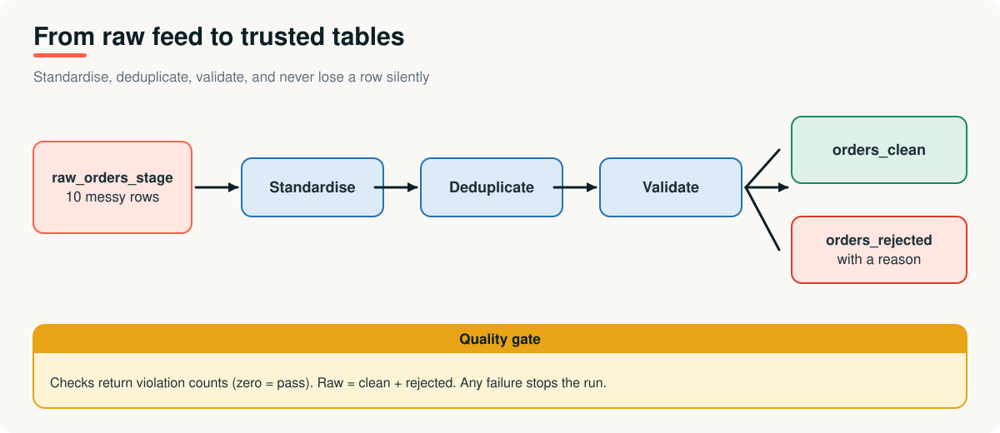

# 07 · Cleaning and Validating Data

> **Module 02 · Topic 07 of 10** &nbsp;|&nbsp; Reading time: ~50 min &nbsp;|&nbsp; Level: Intermediate

[Module home](README.md) &nbsp;·&nbsp; [← Previous: Window Functions](06-window-functions.md) &nbsp;·&nbsp; [Next: Modelling and Loading with SQL →](08-modelling-and-loading-with-sql.md)



## What you will learn

- The problems every real feed has, and why they cause **silent** errors
- SQL tools for cleaning: `TRIM`, `CASE`, `COALESCE`, `NULLIF`, `CAST`, string and date handling
- **Deduplication** with `ROW_NUMBER`
- The **reject pattern**: clean rows go forward, bad rows are kept with a reason
- **Data quality checks written as SQL**, and how to use them as a gate
- Why cleaning must be a repeatable, set-based step and never a manual edit

---

## 1. The business problem

XYZ's order system now sends Asha a daily file. It is loaded as-is into a table called `raw_orders_stage`, where **every column is text**. This is the **bronze** layer from [Module 01, Topic 09](../01_Foundations_of_Big_Data_and_Data_Engineering/09-modern-data-platforms-and-databricks.md): the data exactly as received. Asha has to produce a trustworthy silver layer from it.

```sql
-- The raw feed, exactly as it arrived
SELECT order_ref, customer, region, order_ts, amount, status, loaded_at
FROM raw_orders_stage
ORDER BY order_ref, loaded_at;
```

```text
order_ref  customer     region  order_ts             amount    status     loaded_at
---------  -----------  ------  -------------------  --------  ---------  -------------------
A-1001     Asha Rao     south   2025-12-01 10:15:00  1,299.50  COMPLETE   2025-12-02 01:00:00
A-1002       Ravi Shah  NORTH   2025-12-01 11:40:00  499.00    completed  2025-12-02 01:00:00
A-1002     Ravi Shah    North   2025-12-01 11:40:00  549.00    Completed  2025-12-03 01:00:00
A-1003     Meera Iyer    East   2025-12-02 09:05:00            completed  2025-12-03 01:00:00
A-1004     Kiran Das            02/12/2025           250.00    cancelled  2025-12-03 01:00:00
A-1005     Diya Nair    west    2025-12-03 18:22:00  2,150.75  COMPLETE   2025-12-04 01:00:00
A-1005     Diya Nair    west    2025-12-03 18:22:00  2,150.75  COMPLETE   2025-12-05 01:00:00
A-1006     Imran Khan   North   2025-12-03 19:00:00  -120.00   completed  2025-12-04 01:00:00
A-1007     Sneha Patil  WEST    2025-12-04 08:30:00  899.00    shipped    2025-12-05 01:00:00
A-1008     Tarun Menon  South   2025-12-05 12:00:00  abc       completed  2025-12-06 01:00:00
```

Look at it carefully. Each row has at least one of these problems:

| Problem | Where it shows | Effect if ignored |
|---|---|---|
| **Duplicates** | `A-1005` arrives twice. `A-1002` arrives twice with different amounts (a later correction) | Orders and revenue are double counted |
| **Inconsistent case and spaces** | `south`, `NORTH`, ` East `, `  Ravi Shah` | One region appears as several groups |
| **One value, several spellings** | `COMPLETE`, `completed`, `Completed` | Filters on `status = 'completed'` miss rows |
| **Formatting inside numbers** | `1,299.50`, `2,150.75` | Conversion stops at the comma |
| **Missing or invalid values** | `''`, `abc`, `-120.00`, an empty region | Wrong totals, or no error at all |
| **Mixed date formats** | `2025-12-01 10:15:00` and `02/12/2025` | Sorting and filtering by date break |

The most dangerous one is the quiet conversion. SQLite's `CAST` does not fail on bad text. It converts what it can and gives 0 for the rest:

```sql
-- The naive conversion: no error, wrong numbers
SELECT order_ref, amount, CAST(amount AS REAL) AS naive_cast
FROM raw_orders_stage
ORDER BY order_ref, loaded_at;
```

```text
order_ref  amount    naive_cast
---------  --------  ----------
A-1001     1,299.50         1.0
A-1002     499.00         499.0
A-1002     549.00         549.0
A-1003                      0.0
A-1004     250.00         250.0
A-1005     2,150.75         2.0
A-1005     2,150.75         2.0
A-1006     -120.00       -120.0
A-1007     899.00         899.0
A-1008     abc              0.0
```

`1,299.50` became **1.0**, `2,150.75` became **2.0**, and the missing and `abc` amounts became **0.0**. A report built on this would be wrong by thousands with no warning. Many warehouses raise an error on a bad cast instead, which is better, but you must still decide what happens to the bad rows.

---

## 2. Principles of cleaning

| Principle | Meaning |
|---|---|
| **Keep the raw data** | Never edit or delete bronze. If a rule changes, rebuild silver from it |
| **Clean with queries, not by hand** | A manual fix is lost on the next load and cannot be reviewed |
| **Separate the steps** | Standardise, deduplicate, validate, each as a visible step |
| **Reject, do not hide** | Rows that fail go to a **rejects** table *with a reason*. They are not silently dropped |
| **Same input, same output** | Cleaning is **idempotent**: running it twice gives the same result |
| **Rules are business decisions** | "Negative amounts are invalid" may be wrong if refunds are allowed. Agree rules with the data owner and document them |

A **view** is a saved query. Defining each cleaning step as a view (or CTE) keeps the logic in one reviewable place.

---

## 3. Standardise

First, make every field consistent. The functions you need:

| Function | Use | Example |
|---|---|---|
| `TRIM(x)` | Remove leading and trailing spaces | `TRIM('  Ravi Shah')` |
| `LOWER(x)`, `UPPER(x)` | Normalise case | `LOWER(status)` |
| `REPLACE(x, a, b)` | Remove or swap characters | `REPLACE('1,299.50', ',', '')` |
| `SUBSTR(x, start, len)` | Cut part of a string | `SUBSTR(order_ts, 7, 4)` |
| `\|\|` | Concatenate (`concat()` in Spark SQL) | `a \|\| '-' \|\| b` |
| `NULLIF(x, y)` | NULL if `x` equals `y`, otherwise `x` | `NULLIF(amount, '')` turns `''` into NULL |
| `COALESCE(x, y, ...)` | First non-NULL | `COALESCE(region, 'Unknown')` |
| `CASE WHEN ... THEN ... END` | Map values | `complete` to `completed` |
| `CAST(x AS type)` | Convert type | `CAST(x AS REAL)` |

```sql
-- Step 1: standardise text, status, dates and amounts into a view
CREATE VIEW stage_standardised AS
SELECT order_ref,
       TRIM(customer) AS customer,
       -- blank region becomes NULL; otherwise capitalise the first letter only
       CASE WHEN TRIM(region) = '' THEN NULL
            ELSE UPPER(SUBSTR(TRIM(region), 1, 1)) || LOWER(SUBSTR(TRIM(region), 2)) END AS region,
       -- two date formats, both converted to ISO yyyy-mm-dd (assumes dd/mm/yyyy for the slashed form)
       CASE WHEN order_ts GLOB '[0-9][0-9][0-9][0-9]-[0-9][0-9]-[0-9][0-9]*' THEN date(order_ts)
            WHEN order_ts GLOB '[0-9][0-9]/[0-9][0-9]/[0-9][0-9][0-9][0-9]'
                 THEN SUBSTR(order_ts, 7, 4) || '-' || SUBSTR(order_ts, 4, 2) || '-' || SUBSTR(order_ts, 1, 2)
       END AS order_date,
       -- remove thousands separators; empty text becomes NULL
       NULLIF(REPLACE(TRIM(amount), ',', ''), '') AS amount_text,
       CASE LOWER(TRIM(status)) WHEN 'complete' THEN 'completed' ELSE LOWER(TRIM(status)) END AS status,
       loaded_at
FROM raw_orders_stage;

SELECT * FROM stage_standardised ORDER BY order_ref, loaded_at;
```

```text
order_ref  customer     region  order_date  amount_text  status     loaded_at
---------  -----------  ------  ----------  -----------  ---------  -------------------
A-1001     Asha Rao     South   2025-12-01  1299.50      completed  2025-12-02 01:00:00
A-1002     Ravi Shah    North   2025-12-01  499.00       completed  2025-12-02 01:00:00
A-1002     Ravi Shah    North   2025-12-01  549.00       completed  2025-12-03 01:00:00
A-1003     Meera Iyer   East    2025-12-02  NULL         completed  2025-12-03 01:00:00
A-1004     Kiran Das    NULL    2025-12-02  250.00       cancelled  2025-12-03 01:00:00
A-1005     Diya Nair    West    2025-12-03  2150.75      completed  2025-12-04 01:00:00
A-1005     Diya Nair    West    2025-12-03  2150.75      completed  2025-12-05 01:00:00
A-1006     Imran Khan   North   2025-12-03  -120.00      completed  2025-12-04 01:00:00
A-1007     Sneha Patil  West    2025-12-04  899.00       shipped    2025-12-05 01:00:00
A-1008     Tarun Menon  South   2025-12-05  abc          completed  2025-12-06 01:00:00
```

The regions are now `South`, `North`, `East`, `West`, the three status spellings are one, and both date formats are ISO dates.

> [!WARNING]
> **Dates like `02/12/2025` are ambiguous.** It means 2 December in a day-first system and 12 February in a month-first one. The query above assumes day-first because the rest of the feed suggests it. In a real pipeline, **confirm the format with the source's owner**. Never guess silently, because a wrong guess gives valid-looking, wrong dates.

> [!NOTE]
> The text functions are the same ideas everywhere, but names differ. SQLite has no `INITCAP`, so we built it from `UPPER(SUBSTR(...))`. Spark SQL and PostgreSQL have `initcap()`. Spark SQL's `try_cast(x AS DECIMAL(12,2))` returns NULL for bad text instead of failing or returning 0, which is the safest way to convert. Here the `GLOB` pattern plays that role (SQLite pattern matching uses `GLOB` and `LIKE`, not regular expressions).

---

## 4. Deduplicate

The same order can arrive more than once: a re-delivered file, or a correction. Keep **one row per order**, the most recently loaded. This is the `ROW_NUMBER` pattern from [Topic 06](06-window-functions.md):

```sql
-- Step 2 and 3: keep the latest delivery of each order, then validate it
CREATE VIEW stage_checked AS
WITH latest AS (
    SELECT *,
           ROW_NUMBER() OVER (PARTITION BY order_ref ORDER BY loaded_at DESC) AS rn
    FROM stage_standardised
)
SELECT order_ref, customer, region, order_date, status,
       -- convert only text that is a plain number; everything else stays NULL
       CASE WHEN amount_text NOT GLOB '*[^0-9.-]*' THEN CAST(amount_text AS REAL) END AS amount,
       -- the first rule that fails names the reason; NULL means the row is good
       CASE WHEN amount_text IS NULL              THEN 'amount missing'
            WHEN amount_text GLOB '*[^0-9.-]*'    THEN 'amount not a number'
            WHEN CAST(amount_text AS REAL) < 0    THEN 'amount negative'
            WHEN region IS NULL                   THEN 'region missing'
            WHEN order_date IS NULL               THEN 'order date unreadable'
       END AS reject_reason
FROM latest
WHERE rn = 1;

SELECT * FROM stage_checked ORDER BY order_ref;
```

```text
order_ref  customer     region  order_date  status     amount   reject_reason
---------  -----------  ------  ----------  ---------  -------  -------------------
A-1001     Asha Rao     South   2025-12-01  completed   1299.5  NULL
A-1002     Ravi Shah    North   2025-12-01  completed    549.0  NULL
A-1003     Meera Iyer   East    2025-12-02  completed     NULL  amount missing
A-1004     Kiran Das    NULL    2025-12-02  cancelled    250.0  region missing
A-1005     Diya Nair    West    2025-12-03  completed  2150.75  NULL
A-1006     Imran Khan   North   2025-12-03  completed   -120.0  amount negative
A-1007     Sneha Patil  West    2025-12-04  shipped      899.0  NULL
A-1008     Tarun Menon  South   2025-12-05  completed     NULL  amount not a number
```

Ten raw rows became eight orders. `A-1002` keeps its corrected amount (549.00) and `A-1005` appears once. Every row now carries either a good amount or a `reject_reason`.

> [!IMPORTANT]
> Deduplicate **before** you validate or aggregate, and decide the rule deliberately: "latest `loaded_at` wins" suits corrections, but other feeds need "first wins" or a version number from the source.

---

## 5. Split: clean rows and rejects

Rows with no `reject_reason` go forward. The others go to a **rejects table**, with the reason, for someone to investigate or reprocess.

```sql
CREATE TABLE clean_orders AS
SELECT order_ref, customer, region, order_date, status, amount
FROM stage_checked
WHERE reject_reason IS NULL;

CREATE TABLE rejected_orders AS
SELECT order_ref, customer, reject_reason
FROM stage_checked
WHERE reject_reason IS NOT NULL;

SELECT * FROM clean_orders ORDER BY order_ref;
```

```text
order_ref  customer     region  order_date  status     amount
---------  -----------  ------  ----------  ---------  -------
A-1001     Asha Rao     South   2025-12-01  completed   1299.5
A-1002     Ravi Shah    North   2025-12-01  completed    549.0
A-1005     Diya Nair    West    2025-12-03  completed  2150.75
A-1007     Sneha Patil  West    2025-12-04  shipped      899.0
```

```sql
SELECT * FROM rejected_orders ORDER BY order_ref;
```

```text
order_ref  customer     reject_reason
---------  -----------  -------------------
A-1003     Meera Iyer   amount missing
A-1004     Kiran Das    region missing
A-1006     Imran Khan   amount negative
A-1008     Tarun Menon  amount not a number
```

Four orders are clean and four are rejected. Nothing vanished: **every raw order is in one table or the other**, which we will check in a moment. Whether `A-1004`, a cancelled order with no region, should really be rejected is a business decision. The point is that the decision is **visible**, and a data owner can review the rejects and change the rule.

---

## 6. Data quality checks written as SQL

A **data quality check** is a query that finds rows that break a rule. The convention is: **the check returns the violating rows (or a count), and zero means pass.** The common types:

| Dimension | Question | Typical SQL |
|---|---|---|
| **Completeness** | Are required values present? | `WHERE col IS NULL` |
| **Uniqueness** | Is the key unique? | `GROUP BY key HAVING COUNT(*) > 1` |
| **Validity** | Are values in the allowed set or range? | `WHERE status NOT IN (...)`, `WHERE amount <= 0` |
| **Referential integrity** | Does every foreign key have a parent? | Anti-join (`LEFT JOIN ... IS NULL`) |
| **Consistency and reconciliation** | Do two sources agree? Was any row lost? | Compare counts or sums |
| **Freshness and volume** | Did today's data arrive, and is the size normal? | `MAX(loaded_at)`, compare today's `COUNT(*)` with recent days |

Stack the checks into **one report**, so a pipeline can read it and decide whether to publish. Here it runs on the clean output:

```sql
-- Every check must return 0 before clean_orders is published
SELECT 'duplicate order_ref' AS check_name, COUNT(*) AS failed_rows
FROM (SELECT order_ref FROM clean_orders GROUP BY order_ref HAVING COUNT(*) > 1)
UNION ALL
SELECT 'region missing', COUNT(*) FROM clean_orders WHERE region IS NULL OR TRIM(region) = ''
UNION ALL
SELECT 'amount not positive', COUNT(*) FROM clean_orders WHERE amount IS NULL OR amount <= 0
UNION ALL
SELECT 'status outside allowed set', COUNT(*) FROM clean_orders
WHERE status NOT IN ('completed', 'cancelled', 'shipped', 'pending')
UNION ALL
SELECT 'order_date outside feed window', COUNT(*) FROM clean_orders
WHERE order_date NOT BETWEEN '2025-12-01' AND '2025-12-31'
UNION ALL
SELECT 'rows lost (raw orders minus clean and rejected)',
       (SELECT COUNT(DISTINCT order_ref) FROM raw_orders_stage)
       - ((SELECT COUNT(*) FROM clean_orders) + (SELECT COUNT(*) FROM rejected_orders));
```

```text
check_name                                       failed_rows
-----------------------------------------------  -----------
duplicate order_ref                                        0
region missing                                             0
amount not positive                                        0
status outside allowed set                                 0
order_date outside feed window                             0
rows lost (raw orders minus clean and rejected)            0
```

The last check is a **reconciliation**: every distinct raw order must appear exactly once in the clean or the rejected table. If it ever returns anything but zero, rows are being lost.

**Referential integrity** is the same idea applied to the XYZ tables. The database declares foreign keys, but SQLite does **not enforce them unless you run `PRAGMA foreign_keys = ON`**, and warehouses often do not enforce them at all. So check them yourself with anti-joins:

```sql
SELECT 'orders without a customer' AS check_name, COUNT(*) AS failed_rows
FROM orders AS o
LEFT JOIN customers AS c ON c.customer_id = o.customer_id
WHERE c.customer_id IS NULL
UNION ALL
SELECT 'order lines without a product', COUNT(*)
FROM order_items AS oi
LEFT JOIN products AS p ON p.product_id = oi.product_id
WHERE p.product_id IS NULL
UNION ALL
SELECT 'returns without an order line', COUNT(*)
FROM returns AS r
LEFT JOIN order_items AS oi ON oi.order_id = r.order_id AND oi.line_no = r.line_no
WHERE oi.order_id IS NULL
UNION ALL
SELECT 'order lines with quantity <= 0', COUNT(*) FROM order_items WHERE quantity <= 0
UNION ALL
SELECT 'orders with no lines', COUNT(*)
FROM orders AS o
WHERE NOT EXISTS (SELECT 1 FROM order_items AS oi WHERE oi.order_id = o.order_id);
```

```text
check_name                      failed_rows
------------------------------  -----------
orders without a customer                 0
order lines without a product             0
returns without an order line             0
order lines with quantity <= 0            0
orders with no lines                      0
```

### Using the checks

| What happens on failure | When to choose it |
|---|---|
| **Fail the pipeline** and publish nothing | Critical rules: a duplicate key, lost rows |
| **Reject the rows** and continue | Row-level problems, as in Section 5 |
| **Warn** and continue | Soft rules: volume 20% below normal |

Platforms formalise this. Delta tables accept `CHECK` and `NOT NULL` constraints that reject violating writes, and pipeline tools such as dbt tests and Databricks pipeline expectations declare these rules next to the transformation. The SQL underneath is what you wrote above.

---

## 7. How this runs at scale

Cleaning is **set-based**: one statement acts on every row. That is what lets the engine optimise it, and on Spark spread it across a cluster. The patterns from this topic map directly:

| Pattern | Spark SQL / Databricks note |
|---|---|
| `TRIM`, `LOWER`, `REPLACE`, `CASE` | Same names. `initcap()` is available. These are narrow operations with no shuffle |
| `CAST` | Prefer `try_cast`, which returns NULL for bad values |
| Date parsing | `to_date(col, 'dd/MM/yyyy')`. Behaviour on invalid input depends on the ANSI mode setting, so test it |
| `ROW_NUMBER` dedupe | A window: it shuffles by the key and sorts ([Topic 06](06-window-functions.md#7-how-the-engine-computes-a-window)) |
| Checks | Ordinary aggregate queries. On big tables run them on the **new partition only**, not the full history |

```sql
-- Spark SQL / Databricks equivalent of the standardising step (not run here)
SELECT order_ref,
       trim(customer)                                          AS customer,
       initcap(trim(region))                                   AS region,
       try_cast(replace(trim(amount), ',', '') AS DECIMAL(12,2)) AS amount,
       lower(trim(status))                                     AS status
FROM raw_orders_stage;
```

---

## 8. Limitations and engineering considerations

| Issue | Detail |
|---|---|
| **Rules encode business assumptions** | Negative amounts, blank regions and date formats need agreement with the data owner |
| **Over-cleaning hides problems** | Silently "fixing" values removes the evidence. Reject or flag, and keep bronze |
| **Pattern matching is limited** | `GLOB` accepts `1.2.3`. In production prefer `try_cast` or regular expressions |
| **Cleaning is not a substitute for fixing the source** | Feed the rejects back to the system's owner |
| **Checks cost scans** | Run them on the increment, or sample, for very large tables |
| **Time zones and formats** | Store timestamps in one time zone (usually UTC) and convert only for display |

## 9. Real-world applications

- **Ingestion layers:** every bronze to silver step is standardise, deduplicate, validate, reject.
- **Gatekeeping dashboards:** a failed check holds back a table so the dashboard shows yesterday's good data, not today's wrong data.
- **Reconciliation:** comparing a warehouse with its source to prove that nothing was lost.
- **Compliance and audit:** the rejects table is evidence of what was excluded and why.

---

## Key takeaways

1. Raw feeds are text with duplicates, inconsistent spellings, bad numbers and mixed date formats, and some conversions fail **silently**.
2. **Never edit raw data.** Build clean data from it with repeatable queries (views or CTEs).
3. Standardise with `TRIM`, `LOWER`, `REPLACE`, `NULLIF`, `CASE` and `CAST`. Convert safely, with `try_cast` where available.
4. **Deduplicate** with `ROW_NUMBER() ... rn = 1`, before aggregating.
5. **Reject with a reason**, and prove nothing was lost: clean plus rejected equals raw.
6. A data quality check is a query that returns violations. **Zero means pass.** Use the checks as a gate.
7. Validation rules are **business decisions**. Agree and document them.

## Interview questions

<details><summary><b>1.</b> How do you remove duplicates and keep the latest record?</summary>

Use `ROW_NUMBER() OVER (PARTITION BY business_key ORDER BY loaded_at DESC)` in a CTE or subquery, and keep `rn = 1`. Add a unique tie-breaker if two rows can share the same timestamp.
</details>

<details><summary><b>2.</b> What is the difference between <code>COALESCE</code> and <code>NULLIF</code>?</summary>

`COALESCE(a, b, ...)` returns the first non-NULL argument, so it replaces NULLs with a default. `NULLIF(a, b)` returns NULL when `a` equals `b`, otherwise `a`, so it turns a sentinel such as an empty string into NULL.
</details>

<details><summary><b>3.</b> Why is <code>CAST</code> on dirty text dangerous?</summary>

Some engines convert as much as they can and return 0 or a partial number for bad text, with no error, so `1,299.50` becomes 1. Others raise an error that stops the whole load. Use a safe conversion such as `try_cast`, and route failures to a rejects table.
</details>

<details><summary><b>4.</b> What is a rejects (quarantine) table, and why use one?</summary>

A table that stores rows failing validation along with the reason. It keeps bad data from reaching clean tables without hiding it, allows investigation and reprocessing, and gives an audit trail.
</details>

<details><summary><b>5.</b> How do you check that a cleaning step did not lose rows?</summary>

Reconcile counts: the distinct keys in the raw data must equal the clean rows plus the rejected rows. A non-zero difference means rows disappeared.
</details>

<details><summary><b>6.</b> How would you test referential integrity in a warehouse that does not enforce foreign keys?</summary>

Run anti-joins from the child table to the parent: `LEFT JOIN parent ... WHERE parent.key IS NULL`. Any rows returned are orphans. Schedule the check after each load.
</details>

<details><summary><b>7.</b> What is idempotency, and why does it matter for cleaning?</summary>

Running the same step again on the same input produces the same output, with no duplicates or extra changes. It lets you safely retry a failed job and rebuild silver from bronze.
</details>

<details><summary><b>8.</b> A date arrives as <code>02/12/2025</code>. How do you handle it?</summary>

Do not guess. Confirm with the source whether it is day-first or month-first, then parse with an explicit format, and add a validity check, such as dates inside the feed window, that catches a wrong guess.
</details>

## Official documentation

- [SQLite: core functions](https://www.sqlite.org/lang_corefunc.html) · [date and time functions](https://www.sqlite.org/lang_datefunc.html) · [CREATE VIEW](https://www.sqlite.org/lang_createview.html)
- [Spark SQL: built-in functions](https://spark.apache.org/docs/latest/api/sql/index.html) · [ANSI compliance](https://spark.apache.org/docs/latest/sql-ref-ansi-compliance.html)
- [Delta Lake: table constraints](https://docs.delta.io/latest/delta-constraints.html)

---

| Previous | Contents | Next |
|:---|:---:|:---|
| [← Window Functions](06-window-functions.md) | [Module home](README.md#topics-covered) | [Modelling and Loading with SQL →](08-modelling-and-loading-with-sql.md) |
