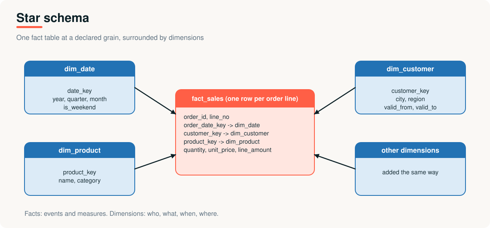
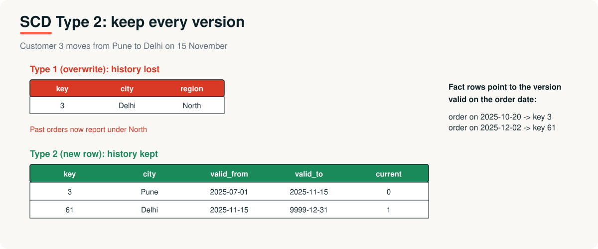

# 08 · Modelling and Loading with SQL

> **Module 02 · Topic 08 of 10** &nbsp;|&nbsp; Reading time: ~65 min &nbsp;|&nbsp; Level: Intermediate

[Module home](README.md) &nbsp;·&nbsp; [← Previous: Cleaning and Validating Data](07-cleaning-and-validating-data.md) &nbsp;·&nbsp; [Next: Query Performance and Execution →](09-query-performance-and-execution.md)



## What you will learn

- How to reshape normalised tables into a **star schema**: facts, dimensions, grain and surrogate keys
- How to build the tables with `INSERT ... SELECT`, including a **date dimension**
- **Slowly changing dimensions** (Type 1 and Type 2), and why they protect history
- **Incremental loading**: watermarks, idempotent **upserts**, and `MERGE`
- A complete, rerunnable **ELT pipeline** with a quality gate

---

## 1. The business problem

The clean data is ready, and the dashboards are growing. Four problems appear within a month.

| Attempt | What happens | Why |
|---|---|---|
| 1 | Every dashboard queries the five normalised source tables directly | Queries are slow and long, and two analysts join the tables differently, so "revenue" differs between dashboards |
| 2 | A customer moves from Pune to Delhi, and the team overwrites the city | **Last quarter's West revenue shifts to North.** A report that was correct yesterday changes today |
| 3 | The nightly job `INSERT`s yesterday's orders, fails halfway, and is rerun | Duplicate rows. Revenue is double counted |
| 4 | The job reloads all history every night | Fine for 900 orders. Impossible at 900 million |

The first needs a **dimensional model**, the second **slowly changing dimensions**, and the last two **incremental, idempotent loading**. Together they are the core of what a data engineer builds in SQL.

---

## 2. From normalised tables to a star schema

The source tables were designed for an application: many small writes, no repeated data ([Topic 04](04-joins.md)). Analytics needs the opposite: **big reads, few writes, simple joins**.

| | **OLTP** (application database) | **OLAP** (analytics, the gold layer) |
|---|---|---|
| **Workload** | Many small reads and writes | Large scans and aggregations |
| **Design** | Normalised, many tables | Denormalised, a few tables in a star |
| **Optimised for** | Fast, correct updates | Fast, simple reads |
| **Example** | `orders`, `order_items`, `customers` | `fact_sales`, `dim_customer`, `dim_date` |

A **star schema** has two kinds of table:

| Table | Holds | XYZ example |
|---|---|---|
| **Fact** | Measurable events at a declared **grain**, plus keys to the dimensions | `fact_sales`: one row per **order line**, with quantity and amount |
| **Dimension** | The descriptive context used to filter and group | `dim_customer`, `dim_product`, `dim_date` |

Three habits define a good model:

1. **Declare the grain first.** "One row per order line" decides what every measure means ([Topic 01](01-why-sql-still-matters.md#6-meet-the-xyz-database)).
2. **Use surrogate keys.** A dimension gets its own meaningless integer key (`customer_key`), separate from the source's `customer_id`, so history can be kept (Section 4).
3. **Always have a date dimension.** It holds year, quarter, month, weekday and weekend flags once, so every report uses the same calendar.

The benefit is that a question like Asha's becomes **one fact joined to a few dimensions**, written the same way by everyone.

---

## 3. Build the dimensions

### The date dimension

Generate it with the recursive CTE from [Topic 05](05-subqueries-ctes-and-set-operations.md#4-recursive-ctes). The key is the date as an integer (`20251001`), which is compact and sorts correctly.

```sql
CREATE TABLE dim_date (
    date_key   INTEGER PRIMARY KEY,   -- 20251001
    full_date  TEXT NOT NULL,         -- 2025-10-01
    year       INTEGER,
    quarter    INTEGER,
    month      INTEGER,
    year_month TEXT,
    day_name   TEXT,
    is_weekend INTEGER
);

INSERT INTO dim_date
WITH RECURSIVE d(day) AS (
    SELECT '2025-07-01'
    UNION ALL
    SELECT date(day, '+1 day') FROM d WHERE day < '2025-12-31'
)
SELECT CAST(REPLACE(day, '-', '') AS INTEGER),
       day,
       CAST(strftime('%Y', day) AS INTEGER),
       (CAST(strftime('%m', day) AS INTEGER) + 2) / 3,
       CAST(strftime('%m', day) AS INTEGER),
       strftime('%Y-%m', day),
       CASE strftime('%w', day) WHEN '0' THEN 'Sun' WHEN '1' THEN 'Mon' WHEN '2' THEN 'Tue'
                                WHEN '3' THEN 'Wed' WHEN '4' THEN 'Thu' WHEN '5' THEN 'Fri' ELSE 'Sat' END,
       CASE WHEN strftime('%w', day) IN ('0', '6') THEN 1 ELSE 0 END
FROM d;

SELECT * FROM dim_date WHERE full_date IN ('2025-10-01', '2025-12-27') ORDER BY date_key;
```

```text
date_key  full_date   year  quarter  month  year_month  day_name  is_weekend
--------  ----------  ----  -------  -----  ----------  --------  ----------
20251001  2025-10-01  2025        4     10  2025-10     Wed                0
20251227  2025-12-27  2025        4     12  2025-12     Sat                1
```

### Product and customer dimensions

`customer_key` and `product_key` are generated by the database. The customer dimension is built for history from the start, with validity dates and a current-row flag. Every customer begins with one row that is valid from the start of the warehouse until the "end of time".

```sql
CREATE TABLE dim_product (
    product_key INTEGER PRIMARY KEY,   -- surrogate key
    product_id  INTEGER NOT NULL,      -- natural key from the source
    name        TEXT NOT NULL,
    category    TEXT NOT NULL
);
INSERT INTO dim_product (product_id, name, category)
SELECT product_id, name, category FROM products ORDER BY product_id;

CREATE TABLE dim_customer (
    customer_key INTEGER PRIMARY KEY,  -- surrogate key: one per VERSION of a customer
    customer_id  INTEGER NOT NULL,     -- natural key from the source
    name         TEXT NOT NULL,
    city         TEXT,
    region       TEXT NOT NULL,
    segment      TEXT,
    valid_from   TEXT NOT NULL,
    valid_to     TEXT NOT NULL,        -- '9999-12-31' means "still current"
    is_current   INTEGER NOT NULL
);
INSERT INTO dim_customer (customer_id, name, city, region, segment, valid_from, valid_to, is_current)
SELECT customer_id, name, city, region, segment, '2025-07-01', '9999-12-31', 1
FROM customers
ORDER BY customer_id;

SELECT customer_key, customer_id, name, city, region, valid_from, valid_to, is_current
FROM dim_customer
WHERE customer_id IN (3, 4);
```

```text
customer_key  customer_id  name           city     region  valid_from  valid_to    is_current
------------  -----------  -------------  -------  ------  ----------  ----------  ----------
           3            3  Nikhil Das     Pune     West    2025-07-01  9999-12-31           1
           4            4  Lakshmi Gupta  Chennai  South   2025-07-01  9999-12-31           1
```

---

## 4. Slowly changing dimensions

Descriptions change: a customer moves, a product is re-categorised. These are **slowly changing dimensions** (SCD). What the warehouse does with the change decides whether history survives.



| Type | What it does | History kept? | Use when |
|---|---|---|---|
| **Type 1** | **Overwrite** the old value | No | The old value was a mistake, or history does not matter |
| **Type 2** | **Add a new row**, and close the old one with an end date | **Yes**, fully | Reports must show the world "as it was" |
| **Type 3** | Add a column for the previous value | One step back only | Rarely: you only ever compare old with new |

Type 1 is attempt 2 from the business problem: overwriting Pune with Delhi moves every past order to the new region. **Type 2** avoids it. Customer 3, Nikhil Das, moves from Pune (West) to Delhi (North) on 15 November. The change arrives in a small table:

```sql
CREATE TABLE customer_changes (
    customer_id    INTEGER,
    new_city       TEXT,
    new_region     TEXT,
    effective_date TEXT
);
INSERT INTO customer_changes VALUES (3, 'Delhi', 'North', '2025-11-15');

-- Step 1: insert a new version, copying the unchanged attributes from the current row
INSERT INTO dim_customer (customer_id, name, city, region, segment, valid_from, valid_to, is_current)
SELECT d.customer_id, d.name, ch.new_city, ch.new_region, d.segment, ch.effective_date, '9999-12-31', 1
FROM dim_customer AS d
JOIN customer_changes AS ch ON ch.customer_id = d.customer_id
WHERE d.is_current = 1
  AND (d.city IS NOT ch.new_city OR d.region <> ch.new_region);

-- Step 2: close the old version on the day the change takes effect
UPDATE dim_customer
SET valid_to   = (SELECT ch.effective_date FROM customer_changes AS ch
                  WHERE ch.customer_id = dim_customer.customer_id),
    is_current = 0
WHERE customer_id IN (SELECT customer_id FROM customer_changes)
  AND is_current = 1
  AND valid_from < (SELECT ch.effective_date FROM customer_changes AS ch
                    WHERE ch.customer_id = dim_customer.customer_id);

SELECT customer_key, customer_id, name, city, region, valid_from, valid_to, is_current
FROM dim_customer
WHERE customer_id = 3
ORDER BY customer_key;
```

```text
customer_key  customer_id  name        city   region  valid_from  valid_to    is_current
------------  -----------  ----------  -----  ------  ----------  ----------  ----------
           3            3  Nikhil Das  Pune   West    2025-07-01  2025-11-15           0
          61            3  Nikhil Das  Delhi  North   2025-11-15  9999-12-31           1
```

Nikhil Das now has **two rows**, one per version, each with its own surrogate key. The `IS NOT` test in step 1 is NULL-safe, so a change from or to a NULL city is still detected ([Topic 02](02-querying-fundamentals.md#5-null-the-value-that-is-not-a-value)). Warehouses write the same two steps as a single `MERGE` (Section 6).

---

## 5. Load the fact table

A fact row must point to the dimension version that was **valid when the event happened**. That is why the join uses the validity range, not just the natural key.

```sql
CREATE TABLE fact_sales (
    order_id       INTEGER NOT NULL,
    line_no        INTEGER NOT NULL,
    order_date_key INTEGER NOT NULL,
    customer_key   INTEGER NOT NULL,
    product_key    INTEGER NOT NULL,
    order_status   TEXT NOT NULL,
    quantity       INTEGER NOT NULL,
    unit_price     REAL NOT NULL,
    line_amount    REAL NOT NULL,
    PRIMARY KEY (order_id, line_no)          -- the declared grain: one row per order line
);

INSERT INTO fact_sales
SELECT oi.order_id,
       oi.line_no,
       CAST(REPLACE(o.order_date, '-', '') AS INTEGER),
       c.customer_key,
       p.product_key,
       o.status,
       oi.quantity,
       oi.unit_price,
       oi.quantity * oi.unit_price
FROM order_items AS oi
JOIN orders AS o       ON o.order_id = oi.order_id
JOIN dim_customer AS c ON c.customer_id = o.customer_id
                      AND o.order_date >= c.valid_from
                      AND o.order_date <  c.valid_to       -- the version valid on the order date
JOIN dim_product AS p  ON p.product_id = oi.product_id;
```

Always **reconcile** a load, as in [Topic 07](07-cleaning-and-validating-data.md#6-data-quality-checks-written-as-sql): the fact table must hold exactly the rows and totals of its source.

```sql
SELECT (SELECT COUNT(*) FROM fact_sales)                       AS fact_rows,
       (SELECT COUNT(*) FROM order_items)                      AS source_rows,
       (SELECT ROUND(SUM(line_amount), 2) FROM fact_sales)     AS fact_total,
       (SELECT ROUND(SUM(quantity * unit_price), 2) FROM order_items) AS source_total;
```

```text
fact_rows  source_rows  fact_total  source_total
---------  -----------  ----------  ------------
     1773         1773   5640479.9     5640479.9
```

Customer 3's orders are split across the two versions at the date of the move:

```sql
SELECT c.customer_key, c.city, c.region, c.valid_from,
       COUNT(*)                     AS lines,
       ROUND(SUM(f.line_amount), 2) AS revenue
FROM fact_sales AS f
JOIN dim_customer AS c ON c.customer_key = f.customer_key
WHERE c.customer_id = 3
GROUP BY c.customer_key, c.city, c.region, c.valid_from
ORDER BY c.customer_key;
```

```text
customer_key  city   region  valid_from  lines  revenue
------------  -----  ------  ----------  -----  -------
           3  Pune   West    2025-07-01     20  59655.2
          61  Delhi  North   2025-11-15     24  56300.9
```

### Querying the star

Asha's regional question, which needed three joins and two CTEs in [Topic 05](05-subqueries-ctes-and-set-operations.md), is now a plain join of the fact to two dimensions, and everyone writes it the same way:

```sql
-- Completed revenue by month and region, as the customer's region was at the time
SELECT d.year_month,
       c.region,
       ROUND(SUM(f.line_amount), 2) AS revenue
FROM fact_sales AS f
JOIN dim_date AS d     ON d.date_key     = f.order_date_key
JOIN dim_customer AS c ON c.customer_key = f.customer_key
WHERE f.order_status = 'completed'
  AND d.year_month >= '2025-11'
GROUP BY d.year_month, c.region
ORDER BY d.year_month, c.region;
```

```text
year_month  region  revenue
----------  ------  --------
2025-11     East    195920.9
2025-11     North   165368.1
2025-11     South   399869.6
2025-11     West    461837.9
2025-12     East    185842.0
2025-12     North   171014.0
2025-12     South   187937.0
2025-12     West    291600.0
```

**What Type 2 protected.** Compare Q4 revenue *as it was* (each order in the region the customer was in at the time) with *as is* (every order moved to the customer's current region, which is what Type 1 would give):

```sql
WITH as_was AS (
    SELECT c.region, SUM(f.line_amount) AS revenue
    FROM fact_sales AS f
    JOIN dim_customer AS c ON c.customer_key = f.customer_key
    WHERE f.order_status = 'completed' AND f.order_date_key >= 20251001
    GROUP BY c.region
),
as_is AS (
    SELECT cur.region, SUM(f.line_amount) AS revenue
    FROM fact_sales AS f
    JOIN dim_customer AS c   ON c.customer_key = f.customer_key
    JOIN dim_customer AS cur ON cur.customer_id = c.customer_id AND cur.is_current = 1
    WHERE f.order_status = 'completed' AND f.order_date_key >= 20251001
    GROUP BY cur.region
)
SELECT w.region,
       ROUND(w.revenue, 2) AS q4_as_was,
       ROUND(i.revenue, 2) AS q4_as_is
FROM as_was AS w
JOIN as_is AS i ON i.region = w.region
ORDER BY w.region;
```

```text
region  q4_as_was  q4_as_is
------  ---------  ---------
East     582948.9   582948.9
North    451272.1   486439.3
South    873558.6   873558.6
West    1148998.9  1113831.7
```

North and West differ because one customer moved. With a Type 1 overwrite, the published West figure for Q4 would drop by about 35,000 the day after the move, with no change in what actually sold.

---

## 6. Loading patterns

| Pattern | How it works | Cost | Risk |
|---|---|---|---|
| **Full refresh** | Rebuild the whole table every run | Grows with total history | Simple and safe, until it is too slow |
| **Incremental** | Process only what is new or changed since the last run | Grows with the daily change | Needs a reliable way to find "new" |

The usual way to find "new" is a **watermark**: remember the largest `loaded_at` (or `updated_at`) already processed, and read only rows beyond it next time. Whatever the pattern, a load must be **idempotent**: running it twice must give the same result as running it once. Jobs fail and get retried, so this is not optional.

### The non-idempotent load

```sql
-- Daily summary built with a plain INSERT. The job runs, fails later, and is run again
CREATE TABLE daily_sales_naive (order_date TEXT, orders INTEGER, revenue REAL);

INSERT INTO daily_sales_naive
SELECT d.full_date, COUNT(DISTINCT f.order_id), ROUND(SUM(f.line_amount), 2)
FROM fact_sales AS f
JOIN dim_date AS d ON d.date_key = f.order_date_key
WHERE f.order_status = 'completed' AND d.full_date >= '2025-12-26'
GROUP BY d.full_date;

INSERT INTO daily_sales_naive          -- the retry
SELECT d.full_date, COUNT(DISTINCT f.order_id), ROUND(SUM(f.line_amount), 2)
FROM fact_sales AS f
JOIN dim_date AS d ON d.date_key = f.order_date_key
WHERE f.order_status = 'completed' AND d.full_date >= '2025-12-26'
GROUP BY d.full_date;

SELECT COUNT(*) AS rows_loaded, COUNT(DISTINCT order_date) AS distinct_days,
       ROUND(SUM(revenue), 2) AS total_revenue
FROM daily_sales_naive;
```

```text
rows_loaded  distinct_days  total_revenue
-----------  -------------  -------------
          8              4       174852.0
```

Four days were loaded twice: eight rows, and the revenue is exactly doubled. This is attempt 3.

### The idempotent load: upsert

Give the target a **primary key**, and write with an **upsert**: insert the row if its key is new, otherwise update it. SQLite and PostgreSQL write this as `INSERT ... ON CONFLICT ... DO UPDATE`.

```sql
CREATE TABLE daily_sales (
    order_date TEXT PRIMARY KEY,
    orders     INTEGER NOT NULL,
    revenue    REAL NOT NULL
);

INSERT INTO daily_sales (order_date, orders, revenue)
SELECT d.full_date, COUNT(DISTINCT f.order_id), ROUND(SUM(f.line_amount), 2)
FROM fact_sales AS f
JOIN dim_date AS d ON d.date_key = f.order_date_key
WHERE f.order_status = 'completed' AND d.full_date >= '2025-12-26'
GROUP BY d.full_date
ON CONFLICT (order_date) DO UPDATE SET orders = excluded.orders, revenue = excluded.revenue;

INSERT INTO daily_sales (order_date, orders, revenue)          -- the retry: identical statement
SELECT d.full_date, COUNT(DISTINCT f.order_id), ROUND(SUM(f.line_amount), 2)
FROM fact_sales AS f
JOIN dim_date AS d ON d.date_key = f.order_date_key
WHERE f.order_status = 'completed' AND d.full_date >= '2025-12-26'
GROUP BY d.full_date
ON CONFLICT (order_date) DO UPDATE SET orders = excluded.orders, revenue = excluded.revenue;

SELECT COUNT(*) AS rows_loaded, ROUND(SUM(revenue), 2) AS total_revenue FROM daily_sales;
```

```text
rows_loaded  total_revenue
-----------  -------------
          4        87426.0
```

Same four days after two runs, and half the revenue of the broken load. `excluded` refers to the row that the insert tried to write.

Other idempotent techniques:

| Technique | How | Good for |
|---|---|---|
| **Upsert / MERGE** | Insert new keys, update existing ones | Row-level changes, dimensions |
| **Delete and insert a partition** | In one transaction, delete the day or window and insert it again | Recomputing whole days or months |
| **Overwrite a partition** | Replace the partition's files (`INSERT OVERWRITE`, Delta `replaceWhere`) | Large partitioned tables |

### MERGE in warehouses and Delta Lake

Spark and Databricks tables (Delta) use `MERGE INTO`. It is the standard statement for upserts, change feeds and Type 2 dimensions, and PostgreSQL has it from version 15. SQLite has no `MERGE`, so this block is not run here:

```sql
-- Delta Lake / Databricks (not run here): upsert the latest version of each order
MERGE INTO silver.orders AS t
USING staged_orders AS s
   ON t.order_ref = s.order_ref
WHEN MATCHED AND s.loaded_at > t.loaded_at THEN UPDATE SET *
WHEN NOT MATCHED                          THEN INSERT *;
```

---

## 7. A complete incremental pipeline

[`examples/08_incremental_elt_pipeline.py`](examples/08_incremental_elt_pipeline.py) puts the pieces together as one rerunnable job over the raw feed from Topic 07. Each run:

| Step | What it does | Idea from |
|---|---|---|
| 1 | Reads only rows with `loaded_at` beyond the **watermark** | Incremental loading |
| 2 | Standardises, deduplicates and validates them | [Topic 07](07-cleaning-and-validating-data.md) |
| 3 | **Upserts** clean rows by key, and rejects by key. A corrected order leaves the rejects table | Idempotent writes |
| 4 | Runs **quality checks**. Any failure aborts the run | The gate |
| 5 | Advances the watermark | Only after success |

All five steps run in **one transaction**, so a failed run changes nothing and the next run retries the same batch. The feed arrives over six days, including a correction and a late fix for an order that had been rejected:

```text
Daily runs
  day 1 (2025-12-02): read 2, clean 2, rejected 0  ->  orders_clean=2  orders_rejected=0
  day 2 (2025-12-03): read 3, clean 1, rejected 2  ->  orders_clean=2  orders_rejected=2
  day 3 (2025-12-04): read 2, clean 1, rejected 1  ->  orders_clean=3  orders_rejected=3
  day 4 (2025-12-05): read 2, clean 2, rejected 0  ->  orders_clean=4  orders_rejected=3
  day 5 (2025-12-06): read 1, clean 0, rejected 1  ->  orders_clean=4  orders_rejected=4
  day 6 (2025-12-07): read 2, clean 2, rejected 0  ->  orders_clean=6  orders_rejected=3

Run again with no new data: read 0 rows, tables unchanged: True
Replay everything from the start: read 12, tables unchanged: True

orders_clean
order_ref  customer     region  order_date  status     amount   loaded_at
---------  -----------  ------  ----------  ---------  -------  -------------------
A-1001     Asha Rao     South   2025-12-01  completed   1299.5  2025-12-02 01:00:00
A-1002     Ravi Shah    North   2025-12-01  completed    549.0  2025-12-03 01:00:00
A-1003     Meera Iyer   East    2025-12-02  completed   1180.0  2025-12-07 01:00:00
A-1005     Diya Nair    West    2025-12-03  completed  2150.75  2025-12-05 01:00:00
A-1007     Sneha Patil  West    2025-12-04  shipped      899.0  2025-12-05 01:00:00
A-1009     Anika Gupta  North   2025-12-06  completed    640.0  2025-12-07 01:00:00

orders_rejected
order_ref  reject_reason        loaded_at
---------  -------------------  -------------------
A-1004     region missing       2025-12-03 01:00:00
A-1006     amount negative      2025-12-04 01:00:00
A-1008     amount not a number  2025-12-06 01:00:00

Gate: quality check failed: status outside allowed set (1 rows)
Rolled back, tables unchanged: True
Raw feed still holds all 13 rows, and the watermark did not move, so the next run retries the batch.
```

Read it from the top:

- Day 2 rejects two orders and keeps one, and day 6 delivers the corrected `A-1003`, which **moves from rejected to clean**.
- Running with no new data reads 0 rows. **Replaying all 12 raw rows** from the beginning leaves both tables unchanged. That is idempotency, demonstrated.
- The last lines force a bad status into the feed. The quality check fails, the transaction **rolls back**, and the watermark does not advance, so the next run retries the batch.

---

## 8. How it works underneath

**An upsert on a row store** looks up the key in the primary-key index. If it is absent, it inserts. If present, it updates that row in place.

**A MERGE on a lakehouse table** works on immutable files. A Delta table is a set of Parquet files plus a transaction log. A `MERGE` finds the files that contain matching keys, writes **new versions of those files**, and records the swap in the log as one atomic commit, so readers see either the old table or the new one, never a half-written state. That is why large tables are **partitioned** and why `MERGE` conditions should include a partition filter: it limits how many files are rewritten.

**Late-arriving data** is the everyday complication:

| Situation | Typical handling |
|---|---|
| A fact arrives **before** its dimension row | Load it against an "Unknown" dimension member and fix it when the row arrives, or hold it back |
| A fact arrives **days late** | Reprocess a trailing window (say the last 3 days) on every run, instead of trusting the watermark alone |
| A source **deletes** a row | Prefer soft deletes (`is_deleted`), or apply deletes explicitly in the `MERGE` |

---

## 9. Limitations and engineering considerations

| Issue | Detail |
|---|---|
| **Denormalising costs storage and effort** | Dimensions repeat descriptive values, and every attribute change needs a policy (Type 1 or 2) |
| **Type 2 adds complexity** | Joins need date ranges, and queries must pick "as was" or "as is" on purpose |
| **Surrogate keys must be managed** | Generating them consistently across reruns and backfills takes care |
| **Watermarks can miss rows** | If `updated_at` is not reliable, or data arrives out of order, rows are skipped. Reprocess a safety window |
| **Idempotency must be designed in** | Plain `INSERT`s in a retried job are the classic double-count bug |
| **Backfills** | Rebuilding history must give the same answer as the incremental path, so test both |
| **Not every model needs a star** | Wide denormalised tables, or the source model, can be right for small or special cases |

## 10. Real-world applications

- **Gold layers:** dashboards read a star schema or a few wide aggregate tables, so queries are short, fast and consistent.
- **Change data capture (CDC):** a stream of inserts, updates and deletes from a source database is applied to the lakehouse with `MERGE`.
- **Customer history:** Type 2 customer and product dimensions that let finance reproduce last year's report exactly.
- **Incremental models:** transformation tools generate this watermark-and-upsert logic, but the SQL is what you wrote above.

---

## Key takeaways

1. A **star schema** is a fact table at a declared **grain** surrounded by dimensions. It makes analytical queries short, fast and consistent.
2. Dimensions use **surrogate keys**, and every model needs a **date dimension**.
3. **Type 2** keeps history by adding a row per version with validity dates. **Type 1** overwrites and rewrites the past.
4. Facts join to the dimension version **valid at the event date**.
5. Load **incrementally** with a watermark, and make every load **idempotent**: upsert by key, or replace a partition in one transaction.
6. **Reconcile** every load, and use quality checks as a gate inside a transaction.
7. `MERGE` is the warehouse form of upsert. On a lakehouse it rewrites only the files it touches.

## Interview questions

<details><summary><b>1.</b> What are fact and dimension tables?</summary>

A fact table stores measurable events (sales lines, clicks) at a declared grain, with foreign keys to dimensions. Dimension tables hold the descriptive attributes (customer, product, date) used to filter and group the facts.
</details>

<details><summary><b>2.</b> What is the grain of a fact table, and why declare it first?</summary>

The grain is what one row represents, for example one order line. Declaring it first fixes what each measure means and what can be summed, and prevents double counting when joined to other tables.
</details>

<details><summary><b>3.</b> Why use surrogate keys instead of the source system's key?</summary>

They are stable and meaningless, so they stay unique across source systems and, most importantly, let a dimension keep several versions of the same entity (Type 2). The source's key is kept as the natural key for matching.
</details>

<details><summary><b>4.</b> Explain SCD Type 1 and Type 2, and when to use each.</summary>

Type 1 overwrites the old value, so history is lost: use it for corrections. Type 2 inserts a new row and closes the old one with validity dates, preserving history: use it when reports must show attributes as they were at the time.
</details>

<details><summary><b>5.</b> How do you load a fact row against a Type 2 dimension?</summary>

Join on the natural key and require the event date to fall within the version's validity range, `event_date >= valid_from AND event_date < valid_to`, then store the version's surrogate key in the fact.
</details>

<details><summary><b>6.</b> What does idempotent mean for a data load, and how do you achieve it?</summary>

Running the load repeatedly gives the same result as running it once. Use a primary key with an upsert or `MERGE`, or delete and reload a partition within one transaction, instead of plain appends.
</details>

<details><summary><b>7.</b> How does a watermark-based incremental load work, and what can go wrong?</summary>

It stores the highest `updated_at` or `loaded_at` processed and reads only rows beyond it. It can miss rows when timestamps are unreliable or data arrives late or out of order, so reprocess a trailing window and reconcile against the source.
</details>

<details><summary><b>8.</b> A job failed halfway and was rerun, and now revenue is doubled. What happened and how do you prevent it?</summary>

The load was not idempotent: a plain `INSERT` appended the same rows again. Prevent it with keyed upserts or partition replacement, run each load in a transaction so a failure leaves no partial data, and add a reconciliation check on row counts and totals.
</details>

## Official documentation

- [SQLite: UPSERT](https://www.sqlite.org/lang_upsert.html) · [INSERT](https://www.sqlite.org/lang_insert.html)
- [Delta Lake: MERGE (upsert)](https://docs.delta.io/latest/delta-update.html#upsert-into-a-table-using-merge) · [Databricks: MERGE INTO](https://docs.databricks.com/aws/en/sql/language-manual/delta-merge-into)
- [PostgreSQL: INSERT ... ON CONFLICT](https://www.postgresql.org/docs/current/sql-insert.html) · [MERGE](https://www.postgresql.org/docs/current/sql-merge.html)
- [Kimball Group: dimensional modeling techniques](https://www.kimballgroup.com/data-warehouse-business-intelligence-resources/kimball-techniques/dimensional-modeling-techniques/)

---

| Previous | Contents | Next |
|:---|:---:|:---|
| [← Cleaning and Validating Data](07-cleaning-and-validating-data.md) | [Module home](README.md#topics-covered) | [Query Performance and Execution →](09-query-performance-and-execution.md) |
