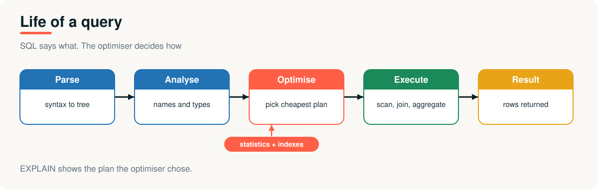
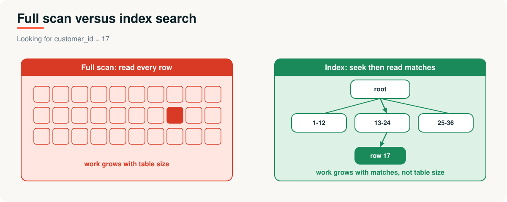

# 09 · Query Performance and Execution

> **Module 02 · Topic 09 of 10** &nbsp;|&nbsp; Reading time: ~55 min &nbsp;|&nbsp; Level: Intermediate to Advanced

[Module home](README.md) &nbsp;·&nbsp; [← Previous: Modelling and Loading with SQL](08-modelling-and-loading-with-sql.md) &nbsp;·&nbsp; [Next: Module Review and Interview Prep →](10-module-review-and-interview-prep.md)



## What you will learn

- What happens between pressing Run and getting rows back
- How to read a query plan (`EXPLAIN`) and tell a scan from an index search
- How **indexes** work, and the ways a query can accidentally defeat one
- Why analytical engines read **columns, partitions and files** instead
- How Spark SQL runs joins and aggregations across a cluster: **shuffle, broadcast and skew**

---

## 1. The business problem

The orders feed grows from 900 orders to 900 million. Three things happen.

| Symptom | Reported by | Underlying cause |
|---|---|---|
| "Customer lookup takes 40 seconds" | Support team | Every lookup reads the whole table |
| "The same report was fast last month" | Finance | Data grew, and the plan stayed a full scan |
| "The nightly join runs for hours, and one task never finishes" | Data engineering | One customer owns a huge share of the rows, so a single task is overloaded |

You cannot fix these by guessing. You fix them by **reading the plan**, understanding what the engine will do, and changing the query, the layout or the data. The tuning mindset is: **do less work**. Read fewer rows, fewer columns, move less data.

---

## 2. What happens when a query runs

SQL says *what* you want. The engine decides *how*.

| Stage | What happens |
|---|---|
| **1. Parse** | Check syntax and build a tree of the query |
| **2. Analyse** | Resolve table and column names, check types |
| **3. Optimise** | Generate candidate plans and pick the cheapest using **statistics** (row counts, value distributions) and available indexes |
| **4. Execute** | Run the chosen plan: scan or seek, join, aggregate, sort |

The result of stage 3 is the **query plan**. Every engine can show it:

| Engine | Command |
|---|---|
| SQLite | `EXPLAIN QUERY PLAN <query>` |
| PostgreSQL | `EXPLAIN` (estimate) or `EXPLAIN ANALYZE` (runs it, shows actual) |
| Spark SQL / Databricks | `EXPLAIN` or `EXPLAIN FORMATTED` |

The optimiser is only as good as its statistics and your query's shape. When it picks a poor plan, it is usually because the information was stale, or the query hid something from it.

---

## 3. Reading a plan in SQLite

Start with a lookup that support runs hundreds of times a day, one customer's orders:

```sql
EXPLAIN QUERY PLAN
SELECT order_id, order_date, status
FROM orders
WHERE customer_id = 17;
```

```text
QUERY PLAN
`--SCAN orders
```

`SCAN orders` means **every row is read** and tested. That is fine for 900 rows. It is the 40-second query at 900 million.

### Add an index

An **index** is a separate, sorted structure (a B-tree) that maps column values to row locations, like the index at the back of a book. The engine can jump to the matching rows instead of reading the table.

```sql
CREATE INDEX idx_orders_customer ON orders (customer_id);

EXPLAIN QUERY PLAN
SELECT order_id, order_date, status
FROM orders
WHERE customer_id = 17;
```

```text
QUERY PLAN
`--SEARCH orders USING INDEX idx_orders_customer (customer_id=?)
```

`SEARCH ... USING INDEX` replaces `SCAN`. The engine does a few B-tree steps and then reads only the matching rows. The cost grows with the **number of matches**, not with the size of the table.



### How a B-tree helps

A B-tree keeps keys sorted in wide, shallow levels. A million rows need only 3 or 4 levels, and a billion about 5. That gives two abilities, and you need both to understand the traps below:

| Ability | Example |
|---|---|
| **Equality seek** | `customer_id = 17` |
| **Range seek** | `order_date BETWEEN '2025-10-01' AND '2025-12-31'` (the keys are sorted, so the range is contiguous) |

### Covering and composite indexes

A **covering index** contains every column the query needs, so the engine never touches the table.

```sql
CREATE INDEX idx_orders_cust_date_status ON orders (customer_id, order_date, status);

EXPLAIN QUERY PLAN
SELECT order_date, status
FROM orders
WHERE customer_id = 17;
```

```text
QUERY PLAN
`--SEARCH orders USING COVERING INDEX idx_orders_cust_date_status (customer_id=?)
```

`COVERING INDEX` means the answer came entirely from the index. This index is also **composite**, and the column order matters: it can serve `customer_id`, or `customer_id` plus `order_date`, but it cannot seek on `order_date` alone, because the keys are sorted by `customer_id` first.

```sql
EXPLAIN QUERY PLAN
SELECT order_id FROM orders WHERE order_date = '2025-12-01';
```

```text
QUERY PLAN
`--SCAN orders USING COVERING INDEX idx_orders_cust_date_status
```

The engine cannot seek: the plan still says `SCAN`, reading the whole index from the start. Put the column you filter on with **equality** first, then range columns, and check the plan.

### Ways to defeat an index

| Pattern | Why the index cannot be used | Fix |
|---|---|---|
| `WHERE strftime('%Y', order_date) = '2025'` | The index holds `order_date`, not the function result | Use a range: `order_date >= '2025-01-01' AND order_date < '2026-01-01'` |
| `WHERE LOWER(name) = 'asha'` | Same reason | Index the expression, or store a cleaned column |
| `WHERE customer_id + 0 = 17` | Arithmetic on the column | Move the arithmetic to the constant |
| `WHERE city LIKE '%une'` | A leading wildcard has no sorted prefix | Search from the front, or use a text-search index |
| Comparing a text column with a number | Type conversion on every row | Match the types |

Prove it with the date example:

```sql
EXPLAIN QUERY PLAN
SELECT COUNT(*) FROM orders WHERE strftime('%Y-%m', order_date) = '2025-12';
```

```text
QUERY PLAN
`--SCAN orders USING COVERING INDEX idx_orders_cust_date_status
```

```sql
CREATE INDEX idx_orders_date ON orders (order_date);

EXPLAIN QUERY PLAN
SELECT COUNT(*) FROM orders WHERE order_date >= '2025-12-01' AND order_date < '2026-01-01';
```

```text
QUERY PLAN
`--SEARCH orders USING COVERING INDEX idx_orders_date (order_date>? AND order_date<?)
```

Both answer the same question. The first wraps the column in a function, so the plan shows a `SCAN` (the whole table is read, or here the whole index). The second is a `SEARCH`. This is the single most common performance fix in practice: **keep the column bare on one side of the comparison.**

### The cost of an index

Indexes are not free:

- Every `INSERT`, `UPDATE` and `DELETE` must also update each index on the table
- They use storage
- Too many indexes slow writes more than they speed reads

Index the columns you **filter, join and sort on**, and drop the ones nobody uses.

### Joins and indexes

For a join, the engine often loops over one table and looks up matches in the other. An index on the join column of the inner table makes each lookup cheap:

```sql
EXPLAIN QUERY PLAN
SELECT o.order_id, oi.product_id, oi.quantity
FROM orders AS o
JOIN order_items AS oi ON oi.order_id = o.order_id
WHERE o.customer_id = 17;
```

```text
QUERY PLAN
|--SEARCH o USING COVERING INDEX idx_orders_customer (customer_id=?)
`--SEARCH oi USING INDEX sqlite_autoindex_order_items_1 (order_id=?)
```

Read the plan from the top: the engine finds the customer's orders through the index, then looks up each order's items. The three physical join algorithms are:

| Algorithm | How | Best when |
|---|---|---|
| **Nested loop** | For each outer row, look up matches in the inner table | One side is small and the other has an index |
| **Hash join** | Build a hash table of the smaller side, probe it with the larger | Large, unsorted inputs and equality joins |
| **Sort-merge join** | Sort both sides on the key, then merge | Both sides are huge, or already sorted |

SQLite uses nested loops. PostgreSQL and Spark choose among all three.

### Keep statistics fresh

The optimiser chooses plans from statistics. After large loads, refresh them:

```sql
ANALYZE;                         -- SQLite, PostgreSQL
ANALYZE TABLE orders COMPUTE STATISTICS;   -- Spark SQL / Databricks (not run here)
```

---

## 4. Timing: measure, do not guess

Plans tell you what the engine intends. Timing tells you if it matters. [`examples/09_index_demo.py`](examples/09_index_demo.py) builds a larger table of 400,000 rows, times the same lookup with and without an index, and prints the plan for each.

```text
Table: 400,000 rows, 200 lookups by customer_id

Without an index
  plan: SCAN big_orders
  rows found: 1587

With an index on customer_id
  plan: SEARCH big_orders USING INDEX idx_big_customer (customer_id=?)
  rows found: 1587

Same rows returned: True
Indexed lookups were faster by a factor of 1,222 (machine dependent; expect a large factor, not an exact number)
```

The exact times depend on the machine, so treat them as **illustrative**. The ratio is what matters: the scan reads all rows each time, while the indexed lookup reads a handful. Always measure on data of realistic size. Plans on a 900-row table look identical in cost.

---

## 5. Why analytical engines work differently

Everything so far describes a **row store** with B-tree indexes: ideal for finding a few rows fast. Analytics asks different questions: *sum revenue over 900 million rows, grouped by region*. For that, indexes do not help, because the query needs most of the rows. Lakehouse and warehouse engines instead cut the work in three other ways.

| Technique | What it avoids | How |
|---|---|---|
| **Columnar storage** (Parquet, ORC) | Reading columns you do not use | Each column is stored together, so `SUM(amount)` reads only `amount`. Similar values also compress well |
| **Partition pruning** | Reading folders you do not need | Data is split in folders by a column, usually the date (`order_date=2025-12-01/`). A filter on that column skips the other folders |
| **Predicate pushdown and file skipping** | Reading row groups and files that cannot match | Each file and row group stores min/max statistics. A filter like `amount > 5000` skips every group whose maximum is lower |

These work only when the query lets them. The same rule as indexes applies: **filter on the partition column directly**, with no function on it.

```sql
-- Spark SQL / Databricks (not run here)
-- Prunes: the filter is on the partition column itself
SELECT region, SUM(amount)
FROM gold.sales
WHERE order_date >= '2025-12-01' AND order_date < '2026-01-01'
GROUP BY region;

-- Does not prune: the function hides the column from the planner
SELECT region, SUM(amount)
FROM gold.sales
WHERE date_format(order_date, 'yyyy-MM') = '2025-12'
GROUP BY region;
```

Choose partition columns with **low cardinality that queries always filter on** (the date, perhaps the region). Partitioning by `customer_id` creates millions of tiny folders and makes everything slower: the **small files problem**. Delta Lake and Databricks add clustering features (Z-order, liquid clustering) to keep related rows physically close, giving the effect of an index on other columns.

---

## 6. Spark SQL: shuffles, joins and skew

On a cluster the expensive thing is not reading the data, it is **moving it between machines**. This movement is a **shuffle**: every executor sends rows to other executors over the network, written to disk first.

Operations that shuffle: `GROUP BY`, joins on large tables, `DISTINCT`, window functions with `PARTITION BY`, and `ORDER BY`. A shuffle splits a job into **stages**, and in the Spark UI each stage boundary is a shuffle.

### Reading a Spark plan

```sql
-- Spark SQL / Databricks (not run here)
EXPLAIN FORMATTED
SELECT c.region, SUM(f.line_amount) AS revenue
FROM fact_sales f JOIN dim_customer c ON c.customer_key = f.customer_key
GROUP BY c.region;
```

A shortened plan looks like this. Read it from the bottom up:

```text
== Physical Plan ==
HashAggregate (keys=[region], functions=[sum(line_amount)])        <- final aggregation
+- Exchange hashpartitioning(region, 200)                          <- SHUFFLE by region
   +- HashAggregate (keys=[region], functions=[partial_sum(line_amount)])   <- partial, per partition
      +- BroadcastHashJoin [customer_key], [customer_key]          <- small side broadcast, no shuffle
         :- FileScan parquet fact_sales [customer_key, line_amount]   <- only 2 columns read
         +- BroadcastExchange                                      <- small table sent to all executors
            +- FileScan parquet dim_customer [customer_key, region]
```

| Plan line | What it tells you |
|---|---|
| `FileScan ... [customer_key, line_amount]` | Column pruning is working: two columns, not the whole table |
| `PartitionFilters` / `PushedFilters` (in `FORMATTED`) | Partition pruning and pushdown happened |
| `Exchange` | A shuffle. Each one costs network and disk |
| `partial_sum` then final `sum` | Spark aggregates inside each partition first to shuffle less |
| `BroadcastHashJoin` | No shuffle of the big table |

### Join strategies

| Strategy | When Spark picks it | Cost |
|---|---|---|
| **Broadcast hash join** | One side is small (default threshold 10 MB, configurable with `spark.sql.autoBroadcastJoinThreshold`) | The small table is copied to every executor, and the large table is never shuffled. The fastest |
| **Shuffle hash join** | One side is clearly smaller after shuffling | Both sides shuffled, a hash table built per partition |
| **Sort-merge join** | The default for two large tables | Both sides shuffled and sorted. Scales, but is expensive |

This is why the star schema from Topic 08 performs well: the big fact table joins to **small dimensions that can be broadcast**. You can suggest the strategy with a hint, when the optimiser lacks statistics:

```sql
-- Spark SQL / Databricks (not run here)
SELECT /*+ BROADCAST(c) */ c.region, SUM(f.line_amount)
FROM fact_sales f JOIN dim_customer c ON c.customer_key = f.customer_key
GROUP BY c.region;
```

### Data skew

A shuffle sends all rows with one key to one task. If the keys are uneven, one task gets most of the data and everyone waits for it. This is the "one task never finishes" symptom.

Detect it by counting rows per key, which is a plain `GROUP BY`:

```sql
-- Which customers own the most order lines? A heavy hitter here would be a skew risk
SELECT o.customer_id, COUNT(*) AS lines
FROM order_items AS oi
JOIN orders AS o ON o.order_id = oi.order_id
GROUP BY o.customer_id
ORDER BY lines DESC, o.customer_id
LIMIT 5;
```

```text
customer_id  lines
-----------  -----
         58     87
         30     65
         37     64
          8     62
         47     58
```

Here customer 58 leads with 87 lines against an average of about 33, which is mild. With a real feed, a key like `NULL`, `'unknown'` or a guest-checkout ID can hold millions of rows. Typical remedies:

| Remedy | Idea |
|---|---|
| **Filter or isolate** the heavy key | Handle `NULL` or the default key separately, since it rarely needs a join |
| **Broadcast** the smaller side | Avoids the shuffle of the skewed side |
| **Salting** | Append a random number to the heavy key on one side, and replicate the other side across the salts, to spread the load |
| **Adaptive Query Execution (AQE)** | Spark 3+ re-optimises at run time: it coalesces small shuffle partitions, switches to a broadcast join if a side turns out small, and **splits skewed partitions** in sort-merge joins. Enabled by default (`spark.sql.adaptive.enabled`) |

### Other practical rules

| Rule | Reason |
|---|---|
| Select only the columns you need, never `SELECT *` on wide tables | Column pruning needs a column list |
| Filter early, on partition columns | Pruning and pushdown |
| Use `UNION ALL`, not `UNION`, when duplicates are impossible | `UNION` adds a dedupe shuffle |
| Avoid `ORDER BY` on huge results unless you need it | A global sort is a full shuffle |
| Window functions need a `PARTITION BY` | Without one, all rows go to a single partition |
| Prefer built-in functions over Python UDFs | UDFs block optimisation and add serialisation cost |
| Cache only what is reused | Caching costs memory |

---

## 7. A tuning routine

When a query is slow, work down this list. Do not guess.

| Step | Question |
|---|---|
| 1 | **How slow, and compared with what?** Measure first |
| 2 | **Read the plan.** Is there a full scan, a huge shuffle, or a bad join strategy? |
| 3 | **How many rows come out of each step?** Early filtering beats later cleverness |
| 4 | **Is the query hiding something?** A function on a filter column, `SELECT *`, an unneeded `DISTINCT` |
| 5 | **Are the statistics current?** Run `ANALYZE` after large loads |
| 6 | **Is the layout right?** Index, partition, cluster, or file size |
| 7 | **Change one thing, measure again.** |

## 8. Limitations and engineering considerations

| Issue | Detail |
|---|---|
| **Plans are estimates** | `EXPLAIN` shows intent. Use `EXPLAIN ANALYZE` (PostgreSQL) or the Spark UI to see actual rows and time |
| **Small data hides problems** | A bad plan on 900 rows is invisible. Test with realistic volume |
| **Engines differ** | An index trick in SQLite or PostgreSQL has no equivalent in Spark, where you use partitioning and file layout |
| **Over-indexing and over-partitioning** | Both slow writes, and too many partitions create small files |
| **Premature tuning** | A correct, readable query on a sensible model is usually fast enough. Tune what you measured |
| **Hints are a last resort** | They override the optimiser and become wrong as data changes |

## 9. Real-world applications

- **Application databases:** the right composite index turns a 40-second customer lookup into milliseconds.
- **Lakehouse tables:** partitioning on the date and clustering on a frequently filtered column keeps dashboards fast as history grows.
- **Cost control:** cloud warehouses charge for bytes scanned or compute time, so pruning and column selection reduce the bill directly.
- **Pipeline reliability:** fixing skew is often what turns a job that sometimes fails into one that finishes on time.

---

## Key takeaways

1. The engine, not you, chooses **how** to run the SQL. `EXPLAIN` shows the plan, so read it before tuning.
2. An **index** turns a full scan into a seek, but only when the filtered column is **bare**. A function or arithmetic on it defeats the index.
3. **Composite index order** matters: equality columns first, then range columns. A **covering** index avoids the table entirely.
4. Indexes speed reads and slow writes. Add the ones you need.
5. Analytical engines win by reading less: **columnar storage, partition pruning, pushdown** and file skipping.
6. On a cluster the expensive operation is the **shuffle**. Broadcast small dimensions, filter early and select fewer columns.
7. **Skew** is a few keys with most of the rows. Find it with `GROUP BY`, and fix it by isolating, broadcasting, salting or relying on AQE.
8. Measure first, change one thing, and measure again.

## Interview questions

<details><summary><b>1.</b> A query is slow. How do you diagnose it?</summary>

Measure it, then read the plan (`EXPLAIN`) to find full scans, large shuffles or poor join strategies. Check row counts at each step, whether a function hides a filter column, whether statistics are current, and whether the layout (index, partition, clustering) suits the query. Change one thing at a time and measure again.
</details>

<details><summary><b>2.</b> What is an index, and what is its trade-off?</summary>

A sorted structure, typically a B-tree, that maps column values to row locations so the engine can seek instead of scanning. It speeds reads on indexed columns, but costs storage and slows inserts, updates and deletes because every index must be maintained.
</details>

<details><summary><b>3.</b> Why does <code>WHERE YEAR(order_date) = 2025</code> not use an index on <code>order_date</code>?</summary>

The index stores raw dates, not the function's result, so the engine must compute the function for every row. Rewrite it as a range, `order_date >= '2025-01-01' AND order_date < '2026-01-01'`, which can use the index and partition pruning.
</details>

<details><summary><b>4.</b> What does the column order in a composite index mean?</summary>

The index is sorted by the first column, then the second within it. It can serve filters on the leading columns, but not on a later column alone. Put equality-filtered columns first and range columns after.
</details>

<details><summary><b>5.</b> What is a covering index?</summary>

An index containing all columns a query needs, so the engine answers from the index without reading the table. In SQLite's plan it shows as `COVERING INDEX`.
</details>

<details><summary><b>6.</b> What is a shuffle in Spark, and why is it costly?</summary>

Redistribution of rows across executors so that rows with the same key meet, needed for group-bys, large joins, distinct and sorts. It involves disk writes and network transfer, and it creates a stage boundary. Reducing shuffles is the main lever for performance.
</details>

<details><summary><b>7.</b> When does Spark use a broadcast join, and why is it faster?</summary>

When one side is below the broadcast threshold (default 10 MB) or hinted. The small table is copied to every executor, so the large table is joined in place without being shuffled.
</details>

<details><summary><b>8.</b> What is data skew, and how do you handle it?</summary>

Uneven key distribution that sends most rows to one task, which then dominates run time. Detect it with a count per key. Handle it by isolating heavy keys such as NULL, broadcasting the smaller side, salting, or relying on Adaptive Query Execution to split skewed partitions.
</details>

<details><summary><b>9.</b> How do partitioning and column storage reduce query cost in a lakehouse?</summary>

Partition pruning skips folders that cannot match the filter, columnar formats read only the requested columns, and min/max statistics let the engine skip files and row groups. Together they cut the bytes read, which cuts time and cost.
</details>

## Official documentation

- [SQLite: Query planner](https://www.sqlite.org/queryplanner.html) · [EXPLAIN QUERY PLAN](https://www.sqlite.org/eqp.html) · [Query optimizer overview](https://www.sqlite.org/optoverview.html) · [CREATE INDEX](https://www.sqlite.org/lang_createindex.html)
- [Spark SQL: Performance tuning](https://spark.apache.org/docs/latest/sql-performance-tuning.html) · [Join hints](https://spark.apache.org/docs/latest/sql-ref-syntax-qry-select-hints.html) · [EXPLAIN](https://spark.apache.org/docs/latest/sql-ref-syntax-qry-explain.html)
- [PostgreSQL: Using EXPLAIN](https://www.postgresql.org/docs/current/using-explain.html) · [Indexes](https://www.postgresql.org/docs/current/indexes.html)
- [Databricks: Optimize data file layout](https://docs.databricks.com/aws/delta/optimize)

---

| Previous | Contents | Next |
|:---|:---:|:---|
| [← Modelling and Loading with SQL](08-modelling-and-loading-with-sql.md) | [Module home](README.md#topics-covered) | [Module Review and Interview Prep →](10-module-review-and-interview-prep.md) |
