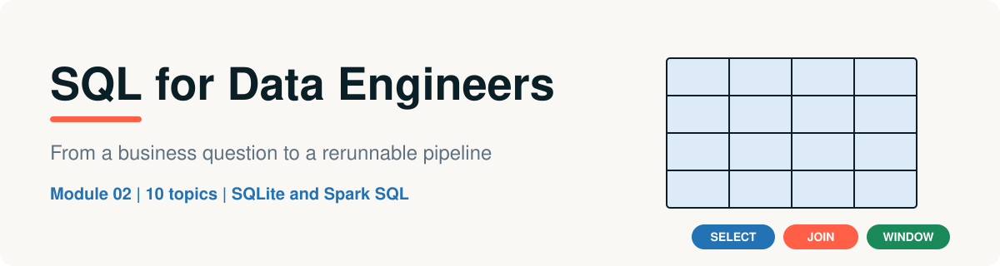
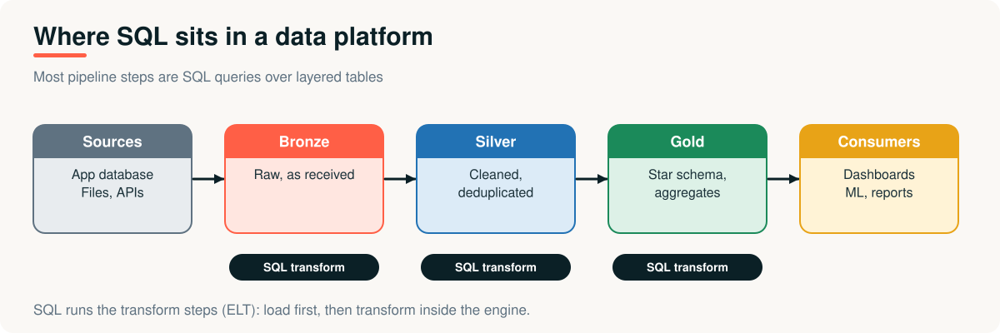
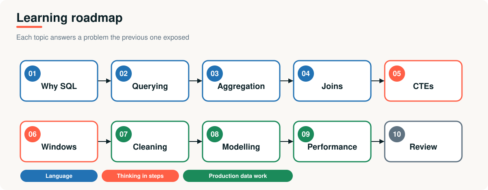

<div align="center">




</div>

# SQL for Data Engineers

**Module 02 of the Data Engineering learning path.**

Module 01 explained why data platforms exist. This module teaches the language that runs on them. You will follow one analyst, Asha at XYZ Company, from a single business question to a rerunnable pipeline:

> *Which regions grew fastest last quarter, and which products are returned most often?*

Every example runs against one small, deterministic **XYZ database** (60 customers, 916 orders, 1,773 order lines, 119 returns), so every output in these documents is real and you can reproduce it.



---

## Introduction

Every topic follows the structure used in Module 01:

1. **The business problem:** a realistic scenario that motivates the idea
2. **The concept:** what it is, and why it works that way
3. **How it works:** logical order, internal behaviour, diagrams
4. **Examples:** SQL you can run, with the real output beneath it
5. **Limitations and engineering considerations**
6. **Real-world applications, key takeaways and interview questions**

## Who is this for?

| Audience | What you get |
|---|---|
| **Students and career changers** | SQL from the first `SELECT`, with the reasoning behind each rule |
| **Analysts moving to engineering** | Cleaning, modelling, incremental loads and performance: the work after the query |
| **Interview candidates** | Questions with answers in every topic, plus rapid-fire and scenario practice in Topic 10 |
| **Trainers** | A ready-made, example-driven sequence for 3-4 sessions |

**Prerequisites:** Module 01 helps (OLTP vs OLAP, ELT, medallion layers), but is not required. No SQL knowledge is assumed.

## Learning objectives

After completing this module you will be able to:

- **Explain** why SQL is declarative and what the optimiser does for you
- **Predict** the result of a query using its logical order of execution and `NULL` rules
- **Aggregate** correctly with `GROUP BY`, `HAVING` and conditional aggregation
- **Choose** the right join, and detect and fix fan-out
- **Structure** long queries with CTEs, subqueries and set operations
- **Apply** window functions for rankings, top-N, period-over-period change and running totals
- **Clean** a messy feed, reject bad rows with reasons, and test data with SQL
- **Model** data as a star schema, keep history with SCD Type 2, and load incrementally and idempotently
- **Read** a query plan, and explain indexes, partition pruning, shuffles, broadcast joins and skew

---

## Topics covered

| # | Topic | Key concepts | Time |
|---|---|---|---|
| 01 | [Why SQL Still Matters](01-why-sql-still-matters.md) | Declarative vs imperative, SQL in ELT and medallion layers, the XYZ database | 30 min |
| 02 | [Querying Fundamentals](02-querying-fundamentals.md) | Logical order, filtering, `NULL` logic, `CASE`, dates | 40 min |
| 03 | [Aggregation and Grouping](03-aggregation-and-grouping.md) | `GROUP BY`, `HAVING`, `COUNT` variants, conditional aggregation | 40 min |
| 04 | [Joins](04-joins.md) | Join types, anti/semi joins, fan-out, join algorithms | 50 min |
| 05 | [Subqueries, CTEs and Set Operations](05-subqueries-ctes-and-set-operations.md) | CTEs, recursive CTEs, `EXISTS`, `UNION`, `EXCEPT` | 45 min |
| 06 | [Window Functions](06-window-functions.md) | Ranking, `LAG`/`LEAD`, frames, top-N per group | 55 min |
| 07 | [Cleaning and Validating Data](07-cleaning-and-validating-data.md) | Standardising, deduplication, reject pattern, SQL quality checks | 50 min |
| 08 | [Modelling and Loading with SQL](08-modelling-and-loading-with-sql.md) | Star schema, SCD Type 2, watermarks, upsert and `MERGE` | 65 min |
| 09 | [Query Performance and Execution](09-query-performance-and-execution.md) | `EXPLAIN`, indexes, pruning, shuffle, broadcast, skew | 55 min |
| 10 | [Module Review and Interview Prep](10-module-review-and-interview-prep.md) | Cheat sheet, rapid-fire and scenario questions, exercises | 45 min |

**Reference:** [Glossary](resources/glossary.md) · [Further reading](resources/further-reading.md) · [Examples guide](examples/README.md)

## Learning roadmap



### Choose your path

| Path | Time | Do this |
|---|---|---|
| **Express** | ~4 hours | Topics 02, 04, 06, 08, then the cheat sheet and questions in 10 |
| **Standard** | ~8-10 hours | All ten topics in order, running the examples as you go |
| **Deep dive** | ~12+ hours | Standard path, plus the exercises in Topic 10 and the pipeline script in Topic 08 |

---

## Repository structure

```text
02_SQL_for_Data_Engineers/
├── README.md                                  <- you are here
├── 01-why-sql-still-matters.md
├── 02-querying-fundamentals.md
├── 03-aggregation-and-grouping.md
├── 04-joins.md
├── 05-subqueries-ctes-and-set-operations.md
├── 06-window-functions.md
├── 07-cleaning-and-validating-data.md
├── 08-modelling-and-loading-with-sql.md
├── 09-query-performance-and-execution.md
├── 10-module-review-and-interview-prep.md
├── examples/                                  runnable SQL and Python
│   ├── xyz_data.py                            builds the XYZ database
│   ├── run_sql.py                             runs a .sql file and prints results
│   ├── 01_why_sql_still_matters.sql ... 09_query_performance_and_execution.sql
│   ├── 01_sql_vs_python_loop.py
│   ├── 08_incremental_elt_pipeline.py
│   └── 09_index_demo.py
├── resources/                                 glossary, further reading
└── assets/diagrams/
    ├── svg/                                   16 diagrams (used in the docs)
    ├── png/                                   same diagrams for slides
    └── src/                                   Python that draws them
```

## Running the examples

You need Python 3.8+ with the standard `sqlite3` module. SQLite **3.25 or newer** is required for window functions. Topic 04 also shows `RIGHT` and `FULL JOIN`, which need **3.39+**. Check yours with `python -c "import sqlite3; print(sqlite3.sqlite_version)"`.

```bash
cd examples
python run_sql.py 03_aggregation_and_grouping.sql     # run one topic's SQL
python 01_sql_vs_python_loop.py
python 08_incremental_elt_pipeline.py
python 09_index_demo.py
```

Spark SQL, Databricks and PostgreSQL snippets are labelled **not run here**: they need those engines, and they show the same idea in another dialect.

## Conventions used in these documents

| Element | Meaning |
|---|---|
| **Business problem** section | Every topic opens with a realistic scenario |
| SQL block followed by a `text` block | The SQL was **executed**, and the output shown is real |
| Blocks marked *not run here* | Spark SQL, Databricks or PostgreSQL syntax, shown for comparison |
| Collapsible **Interview questions** | Try answering before expanding |
| Diagram colours | Blue = foundations, orange = engines, green = results, red = problems |

> [!NOTE]
> Timings in Topic 09 depend on your machine. Read the ratio, not the absolute numbers.

## Using the diagrams in your own material

All diagrams are in [`assets/diagrams/png`](assets/diagrams/png) (slides) and [`assets/diagrams/svg`](assets/diagrams/svg) (sharp at any size). To edit one, change the Python in [`assets/diagrams/src`](assets/diagrams/src) and run `python build.py` (needs `pip install cairosvg`).

---

## Navigation

[Start with Topic 01: Why SQL Still Matters →](01-why-sql-still-matters.md)
