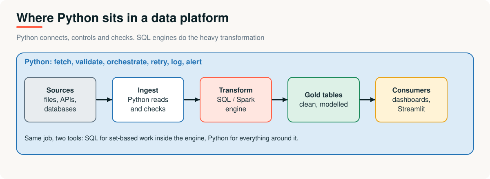
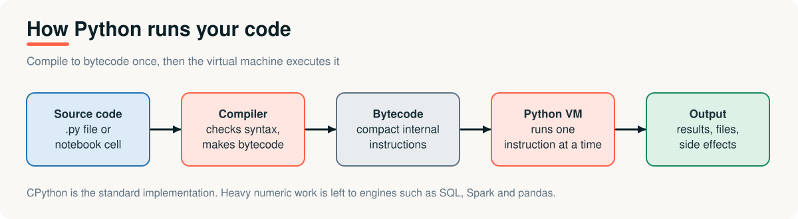

# 01 · Introduction to Python for Data Engineering

> **Module 03 · Topic 01 of 19** &nbsp;|&nbsp; Reading time: ~45 min &nbsp;|&nbsp; Level: Beginner

[Module home](README.md) &nbsp;·&nbsp; [Next: Literals, Keywords and Data Types →](02-literals-keywords-and-data-types.md)



## What you will learn

- What Python is, where it came from, and how it runs your code
- Why data engineers use Python alongside SQL
- What **Anaconda** is, how to install it, and when a plain `venv` is enough
- How to work in a **Jupyter notebook**: cells, modes, shortcuts and magic commands
- The basic **syntax rules**: indentation, comments, statements, case sensitivity
- A first look at Python's **data types**, which the next topics cover one by one

---

## 1. The business problem

In [Module 02](../02_SQL_for_Data_Engineers/README.md), Asha answered XYZ Company's questions with SQL. The queries are correct, but the work around them is not SQL work. This week she is asked for four things.

| Request | Can SQL do it? | What is missing |
|---|---|---|
| Fetch the daily order file that a partner uploads as CSV | No | SQL reads tables, not files on a server |
| Pull exchange rates from a web API every morning | No | SQL cannot call a web service |
| Retry a failed load three times, then send an alert | Not on its own | SQL has no loops, retries or error handling around a whole job |
| Check a file's structure before loading it, and log what happened | Only partly | Needs file handling, branching and logging |

Data engineering needs a language that can **connect** systems, **move** data, **control** the flow, and **recover** from failure. SQL transforms data inside an engine. **Python is the glue that runs around it.** This module teaches that language from the first line, always with data work in mind.

---

## 2. What is Python?

**Python** is a general-purpose programming language known for readable code. You write instructions in plain-looking text files (`.py`), and a program called the **interpreter** reads and runs them.

| Property | Meaning for you |
|---|---|
| **High-level** | You write `sum(values)`, not memory management |
| **Interpreted** | Code runs line by line, so you can test an idea immediately |
| **Dynamically typed** | You do not declare types. A variable takes the type of the value you assign |
| **General-purpose** | The same language does scripts, web services, automation, analytics and machine learning |
| **Large ecosystem** | Libraries exist for almost every data task |

### A short history

| Year | Event |
|---|---|
| 1991 | Guido van Rossum releases Python 0.9 |
| 2000 | Python 2.0 adds list comprehensions and garbage collection |
| 2008 | Python 3.0 fixes long-standing design problems, but is not backward compatible |
| 2020 | Python 2 reaches end of life. Python 3 is the only supported line |
| Today | Python 3 is the default language of data engineering, data science and ML tooling |

Always use **Python 3**. Everything in this module runs on Python 3.8 or newer.

### How your code runs



1. You write source code (`.py` file or a notebook cell).
2. The interpreter **compiles** it to bytecode, a compact internal form.
3. The Python virtual machine **executes** the bytecode, one instruction at a time.
4. Output, files and side effects appear.

The standard implementation is called **CPython**. Python is slower than compiled languages for heavy number crunching, which matters later: data engineers let engines such as SQL databases, Spark and pandas do the heavy work, and use Python to **coordinate** them.

---

## 3. Why Python for data engineering?

| Reason | Example in a data platform |
|---|---|
| **Orchestration** | Workflow tools such as Apache Airflow define pipelines as Python code |
| **Distributed processing** | PySpark runs Spark jobs from Python |
| **Data manipulation** | pandas and NumPy for tables and arrays |
| **Connectivity** | Drivers and libraries for databases, cloud storage, APIs and message queues |
| **Automation** | File handling, scheduling, logging, alerts, tests |
| **Machine learning** | scikit-learn, PyTorch and others share the same language as the pipeline |
| **Readability** | A teammate can read your pipeline without a manual |

### SQL and Python together

They do different jobs, and good pipelines use both.

| | **SQL** | **Python** |
|---|---|---|
| **Strength** | Set-based work inside a database or warehouse | Control flow, files, APIs, custom logic, automation |
| **Style** | Declarative: say what result you want | Imperative: say the steps |
| **Best for** | Filtering, joining, aggregating large tables | Moving data, calling services, retrying, validating, orchestrating |
| **Weak at** | Fetching files, retries, calling APIs | Processing huge tables row by row |

A typical nightly job: **Python** fetches the file, checks it and logs the result, **SQL** transforms and loads it, and **Python** reports success or failure.

Here is a small taste of what is ahead. It computes revenue per region from a few orders, the same question Asha asked in SQL. Do not worry about the details yet: each part is explained in the next topics.

```python
orders = [
    {"order_id": 1001, "region": "West",  "amount": 1200.0},
    {"order_id": 1002, "region": "East",  "amount": 800.0},
    {"order_id": 1003, "region": "West",  "amount": 300.0},
    {"order_id": 1004, "region": "North", "amount": 500.0},
]

revenue = {}
for order in orders:
    region = order["region"]
    revenue[region] = revenue.get(region, 0) + order["amount"]

for region, total in sorted(revenue.items()):
    print(region, total)
```

```text
East 800.0
North 500.0
West 1500.0
```

The loop builds a running total per region. In SQL this was one `GROUP BY`. For four rows it does not matter, and for millions of rows the database is the right place. Python earns its place when the work is **around** the query.

---

## 4. Anaconda

### What it is

**Anaconda** is a distribution: a single installer that bundles Python, the `conda` package and environment manager, Jupyter, and many data libraries (pandas, NumPy, matplotlib and more) that work together.

| Piece | Role |
|---|---|
| **Python** | The interpreter |
| **conda** | Installs packages and creates isolated **environments** |
| **Anaconda Navigator** | A desktop launcher for Jupyter and other tools |
| **Jupyter** | The notebook interface |
| **Preinstalled libraries** | pandas, NumPy, matplotlib and more, already compatible |

### Anaconda or plain Python?

| | **Anaconda / Miniconda** | **python.org + `venv` + `pip`** |
|---|---|---|
| **Setup** | One installer, everything included | Install Python, then add what you need |
| **Size** | Large (several GB) | Small |
| **Environments** | `conda create -n name` | `python -m venv .venv` |
| **Good for** | Learning, analysis, notebooks | Production code, containers, CI |

For this course, install Anaconda (or its smaller version, **Miniconda**) so that notebooks work immediately. Production pipelines usually use `venv` or similar tools, and the habits you learn (one environment per project) carry over.

> [!NOTE]
> Anaconda's licence terms differ for large commercial organisations. Check the current terms on the Anaconda website before using it at work. Miniconda with the free `conda-forge` channel is a common alternative.

### Installation

1. Download the installer for your operating system from the [Anaconda download page](https://www.anaconda.com/download).
2. **Windows:** run the `.exe`, choose "Just Me", and keep the defaults. **macOS:** open the `.pkg`. **Linux:** run the `.sh` file with `bash`.
3. Open **Anaconda Prompt** (Windows) or a new terminal (macOS and Linux).
4. Check that it works:

```bash
python --version
conda --version
```

### Environments

An **environment** is an isolated folder with its own Python and packages. Project A can use one version of a library and project B another, with no conflict. Make one per project.

```bash
conda create -n de-course python=3.11      # create
conda activate de-course                   # switch into it
conda install pandas                       # install a package into it
conda list                                 # see what is installed
conda deactivate                           # leave it
```

The `venv` equivalent, which works anywhere Python is installed:

```bash
python -m venv .venv
source .venv/bin/activate        # macOS, Linux   (Windows: .venv\Scripts\activate)
pip install pandas
```

---

## 5. Jupyter Notebook

### What it is

A **Jupyter notebook** is an interactive document made of **cells**. You write code in a cell, run it, and see the result directly below. Code, output, charts and explanations sit together, which makes notebooks excellent for learning, exploration and sharing analysis.

Start it from the Anaconda prompt:

```bash
jupyter notebook         # classic interface, opens in your browser
jupyter lab              # newer interface
```

### Cells and modes

| Cell type | Holds | Run it to |
|---|---|---|
| **Code** | Python | Execute it and show the output |
| **Markdown** | Formatted text | Render headings, lists, notes |

| Mode | How to enter | What it does |
|---|---|---|
| **Edit mode** | Press `Enter`, or click in a cell | Type inside the cell (green border) |
| **Command mode** | Press `Esc` | Act on cells as a whole (blue border) |

### Basic commands and shortcuts

| Action | Shortcut |
|---|---|
| Run the cell and stay | `Ctrl + Enter` |
| Run the cell and move to the next | `Shift + Enter` |
| Insert a cell above / below (command mode) | `A` / `B` |
| Delete a cell (command mode) | `D`, `D` |
| Convert to Markdown / Code (command mode) | `M` / `Y` |
| Undo cell deletion | `Z` |
| Restart the kernel | `0`, `0` |

The **kernel** is the Python process behind the notebook. It remembers every variable you created, in the order you **ran** cells, not the order they appear on the page. If results look strange, use **Kernel, Restart and Run All** to check that the notebook works from top to bottom.

### Magic commands

Lines starting with `%` or `!` are special notebook commands, not Python:

```text
%timeit sum(range(1000))      times a statement
%%time                        first line of a cell: times the whole cell
%pwd                          current folder
!pip install requests         run a shell command
```

> [!NOTE]
> Notebooks are for exploring and teaching. **Production pipelines are normally `.py` files** that run from a scheduler, because they are easier to test, review and version control. You will write both in this module.

---

## 6. Python syntax

Syntax is the set of rules for writing valid code. Python keeps them few.

### Statements and output

Each line is normally one **statement**. `print()` displays a value.

```python
print("Hello, XYZ Company")
print(2 + 3)
```

```text
Hello, XYZ Company
5
```

### Indentation is part of the language

Python uses **indentation** (spaces at the start of a line) to mark blocks of code. Other languages use braces. Use 4 spaces for each level, which is the standard.

```python
amount = 1200

if amount > 1000:
    print("Large order")        # inside the if block: indented
    print("Needs approval")     # same block
print("Done")                   # not indented: runs either way
```

```text
Large order
Needs approval
Done
```

Wrong indentation is an error, not a style issue:

```python
if amount > 1000:
print("Large order")
# IndentationError: expected an indented block after 'if' statement
```

### Comments

A comment is text Python ignores, used to explain *why*, not to repeat *what*.

```python
# This whole line is a comment
price = 499        # a comment after code

"""
A triple-quoted string on its own is often used as a multi-line note.
"""
print(price)
```

```text
499
```

### Case sensitivity and names

`Revenue`, `revenue` and `REVENUE` are three different names. Use lowercase with underscores (`order_total`) by convention. The rules for names are in [Topic 02](02-literals-keywords-and-data-types.md).

### Several statements and long lines

```python
a = 5; b = 7; print(a + b)        # semicolons allow several statements on one line (rarely used)

total = (1200 +
         800 +
         300)                      # brackets let a statement continue on the next line
print(total)
```

```text
12
2300
```

### Quick syntax reference

| Rule | Example |
|---|---|
| Blocks use indentation | `if x:` then an indented block |
| A colon opens a block | `if`, `for`, `while`, `def`, `class` |
| Comments start with `#` | `# note` |
| Names are case sensitive | `Total` is not `total` |
| Strings use `'...'` or `"..."` | `"West"` |
| Brackets let a line continue | `(a + b +` newline `c)` |

---

## 7. Data types: a first overview

Every value in Python has a **type**. The type decides what you can do with the value. The next topics cover each in depth. This is the map.

| Group | Type | Example | Mutable? |
|---|---|---|---|
| **Numbers** | `int` | `42` | No |
| | `float` | `499.99` | No |
| | `complex` | `3 + 2j` | No |
| **Truth** | `bool` | `True`, `False` | No |
| **Nothing** | `NoneType` | `None` | No |
| **Text** | `str` | `"West"` | No |
| **Sequences** | `list` | `[1, 2, 3]` | **Yes** |
| | `tuple` | `(1, 2, 3)` | No |
| **Unique values** | `set` | `{1, 2, 3}` | **Yes** |
| **Key-value** | `dict` | `{"region": "West"}` | **Yes** |

**Mutable** means the object can be changed after it is created. This matters a great deal in practice and has its own section in [Topic 06](06-dictionary.md).

`type()` tells you the type of any value:

```python
values = [42, 499.99, 3 + 2j, True, None, "West", [1, 2], (1, 2), {1, 2}, {"region": "West"}]

for value in values:
    print(f"{value!r:<20} {type(value).__name__}")
```

```text
42                   int
499.99               float
(3+2j)               complex
True                 bool
None                 NoneType
'West'               str
[1, 2]               list
(1, 2)               tuple
{1, 2}               set
{'region': 'West'}   dict
```

Python decides the type from the value, so a variable can hold different types at different times. This is called **dynamic typing**:

```python
x = 10
print(x, type(x).__name__)

x = "ten"
print(x, type(x).__name__)
```

```text
10 int
ten str
```

Dynamic typing is flexible, and it is also a source of bugs, because nothing stops you passing text where a number is expected. Later topics show how data engineers guard against that with validation and type hints.

### Types in a data record

One order, as Python sees it:

```python
order = {
    "order_id": 1001,            # int
    "customer": "Meera Iyer",    # str
    "amount": 1200.50,           # float
    "is_paid": True,             # bool
    "coupon": None,              # None: no coupon used
    "items": ["Shoes", "Socks"], # list
}

for field, value in order.items():
    print(f"{field:<10} {type(value).__name__:<6} {value}")
```

```text
order_id   int    1001
customer   str    Meera Iyer
amount     float  1200.5
is_paid    bool   True
coupon     NoneType None
items      list   ['Shoes', 'Socks']
```

---

## 8. Limitations and engineering considerations

| Issue | Detail |
|---|---|
| **Speed** | Pure Python loops are slow for very large data. Use SQL engines, Spark or vectorised libraries for bulk work |
| **Dynamic typing** | Type errors appear at run time. Test and validate inputs |
| **Notebook state** | Cells run in any order, so a notebook can give results that a clean run would not. Restart and Run All before trusting it |
| **Environment drift** | "Works on my machine" usually means different package versions. Use one environment per project and record versions |
| **Python 2 vs 3** | Old tutorials may use Python 2 syntax. Check the version first |
| **Parallelism** | A global interpreter lock (GIL) limits threads running Python code at once, so large-scale parallel work goes to Spark or similar engines |

## 9. Real-world applications

- **Orchestration:** Airflow, Prefect and Dagster define pipelines in Python.
- **Spark jobs:** PySpark lets you write distributed transformations in Python.
- **Ingestion:** scripts fetch files, call APIs and read from queues.
- **Data quality:** checks run after each load and alert when something fails.
- **Automation:** report generation, cloud storage housekeeping, access management.
- **Analytics and ML:** notebooks for exploration, the same language for production models.

---

## Key takeaways

1. **Python is the glue of data engineering:** it connects systems, controls flow, retries and reports. SQL transforms data inside the engine.
2. Python is **high-level, interpreted and dynamically typed**. Use Python 3.
3. **Anaconda** bundles Python, conda, Jupyter and data libraries. Use **one environment per project**.
4. A **Jupyter notebook** is made of code and Markdown cells. The **kernel** remembers state in the order cells were *run*. Restart and Run All to check it.
5. Python uses **indentation** for blocks, `#` for comments, and is **case sensitive**.
6. Every value has a **type**. `type()` shows it. Lists, sets and dictionaries are mutable, while strings, numbers and tuples are not.
7. Production pipelines are normally `.py` files. Notebooks are for exploration.

## Interview questions

<details><summary><b>1.</b> What is Python, and why is it popular in data engineering?</summary>

A readable, high-level, interpreted language with a vast ecosystem. In data engineering it orchestrates pipelines (Airflow), runs distributed jobs (PySpark), manipulates data (pandas), connects to databases, files and APIs, and automates tasks, in the same language used for analytics and machine learning.
</details>

<details><summary><b>2.</b> When would you use Python instead of SQL, and when SQL instead of Python?</summary>

SQL for set-based filtering, joining and aggregating large tables inside the database or warehouse. Python for what surrounds that: fetching files, calling APIs, control flow, retries, validation, logging and orchestration. Most pipelines combine both.
</details>

<details><summary><b>3.</b> What is Anaconda, and how does <code>conda</code> differ from <code>pip</code>?</summary>

Anaconda is a distribution bundling Python, conda, Jupyter and data libraries. `conda` manages environments and packages (including non-Python dependencies), while `pip` installs Python packages from PyPI into the current environment.
</details>

<details><summary><b>4.</b> Why use virtual environments?</summary>

They isolate each project's Python version and packages, so different projects can use conflicting versions and the project can be reproduced elsewhere.
</details>

<details><summary><b>5.</b> What is the kernel in Jupyter, and why can a notebook give misleading results?</summary>

The kernel is the Python process that runs cells and holds variables. Cells can be run out of order or edited after running, so the state may not match what the page shows. Restart the kernel and run all cells to confirm.
</details>

<details><summary><b>6.</b> How does Python mark code blocks?</summary>

By indentation (four spaces by convention) after a line ending in a colon. Inconsistent indentation raises an `IndentationError`.
</details>

<details><summary><b>7.</b> What does "dynamically typed" mean, and what is its risk?</summary>

A variable's type is determined by the value it holds at run time, and it can change. The risk is that type mistakes show up only when the code runs, so validation and tests matter.
</details>

<details><summary><b>8.</b> Name Python's basic data types and which are mutable.</summary>

`int`, `float`, `complex`, `bool`, `NoneType`, `str`, `list`, `tuple`, `set` and `dict`. Lists, sets and dictionaries are mutable. The others are immutable.
</details>

## Official documentation

- [The Python Tutorial](https://docs.python.org/3/tutorial/index.html) · [Python Language Reference](https://docs.python.org/3/reference/index.html)
- [Built-in types](https://docs.python.org/3/library/stdtypes.html) · [Lexical analysis (indentation, comments)](https://docs.python.org/3/reference/lexical_analysis.html)
- [venv: creating virtual environments](https://docs.python.org/3/library/venv.html)
- [Anaconda documentation](https://docs.anaconda.com/) · [conda user guide](https://docs.conda.io/projects/conda/en/stable/user-guide/index.html)
- [Jupyter Notebook documentation](https://jupyter-notebook.readthedocs.io/en/stable/)

---

| Previous | Contents | Next |
|:---|:---:|:---|
| [← Module home](README.md) | [Module home](README.md#topics-covered) | [Literals, Keywords and Data Types →](02-literals-keywords-and-data-types.md) |
