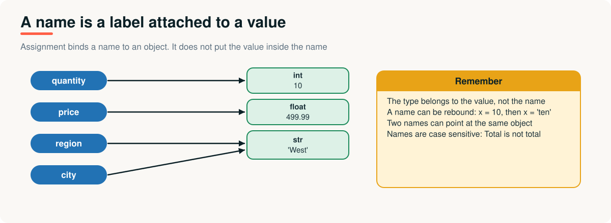

# 02 · Literals, Keywords and Data Types

> **Module 03 · Topic 02 of 19** &nbsp;|&nbsp; Reading time: ~50 min &nbsp;|&nbsp; Level: Beginner

[Module home](README.md) &nbsp;·&nbsp; [← Previous: Introduction to Python for Data Engineering](01-introduction-to-python-for-data-engineering.md) &nbsp;·&nbsp; [Next: Operators and Intro to Conditions →](03-operators-and-intro-conditions.md)



## What you will learn

- What a **literal** is, and which kinds Python has
- What an **identifier** is, and the rules for naming one
- Which words are reserved **keywords**, and how to list them
- How **variables** and **data types** work, including dynamic typing
- How to use `print()` to show output and `input()` to read it, and why `input()` always returns text

---

## 1. The business problem

Asha writes her first script to check one order before it is loaded. Within an hour she hits four errors.

| What she wrote | What happened | Underlying concept |
|---|---|---|
| `2nd_region = "West"` | `SyntaxError` | An identifier cannot start with a digit |
| `class = "Fashion"` | `SyntaxError` | `class` is a reserved keyword |
| `total = input("Amount: ") + 100` | `TypeError` | `input()` returns text, not a number |
| `print(0.1 + 0.2 == 0.3)` | Prints `False` | Floats are approximations |

Every one of these comes from the same few ideas: how Python writes values, how it names them, and what types they have. This topic covers them in the order you meet them.

---

## 2. Literals

A **literal** is a value written directly in the code. Python reads it and creates an object of the matching type.

| Kind | Examples | Type |
|---|---|---|
| Integer | `42`, `-7`, `1_000_000`, `0b1010`, `0o17`, `0xFF` | `int` |
| Float | `499.99`, `1.5e3` | `float` |
| Complex | `3 + 2j` | `complex` |
| String | `"West"`, `'East'`, `"""multi-line"""` | `str` |
| Boolean | `True`, `False` | `bool` |
| Special | `None` | `NoneType` |
| Collections | `[1, 2]`, `(1, 2)`, `{1, 2}`, `{"a": 1}` | `list`, `tuple`, `set`, `dict` |

```python
print(1_000_000)        # underscores make large numbers readable
print(0b1010, 0o17, 0xFF)   # binary, octal and hexadecimal: all print as decimal
print(1.5e3)            # scientific notation
print(type(3 + 2j).__name__)
print("It's fine", 'She said "hello"')    # quote one kind inside the other
```

```text
1000000
10 15 255
1500.0
complex
It's fine She said "hello"
```

The prefixes `0b`, `0o` and `0x` write the same integer in another base. You will meet them rarely, but they appear in file formats, permissions and hashes.

---

## 3. Identifiers

An **identifier** is a name you choose: for a variable, function, class or module. It lets you refer to a value later.

```python
order_total = 1200
print(order_total)
```

```text
1200
```

`order_total` is the identifier. It does not hold the number. It is a **label attached to** the value, a picture drawn in the diagram at the top. This idea explains many behaviours later, especially in the [dictionary topic](06-dictionary.md) when two names refer to the same list.

### Rules for naming an identifier

| Rule | Valid | Invalid |
|---|---|---|
| Letters, digits and underscore only | `order_total`, `region2` | `order-total`, `order total`, `total$` |
| Cannot start with a digit | `region2`, `_temp` | `2nd_region` |
| Case sensitive | `Total` and `total` are different names | |
| Cannot be a keyword | `klass`, `class_name` | `class`, `for`, `if` |
| No length limit | | |

Python can check a name for you:

```python
import keyword

candidates = ["order_total", "region2", "_temp", "2nd_region", "order-total", "order total", "class", "Total"]

for name in candidates:
    ok = name.isidentifier() and not keyword.iskeyword(name)
    print(f"{name!r:<14} valid: {ok}")
```

```text
'order_total'  valid: True
'region2'      valid: True
'_temp'        valid: True
'2nd_region'   valid: False
'order-total'  valid: False
'order total'  valid: False
'class'        valid: False
'Total'        valid: True
```

### Naming conventions

Valid is not the same as good. The style guide **PEP 8** sets the conventions that nearly all Python teams follow.

| Item | Convention | Example |
|---|---|---|
| Variables and functions | `snake_case` | `order_total`, `clean_amount()` |
| Constants | `UPPER_CASE` | `MAX_RETRIES = 3` |
| Classes | `PascalCase` | `OrderRecord` |
| "Private" by convention | Leading underscore | `_cache` |
| Avoid | One-letter names (except short loops), and `l`, `O`, `I` | |

Names should say **what the value means**. `rev_q4_west` explains itself and `x2` does not. In pipelines, a clear name is documentation that cannot go out of date.

---

## 4. Keywords

**Keywords** are words with a fixed meaning in the language. You cannot use them as identifiers. The `keyword` module lists them:

```python
import keyword
import textwrap

print(textwrap.fill(" ".join(keyword.kwlist), width=70))
```

```text
False None True and as assert async await break class continue def del
elif else except finally for from global if import in is lambda
nonlocal not or pass raise return try while with yield
```

About 35 of them exist, and you will learn most in this module. A few you already know in spirit:

| Group | Keywords |
|---|---|
| Values | `True`, `False`, `None` |
| Decisions | `if`, `elif`, `else` |
| Loops | `for`, `while`, `break`, `continue` |
| Functions and classes | `def`, `return`, `lambda`, `class` |
| Errors | `try`, `except`, `finally`, `raise` |
| Logic and tests | `and`, `or`, `not`, `in`, `is` |
| Imports | `import`, `from`, `as` |

`True`, `False` and `None` are capitalised. `true` is not a keyword: it is just an unknown name, and using it gives a `NameError`.

### Keywords are not built-in functions

`print`, `len`, `sum`, `list`, `max` and similar are **built-in functions and types**, not keywords. Python lets you reuse their names, and that is a classic trap:

```python
amounts = [1200, 800, 300]
print(sum(amounts))

sum = 99                       # shadows the built-in function for the rest of the program
try:
    print(sum(amounts))
except TypeError as error:
    print("TypeError:", error)

del sum                        # remove our name, and the built-in is visible again
print(sum(amounts))
```

```text
2300
TypeError: 'int' object is not callable
2300
```

Avoid names such as `list`, `dict`, `str`, `sum`, `max`, `min`, `id`, `type` and `input` for your own variables. Use `order_list` or `total` instead.

---

## 5. Variables and data types

A **variable** is a name bound to a value with the assignment operator `=`. You do not declare a type first.

```python
region = "West"           # str
quantity = 3              # int
unit_price = 499.99       # float
is_paid = True            # bool
coupon = None             # NoneType

print(region, quantity, unit_price, is_paid, coupon)
print(type(region).__name__, type(quantity).__name__, type(unit_price).__name__)
```

```text
West 3 499.99 True None
str int float
```

### Assigning several names

```python
a = b = c = 0                     # the same value to three names
region, city = "West", "Pune"    # one value for each name, in order
first, second = 10, 20
first, second = second, first    # swap without a temporary variable

print(a, b, c)
print(region, city)
print(first, second)
```

```text
0 0 0
West Pune
20 10
```

### Dynamic typing

The **name** has no type. The **value** does, and a name can be pointed at a value of another type:

```python
value = 42
print(type(value).__name__)
value = "forty-two"
print(type(value).__name__)

print(isinstance(42, int), isinstance(42, (int, float)), isinstance("42", int))
```

```text
int
str
True True False
```

`isinstance(value, type)` is the preferred test of a value's type. It also accepts a tuple of types.

### Numbers in practice

Integers have no size limit. Floats are stored in binary and cannot hold most decimals exactly:

```python
print(2 ** 100)                 # big integers just work
print(0.1 + 0.2)                # a float surprise
print(0.1 + 0.2 == 0.3)
print(round(0.1 + 0.2, 2) == 0.3)

from decimal import Decimal
print(Decimal("0.1") + Decimal("0.2") == Decimal("0.3"))     # exact decimal arithmetic
```

```text
1267650600228229401496703205376
0.30000000000000004
False
True
True
```

For money, data engineers store **integer minor units** (paise or cents) or use `Decimal`, and compare floats with a tolerance (`math.isclose`). Never compare computed floats with `==`.

### Booleans, and `None`

`bool` is a subtype of `int`: `True` behaves as `1` and `False` as `0`. `None` means "no value", and is not the same as `0` or an empty string:

```python
print(True + True, False + 5)
print(isinstance(True, int))

coupon = None
print(coupon is None, coupon == 0, coupon == "")
```

```text
2 5
True
True False False
```

**Truthiness.** Any value can be used where a condition is expected. These are treated as false: `0`, `0.0`, `""`, `[]`, `()`, `{}`, `set()` and `None`. Everything else is true.

```python
for value in [0, 0.0, "", [], {}, None, "0", [0], -1]:
    print(f"{value!r:<6} -> {bool(value)}")
```

```text
0      -> False
0.0    -> False
''     -> False
[]     -> False
{}     -> False
None   -> False
'0'    -> True
[0]    -> True
-1     -> True
```

Note that the string `"0"` is true. It is not empty.

### Converting between types

Functions named after the type convert a value (**type casting**): `int()`, `float()`, `str()`, `bool()`.

```python
print(int("42") + 1)
print(float("499.99"))
print(str(1200) + " INR")
print(int(7.9), int(-7.9))        # int() truncates toward zero, it does not round
print(int(True), float(3))

try:
    int("12.5")
except ValueError as error:
    print("ValueError:", error)
```

```text
43
499.99
1200 INR
7 -7
1 3.0
ValueError: invalid literal for int() with base 10: '12.5'
```

`int("12.5")` fails because the text is not an integer. Convert in two steps, `int(float("12.5"))`, if that is really what you mean.

### Common functions for any value

| Function | Use | Example |
|---|---|---|
| `type(x)` | The type of a value | `type(3)` |
| `isinstance(x, T)` | Is it of type `T`? | `isinstance(3, int)` |
| `id(x)` | Identity of the object | `id(order)` |
| `len(x)` | Number of items | `len("West")` |
| `del x` | Remove a name | `del temp` |

---

## 6. Output: `print()`

`print()` writes values to the screen, separated by spaces, followed by a new line. Two keyword arguments control that:

| Argument | Controls | Default |
|---|---|---|
| `sep` | Text between values | `" "` |
| `end` | Text after the last value | `"\n"` |

```python
print("West", 1200, True)
print("West", 1200, "Q4", sep=" | ")
print("Loading", end="...")
print("done")

print("Region:\tWest")                # \t is a tab
print("Line one\nLine two")            # \n is a new line
print("A backslash: \\")
print(r"C:\data\orders.csv")           # r"" is a raw string: backslashes stay as written
```

```text
West 1200 True
West | 1200 | Q4
Loading...done
Region:	West
Line one
Line two
A backslash: \
C:\data\orders.csv
```

### Formatting values with f-strings

An **f-string** (a string starting with `f`) evaluates expressions written inside `{}`. It is the cleanest way to build messages. Topic 07 covers all its options.

```python
region = "West"
revenue = 1197802.8
growth = 2.25

print(f"{region} revenue: {revenue:,.2f}")
print(f"{region} growth: {growth:.1%}")
print(f"{region=}")                    # prints the name and value: handy when debugging
```

```text
West revenue: 1,197,802.80
West growth: 225.0%
region='West'
```

---

## 7. Input: `input()`

`input(prompt)` shows a prompt, waits for the user to type, and returns what they typed **as a string**, always.

```python
customer = input("Customer name: ")
amount = input("Order amount: ")

print(f"Read {customer!r} of type {type(customer).__name__}")
print(f"Read {amount!r} of type {type(amount).__name__}")
```

```text
Customer name: Meera Iyer
Order amount: 1200
Read 'Meera Iyer' of type str
Read '1200' of type str
```

The second value looks like a number but is text. This is the third error in the business-problem table:

```python
amount = "1200"
try:
    total = amount + 100
except TypeError as error:
    print("TypeError:", error)

total = int(amount) + 100        # convert first
print(total)
```

```text
TypeError: can only concatenate str (not "int") to str
1300
```

Always convert what you read, and expect bad input.

```python
raw = input("Order amount: ")

try:
    amount = float(raw)
    print(f"Accepted {amount:.2f}")
except ValueError:
    print(f"{raw!r} is not a valid amount")
```

```text
Order amount: abc
'abc' is not a valid amount
```

Here the `try` and `except` lines catch a conversion failure so the script reports it instead of stopping. Exceptions are covered in full in [Topic 17](17-file-handling-and-exception-handling.md).

> [!NOTE]
> In the documents of this module, `input()` is run with fixed answers so the output is reproducible. In a real run, you type them.

### Reading several values

```python
region, amount, quantity = input("region,amount,quantity: ").split(",")
print(region, int(amount) * int(quantity))
```

```text
region,amount,quantity: West,1200,3
West 3600
```

`split(",")` breaks the text at each comma into a list, which is unpacked into three names. [Topic 07](07-strings-i.md) covers it.

---

## 8. Limitations and engineering considerations

| Issue | Detail |
|---|---|
| **Shadowing built-ins** | Names such as `list` or `sum` silently replace the built-in function. Use descriptive names |
| **Float arithmetic** | Floats are approximate. Use integers in minor units or `Decimal` for money |
| **Dynamic typing** | A wrong type surfaces at run time, often far from the cause. Validate input at the boundary |
| **`input()` is text** | Every value needs converting and validating. Pipelines rarely use `input()`: they read files, arguments or environment variables |
| **Truthiness surprises** | `0`, `""` and `None` are all false, but they mean different things. Test `is None` when you mean "missing" |
| **Naming** | Short or generic names make pipelines hard to maintain |

## 9. Real-world applications

- **Configuration and constants:** `UPPER_CASE` names for settings such as batch sizes and retry counts.
- **Validation:** converting and checking incoming values before they reach a table.
- **Missing data:** `None` represents a missing value from a source before it becomes a database `NULL`.
- **Logging and messages:** `print()` and f-strings build the status lines a job writes.
- **Money:** integer paise or `Decimal` instead of floats.

---

## Key takeaways

1. A **literal** is a value written in code. Its type follows from how it is written.
2. An **identifier** is a name: letters, digits and underscores, not starting with a digit, case sensitive, and never a **keyword**.
3. Follow **PEP 8**: `snake_case` for variables and functions, `UPPER_CASE` for constants, `PascalCase` for classes.
4. `keyword.kwlist` lists the keywords. Built-ins such as `list` and `sum` are not keywords, but should not be reused as names.
5. A variable is a **label on a value**. The value has the type, and Python is **dynamically typed**.
6. Floats are approximate. Money belongs in integers or `Decimal`.
7. `None` means "no value" and differs from `0` and `""`. Test it with `is None`.
8. `print()` has `sep` and `end`. `input()` always returns a **string**, so convert and validate it.

## Interview questions

<details><summary><b>1.</b> What is an identifier, and what are the naming rules?</summary>

A name given to a variable, function, class or module. It may contain letters, digits and underscores, must not start with a digit, is case sensitive, and cannot be a keyword.
</details>

<details><summary><b>2.</b> What is a keyword? How do you list them?</summary>

A reserved word with special meaning, such as `if`, `for`, `def` and `class`. They cannot be used as identifiers. `import keyword; keyword.kwlist` lists them, and `keyword.iskeyword(name)` tests one.
</details>

<details><summary><b>3.</b> Is <code>print</code> a keyword?</summary>

No. In Python 3 it is a built-in function. Built-ins can be shadowed by assignment (`print = 5`), which is why you should not reuse their names.
</details>

<details><summary><b>4.</b> What does "dynamically typed" mean?</summary>

The type belongs to the value, not to the variable name. A name can be rebound to a value of another type, and type errors are detected at run time.
</details>

<details><summary><b>5.</b> Why does <code>0.1 + 0.2 == 0.3</code> give <code>False</code>?</summary>

Floats are stored in binary, and 0.1 and 0.2 cannot be represented exactly, so the sum is a tiny bit off 0.3. Compare with a tolerance (`math.isclose`), or use `Decimal` or integers for exact amounts.
</details>

<details><summary><b>6.</b> What does <code>input()</code> return, and how do you read a number?</summary>

Always a string. Convert it with `int()` or `float()`, and handle the `ValueError` that bad input raises.
</details>

<details><summary><b>7.</b> What is the difference between <code>None</code>, <code>0</code> and an empty string?</summary>

`None` means no value, `0` is a number and `""` is empty text. All three are false in a condition, but they are different values, so test missing data with `is None`.
</details>

<details><summary><b>8.</b> What do <code>sep</code> and <code>end</code> do in <code>print()</code>?</summary>

`sep` sets the text placed between multiple values (default a space), and `end` sets the text printed after the last one (default a new line).
</details>

## Official documentation

- [Lexical analysis: identifiers and keywords](https://docs.python.org/3/reference/lexical_analysis.html#identifiers) · [Literals](https://docs.python.org/3/reference/lexical_analysis.html#literals)
- [`keyword` module](https://docs.python.org/3/library/keyword.html)
- [Built-in functions](https://docs.python.org/3/library/functions.html) · [Built-in types](https://docs.python.org/3/library/stdtypes.html)
- [`decimal` module](https://docs.python.org/3/library/decimal.html) · [`math.isclose`](https://docs.python.org/3/library/math.html#math.isclose)
- [Floating point arithmetic: issues and limitations](https://docs.python.org/3/tutorial/floatingpoint.html)
- [PEP 8: Style Guide for Python Code](https://peps.python.org/pep-0008/)

---

| Previous | Contents | Next |
|:---|:---:|:---|
| [← Introduction to Python for Data Engineering](01-introduction-to-python-for-data-engineering.md) | [Module home](README.md#topics-covered) | [Operators and Intro to Conditions →](03-operators-and-intro-conditions.md) |
