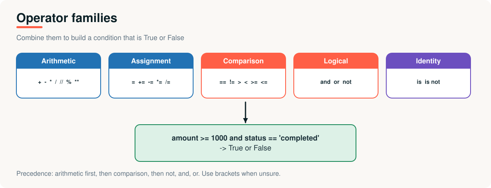
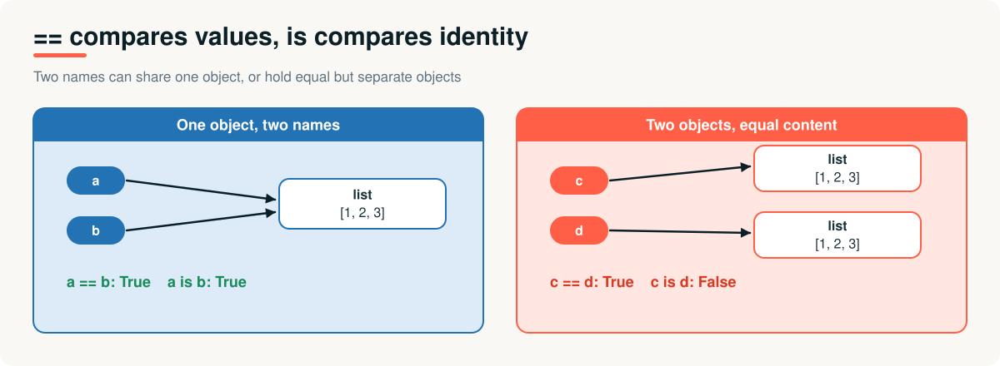

# 03 · Operators and Intro to Conditions

> **Module 03 · Topic 03 of 19** &nbsp;|&nbsp; Reading time: ~50 min &nbsp;|&nbsp; Level: Beginner

[Module home](README.md) &nbsp;·&nbsp; [← Previous: Literals, Keywords and Data Types](02-literals-keywords-and-data-types.md) &nbsp;·&nbsp; [Next: Lists and Intro to For Loops →](04-lists-and-intro-to-for-loops.md)



## What you will learn

- The **arithmetic**, **assignment**, **comparison**, **logical** and **identity** operators
- How operator **precedence** decides what runs first
- The difference between `==` and `is`
- How to make a program decide with `if` and `if ... else`

---

## 1. The business problem

Asha is turning her order checks into code. The rules look simple, and the first version gets several of them wrong.

| Rule from the business | First attempt | What went wrong |
|---|---|---|
| Split 1,773 order lines into pages of 500 | `1773 / 500` | Gives `3.546`, not "3 pages and 273 left over" |
| Flag completed orders | `if status = "completed"` | `SyntaxError`: `=` assigns, `==` compares |
| Treat a missing coupon | `if coupon == None` | Works, but the safe test is `is None` |
| Large completed orders go to approval | `amount > 1000 or amount < 0 and status == "completed"` | `and` binds tighter than `or`, so the rule means something else |
| Compare two lists of order IDs | `ids_a is ids_b` | `False`, though both hold the same IDs |

Operators are small, but they decide whether business rules mean what you wrote. This topic covers each family, and ends with `if`, the first way to act on a result.

---

## 2. Arithmetic operators

| Operator | Meaning | Example | Result |
|---|---|---|---|
| `+` | Add | `7 + 2` | `9` |
| `-` | Subtract | `7 - 2` | `5` |
| `*` | Multiply | `7 * 2` | `14` |
| `/` | True division, always a `float` | `7 / 2` | `3.5` |
| `//` | Floor division | `7 // 2` | `3` |
| `%` | Modulo (remainder) | `7 % 2` | `1` |
| `**` | Power | `7 ** 2` | `49` |

```python
print(7 + 2, 7 - 2, 7 * 2)
print(7 / 2, 8 / 2)           # / always returns a float
print(7 // 2, 7 % 2, 7 ** 2)
print(divmod(7, 2))            # quotient and remainder in one call
```

```text
9 5 14
3.5 4.0
3 1 49
(3, 1)
```

### Floor division and negative numbers

`//` rounds **down**, toward minus infinity, not toward zero. The remainder keeps the sign of the divisor so that `a == (a // b) * b + a % b` always holds.

```python
print(-7 // 2, -7 % 2)
print(int(-7 / 2))            # truncates toward zero: a different answer
```

```text
-4 1
-3
```

### Paging through data

The business problem: 1,773 order lines, pages of 500.

```python
lines = 1773
page_size = 500

full_pages, remainder = divmod(lines, page_size)
total_pages = full_pages + (1 if remainder else 0)

print(f"{full_pages} full pages, {remainder} lines left, {total_pages} pages in total")
print(-(-lines // page_size))     # a common ceiling-division trick: negate, floor-divide, negate
```

```text
3 full pages, 273 lines left, 4 pages in total
4
```

Batch sizes, pagination and partitioning use `//` and `%` all the time. A common use of `%` is a rotation: `row_number % 4` cycles through 0, 1, 2, 3.

### Operators on text and collections

`+` and `*` also work on strings and lists, where they join and repeat:

```python
print("Order " + "1001")
print("-" * 20)
print([0] * 5)
print([1, 2] + [3])
```

```text
Order 1001
--------------------
[0, 0, 0, 0, 0]
[1, 2, 3]
```

### Division by zero

```python
try:
    print(100 / 0)
except ZeroDivisionError as error:
    print("ZeroDivisionError:", error)
```

```text
ZeroDivisionError: division by zero
```

---

## 3. Assignment operators

`=` binds a name to a value. **Augmented assignment** combines an operation with the assignment and updates the name in place.

| Operator | Same as | Operator | Same as |
|---|---|---|---|
| `x = 5` | bind `x` to 5 | `x //= 2` | `x = x // 2` |
| `x += 3` | `x = x + 3` | `x %= 2` | `x = x % 2` |
| `x -= 3` | `x = x - 3` | `x **= 2` | `x = x ** 2` |
| `x *= 3` | `x = x * 3` | `x /= 2` | `x = x / 2` |

```python
revenue = 1000
revenue += 250        # add
revenue -= 50         # subtract
revenue *= 2          # multiply
print(revenue)

revenue //= 7
print(revenue)
revenue **= 2
print(revenue)

log = "start"
log += " > load"      # += also works on strings
print(log)
```

```text
2400
342
116964
start > load
```

A running total is the typical use: start from zero and `+=` each value.

---

## 4. Comparison (relational) operators

A comparison returns a **boolean**: `True` or `False`.

| Operator | Meaning | Example | Result |
|---|---|---|---|
| `==` | Equal to | `5 == 5` | `True` |
| `!=` | Not equal to | `5 != 3` | `True` |
| `>` | Greater than | `5 > 3` | `True` |
| `<` | Less than | `5 < 3` | `False` |
| `>=` | Greater than or equal | `5 >= 5` | `True` |
| `<=` | Less than or equal | `5 <= 3` | `False` |

```python
amount = 1200
print(amount == 1200, amount != 1200)
print(amount > 1000, amount < 1000)
print(amount >= 1200, amount <= 1000)

print("West" == "west")            # text comparison is case sensitive
print("Delhi" < "Pune")            # strings compare alphabetically, by character code
print(1 == 1.0)                    # numbers of different types compare by value
print(1 == "1")                    # different kinds of value are simply not equal
```

```text
True False
True False
True False
False
True
True
False
```

`=` assigns and `==` compares. Writing `if status = "completed"` is a `SyntaxError`, which is Python protecting you from a mistake that other languages allow.

### Chained comparisons

Python lets you write a range test the way you say it:

```python
amount = 1200

print(1000 <= amount < 5000)               # a range test
print(1000 <= amount and amount < 5000)    # the long form: the same result
```

```text
True
True
```

### Floats and equality

As [Topic 02](02-literals-keywords-and-data-types.md) showed, compare floats with a tolerance:

```python
import math

computed = 0.1 + 0.2
print(computed == 0.3)
print(math.isclose(computed, 0.3))
```

```text
False
True
```

---

## 5. Logical operators

| Operator | Result | Example |
|---|---|---|
| `and` | True if **both** sides are true | `amount > 1000 and status == "completed"` |
| `or` | True if **at least one** side is true | `region == "West" or region == "East"` |
| `not` | Reverses the truth value | `not is_paid` |

Truth tables:

| `a` | `b` | `a and b` | `a or b` |
|---|---|---|---|
| True | True | True | True |
| True | False | False | True |
| False | True | False | True |
| False | False | False | False |

```python
amount = 1200
status = "completed"
is_paid = False

print(amount > 1000 and status == "completed")
print(amount > 5000 or status == "completed")
print(not is_paid)
```

```text
True
True
True
```

### Short-circuit evaluation

`and` and `or` stop as soon as the answer is known. The right side is not evaluated at all when the left side decides the result. That makes this safe:

```python
orders = 0
total = 5000

print(orders != 0 and total / orders > 100)    # no ZeroDivisionError: the right side never runs
```

```text
False
```

### They return a value, not just True or False

`and` and `or` return **one of their operands**. This is how Python writes a default value:

```python
print("" or "unknown")             # first truthy value, or the last one
print("West" or "unknown")
print(0 and 5)                     # first falsy value, or the last one
print(None or 0 or "fallback")

region = ""
print(region or "UNASSIGNED")
```

```text
unknown
West
0
fallback
UNASSIGNED
```

`value or default` replaces a missing or empty value. Be careful: `0` and `""` are also falsy, so `quantity or 1` would turn a real quantity of `0` into `1`. Test `is None` when zero is valid.

### Precedence of logical operators

Order of evaluation: `not`, then `and`, then `or`. This is the fourth row of the business problem.

```python
amount = 1500
status = "pending"

# Intended rule: (amount > 1000 or amount < 0) AND status is completed
wrong = amount > 1000 or amount < 0 and status == "completed"
right = (amount > 1000 or amount < 0) and status == "completed"

print("as written :", wrong)
print("with brackets:", right)
```

```text
as written : True
with brackets: False
```

The first version reads as `amount > 1000 or (amount < 0 and status == "completed")`, so a pending order over 1,000 passed. **Use brackets** whenever `and` and `or` meet. They cost nothing and make the rule explicit.

---

## 6. Identity operators

| Operator | Meaning |
|---|---|
| `is` | Both names refer to the **same object** |
| `is not` | They refer to **different objects** |

`==` asks "do they have the same **value**?". `is` asks "are they the **same object**?".

```python
a = [1001, 1002]
b = [1001, 1002]          # a different list with the same content
c = a                     # another name for the same list

print(a == b)             # same content
print(a is b)             # different objects
print(a is c)             # the same object
print(id(a) == id(c))     # id() is the object's identity
```

```text
True
False
True
True
```



Changing `a` through the name `c` changes `a`, because they are one object. The [dictionary topic](06-dictionary.md) returns to this with copies.

### When to use `is`

Use `is` and `is not` for the singletons `None`, `True` and `False`:

```python
coupon = None

print(coupon is None)
print(coupon is not None)
```

```text
True
False
```

Do not use `is` to compare numbers or strings. Whether two equal numbers or strings happen to be one object depends on the Python implementation, so the result of `is` there is unreliable:

```python
x = 1000
y = 1000
x is y      # may be True or False depending on how the code was compiled. Use ==
```

### Membership operators

Two related operators test whether a value is **in** a collection, and are used in conditions constantly:

```python
allowed_status = ["completed", "pending", "cancelled"]

print("completed" in allowed_status)
print("teleported" not in allowed_status)
print("Pu" in "Pune")                   # also works on text
```

```text
True
True
True
```

---

## 7. Operator precedence

When an expression has several operators, Python applies them in a fixed order, highest first. Brackets override it.

| Priority | Operators |
|---|---|
| 1 (highest) | `( )` brackets |
| 2 | `**` |
| 3 | unary `+x`, `-x` |
| 4 | `*`, `/`, `//`, `%` |
| 5 | `+`, `-` |
| 6 | `==`, `!=`, `<`, `>`, `<=`, `>=`, `is`, `is not`, `in`, `not in` |
| 7 | `not` |
| 8 | `and` |
| 9 (lowest) | `or` |

```python
print(2 + 3 * 4)          # multiplication first
print((2 + 3) * 4)        # brackets first
print(-2 ** 2)            # ** binds tighter than the minus sign
print(2 ** 3 ** 2)        # ** groups right to left: 2 ** 9
print(10 - 2 - 3)         # other operators group left to right
```

```text
14
20
-4
512
5
```

Operators of equal priority are evaluated left to right, except `**`. When in doubt, add brackets.

---

## 8. Introduction to conditional statements

Programs need to **decide**. An `if` statement runs a block of code only when a condition is true. The block is **indented**, as you saw in [Topic 01](01-introduction-to-python-for-data-engineering.md).

```text
if condition:
    ...runs when the condition is true...
```

```python
amount = 1200

if amount > 1000:
    print("Large order: needs approval")

print("Checked")
```

```text
Large order: needs approval
Checked
```

### `if` and `else`

`else` runs when the condition is false.

```python
amount = 450

if amount > 1000:
    print("Large order: needs approval")
else:
    print("Standard order")
```

```text
Standard order
```

### Using the operators in conditions

Any expression that gives a truth value works as a condition:

```python
status = "completed"
amount = 1200
coupon = None

if status == "completed" and amount >= 1000:
    print("High value completed order")

if coupon is None:
    print("No coupon used")

if status in ("cancelled", "pending"):
    print("Not yet revenue")
else:
    print("Counts as revenue")
```

```text
High value completed order
No coupon used
Counts as revenue
```

### A one-line form

For a simple choice between two values, a **conditional expression** is shorter:

```python
amount = 1200
label = "large" if amount > 1000 else "standard"
print(label)
```

```text
large
```

The full treatment, with `elif`, nesting and ladders, is in [Topic 08](08-conditional-statements.md).

---

## 9. Limitations and engineering considerations

| Issue | Detail |
|---|---|
| **`=` versus `==`** | Assigning when you meant to compare. Python rejects it in an `if`, but not in all places |
| **`is` for values** | Use `==` for numbers and text. Reserve `is` for `None`, `True` and `False` |
| **Float comparison** | Use `math.isclose`, integer minor units or `Decimal` |
| **Precedence** | `and` binds tighter than `or`. Bracket mixed conditions |
| **Truthiness defaults** | `value or default` also replaces `0` and `""`. Use `is None` when those are valid |
| **Integer division** | `//` floors. `-7 // 2` is `-4`, which can surprise you with negative numbers |
| **Mixed types** | `"5" + 3` is an error, and `"5" * 3` repeats text. Convert deliberately |

## 10. Real-world applications

- **Batching and pagination:** `//` and `%` split work into pages or partitions.
- **Validation rules:** comparisons with `and`, `or` and `in` express business rules in code.
- **Defaults for missing data:** `value or default` and `is None` checks.
- **Running totals and counters:** augmented assignment with `+=`.
- **Routing:** an `if` statement sends a record to the clean path or the reject path.
- **Guards:** short-circuiting prevents division by zero and missing-key errors.

---

## Key takeaways

1. `/` always gives a float, `//` floors, `%` is the remainder, and `divmod` gives both. `**` is power.
2. Augmented assignment (`+=`, `-=`, ...) updates a name in place. It is how running totals are written.
3. Comparisons return `True` or `False`. `=` assigns and `==` compares. Chained comparisons such as `1000 <= x < 5000` work as written.
4. `and`, `or` and `not` **short-circuit** and return one of their operands. `value or default` supplies a default.
5. Precedence is `not`, then `and`, then `or`. **Bracket** mixed conditions.
6. `==` compares **values**. `is` compares **identity**. Use `is` only for `None`, `True` and `False`.
7. `in` and `not in` test membership.
8. `if` and `if ... else` let a program decide. The block is indented, and `elif` comes in Topic 08.

## Interview questions

<details><summary><b>1.</b> What is the difference between <code>/</code> and <code>//</code>?</summary>

`/` is true division and always returns a float (`7 / 2` is `3.5`). `//` is floor division and rounds down to a whole number (`7 // 2` is `3`, and `-7 // 2` is `-4`).
</details>

<details><summary><b>2.</b> What is the difference between <code>==</code> and <code>is</code>?</summary>

`==` compares values for equality. `is` tests whether two names refer to the very same object. Two lists with equal contents are `==` but not `is`. Use `is` for `None`.
</details>

<details><summary><b>3.</b> What are short-circuit operators?</summary>

`and` and `or` stop evaluating as soon as the result is known, and skip the right side. This allows guard conditions such as `n != 0 and total / n > 10`.
</details>

<details><summary><b>4.</b> What does <code>0 or "default"</code> return, and why?</summary>

`"default"`. `or` returns the first truthy operand, or the last one if none are truthy. `0` is falsy, so it is skipped.
</details>

<details><summary><b>5.</b> What is the precedence of <code>not</code>, <code>and</code> and <code>or</code>?</summary>

`not` first, then `and`, then `or`. So `a or b and c` means `a or (b and c)`. Use brackets to be explicit.
</details>

<details><summary><b>6.</b> How do you check whether a value is missing, and why not <code>== None</code>?</summary>

Use `value is None`. `None` is a singleton, so identity is the correct and reliable test, and a class can define `==` to give surprising results for `None`.
</details>

<details><summary><b>7.</b> What does <code>a += 1</code> do?</summary>

It adds 1 to the value of `a` and rebinds `a` to the result, equivalent to `a = a + 1` for numbers. For some mutable objects, such as lists, `+=` modifies the object in place.
</details>

<details><summary><b>8.</b> How would you compute the number of pages for 1,773 rows with 500 per page?</summary>

`divmod(1773, 500)` gives `(3, 273)`, so add one page when the remainder is not zero: 4 pages. The ceiling trick `-(-1773 // 500)` gives the same result.
</details>

## Official documentation

- [Expressions: operators, comparisons and precedence](https://docs.python.org/3/reference/expressions.html) · [Operator precedence](https://docs.python.org/3/reference/expressions.html#operator-precedence)
- [Numeric types: `int`, `float` and `complex`](https://docs.python.org/3/library/stdtypes.html#numeric-types-int-float-complex)
- [Boolean operations: `and`, `or`, `not`](https://docs.python.org/3/library/stdtypes.html#boolean-operations-and-or-not) · [Comparisons](https://docs.python.org/3/library/stdtypes.html#comparisons)
- [Simple statements: assignment](https://docs.python.org/3/reference/simple_stmts.html#assignment-statements) · [Compound statements: `if`](https://docs.python.org/3/reference/compound_stmts.html#the-if-statement)
- [Tutorial: More control flow tools](https://docs.python.org/3/tutorial/controlflow.html)

---

| Previous | Contents | Next |
|:---|:---:|:---|
| [← Literals, Keywords and Data Types](02-literals-keywords-and-data-types.md) | [Module home](README.md#topics-covered) | [Lists and Intro to For Loops →](04-lists-and-intro-to-for-loops.md) |
