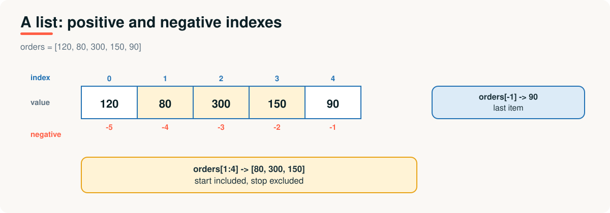

# 04 · Lists and Intro to For Loops

> **Module 03 · Topic 04 of 19** &nbsp;|&nbsp; Reading time: ~60 min &nbsp;|&nbsp; Level: Beginner

[Module home](README.md) &nbsp;·&nbsp; [← Previous: Operators and Intro to Conditions](03-operators-and-intro-conditions.md) &nbsp;·&nbsp; [Next: Tuples and Sets →](05-tuples-and-sets.md)



## What you will learn

- What a **list** is, and how to create one
- How to read items with **indexing** and **slicing**
- The **built-in methods** that add, remove, search and sort items
- How a **`for` loop** visits each item, with `range()`, indexes and `enumerate()`
- How to solve small list problems, such as printing the items at even positions

---

## 1. The business problem

A partner sends the day's orders, and Asha holds them in separate variables: `amount_1`, `amount_2`, `amount_3`, and so on. Today there are 7 orders. Tomorrow there will be 700. She needs one structure that holds **many values in order**, and a way to repeat an action for each.

| Task | With separate variables | What is needed |
|---|---|---|
| Hold today's order amounts | One variable per order | One variable holding all of them |
| Total revenue | `amount_1 + amount_2 + ...` | A way to add any number of values |
| Largest order | Many comparisons | A built-in that scans for you |
| Pick every second order for an audit sample | Not possible without hand-writing it | Positions and slicing |
| Print each order with its number | Copy and paste | A loop |

A **list** is Python's answer. A **`for` loop** repeats a block of code once per item.

---

## 2. What is a list?

A **list** is an **ordered**, **mutable** collection of items, written in square brackets.

| Property | Meaning |
|---|---|
| **Ordered** | Items keep the position you gave them, starting at index `0` |
| **Mutable** | You can change, add and remove items after creating the list |
| **Allows duplicates** | The same value can appear many times |
| **Mixed types** | One list can hold numbers, text, other lists and so on, though one type per list is the norm in data work |

### How to define a list

```python
amounts = [1200.0, 800.0, 300.0, 500.0, 250.0, 1800.0, 950.0]
regions = ["West", "East", "West", "North", "East", "West", "South"]
empty = []
mixed = [1001, "Meera Iyer", 1200.5, True, None]

print(amounts)
print(len(amounts), len(empty), len(mixed))
print(type(amounts).__name__)
```

```text
[1200.0, 800.0, 300.0, 500.0, 250.0, 1800.0, 950.0]
7 0 5
list
```

Other ways to create one:

```python
print(list("West"))                 # from any iterable, such as text
print(list(range(5)))               # 0 to 4
print(list(range(1001, 1006)))      # start and stop (stop is not included)
print(list(range(0, 10, 3)))        # start, stop, step
print([0] * 4)                      # a list repeated
print([[1, 2], [3, 4]])             # a list of lists: a small table
```

```text
['W', 'e', 's', 't']
[0, 1, 2, 3, 4]
[1001, 1002, 1003, 1004, 1005]
[0, 3, 6, 9]
[0, 0, 0, 0]
[[1, 2], [3, 4]]
```

`range(start, stop, step)` produces numbers lazily. The stop value is **never included**, a rule you will meet again in slicing.

---

## 3. Accessing items: indexing

Every item has a position called its **index**. Counting starts at **0**. Negative indexes count from the end, so `-1` is the last item.

```python
amounts = [1200.0, 800.0, 300.0, 500.0, 250.0, 1800.0, 950.0]

print(amounts[0])        # first
print(amounts[2])
print(amounts[-1])       # last
print(amounts[-2])       # second from last
```

```text
1200.0
300.0
950.0
1800.0
```

Going outside the list is an error:

```python
try:
    print(amounts[7])
except IndexError as error:
    print("IndexError:", error)
```

```text
IndexError: list index out of range
```

A list of 7 items has valid indexes `0` to `6`, and `-1` to `-7`. A nested list takes one index per level:

```python
table = [[1001, "West"], [1002, "East"]]
print(table[1])
print(table[1][1])
```

```text
[1002, 'East']
East
```

---

## 4. Slicing

A **slice** takes a part of a list: `list[start:stop:step]`. It includes `start`, excludes `stop`, and returns a **new list**. Every part is optional.

```python
amounts = [1200.0, 800.0, 300.0, 500.0, 250.0, 1800.0, 950.0]

print(amounts[1:4])      # indexes 1, 2, 3
print(amounts[:3])       # the first three
print(amounts[4:])       # from index 4 to the end
print(amounts[-3:])      # the last three
print(amounts[::2])      # every second item
print(amounts[1::2])     # every second item, starting at index 1
print(amounts[::-1])     # reversed
print(amounts[:])        # a full copy
```

```text
[800.0, 300.0, 500.0]
[1200.0, 800.0, 300.0]
[250.0, 1800.0, 950.0]
[250.0, 1800.0, 950.0]
[1200.0, 300.0, 250.0, 950.0]
[800.0, 500.0, 1800.0]
[950.0, 1800.0, 250.0, 500.0, 300.0, 800.0, 1200.0]
[1200.0, 800.0, 300.0, 500.0, 250.0, 1800.0, 950.0]
```

| Slice | Meaning |
|---|---|
| `x[a:b]` | Items from `a` up to, but not including, `b` |
| `x[:b]` | From the start up to `b` |
| `x[a:]` | From `a` to the end |
| `x[::k]` | Every `k`-th item |
| `x[::-1]` | Reversed |

A useful fact: `x[:n]` has `n` items, and `x[:n] + x[n:]` is always the whole list. Slices never raise `IndexError`: indexes past the end are quietly clipped.

```python
print(amounts[5:100])
print(amounts[10:])
```

```text
[1800.0, 950.0]
[]
```

---

## 5. Changing a list

Because lists are mutable, you can replace items in place.

```python
amounts = [1200.0, 800.0, 300.0, 500.0]

amounts[1] = 850.0                 # replace one item
print(amounts)

amounts[0:2] = [1300.0, 900.0, 100.0]     # replace a slice, and the size may change
print(amounts)

del amounts[-1]                    # delete by index
print(amounts)
```

```text
[1200.0, 850.0, 300.0, 500.0]
[1300.0, 900.0, 100.0, 300.0, 500.0]
[1300.0, 900.0, 100.0, 300.0]
```

---

## 6. Built-in methods

A **method** is a function that belongs to an object and is called with a dot. Most list methods **change the list itself and return `None`**.

| Method | What it does | Returns |
|---|---|---|
| `append(x)` | Add `x` at the end | `None` |
| `extend(items)` | Add every item of `items` at the end | `None` |
| `insert(i, x)` | Insert `x` before index `i` | `None` |
| `remove(x)` | Delete the first item equal to `x` | `None` |
| `pop(i)` | Remove and **return** the item at `i` (default: last) | the item |
| `clear()` | Remove everything | `None` |
| `index(x)` | Index of the first item equal to `x` | an `int` |
| `count(x)` | How many items equal `x` | an `int` |
| `sort()` | Sort the list in place | `None` |
| `reverse()` | Reverse the list in place | `None` |
| `copy()` | A shallow copy | a new list |

```python
orders = ["O-1", "O-2"]

orders.append("O-3")
print(orders)

orders.extend(["O-4", "O-5"])
print(orders)

orders.insert(0, "O-0")
print(orders)

orders.remove("O-2")
print(orders)

last = orders.pop()
print(last, orders)

print(orders.index("O-3"), orders.count("O-3"))
```

```text
['O-1', 'O-2', 'O-3']
['O-1', 'O-2', 'O-3', 'O-4', 'O-5']
['O-0', 'O-1', 'O-2', 'O-3', 'O-4', 'O-5']
['O-0', 'O-1', 'O-3', 'O-4', 'O-5']
O-5 ['O-0', 'O-1', 'O-3', 'O-4']
2 1
```

### Sorting

```python
amounts = [1200.0, 800.0, 300.0, 500.0, 250.0]

print(sorted(amounts))                    # sorted() returns a NEW list
print(amounts)                            # the original is unchanged

amounts.sort(reverse=True)                # sort() changes the list in place
print(amounts)

regions = ["West", "east", "North", "South"]
print(sorted(regions))                            # capital letters sort before lowercase
print(sorted(regions, key=str.lower))             # key= changes what is compared
```

```text
[250.0, 300.0, 500.0, 800.0, 1200.0]
[1200.0, 800.0, 300.0, 500.0, 250.0]
[1200.0, 800.0, 500.0, 300.0, 250.0]
['North', 'South', 'West', 'east']
['east', 'North', 'South', 'West']
```

### A common mistake: assigning the result of an in-place method

```python
amounts = [300.0, 100.0, 200.0]
result = amounts.sort()
print(result)                 # None: sort() changes the list and returns nothing
print(amounts)
```

```text
None
[100.0, 200.0, 300.0]
```

### Built-in functions that work on lists

| Function | Result |
|---|---|
| `len(x)` | Number of items |
| `sum(x)` | Total of numbers |
| `min(x)`, `max(x)` | Smallest and largest |
| `sorted(x)` | New sorted list |
| `reversed(x)` | Iterator that goes backwards |
| `x in items` | Whether the value is present |

```python
amounts = [1200.0, 800.0, 300.0, 500.0, 250.0, 1800.0, 950.0]

print(len(amounts), sum(amounts), min(amounts), max(amounts))
print(f"average: {sum(amounts) / len(amounts):.2f}")
print(500.0 in amounts, 999.0 in amounts)
```

```text
7 5800.0 250.0 1800.0
average: 828.57
True False
```

### Lists are shared, not copied, when you assign them

```python
original = [1, 2, 3]
alias = original              # a second name for the same list
copy = original.copy()        # a new list

alias.append(4)
print(original)               # changed: alias is the same object
print(copy)                   # unaffected
```

```text
[1, 2, 3, 4]
[1, 2, 3]
```

This is the identity idea from [Topic 03](03-operators-and-intro-conditions.md#6-identity-operators). Use `copy()` or `x[:]` when you want an independent list, and see [Topic 06](06-dictionary.md) for copies of nested data.

---

## 7. Introduction to `for` loops

A **loop** repeats a block of code. A `for` loop visits each item of a sequence in order. Its shape:

```text
for item in sequence:
    ...runs once per item...
```

```python
amounts = [1200.0, 800.0, 300.0]

for amount in amounts:
    print("Order amount:", amount)

print("Loop finished")      # not indented: runs once, after the loop
```

```text
Order amount: 1200.0
Order amount: 800.0
Order amount: 300.0
Loop finished
```

On each pass, the name `amount` is bound to the next item. The indented lines are the **loop body**.

### Totals and counters

The classic pattern: start a variable before the loop, update it inside.

```python
amounts = [1200.0, 800.0, 300.0, 500.0, 250.0, 1800.0, 950.0]

total = 0
large_orders = 0

for amount in amounts:
    total += amount
    if amount > 1000:
        large_orders += 1

print(f"total {total:,.1f}, large orders: {large_orders}")
```

```text
total 5,800.0, large orders: 2
```

### Looping with `range()`

`range()` repeats something a fixed number of times, or produces indexes:

```python
for number in range(3):
    print("Retry attempt", number + 1)
```

```text
Retry attempt 1
Retry attempt 2
Retry attempt 3
```

### Looping with indexes

When you need the **position** as well as the value, loop over `range(len(...))`:

```python
regions = ["West", "East", "North"]

for i in range(len(regions)):
    print(i, regions[i])
```

```text
0 West
1 East
2 North
```

This works, but Python has a cleaner tool for it.

### `enumerate()`

`enumerate(items, start=0)` gives pairs of `(index, item)`:

```python
for position, region in enumerate(regions):
    print(position, region)

print("--")
for number, region in enumerate(regions, start=1):      # start counting at 1 for people
    print(f"Row {number}: {region}")
```

```text
0 West
1 East
2 North
--
Row 1: West
Row 2: East
Row 3: North
```

Prefer `enumerate` to `range(len(...))`: it is shorter and avoids index mistakes.

### Looping over two lists together

`zip()` pairs items from several lists:

```python
ids = [1001, 1002, 1003]
amounts = [1200.0, 800.0, 300.0]

for order_id, amount in zip(ids, amounts):
    print(order_id, amount)
```

```text
1001 1200.0
1002 800.0
1003 300.0
```

---

## 8. Basic examples with lists

### Items at even and odd index

Positions start at 0, so "even index" means the 1st, 3rd, 5th item.

```python
amounts = [1200.0, 800.0, 300.0, 500.0, 250.0, 1800.0, 950.0]

print("Even index, with a loop:")
for i in range(len(amounts)):
    if i % 2 == 0:
        print(" ", i, amounts[i])

print("Even index, with slicing :", amounts[::2])
print("Odd index, with slicing  :", amounts[1::2])
```

```text
Even index, with a loop:
  0 1200.0
  2 300.0
  4 250.0
  6 950.0
Even index, with slicing : [1200.0, 300.0, 250.0, 950.0]
Odd index, with slicing  : [800.0, 500.0, 1800.0]
```

The slice does in one line what the loop does in four. A common use is taking every `n`-th row as an audit sample.

### Filter into a new list

```python
large = []
for amount in amounts:
    if amount >= 900:
        large.append(amount)

print(large)
```

```text
[1200.0, 1800.0, 950.0]
```

### Find the position of the largest order

```python
largest = max(amounts)
position = amounts.index(largest)
print(f"Largest order {largest} is at index {position}")
```

```text
Largest order 1800.0 is at index 5
```

### Count and group

```python
regions = ["West", "East", "West", "North", "East", "West", "South"]

for region in ["West", "East", "North", "South"]:
    print(f"{region:<6} {regions.count(region)}")
```

```text
West   3
East   2
North  1
South  1
```

### Remove duplicates, keeping the order

```python
order_ids = [1001, 1002, 1002, 1003, 1001, 1004]

unique = []
for order_id in order_ids:
    if order_id not in unique:
        unique.append(order_id)

print(unique)
```

```text
[1001, 1002, 1003, 1004]
```

Checking `not in unique` scans the list each time, so this is slow for large data. The [sets in Topic 05](05-tuples-and-sets.md) do it much faster.

### A pitfall: changing a list while looping over it

```python
amounts = [100.0, 0.0, 0.0, 250.0, 0.0]

for amount in amounts:
    if amount == 0.0:
        amounts.remove(amount)       # removing shifts the later items left, so the loop skips one

print(amounts)
```

```text
[100.0, 250.0, 0.0]
```

Items were skipped. Build a new list instead:

```python
amounts = [100.0, 0.0, 0.0, 250.0, 0.0]
amounts = [a for a in amounts if a != 0.0]      # a list comprehension: Topic 11
print(amounts)
```

```text
[100.0, 250.0]
```

---

## 9. Limitations and engineering considerations

| Issue | Detail |
|---|---|
| **Memory and speed** | A list of millions of Python objects uses a lot of memory. Use columnar tools (pandas, Arrow, Spark) for large tables |
| **Search is slow** | `x in list` scans every item. Use a set or dictionary for repeated lookups |
| **Inserting at the front is slow** | `insert(0, x)` shifts every item. Use `collections.deque` for queues |
| **Aliasing** | `b = a` does not copy. Use `copy()` or slicing |
| **In-place methods return `None`** | `x = y.sort()` leaves `x` as `None` |
| **Mutating while looping** | Skips items. Build a new list instead |
| **Mixed types** | Legal, but they make sorting and arithmetic fail. Keep one type per list |

## 10. Real-world applications

- **Batches of records:** a list of rows read from a file or API page.
- **Samples:** slices such as `rows[::100]` give every 100th row for a quick check.
- **Accumulating results:** `append` collects valid rows, rejected rows or log messages.
- **Retries:** `for attempt in range(3)` repeats a call a fixed number of times.
- **Column values:** a list of one column's values, to total or check.
- **Pagination:** slicing `rows[start:stop]` to process a page at a time.

---

## Key takeaways

1. A **list** is an ordered, mutable collection written `[...]`. Indexes start at **0**, and negative indexes count from the end.
2. A slice `x[start:stop:step]` includes `start`, excludes `stop`, and returns a **new** list. `x[::-1]` reverses.
3. Most list methods change the list **in place and return `None`**. `sorted()` returns a new list.
4. `append`, `extend`, `insert`, `remove`, `pop`, `index`, `count`, `sort` and `reverse` are the core methods. `len`, `sum`, `min` and `max` work on lists.
5. `b = a` makes a second name for one list. Use `copy()` for an independent list.
6. A `for` loop visits each item. Use `range()` for counts, **`enumerate()`** for index and value, and `zip()` for parallel lists.
7. Do not change a list while looping over it. Build a new one.

## Interview questions

<details><summary><b>1.</b> What is a list, and what are its main properties?</summary>

An ordered, mutable collection of items, written in square brackets. It allows duplicates and mixed types, and items are accessed by zero-based index.
</details>

<details><summary><b>2.</b> What does <code>x[1:4]</code> return, and what does <code>x[::-1]</code> do?</summary>

`x[1:4]` returns a new list with items at indexes 1, 2 and 3 (the stop index is excluded). `x[::-1]` returns a reversed copy.
</details>

<details><summary><b>3.</b> What is the difference between <code>append</code> and <code>extend</code>?</summary>

`append(x)` adds `x` as a single item, so appending a list nests it. `extend(items)` adds each item of an iterable individually.
</details>

<details><summary><b>4.</b> What is the difference between <code>sort()</code> and <code>sorted()</code>?</summary>

`sort()` sorts the list in place and returns `None`. `sorted()` returns a new sorted list and leaves the original unchanged, and it works on any iterable.
</details>

<details><summary><b>5.</b> What is the difference between <code>remove</code>, <code>pop</code> and <code>del</code>?</summary>

`remove(x)` deletes the first item with that value. `pop(i)` deletes by index and returns the item. `del x[i]` deletes by index (or a slice) and returns nothing.
</details>

<details><summary><b>6.</b> How do you copy a list, and why does <code>b = a</code> not copy it?</summary>

Assignment binds a second name to the same object, so changes through one name show in the other. Use `a.copy()`, `a[:]` or `list(a)` for a shallow copy.
</details>

<details><summary><b>7.</b> What does <code>enumerate</code> do, and why prefer it to <code>range(len(x))</code>?</summary>

It yields `(index, item)` pairs, optionally starting at a chosen number. It is shorter and avoids manual indexing errors.
</details>

<details><summary><b>8.</b> Why is it unsafe to remove items from a list while iterating over it?</summary>

Removing shifts later items to lower indexes, but the loop's position keeps advancing, so some items are skipped. Iterate over a copy or build a new list.
</details>

## Official documentation

- [Tutorial: More on lists](https://docs.python.org/3/tutorial/datastructures.html#more-on-lists)
- [Sequence types: `list`, `tuple`, `range`](https://docs.python.org/3/library/stdtypes.html#sequence-types-list-tuple-range) · [Mutable sequence operations](https://docs.python.org/3/library/stdtypes.html#mutable-sequence-types)
- [Tutorial: `for` statements and `range()`](https://docs.python.org/3/tutorial/controlflow.html#for-statements)
- [Built-in functions: `enumerate`, `zip`, `sorted`, `range`](https://docs.python.org/3/library/functions.html)
- [Sorting HOW TO](https://docs.python.org/3/howto/sorting.html)

---

| Previous | Contents | Next |
|:---|:---:|:---|
| [← Operators and Intro to Conditions](03-operators-and-intro-conditions.md) | [Module home](README.md#topics-covered) | [Tuples and Sets →](05-tuples-and-sets.md) |
