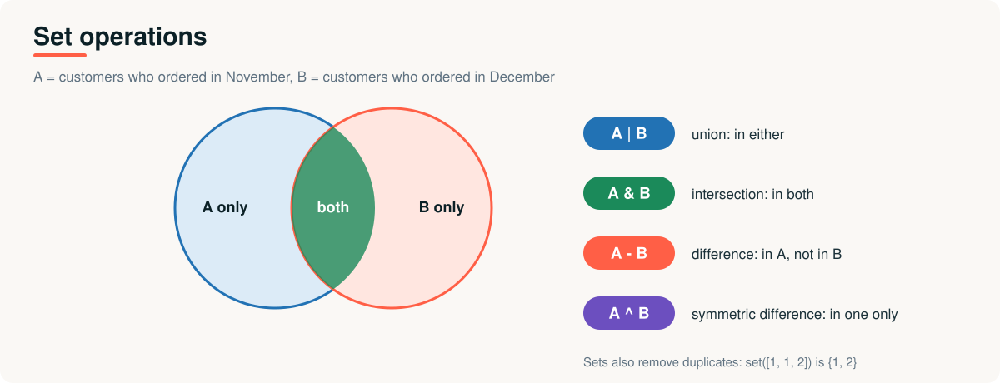

# 05 · Tuples and Sets

> **Module 03 · Topic 05 of 19** &nbsp;|&nbsp; Reading time: ~60 min &nbsp;|&nbsp; Level: Beginner

[Module home](README.md) &nbsp;·&nbsp; [← Previous: Lists and Intro to For Loops](04-lists-and-intro-to-for-loops.md) &nbsp;·&nbsp; [Next: Dictionary →](06-dictionary.md)



## What you will learn

- What a **tuple** is, how to create and read one, and how it differs from a list
- Why **immutability** is useful for records and keys
- What a **set** is, and how to create and change one
- The **set operations**: union, intersection, difference and symmetric difference
- When to use a list, a tuple or a set

---

## 1. The business problem

Two questions come up on the same day.

| Question | A list is awkward because |
|---|---|
| "Keep each region's code, name and manager together as one fixed record" | Lists can be changed by accident, and a list cannot be used as a lookup key |
| "A function should return a total *and* a count" | You need a lightweight bundle of values |
| "Which customers ordered in Q3 **and** Q4? Which only in Q3? Which are new in Q4?" | Comparing two lists means nested loops, which are slow and long |
| "Remove duplicate customer IDs" | Checking `not in` a list scans it every time |

A **tuple** is a fixed bundle of values. A **set** is a collection of unique values with fast membership tests and built-in comparison operations.

---

## 2. Tuples

### What is a tuple?

A **tuple** is an **ordered**, **immutable** collection, usually written in round brackets. Once created, its items cannot be replaced, added or removed.

| Property | Meaning |
|---|---|
| **Ordered** | Items keep their position and are read by index |
| **Immutable** | You cannot change it after creating it |
| **Allows duplicates** | The same value may repeat |
| **Mixed types** | A tuple can hold different types, and often does |

### How to create a tuple

```python
region = ("W", "West", "Pune")            # round brackets
point = 18.52, 73.85                      # the commas make the tuple: brackets are optional
empty = ()
single = (5,)                             # a single item needs a trailing comma
not_a_tuple = (5)                         # without it, this is just the number 5

print(region, type(region).__name__)
print(point)
print(single, type(single).__name__, "|", not_a_tuple, type(not_a_tuple).__name__)
print(tuple([1, 2, 3]), tuple("abc"))     # convert from another iterable
print(len(region), len(empty))
```

```text
('W', 'West', 'Pune') tuple
(18.52, 73.85)
(5,) tuple | 5 int
(1, 2, 3) ('a', 'b', 'c')
3 0
```

The trailing comma in `(5,)` is what makes it a tuple, a detail that surprises almost everyone once.

### Accessing items: indexing and slicing

Tuples use the same indexing and slicing as lists, with the same rules: starting at 0, negative indexes from the end, `stop` excluded.

```python
order = (1001, "Meera Iyer", "West", 1200.0, "completed")

print(order[0])
print(order[-1])
print(order[1:3])          # a slice of a tuple is a tuple
print(order[::-1])
print("West" in order)
```

```text
1001
completed
('Meera Iyer', 'West')
('completed', 1200.0, 'West', 'Meera Iyer', 1001)
True
```

### Immutability

```python
try:
    order[3] = 1300.0
except TypeError as error:
    print("TypeError:", error)
```

```text
TypeError: 'tuple' object does not support item assignment
```

You can only **build a new tuple** from the old one:

```python
new_order = order[:3] + (1300.0,) + order[4:]
print(new_order)
print(order)                 # unchanged
```

```text
(1001, 'Meera Iyer', 'West', 1300.0, 'completed')
(1001, 'Meera Iyer', 'West', 1200.0, 'completed')
```

A tuple has only two methods, because it cannot change:

```python
statuses = ("completed", "pending", "completed", "cancelled")

print(statuses.count("completed"))
print(statuses.index("pending"))
```

```text
2
1
```

Functions such as `len()`, `min()`, `max()`, `sum()` and `sorted()` also work on tuples. `sorted()` returns a **list**.

### Unpacking

Unpacking assigns the items to separate names in one statement. It is one of the most useful tuple features:

```python
order = (1001, "Meera Iyer", "West", 1200.0, "completed")

order_id, customer, region, amount, status = order
print(order_id, customer, amount)

first, *middle, last = order        # * collects the rest into a list
print(first, middle, last)

order_id, _, region, *_ = order     # _ is a convention for "I don't need this"
print(order_id, region)
```

```text
1001 Meera Iyer 1200.0
1001 ['Meera Iyer', 'West', 1200.0] completed
1001 West
```

### Returning several values from a function

A function that "returns two values" is really returning a tuple that the caller unpacks. [Topic 13](13-functions-ii.md) covers functions fully.

```python
def summarise(amounts):
    return sum(amounts), len(amounts)        # a tuple

total, count = summarise([1200.0, 800.0, 300.0])
print(total, count)
print(summarise([5.0, 5.0]))
```

```text
2300.0 3
(10.0, 2)
```

### Tuples as records and lookup keys

Because a tuple cannot change, it can be used where a list cannot, for example as a dictionary key:

```python
revenue = {
    ("West", "Q3"): 368579.0,
    ("West", "Q4"): 1197802.8,
}
print(revenue[("West", "Q4")])

try:
    revenue[["West", "Q4"]] = 1.0
except TypeError as error:
    print("TypeError:", error)
```

```text
1197802.8
TypeError: unhashable type: 'list'
```

A list of tuples is the usual shape of rows read from a database:

```python
rows = [(1001, "West", 1200.0), (1002, "East", 800.0), (1003, "West", 300.0)]

for order_id, region, amount in rows:      # unpack each row in the loop header
    print(order_id, region, amount)
```

```text
1001 West 1200.0
1002 East 800.0
1003 West 300.0
```

### Lists versus tuples

| | **List** | **Tuple** |
|---|---|---|
| **Syntax** | `[1, 2]` | `(1, 2)` |
| **Mutable** | Yes | No |
| **Methods** | Many (`append`, `sort`, ...) | Two (`count`, `index`) |
| **Use as dictionary key** | No | Yes, if its items are immutable |
| **Typical use** | A growing sequence of **similar** items | A fixed record of **different** fields |
| **Memory and speed** | Slightly more | Slightly less |

A rule of thumb: **a list is a collection of the same kind of thing, a tuple is one thing with several parts.**

### A caution: immutable does not mean "fully frozen"

A tuple's *items* cannot be replaced, but if an item is itself mutable, that item can still change:

```python
record = ("O-1", [100.0, 200.0])
record[1].append(300.0)             # allowed: we changed the list inside, not the tuple
print(record)
```

```text
('O-1', [100.0, 200.0, 300.0])
```

---

## 3. Sets

### What is a set?

A **set** is an **unordered** collection of **unique** items, written with curly brackets. Adding a value that is already there changes nothing.

| Property | Meaning |
|---|---|
| **Unique** | Each value appears at most once |
| **Unordered** | No positions, so **no indexing or slicing**. Do not rely on the print order |
| **Mutable** | You can add and remove items |
| **Items must be hashable** | Numbers, strings and tuples are allowed. Lists, sets and dictionaries are not |

Because of the way it is stored (a hash table), checking `x in my_set` takes about the same time however large the set is.

### How to create a set

```python
customers = {1, 2, 3, 3, 2, 1}               # duplicates are dropped
print(customers)

regions = set(["West", "East", "West"])      # from any iterable
print(sorted(regions))

letters = set("analytics")                   # from text: its unique characters
print(sorted(letters))

empty = set()                                # {} creates an empty DICTIONARY, not a set
print(type(empty).__name__, type({}).__name__)

try:
    bad = {[1, 2], 3}
except TypeError as error:
    print("TypeError:", error)
```

```text
{1, 2, 3}
['East', 'West']
['a', 'c', 'i', 'l', 'n', 's', 't', 'y']
set dict
TypeError: unhashable type: 'list'
```

> [!NOTE]
> The order in which a set prints is **not defined** and can differ between runs, especially for text. This module prints `sorted(...)` of a set whenever order would matter.

### The classic use: remove duplicates

```python
order_ids = [1001, 1002, 1002, 1003, 1001, 1004]

unique_ids = set(order_ids)
print(len(order_ids), len(unique_ids))
print(sorted(unique_ids))

print(list(dict.fromkeys(order_ids)))      # keeps the original order (dictionaries keep insertion order)
```

```text
6 4
[1001, 1002, 1003, 1004]
[1001, 1002, 1003, 1004]
```

`set(...)` loses the original order. If order matters, `dict.fromkeys()` removes duplicates and keeps it.

### Built-in methods: changing a set

| Method | What it does |
|---|---|
| `add(x)` | Add one item |
| `update(items)` | Add many items |
| `remove(x)` | Delete `x`. Raises `KeyError` if absent |
| `discard(x)` | Delete `x` if present. No error if absent |
| `pop()` | Remove and return an **arbitrary** item |
| `clear()` | Empty the set |
| `copy()` | A shallow copy |

```python
statuses = {"completed", "pending"}

statuses.add("cancelled")
statuses.add("completed")              # already there: no change
statuses.update(["shipped", "returned"])
print(sorted(statuses))

statuses.discard("returned")
statuses.discard("teleported")         # not present: silently ignored
print(sorted(statuses))

try:
    statuses.remove("teleported")
except KeyError as error:
    print("KeyError:", error)
```

```text
['cancelled', 'completed', 'pending', 'returned', 'shipped']
['cancelled', 'completed', 'pending', 'shipped']
KeyError: 'teleported'
```

### Accessing set items

A set has no positions, so you cannot ask for "the first item". You can **loop** over it, **test membership**, and measure it:

```python
statuses = {"completed", "pending", "cancelled"}

print("completed" in statuses)
print(len(statuses))

for status in sorted(statuses):          # sorted() gives a fixed, readable order
    print(status)

try:
    print(statuses[0])
except TypeError as error:
    print("TypeError:", error)
```

```text
True
3
cancelled
completed
pending
TypeError: 'set' object is not subscriptable
```

---

## 4. Set operations

These answer questions such as "who is in both groups?". Take customers who ordered in each quarter:

```python
q3 = {1, 2, 3, 5, 8}      # customer IDs who ordered in Q3
q4 = {2, 3, 4, 5, 9}      # customer IDs who ordered in Q4
```

| Operation | Operator | Method | Meaning | SQL equivalent |
|---|---|---|---|---|
| **Union** | `a \| b` | `a.union(b)` | In either | `UNION` |
| **Intersection** | `a & b` | `a.intersection(b)` | In both | `INTERSECT` |
| **Difference** | `a - b` | `a.difference(b)` | In `a` but not in `b` | `EXCEPT` |
| **Symmetric difference** | `a ^ b` | `a.symmetric_difference(b)` | In exactly one | `(a EXCEPT b) UNION (b EXCEPT a)` |

```python
print("Ordered in either quarter :", sorted(q3 | q4))
print("Retained (both)           :", sorted(q3 & q4))
print("Lost (Q3 only)            :", sorted(q3 - q4))
print("New (Q4 only)             :", sorted(q4 - q3))
print("In exactly one quarter    :", sorted(q3 ^ q4))
```

```text
Ordered in either quarter : [1, 2, 3, 4, 5, 8, 9]
Retained (both)           : [2, 3, 5]
Lost (Q3 only)            : [1, 8]
New (Q4 only)             : [4, 9]
In exactly one quarter    : [1, 4, 8, 9]
```

This is customer retention analysis in four lines. The same logic in SQL used the set operations of [Module 02, Topic 05](../02_SQL_for_Data_Engineers/05-subqueries-ctes-and-set-operations.md). Use SQL when the data lives in a database, and Python when it is already in memory.

### Comparing sets

| Test | Meaning |
|---|---|
| `a <= b` or `a.issubset(b)` | Every item of `a` is in `b` |
| `a >= b` or `a.issuperset(b)` | Every item of `b` is in `a` |
| `a.isdisjoint(b)` | They share nothing |

```python
allowed = {"completed", "pending", "cancelled", "shipped"}
seen = {"completed", "pending"}
bad_feed = {"completed", "teleported"}

print(seen <= allowed)                       # all statuses seen are valid
print(bad_feed <= allowed)
print(sorted(bad_feed - allowed))            # which ones are not valid?
print({1, 2}.isdisjoint({3, 4}))
```

```text
True
False
['teleported']
True
```

Checking a feed against its allowed values, as in the last lines, is a common data-quality test.

### Methods that change a set from another

The operators build a new set. The `_update` methods change the set in place:

```python
active = {1, 2, 3, 4}
active.intersection_update({2, 3, 9})     # keep only items also in the other set
print(sorted(active))

active.difference_update({3})
print(sorted(active))
```

```text
[2, 3]
[2]
```

### Frozen sets

A `frozenset` is an immutable set. It can be a dictionary key or a member of another set:

```python
pair = frozenset({"West", "East"})
routes = {pair: "inter-region"}
print(routes[frozenset({"East", "West"})])      # order does not matter
```

```text
inter-region
```

### Choosing between list, tuple and set

| You need | Use |
|---|---|
| A sequence that grows or changes, order matters | **list** |
| A fixed record, or a key for a dictionary | **tuple** |
| Unique values, fast membership tests, or set algebra | **set** |
| Key-value pairs | **dictionary** ([next topic](06-dictionary.md)) |

---

## 5. Limitations and engineering considerations

| Issue | Detail |
|---|---|
| **Sets have no order** | Do not rely on print or iteration order. Use `sorted()` for stable output |
| **Sets lose duplicates, and counts** | `set(items)` cannot tell you how many times a value appeared. Count with a dictionary |
| **Hashable items only** | A list, set or dictionary cannot be a set member or dictionary key. Convert a list to a tuple |
| **`{}` is an empty dictionary** | Use `set()` for an empty set |
| **One-item tuple** | `(5)` is not a tuple. `(5,)` is |
| **Shallow immutability** | A tuple holding a list can still change the list |
| **Everything is in memory** | Sets of millions of IDs are fine, but billions need a database or Spark |

## 6. Real-world applications

- **Deduplication:** unique customer, product or order IDs.
- **Reconciliation:** `source_ids - target_ids` finds rows that were not loaded, and `target_ids - source_ids` finds rows that should not be there.
- **Retention and cohort analysis:** intersection and difference between periods.
- **Validation:** `set(values) <= allowed_values` checks a column against its permitted values.
- **Rows as tuples:** database drivers return query results as tuples.
- **Composite keys:** `(customer_id, month)` as a dictionary key.

---

## Key takeaways

1. A **tuple** is an ordered, **immutable** sequence. Create it with commas (`(5,)` for one item). Use it for fixed records and dictionary keys.
2. Tuples support indexing, slicing, `count` and `index`, and can be **unpacked** into names (with `*` to collect the rest).
3. A function that returns several values returns a tuple.
4. A **set** holds **unique**, **hashable** items with **no order**: no indexing or slicing. Membership tests are fast.
5. `{}` is an empty dictionary. An empty set is `set()`.
6. `add`, `update`, `remove`, `discard`, `pop` and `clear` change a set. `discard` never raises an error, and `remove` does.
7. `|` union, `&` intersection, `-` difference and `^` symmetric difference answer "in either, in both, only here, in exactly one".
8. **List:** changing sequence. **Tuple:** fixed record. **Set:** unique values and set algebra.

## Interview questions

<details><summary><b>1.</b> What is the difference between a list and a tuple?</summary>

Lists are mutable and have many methods. Tuples are immutable, have only `count` and `index`, can be dictionary keys when their items are immutable, and are normally used for fixed records. Both are ordered and indexed.
</details>

<details><summary><b>2.</b> How do you create a tuple with one item?</summary>

With a trailing comma: `(5,)`. Without the comma, `(5)` is just the integer 5 in brackets.
</details>

<details><summary><b>3.</b> What is tuple unpacking?</summary>

Assigning the items of a tuple (or any sequence) to separate names in one statement, such as `a, b = (1, 2)`. A starred name collects the remainder, as in `first, *rest = items`.
</details>

<details><summary><b>4.</b> If tuples are immutable, how can <code>("a", [1])[1].append(2)</code> work?</summary>

Immutability applies to the tuple's own items (which objects it refers to), not to the objects themselves. The list inside is mutable, so it can change even though the tuple still refers to the same list.
</details>

<details><summary><b>5.</b> What is a set, and why are membership tests fast?</summary>

An unordered collection of unique, hashable items. It is stored as a hash table, so `x in s` takes roughly constant time, unlike a list, which scans every item.
</details>

<details><summary><b>6.</b> What is the difference between <code>remove</code> and <code>discard</code>?</summary>

`remove(x)` raises a `KeyError` when `x` is missing. `discard(x)` does nothing in that case.
</details>

<details><summary><b>7.</b> How do you remove duplicates from a list, and preserve the order?</summary>

`list(set(items))` removes them but loses the order. `list(dict.fromkeys(items))` keeps the first occurrence order.
</details>

<details><summary><b>8.</b> Given two sets of customer IDs, how would you find customers lost, retained and new?</summary>

Lost: `old - new`. Retained: `old & new`. New: `new - old`. These correspond to `EXCEPT`, `INTERSECT` and `EXCEPT` in SQL.
</details>

## Official documentation

- [Tutorial: Tuples and sequences](https://docs.python.org/3/tutorial/datastructures.html#tuples-and-sequences) · [Sets](https://docs.python.org/3/tutorial/datastructures.html#sets)
- [Built-in types: tuples](https://docs.python.org/3/library/stdtypes.html#tuples) · [Set types: `set` and `frozenset`](https://docs.python.org/3/library/stdtypes.html#set-types-set-frozenset)
- [Glossary: hashable](https://docs.python.org/3/glossary.html#term-hashable)
- [Data model: objects, values and types](https://docs.python.org/3/reference/datamodel.html#objects-values-and-types)

---

| Previous | Contents | Next |
|:---|:---:|:---|
| [← Lists and Intro to For Loops](04-lists-and-intro-to-for-loops.md) | [Module home](README.md#topics-covered) | [Dictionary →](06-dictionary.md) |
