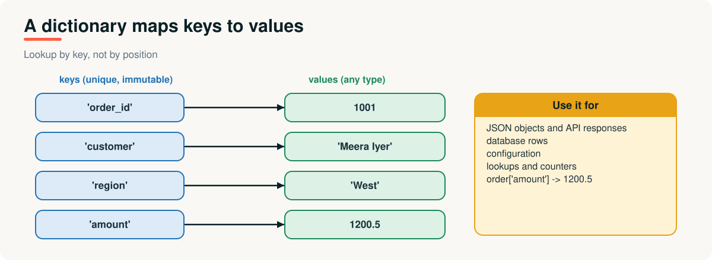
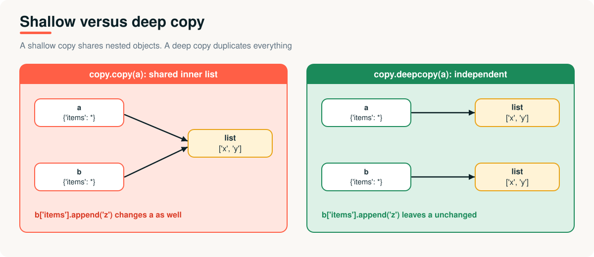

# 06 · Dictionary

> **Module 03 · Topic 06 of 19** &nbsp;|&nbsp; Reading time: ~60 min &nbsp;|&nbsp; Level: Beginner to Intermediate

[Module home](README.md) &nbsp;·&nbsp; [← Previous: Tuples and Sets](05-tuples-and-sets.md) &nbsp;·&nbsp; [Next: Strings I →](07-strings-i.md)



## What you will learn

- What a **dictionary** is, and how to create one
- How to **add, modify, retrieve and delete** values
- How to get all keys, values and items, and the built-in **methods**
- How dictionaries differ from sets, lists and tuples
- **Mutable versus immutable** data types, and the copy pitfalls that follow

---

## 1. The business problem

A record from a source system is a set of **named fields**, not a numbered sequence. Asha's lists and tuples force her to remember what position means what.

| Task | With lists and tuples | The problem |
|---|---|---|
| Read the amount from `(1001, "Meera Iyer", "West", 1200.0)` | `order[3]` | Nobody remembers that position 3 is the amount |
| Translate a status code `"C"` to `"completed"` | A chain of `if` statements | Long, and hard to extend |
| Count orders per region | Parallel lists, with `index()` searches | Slow and fragile |
| Read a JSON response from an API | Not a list | JSON objects have named fields |
| Add a field to every record | Positions shift | Code breaks |

A **dictionary** stores **key-value pairs** and finds a value by its key. It is the most important structure in Python for data work, because JSON, configuration files and database rows all have this shape.

---

## 2. What is a dictionary?

A **dictionary** (`dict`) maps **keys** to **values**, written in curly brackets with a colon between key and value.

| Property | Meaning |
|---|---|
| **Key-value pairs** | Each item has a key and a value |
| **Unique keys** | A key appears once. Assigning to an existing key replaces its value |
| **Keys must be hashable** | Strings, numbers and tuples of those are fine. Lists, sets and dictionaries are not |
| **Values can be anything** | Numbers, text, lists, other dictionaries and so on |
| **Ordered by insertion** | Since Python 3.7, items keep the order in which they were added |
| **Mutable** | You can add, change and delete pairs |
| **Fast lookup** | Finding a value by key takes about the same time however large the dictionary is |

### How to create a dictionary

```python
order = {"order_id": 1001, "customer": "Meera Iyer", "region": "West", "amount": 1200.0}
print(order)
print(len(order), type(order).__name__)

empty = {}
print(empty)
```

```text
{'order_id': 1001, 'customer': 'Meera Iyer', 'region': 'West', 'amount': 1200.0}
4 dict
{}
```

Other ways:

```python
print(dict(region="West", amount=1200.0))                       # keyword arguments (keys must be valid names)
print(dict([("West", 1), ("East", 2)]))                          # from a list of key-value pairs
print(dict(zip(["West", "East"], [1200.0, 800.0])))              # from two lists
print(dict.fromkeys(["completed", "pending"], 0))                # the same value for every key
```

```text
{'region': 'West', 'amount': 1200.0}
{'West': 1, 'East': 2}
{'West': 1200.0, 'East': 800.0}
{'completed': 0, 'pending': 0}
```

A dictionary can hold other dictionaries and lists. This is the shape of a typical API response:

```python
order = {
    "order_id": 1001,
    "customer": {"name": "Meera Iyer", "city": "Pune"},
    "items": [
        {"product": "Running Shoes", "qty": 1, "price": 3200.0},
        {"product": "Cotton T-Shirt", "qty": 2, "price": 450.0},
    ],
}

print(order["customer"]["city"])
print(order["items"][1]["product"])
```

```text
Pune
Cotton T-Shirt
```

---

## 3. Adding, modifying and retrieving values

### Retrieving

Put the key in square brackets. A missing key raises a `KeyError`.

```python
order = {"order_id": 1001, "region": "West", "amount": 1200.0}

print(order["region"])

try:
    print(order["coupon"])
except KeyError as error:
    print("KeyError:", error)
```

```text
West
KeyError: 'coupon'
```

`get(key, default)` returns the default (or `None`) when the key is absent, which is the safe choice for optional fields:

```python
print(order.get("coupon"))
print(order.get("coupon", "none"))
print(order.get("region", "unknown"))
print("coupon" in order, "region" in order)       # `in` tests the KEYS
```

```text
None
none
West
False True
```

### Adding and modifying

Assigning to a key **adds** it if new and **replaces** it if it exists. The syntax is identical.

```python
order["coupon"] = "FEST10"        # new key: added
order["amount"] = 1250.0          # existing key: replaced
print(order)

order.update({"status": "completed", "amount": 1300.0})     # several at once
print(order)
```

```text
{'order_id': 1001, 'region': 'West', 'amount': 1250.0, 'coupon': 'FEST10'}
{'order_id': 1001, 'region': 'West', 'amount': 1300.0, 'coupon': 'FEST10', 'status': 'completed'}
```

### Deleting

```python
removed = order.pop("coupon")             # remove a key and return its value
print(removed)

print(order.pop("coupon", "not there"))   # a default avoids a KeyError

del order["status"]                       # remove without returning
print(order)
```

```text
FEST10
not there
{'order_id': 1001, 'region': 'West', 'amount': 1300.0}
```

### `setdefault`

`setdefault(key, default)` returns the value if the key exists, and otherwise stores the default and returns it. It is a compact way to start a group:

```python
groups = {}
groups.setdefault("West", []).append(1001)
groups.setdefault("West", []).append(1003)
groups.setdefault("East", []).append(1002)
print(groups)
```

```text
{'West': [1001, 1003], 'East': [1002]}
```

---

## 4. Getting all keys, values and items

Three methods return **views** of the dictionary, and a view reflects later changes:

| Method | Returns |
|---|---|
| `keys()` | All keys |
| `values()` | All values |
| `items()` | All `(key, value)` pairs |

```python
revenue = {"West": 1500.0, "East": 1050.0, "North": 500.0}

print(revenue.keys())
print(revenue.values())
print(revenue.items())
print(list(revenue))                      # looping or listing a dictionary gives its keys
```

```text
dict_keys(['West', 'East', 'North'])
dict_values([1500.0, 1050.0, 500.0])
dict_items([('West', 1500.0), ('East', 1050.0), ('North', 500.0)])
['West', 'East', 'North']
```

### Looping over a dictionary

```python
for region in revenue:                           # keys
    print(region)

print("--")
for region, total in revenue.items():            # key and value together (the most common form)
    print(f"{region:<6} {total:>8,.1f}")

print("--")
print(sum(revenue.values()), max(revenue.values()))
print(max(revenue, key=revenue.get))             # the key with the largest value
```

```text
West
East
North
--
West    1,500.0
East    1,050.0
North     500.0
--
3050.0 1500.0
West
```

### Sorting a dictionary

Dictionaries are not sorted, but you can build a sorted list of pairs:

```python
by_value = sorted(revenue.items(), key=lambda pair: pair[1], reverse=True)
print(by_value)

print(dict(by_value))                      # back to a dictionary, in the new order
```

```text
[('West', 1500.0), ('East', 1050.0), ('North', 500.0)]
{'West': 1500.0, 'East': 1050.0, 'North': 500.0}
```

`lambda pair: pair[1]` is a tiny function that picks the value from each pair. It is explained in [Topic 13](13-functions-ii.md).

---

## 5. Built-in methods

| Method | What it does |
|---|---|
| `d[key]` | Value for `key`. `KeyError` if missing |
| `get(key, default=None)` | Value for `key`, or the default |
| `keys()`, `values()`, `items()` | Views of keys, values and pairs |
| `update(other)` | Add or replace pairs from another dictionary |
| `pop(key, default)` | Remove `key` and return its value |
| `popitem()` | Remove and return the **last** pair added |
| `setdefault(key, default)` | Get the value, inserting the default if missing |
| `clear()` | Remove everything |
| `copy()` | A shallow copy |
| `dict.fromkeys(keys, value)` | New dictionary with one value for every key |

Merging two dictionaries:

```python
defaults = {"retries": 3, "timeout": 30, "format": "csv"}
overrides = {"timeout": 60}

merged = defaults | overrides              # Python 3.9+: the right side wins
print(merged)

print({**defaults, **overrides})           # the same, for older versions
```

```text
{'retries': 3, 'timeout': 60, 'format': 'csv'}
{'retries': 3, 'timeout': 60, 'format': 'csv'}
```

### Common patterns

**Counting.** The loop from [Topic 01](01-introduction-to-python-for-data-engineering.md), on real data:

```python
statuses = ["completed", "completed", "pending", "cancelled", "completed", "pending"]

counts = {}
for status in statuses:
    counts[status] = counts.get(status, 0) + 1

print(counts)
```

```text
{'completed': 3, 'pending': 2, 'cancelled': 1}
```

The standard library has a ready-made tool, `collections.Counter`:

```python
from collections import Counter

print(Counter(statuses))
print(Counter(statuses).most_common(1))
```

```text
Counter({'completed': 3, 'pending': 2, 'cancelled': 1})
[('completed', 3)]
```

**Lookup table.** A dictionary replaces a chain of `if` statements:

```python
status_labels = {"C": "completed", "P": "pending", "X": "cancelled"}

for code in ["C", "X", "Z"]:
    print(code, "->", status_labels.get(code, "UNKNOWN CODE"))
```

```text
C -> completed
X -> cancelled
Z -> UNKNOWN CODE
```

**Grouping.** Total revenue by region from a list of records:

```python
orders = [
    {"order_id": 1001, "region": "West",  "amount": 1200.0},
    {"order_id": 1002, "region": "East",  "amount": 800.0},
    {"order_id": 1003, "region": "West",  "amount": 300.0},
    {"order_id": 1004, "region": "North", "amount": 500.0},
]

revenue = {}
for order in orders:
    revenue[order["region"]] = revenue.get(order["region"], 0) + order["amount"]
print(revenue)
```

```text
{'West': 1500.0, 'East': 800.0, 'North': 500.0}
```

This is the Python form of `SELECT region, SUM(amount) ... GROUP BY region` from [Module 02](../02_SQL_for_Data_Engineers/03-aggregation-and-grouping.md).

**Records to JSON text.** Dictionaries, lists, strings, numbers, booleans and `None` map directly to JSON, the format of most APIs:

```python
import json

order = {"order_id": 1001, "region": "West", "amount": 1200.0, "coupon": None, "paid": True}
text = json.dumps(order)
print(text)
print(json.loads(text) == order)
```

```text
{"order_id": 1001, "region": "West", "amount": 1200.0, "coupon": null, "paid": true}
True
```

---

## 6. Sets versus dictionaries

Both use curly brackets and hash-based lookup, and require hashable keys.

| | **Set** | **Dictionary** |
|---|---|---|
| **Holds** | Unique values | Key-value pairs |
| **Syntax** | `{1, 2}` | `{"a": 1}` |
| **Empty** | `set()` | `{}` |
| **Access an item** | By membership test only | By key: `d["a"]` |
| **Ordered** | No | Yes, by insertion |
| **Duplicates** | Dropped | A repeated key replaces its value |
| **Use when** | You only need to know "is it there?" | You need to find the **value** belonging to a key |

---

## 7. Mutable versus immutable data types

An object is **mutable** if it can be changed after it is created, and **immutable** if it cannot.

| Immutable | Mutable |
|---|---|
| `int`, `float`, `bool`, `complex` | `list` |
| `str` | `dict` |
| `tuple` | `set` |
| `frozenset`, `None` | Most user-defined objects |

Dictionary keys and set members must be immutable (hashable), because a changing key could never be found again.

### What changing means

`id()` shows the identity of an object. Changing an immutable value creates a **new** object, and changing a mutable one keeps the same object:

```python
text = "West"
print(id(text) == id(text + "!"))         # a new string every time

name = text
text += " region"                         # builds a new string and re-binds the name
print(name, "|", text)                    # `name` still refers to the old string

amounts = [1, 2]
before = id(amounts)
amounts.append(3)                         # modifies the same list
print(before == id(amounts), amounts)
```

```text
False
West | West region
True [1, 2, 3]
```

### The alias trap with a dictionary

Assignment never copies. Two names can refer to one dictionary, so a change through one is visible through the other:

```python
config = {"retries": 3, "timeout": 30}
backup = config                           # another name, not a copy

config["retries"] = 10
print(backup)                             # also changed
print(backup is config)
```

```text
{'retries': 10, 'timeout': 30}
True
```

### Shallow copy

`copy()` makes a new dictionary, but its **values are shared**. With simple values that is enough:

```python
config = {"retries": 3, "timeout": 30}
backup = config.copy()

config["retries"] = 10
print(config)
print(backup)                             # unaffected
```

```text
{'retries': 10, 'timeout': 30}
{'retries': 3, 'timeout': 30}
```

With nested mutable values, the inner objects are still shared:

```python
job = {"name": "load_orders", "tags": ["daily", "critical"]}
shallow = job.copy()

job["tags"].append("finance")
print(job["tags"])
print(shallow["tags"])                    # changed too: the inner list is shared
print(job["tags"] is shallow["tags"])
```

```text
['daily', 'critical', 'finance']
['daily', 'critical', 'finance']
True
```

### Deep copy

`copy.deepcopy()` copies the whole structure, including nested objects:

```python
import copy

job = {"name": "load_orders", "tags": ["daily", "critical"]}
deep = copy.deepcopy(job)

job["tags"].append("finance")
print(job["tags"])
print(deep["tags"])                       # independent
```

```text
['daily', 'critical', 'finance']
['daily', 'critical']
```



| Operation | New outer object? | Nested objects shared? |
|---|---|---|
| `b = a` | No (same object) | Yes (it is the same thing) |
| `a.copy()`, `dict(a)`, `a[:]` for lists | Yes | **Yes** |
| `copy.deepcopy(a)` | Yes | No |

---

## 8. Limitations and engineering considerations

| Issue | Detail |
|---|---|
| **Missing keys** | `d[key]` raises `KeyError`. Use `get()` or validate the record's fields |
| **Typos in keys** | `"amount"` and `"amout"` are different keys, and nothing warns you. Later topics use classes to protect structure |
| **Memory** | A dictionary per row is expensive for millions of rows. Use columnar tools for big data |
| **Aliasing and shallow copies** | A shared nested object can change unexpectedly. Use `deepcopy` when you need independence |
| **Hashable keys only** | Convert list keys to tuples |
| **No sorting** | Sort `items()` into a list, or rebuild the dictionary |
| **Mutating while looping** | Adding or removing keys during iteration raises a `RuntimeError`. Loop over `list(d)` or build a new dictionary |
| **JSON limits** | Tuples become lists, and keys become strings. Not every Python value is JSON-serialisable |

## 9. Real-world applications

- **Records:** one row, one API object or one JSON document is a dictionary.
- **Configuration:** settings such as paths, batch sizes and credentials names.
- **Lookup and mapping tables:** status codes to labels, country codes to regions, column renames.
- **Counting and grouping:** the Python analogue of `GROUP BY`.
- **Schemas:** column names mapped to expected types, used for validation.
- **Caching:** results stored by key so they are not recomputed.

---

## Key takeaways

1. A **dictionary** maps unique, hashable **keys** to values. It is ordered by insertion and finds values quickly by key.
2. `d[key] = value` **adds or replaces**. `d[key]` fails for a missing key, so use `get(key, default)` for optional fields.
3. `keys()`, `values()` and `items()` give views. Loop with `for key, value in d.items()`.
4. `update`, `pop`, `popitem`, `setdefault`, `clear` and `copy` are the main methods. `|` merges (Python 3.9+).
5. Counting, grouping and lookup tables are the everyday patterns. `Counter` is a ready-made counter.
6. **Set** versus **dictionary:** a set answers "is it there?", and a dictionary answers "what belongs to this key?".
7. **Immutable:** numbers, strings, tuples. **Mutable:** lists, dictionaries, sets. Keys and set members must be immutable.
8. `b = a` does not copy. `copy()` is **shallow**. `copy.deepcopy()` copies nested data.

## Interview questions

<details><summary><b>1.</b> What is a dictionary, and what can be a key?</summary>

A mutable, insertion-ordered mapping of unique keys to values. Keys must be hashable, meaning immutable types such as strings, numbers and tuples of immutables. Lists, sets and dictionaries cannot be keys.
</details>

<details><summary><b>2.</b> What is the difference between <code>d[key]</code> and <code>d.get(key)</code>?</summary>

`d[key]` raises `KeyError` when the key is missing. `d.get(key)` returns `None`, or a supplied default, so it is safe for optional fields.
</details>

<details><summary><b>3.</b> How do you add a new key, and how do you modify an existing one?</summary>

Both use assignment: `d[key] = value`. If the key does not exist it is added, and if it exists its value is replaced. `update()` does this for several pairs.
</details>

<details><summary><b>4.</b> How do you loop over keys, values and both?</summary>

`for k in d` (or `d.keys()`), `for v in d.values()`, and `for k, v in d.items()`.
</details>

<details><summary><b>5.</b> How do you count occurrences of items in a list?</summary>

Loop with `counts[x] = counts.get(x, 0) + 1`, or use `collections.Counter(items)`.
</details>

<details><summary><b>6.</b> Compare sets and dictionaries.</summary>

Both are hash-based, with hashable keys or members and fast lookup. A set stores only unique values and answers membership. A dictionary stores key-value pairs and returns the value for a key. `{}` is an empty dictionary, and `set()` an empty set.
</details>

<details><summary><b>7.</b> What is the difference between mutable and immutable types? Give examples.</summary>

Mutable objects can be changed in place (lists, dictionaries, sets). Immutable objects cannot (numbers, strings, tuples), so "changing" one creates a new object. Hashable keys must be immutable.
</details>

<details><summary><b>8.</b> What is the difference between a shallow copy and a deep copy?</summary>

A shallow copy (`d.copy()`) creates a new outer container whose nested objects are still shared with the original. A deep copy (`copy.deepcopy`) recursively copies nested objects, so the two structures are fully independent.
</details>

## Official documentation

- [Tutorial: Dictionaries](https://docs.python.org/3/tutorial/datastructures.html#dictionaries) · [Looping techniques](https://docs.python.org/3/tutorial/datastructures.html#looping-techniques)
- [Built-in types: mapping types, `dict`](https://docs.python.org/3/library/stdtypes.html#mapping-types-dict) · [Dictionary view objects](https://docs.python.org/3/library/stdtypes.html#dict-views)
- [`collections.Counter`](https://docs.python.org/3/library/collections.html#collections.Counter)
- [`copy`: shallow and deep copy operations](https://docs.python.org/3/library/copy.html)
- [`json`: JSON encoder and decoder](https://docs.python.org/3/library/json.html)
- [Data model: objects, values and types](https://docs.python.org/3/reference/datamodel.html#objects-values-and-types)

---

| Previous | Contents | Next |
|:---|:---:|:---|
| [← Tuples and Sets](05-tuples-and-sets.md) | [Module home](README.md#topics-covered) | [Strings I →](07-strings-i.md) |
