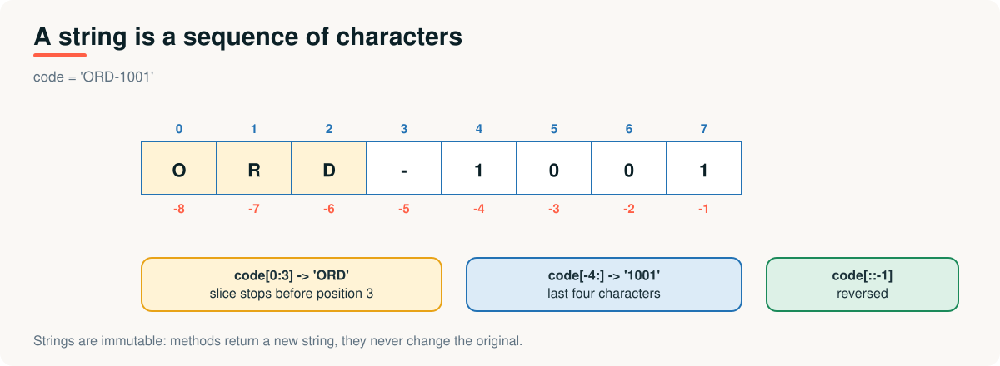

# 07 · Strings I

> **Module 03 · Topic 07 of 19** &nbsp;|&nbsp; Reading time: ~55 min &nbsp;|&nbsp; Level: Beginner

[Module home](README.md) &nbsp;·&nbsp; [← Previous: Dictionary](06-dictionary.md) &nbsp;·&nbsp; [Next: Conditional Statements →](08-conditional-statements.md)



## What you will learn

- What a **string** is, and the ways to create one
- How to access characters by **indexing** and **slicing**
- The most useful **built-in string methods**
- How to build text with **`.format()`** and **f-strings**
- How to take **user input** and **convert types** (type-casting)

---

## 1. The business problem

Most data arrives as text. A partner file has no numbers or dates, only characters that look like them.

| Raw value from the feed | What the pipeline needs | The problem |
|---|---|---|
| `"  Meera Iyer "` | `"Meera Iyer"` | Stray spaces break joins and group-bys |
| `"west"`, `"WEST"`, `"West "` | `"West"` | Three spellings of one region |
| `"1,200.50"` | `1200.5` | A number stored as text, with a comma |
| `"2025-12-02"` | Year, month, day | Several facts packed in one string |
| `"asha@xyzcompany.com"` | The domain | Needs searching and cutting |

In Module 02 you cleaned these values with `TRIM`, `LOWER` and `CAST` in SQL. Python strings have the same tools, and they are what you use when cleaning happens **before** the data reaches a database.

---

## 2. What is a string?

A **string** (`str`) is an ordered sequence of characters. A string is **immutable**: you cannot change a character in place, only create a new string.

### Creating strings

Use single or double quotes, and triple quotes for text over several lines.

```python
region = "West"
city = 'Pune'
note = """Order held for review.
Customer called twice."""

print(region, city)
print(note)
print(type(region).__name__, len(region))
```

```text
West Pune
Order held for review.
Customer called twice.
str 4
```

`len()` returns the number of characters.

Use the other kind of quote to put a quote inside a string, or a backslash **escape**:

```python
print("It's fine")
print('She said "ship it"')
print("Line one\nLine two")      # \n is a new line
print("Column A\tColumn B")      # \t is a tab
print("C:\\data\\orders.csv")    # \\ is one backslash
print(r"C:\data\orders.csv")     # r"..." is a raw string: backslashes stay as written
```

```text
It's fine
She said "ship it"
Line one
Line two
Column A	Column B
C:\data\orders.csv
C:\data\orders.csv
```

### Joining and repeating

```python
first = "Meera"
last = "Iyer"
print(first + " " + last)     # concatenation
print("-" * 20)               # repetition
print("West" in "North West") # membership test
```

```text
Meera Iyer
--------------------
True
```

---

## 3. Indexing and slicing

Each character has a position, starting at **0**. Negative positions count from the end.

```python
code = "ORD-2025-1001"

print(code[0])      # first character
print(code[4])
print(code[-1])     # last character
print(code[-4:])    # last four characters
```

```text
O
2
1
1001
```

A **slice** `text[start:stop:step]` takes characters from `start` up to, but **not including**, `stop`. Any part can be left out.

```python
code = "ORD-2025-1001"

print(code[0:3])     # ORD
print(code[4:8])     # 2025
print(code[9:])      # from position 9 to the end
print(code[:3])      # from the start to position 3
print(code[::2])     # every second character
print(code[::-1])    # reversed
```

```text
ORD
2025
1001
ORD
OD22-01
1001-5202-DRO
```

Going outside a slice's range is safe, but an out-of-range **index** is an error:

```python
code = "ORD-2025-1001"
print(code[50:60] == "")      # a slice out of range gives an empty string
try:
    print(code[50])
except IndexError as error:
    print("IndexError:", error)
```

```text
True
IndexError: string index out of range
```

Strings are immutable, so assigning to a position fails:

```python
code = "ORD-2025-1001"
try:
    code[0] = "X"
except TypeError as error:
    print("TypeError:", error)

code = "X" + code[1:]         # build a new string instead
print(code)
```

```text
TypeError: 'str' object does not support item assignment
XRD-2025-1001
```

---

## 4. Built-in methods

A **method** is a function that belongs to a value, called with a dot. String methods **return a new string**. They never change the original.

### Case

```python
text = "xyz Company west"

print(text.upper())
print(text.lower())
print(text.title())          # first letter of every word
print(text.capitalize())     # only the first letter of the string
print(text.swapcase())
```

```text
XYZ COMPANY WEST
xyz company west
Xyz Company West
Xyz company west
XYZ cOMPANY WEST
```

### Cleaning whitespace

```python
raw = "   Meera Iyer \n"
print(repr(raw.strip()))      # both ends
print(repr(raw.lstrip()))     # left only
print(repr(raw.rstrip()))     # right only
print("**West**".strip("*"))  # strip given characters
```

```text
'Meera Iyer'
'Meera Iyer \n'
'   Meera Iyer'
West
```

### Searching

```python
email = "asha@xyzcompany.com"

print(email.find("@"))              # position, or -1 if missing
print(email.find("#"))
print(email.index("@"))             # like find, but raises ValueError if missing
print(email.count("a"))
print(email.startswith("asha"))
print(email.endswith(".com"))
```

```text
4
-1
4
3
True
True
```

### Replacing, splitting and joining

```python
print("1,200.50".replace(",", ""))

line = "1001,Meera Iyer,West,1200.50"
fields = line.split(",")
print(fields)

print("-".join(["2025", "12", "02"]))       # join a list of strings
print("a b  c".split())                      # no argument: split on any whitespace
print("one two three".split(" ", 1))         # at most one split
```

```text
1200.50
['1001', 'Meera Iyer', 'West', '1200.50']
2025-12-02
['a', 'b', 'c']
['one', 'two three']
```

`split` and `join` are inverses, and they are how you parse a delimited line.

### Checking what a string contains

```python
print("12345".isdigit())
print("12.5".isdigit())      # the dot is not a digit
print("West".isalpha())
print("West2".isalnum())
print("   ".isspace())
print("West".islower(), "WEST".isupper())
```

```text
True
False
True
True
True
False True
```

Padding and alignment:

```python
print("42".zfill(6))          # zero-pad to width 6
print("West".ljust(8) + "|")
print("West".rjust(8) + "|")
print("West".center(8, "*"))
```

```text
000042
West    |
    West|
**West**
```

### Common methods at a glance

| Method | Returns |
|---|---|
| `upper()`, `lower()`, `title()`, `capitalize()` | Changed case |
| `strip()`, `lstrip()`, `rstrip()` | Whitespace removed |
| `find()`, `index()`, `count()` | Position or count of a substring |
| `startswith()`, `endswith()` | `True` or `False` |
| `replace(old, new)` | New text with replacements |
| `split(sep)`, `join(items)` | List of parts, or one joined string |
| `isdigit()`, `isalpha()`, `isalnum()`, `isspace()` | `True` or `False` |
| `zfill(n)`, `ljust()`, `rjust()`, `center()` | Padded text |

### Chaining methods

Because each method returns a string, they chain left to right. This is the Python version of `UPPER(TRIM(region))`:

```python
raw_region = "  wEsT "
clean = raw_region.strip().capitalize()
print(repr(clean))
```

```text
'West'
```

---

## 5. Formatting strings

### f-strings (preferred)

An **f-string** starts with `f`. Anything in `{}` is evaluated, and an optional **format spec** follows a colon.

```python
name = "Meera Iyer"
amount = 1200.5
orders = 7

print(f"{name} placed {orders} orders worth {amount}")
print(f"{amount:,.2f}")          # thousands separator, 2 decimals
print(f"{orders:03d}")           # zero-padded to 3 digits
print(f"{0.1834:.1%}")           # as a percentage
print(f"{name:<12}|{orders:>4}|")   # left and right aligned
print(f"{2 + 3 = }")             # shows the expression and its value (Python 3.8+)
```

```text
Meera Iyer placed 7 orders worth 1200.5
1,200.50
007
18.3%
Meera Iyer  |   7|
2 + 3 = 5
```

### `.format()`

`.format()` is older and still common in existing code:

```python
print("{} placed {} orders".format("Meera", 7))
print("{0} placed {1} orders. {0} is in {2}".format("Meera", 7, "Pune"))
print("{name} owes {amount:,.2f}".format(name="Meera", amount=1200.5))
```

```text
Meera placed 7 orders
Meera placed 7 orders. Meera is in Pune
Meera owes 1,200.50
```

### The `%` style

Very old code uses `%`. You only need to recognise it:

```python
print("%s owes %.2f" % ("Meera", 1200.5))
```

```text
Meera owes 1200.50
```

| Style | Example | Use it |
|---|---|---|
| f-string | `f"{name} {amount:,.2f}"` | **New code** |
| `.format()` | `"{} {}".format(a, b)` | When you need a template stored in a variable |
| `%` | `"%s" % name` | Only to read old code |

---

## 6. User input

`input()` shows a prompt, waits for the user, and **always returns a string**, even if they type digits.

```python
name = input("Customer name: ")
amount_text = input("Order amount: ")

print(f"Name: {name!r}")
print(f"Amount: {amount_text!r}, type {type(amount_text).__name__}")
```

```text
Customer name: Meera Iyer
Order amount: 1200.50
Name: 'Meera Iyer'
Amount: '1200.50', type str
```

Here `"1200.50"` was entered, and what you receive is the text `'1200.50'`. You cannot do arithmetic on it until you convert it.

> [!NOTE]
> The output above uses fixed answers so that the document is reproducible. When you run `examples/07_strings_i.py` yourself, you type them.

Data pipelines rarely use `input()`. Values come from files, APIs and parameters. It is the quickest way to practise, and scripts that run on a schedule must never wait for a keyboard.

---

## 7. Type-casting

**Type-casting** converts a value from one type to another with the type's name as a function: `int()`, `float()`, `str()`, `bool()`.

```python
print(int("42") + 1)
print(float("1200.50") * 2)
print(str(99) + " items")
print(int(7.9))               # int() truncates, it does not round
print(round(7.9))
print(list("West"))           # a string becomes a list of characters
```

```text
43
2401.0
99 items
7
8
['W', 'e', 's', 't']
```

Casting fails when the text does not look like the target type:

```python
for text in ["42", "1,200", "12.5", "abc", ""]:
    try:
        print(f"{text!r:>8} -> {int(text)}")
    except ValueError as error:
        print(f"{text!r:>8} -> ValueError: {error}")
```

```text
    '42' -> 42
 '1,200' -> ValueError: invalid literal for int() with base 10: '1,200'
  '12.5' -> ValueError: invalid literal for int() with base 10: '12.5'
   'abc' -> ValueError: invalid literal for int() with base 10: 'abc'
      '' -> ValueError: invalid literal for int() with base 10: ''
```

Note that `int("12.5")` fails. A string that looks like a decimal needs `float()`. `"1,200"` fails because of the comma: remove it first with `replace`.

`bool()` of a string is `True` for any non-empty text, which surprises people:

```python
print(bool("False"), bool("0"), bool(""))
```

```text
True True False
```

### Cleaning a text amount

Putting the pieces together, the Python version of `CAST(REPLACE(TRIM(amount), ',', '') AS REAL)`:

```python
def to_amount(text):
    cleaned = text.strip().replace(",", "")
    if cleaned == "":
        return None
    try:
        return float(cleaned)
    except ValueError:
        return None

for raw in [" 1,200.50 ", "800", "", "N/A"]:
    print(f"{raw!r:>14} -> {to_amount(raw)}")
```

```text
  ' 1,200.50 ' -> 1200.5
         '800' -> 800.0
            '' -> None
         'N/A' -> None
```

A function is defined here to keep the example short. [Topic 12](12-functions-i.md) explains `def` properly. Notice that bad values become `None` instead of crashing or silently turning into zero, which mirrors the SQL rule from Module 02: **never let a failed conversion become a plausible number**.

---

## 8. Limitations and engineering considerations

| Issue | Detail |
|---|---|
| **Immutability** | Every change makes a new string. Building a long string with `+` in a loop is slow. Collect pieces in a list and `"".join()` them |
| **Text, not meaning** | `"2025-12-02"` is just characters until it is parsed into a date |
| **Encoding** | Characters are stored as bytes in files. Read and write with an explicit encoding, usually `utf-8` (see [Topic 17](17-file-handling-and-exception-handling.md)) |
| **`input()` returns text** | Always cast, and always handle bad input |
| **Case and whitespace** | `"West"` and `"west "` are different values. Standardise before comparing, grouping or joining |
| **Casting to bool** | Any non-empty string is `True` |
| **Locale formats** | `"1.200,50"` is 1200.50 in some countries. Never guess the format |

## 9. Real-world applications

- **Standardising fields:** trimming, case-fixing and removing characters before loading.
- **Parsing delimited lines:** `split` on commas, pipes or tabs.
- **Building file names and paths:** `f"orders_{date}.csv"`.
- **Reading identifiers:** slicing a fixed-width code such as `ORD-2025-1001`.
- **Logging:** readable messages with f-strings.
- **Converting text to numbers and dates** at the start of a pipeline.

---

## Key takeaways

1. A string is an **immutable** sequence of characters. Methods return **new** strings.
2. **Indexing** starts at 0. Negative indexes count from the end. A **slice** `[start:stop:step]` excludes `stop`.
3. The methods you will use constantly: `strip`, `lower`, `upper`, `replace`, `split`, `join`, `find`, `startswith`, `endswith`, `isdigit`.
4. Use **f-strings** for formatting. Know `.format()` to read older code.
5. `input()` **always returns a string**. Cast it, and handle failure.
6. `int("12.5")` and `int("1,200")` fail. Clean the text first, and turn bad values into `None`, not zero.
7. Standardise case and whitespace **before** comparing, grouping or joining.

## Interview questions

<details><summary><b>1.</b> What does it mean that strings are immutable?</summary>

A string cannot be changed after creation. `text[0] = "X"` raises `TypeError`. Methods such as `upper()` or `replace()` return a new string and leave the original unchanged.
</details>

<details><summary><b>2.</b> What does <code>text[1:4]</code> return, and what is <code>text[::-1]</code>?</summary>

The characters at positions 1, 2 and 3 (the stop position is excluded). `text[::-1]` is the reversed string.
</details>

<details><summary><b>3.</b> What is the difference between <code>find()</code> and <code>index()</code>?</summary>

Both return the position of a substring. If it is missing, `find()` returns `-1`, while `index()` raises `ValueError`.
</details>

<details><summary><b>4.</b> How do you split a line on commas and join it back with pipes?</summary>

`"|".join(line.split(","))`. `split` returns a list of parts, and `join` combines them with the separator.
</details>

<details><summary><b>5.</b> Why are f-strings preferred over <code>.format()</code> and <code>%</code>?</summary>

They are shorter, easier to read because the values sit inside the text, evaluated at run time, and support format specs such as `{x:,.2f}`.
</details>

<details><summary><b>6.</b> What type does <code>input()</code> return, and why does that matter?</summary>

Always `str`. Arithmetic or numeric comparison on it gives wrong results or errors, so convert with `int()` or `float()` and handle `ValueError`.
</details>

<details><summary><b>7.</b> Why does <code>int("12.5")</code> fail, and what do you do?</summary>

`int()` accepts only text that looks like an integer. Use `float("12.5")`, then `int()` if a whole number is needed. Remove thousands separators with `replace` first.
</details>

<details><summary><b>8.</b> What does <code>bool("False")</code> return?</summary>

`True`. Any non-empty string is truthy. Compare the text explicitly, for example `text.lower() == "true"`.
</details>

## Official documentation

- [Text sequence type: str](https://docs.python.org/3/library/stdtypes.html#text-sequence-type-str) · [String methods](https://docs.python.org/3/library/stdtypes.html#string-methods)
- [Formatted string literals (f-strings)](https://docs.python.org/3/reference/lexical_analysis.html#f-strings) · [Format specification mini-language](https://docs.python.org/3/library/string.html#format-specification-mini-language)
- [Built-in functions: input, int, float](https://docs.python.org/3/library/functions.html)

---

| Previous | Contents | Next |
|:---|:---:|:---|
| [← Dictionary](06-dictionary.md) | [Module home](README.md#topics-covered) | [Conditional Statements →](08-conditional-statements.md) |
