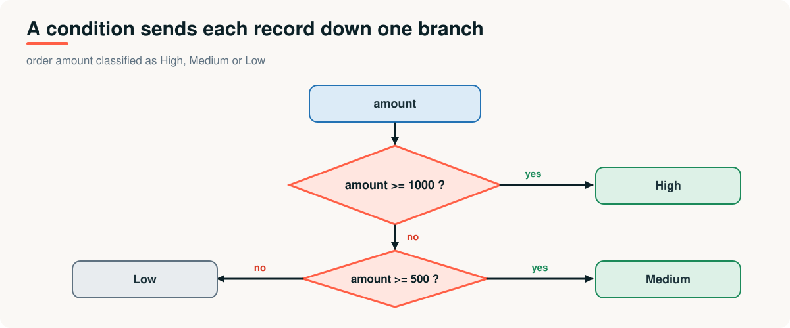
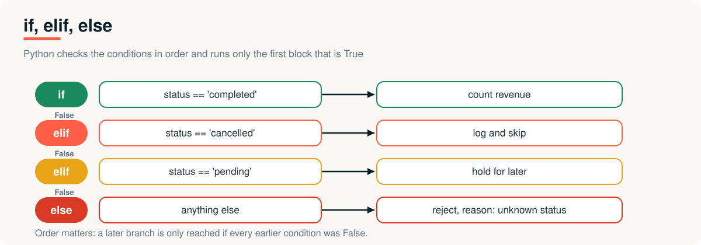

# 08 · Conditional Statements

> **Module 03 · Topic 08 of 19** &nbsp;|&nbsp; Reading time: ~45 min &nbsp;|&nbsp; Level: Beginner

[Module home](README.md) &nbsp;·&nbsp; [← Previous: Strings-I](07-strings-i.md) &nbsp;·&nbsp; [Next: While Loops →](09-while-loops.md)



## What you will learn

- What a **conditional statement** is and why every pipeline needs one
- How `if`, `if-else` and `if-elif-else` work, and how Python evaluates them
- How to **nest** conditions, and when to flatten them instead
- How to build an **elif ladder** for tiered rules, and why the order of branches matters
- How Python decides what counts as true (**truthiness**)

---

## 1. The business problem

Orders arrive from several sources. Before loading, Asha must decide what happens to each record, and the rules depend on the data.

| Situation | Required action |
|---|---|
| Amount is missing or not positive | Reject the record |
| Order is cancelled | Load it, but exclude it from revenue |
| Amount above 5,000 | Flag for manual approval |
| Amount 1,000 to 5,000 | Standard processing |
| Region is blank | Send to a review queue |

A program that does the same thing to every record cannot do this. It must **choose** based on the data. That is the job of a conditional statement. In [Topic 03](03-operators-and-intro-conditions.md) you saw a first `if`. This topic covers the full set.

---

## 2. What is a conditional statement?

A **conditional statement** runs a block of code **only when a condition is true**. The condition is any expression that evaluates to `True` or `False`, usually built from the comparison and logical operators of Topic 03.



Every conditional follows the same shape:

```text
keyword  condition :
    indented block, runs only if the condition is true
```

---

## 3. The `if` statement

```python
amount = 6200

if amount > 5000:
    print("Flag for manual approval")

print("Record processed")
```

```text
Flag for manual approval
Record processed
```

When the condition is false, the block is skipped, and the program continues with the next unindented line:

```python
amount = 800

if amount > 5000:
    print("Flag for manual approval")

print("Record processed")
```

```text
Record processed
```

---

## 4. `if-else`

`else` runs when the condition is **false**. Exactly one of the two blocks runs.

```python
status = "cancelled"

if status == "completed":
    print("Include in revenue")
else:
    print("Exclude from revenue")
```

```text
Exclude from revenue
```

`else` has no condition of its own, and it must come last.

---

## 5. `if-elif-else`

When there are more than two outcomes, add `elif` (else if). Python tests the conditions **from the top** and runs the block of the **first** one that is true. The rest are skipped.

```python
status = "pending"

if status == "completed":
    action = "load into revenue"
elif status == "cancelled":
    action = "load, exclude from revenue"
elif status == "pending":
    action = "hold until settled"
else:
    action = "reject: unknown status"

print(f"{status}: {action}")
```

```text
pending: hold until settled
```

You can have any number of `elif` branches, and `else` is optional. Without it, nothing runs when no condition matches.

---

## 6. Nested conditions

A conditional inside another conditional is **nested**. The inner one is only reached when the outer condition is true.

```python
amount = 6200
region = "West"

if amount > 0:
    if amount > 5000:
        if region == "West":
            print("Large West order: route to West approver")
        else:
            print("Large order: route to head office")
    else:
        print("Standard processing")
else:
    print("Reject: amount must be positive")
```

```text
Large West order: route to West approver
```

Nesting is correct, but each level moves the code to the right and makes it harder to read. Often the same logic is clearer with logical operators:

```python
amount = 6200
region = "West"

if amount > 5000 and region == "West":
    print("Large West order: route to West approver")
```

```text
Large West order: route to West approver
```

A good habit for validation is the **guard clause**: handle the bad cases first, then continue with the normal case without extra indentation.

```python
record = {"order_id": 1004, "amount": -50, "region": "East"}

if record["amount"] <= 0:
    print("Reject: amount must be positive")
elif record["region"] == "":
    print("Send to review queue: region missing")
else:
    print("Process normally")
```

```text
Reject: amount must be positive
```

---

## 7. The elif ladder

An **elif ladder** is a chain of `elif` branches for tiered rules, such as price bands, grades or priority levels. Because Python stops at the first true condition, **the order of branches is part of the logic**.

```python
def order_tier(amount):
    if amount >= 10000:
        return "platinum"
    elif amount >= 5000:
        return "gold"
    elif amount >= 1000:
        return "silver"
    elif amount > 0:
        return "bronze"
    else:
        return "invalid"

for amount in [12000, 5000, 1200, 250, 0]:
    print(f"{amount:>6}  ->  {order_tier(amount)}")
```

```text
 12000  ->  platinum
  5000  ->  gold
  1200  ->  silver
   250  ->  bronze
     0  ->  invalid
```

Notice that each branch only needs to state its **lower bound**. By the time Python reaches `amount >= 5000`, the first branch has already ruled out 10,000 and above.

### The order mistake

Reverse the branches and every large amount lands in the first, widest band:

```python
def broken_tier(amount):
    if amount > 0:
        return "bronze"          # catches everything positive
    elif amount >= 1000:
        return "silver"          # never reached
    else:
        return "invalid"

print(broken_tier(12000))
```

```text
bronze
```

Put the **most specific or most restrictive** conditions first.

---

## 8. What counts as true? Truthiness

Python does not require a condition to be a comparison. Any value can be tested, and each has a **truth value**.

| Falsy (treated as `False`) | Truthy (treated as `True`) |
|---|---|
| `False`, `None` | `True` |
| `0`, `0.0` | Any non-zero number |
| `""` (empty string) | Any non-empty string |
| `[]`, `()`, `{}`, `set()` | Any non-empty collection |

```python
for value in [0, 42, "", "West", [], [1], None]:
    if value:
        print(f"{value!r:<8} truthy")
    else:
        print(f"{value!r:<8} falsy")
```

```text
0        falsy
42       truthy
''       falsy
'West'   truthy
[]       falsy
[1]      truthy
None     falsy
```

This gives short, common checks:

```python
region = ""
orders = []

if not region:
    print("Region is missing")
if not orders:
    print("No orders to process")
```

```text
Region is missing
No orders to process
```

> [!NOTE]
> Truthiness is convenient and also a trap. A valid amount of `0` is falsy, so `if not amount:` treats a zero amount the same as a missing one. When the difference matters, test explicitly: `if amount is None:`.

### The conditional expression

For a simple choice between two values, one line is enough:

```python
amount = 6200
label = "approval needed" if amount > 5000 else "auto"
print(label)
```

```text
approval needed
```

---

## 9. Putting it together: routing a batch

```python
orders = [
    {"order_id": 1001, "amount": 1200.0,  "status": "completed", "region": "West"},
    {"order_id": 1002, "amount": -50.0,   "status": "completed", "region": "East"},
    {"order_id": 1003, "amount": 7400.0,  "status": "completed", "region": "North"},
    {"order_id": 1004, "amount": 300.0,   "status": "cancelled", "region": "South"},
    {"order_id": 1005, "amount": 900.0,   "status": "completed", "region": ""},
]

for o in orders:
    if o["amount"] is None or o["amount"] <= 0:
        route = "reject"
    elif not o["region"]:
        route = "review queue"
    elif o["status"] == "cancelled":
        route = "load, exclude from revenue"
    elif o["amount"] > 5000:
        route = "manual approval"
    else:
        route = "standard"
    print(f"{o['order_id']}  {route}")
```

```text
1001  standard
1002  reject
1003  manual approval
1004  load, exclude from revenue
1005  review queue
```

Each rule is a branch, in priority order: bad data first, then exceptions, then the rule for large orders, and the normal case last. This is the same decision logic as the `CASE` expression you wrote in SQL in [Module 02](../02_SQL_for_Data_Engineers/02-querying-fundamentals.md).

---

## 10. Limitations and engineering considerations

| Issue | Detail |
|---|---|
| **Branch order** | A wide condition above a narrow one hides it. Order from most specific to least |
| **`=` vs `==`** | `=` assigns and `==` compares. Using `=` in a condition is a syntax error |
| **Deep nesting** | More than two or three levels is hard to read. Use guard clauses, `and`/`or`, or a function |
| **Truthiness traps** | `0` and `""` are falsy, so a valid zero can be mistaken for missing data. Use `is None` when it matters |
| **Float comparisons** | `0.1 + 0.2 == 0.3` is `False` because of rounding. Compare with a tolerance or use `Decimal` for money |
| **Missing `else`** | A value set only inside `if` branches may be undefined when none match. Set a default first or end with `else` |
| **Very long ladders** | Many `elif` branches for lookups are better as a dictionary |

## 11. Real-world applications

- **Validation:** reject, quarantine or accept each record based on its fields.
- **Routing:** send records to different tables or queues by type, region or size.
- **Pipeline control:** run a step only if the previous one succeeded or the file exists.
- **Alerting:** notify when a metric crosses a threshold.
- **Feature rules:** tiering and bucketing, the same logic as SQL `CASE`.

---

## Key takeaways

1. A conditional runs a block **only when its condition is true**.
2. `if` handles one case, `if-else` two, and `if-elif-else` many. **Only the first matching branch runs.**
3. **Order matters in an elif ladder:** put the most specific condition first.
4. Nesting works, but prefer **guard clauses** and `and`/`or` for readability.
5. Any value has a **truth value**: empty and zero values are falsy. Use `is None` when zero is valid.
6. `x if condition else y` is a compact choice between two values.
7. A conditional's job in a pipeline is to **decide**: accept, reject, route or alert.

## Interview questions

<details><summary><b>1.</b> What is the difference between <code>if</code> followed by <code>if</code>, and <code>if</code> followed by <code>elif</code>?</summary>

Separate `if` statements are all evaluated independently, so several blocks can run. In an `if-elif` chain only the first true branch runs and the rest are skipped.
</details>

<details><summary><b>2.</b> Can an <code>elif</code> or <code>else</code> appear without an <code>if</code>?</summary>

No. They are continuations of an `if` statement, and `else` must be last. Without a preceding `if` it is a syntax error.
</details>

<details><summary><b>3.</b> Why does the order of branches matter in an elif ladder?</summary>

Python tests branches top to bottom and stops at the first true one. A broad condition placed early shadows narrower ones below it.
</details>

<details><summary><b>4.</b> What values are falsy in Python?</summary>

`False`, `None`, zero of any numeric type, and empty strings and collections (`""`, `[]`, `()`, `{}`, `set()`). Everything else is truthy by default.
</details>

<details><summary><b>5.</b> Why can <code>if not amount:</code> be a bug in a data pipeline?</summary>

A valid amount of `0` is falsy, so it is treated like `None` or missing. Test `amount is None` when zero is a legitimate value.
</details>

<details><summary><b>6.</b> How would you reduce deeply nested <code>if</code> statements?</summary>

Handle invalid cases first with guard clauses, combine conditions with `and`/`or`, or move the logic into a small function that returns early.
</details>

<details><summary><b>7.</b> What does <code>x = "a" if cond else "b"</code> do?</summary>

It is a conditional expression: `x` becomes `"a"` when `cond` is true and `"b"` otherwise. Use it for simple two-way choices.
</details>

## Official documentation

- [The `if` statement (tutorial)](https://docs.python.org/3/tutorial/controlflow.html#if-statements)
- [Compound statements: `if`](https://docs.python.org/3/reference/compound_stmts.html#the-if-statement)
- [Truth value testing](https://docs.python.org/3/library/stdtypes.html#truth-value-testing)
- [Conditional expressions](https://docs.python.org/3/reference/expressions.html#conditional-expressions)

---

| Previous | Contents | Next |
|:---|:---:|:---|
| [← Strings-I](07-strings-i.md) | [Module home](README.md#topics-covered) | [While Loops →](09-while-loops.md) |
