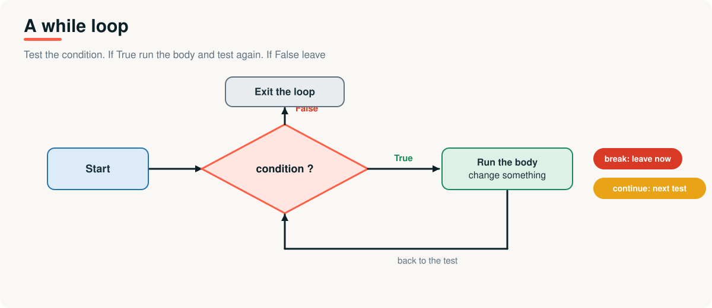

# 09 · While Loops

> **Module 03 · Topic 09 of 19** &nbsp;|&nbsp; Reading time: ~50 min &nbsp;|&nbsp; Level: Beginner

[Module home](README.md) &nbsp;·&nbsp; [← Previous: Conditional Statements](08-conditional-statements.md) &nbsp;·&nbsp; [Next: Strings-II →](10-strings-ii.md)



## What you will learn

- What a **loop** is and why programs need them
- The syntax and flow of a **`while` loop**
- **Control flow** inside loops: `break`, `continue` and `pass`
- How to avoid **infinite loops**
- How to build a **retry loop**, a pattern used in nearly every pipeline
- How to solve **pattern problems** with nested loops

---

## 1. The business problem

Asha's nightly job calls a partner service that sometimes fails for a few seconds. Three more tasks look similar.

| Task | The repetition |
|---|---|
| Call the partner service until it answers, up to 5 times | Repeat until success **or** a limit |
| Read a queue of incoming files until it is empty | Repeat **until nothing is left** |
| Add up order amounts until a daily budget is reached | Repeat **until a threshold** is crossed |
| Print a banner or a simple text report | Repeat a fixed shape |

In every case the number of repetitions is **not known in advance**. It depends on what happens while the loop runs. That is exactly what `while` is for.

---

## 2. What is a loop, and why use one?

A **loop** repeats a block of code. Without loops, repeating an action 1,000 times means writing it 1,000 times, and changing it means editing 1,000 places.

| Loop | Use when |
|---|---|
| **`for`** | You know what to loop over: the items of a list, a range of numbers |
| **`while`** | You loop **as long as a condition stays true**, and do not know how many times |

You met `for` in [Topic 04](04-lists-and-intro-to-for-loops.md). This topic is about `while`.

---

## 3. `while` syntax

```text
while condition:
    body, repeated as long as the condition is true
```

Python checks the condition **before every pass**. If it is true, the body runs, and then Python checks again. When the condition becomes false, the loop ends and the program continues after it.

```python
count = 1

while count <= 5:
    print("Pass", count)
    count += 1

print("Loop finished, count is", count)
```

```text
Pass 1
Pass 2
Pass 3
Pass 4
Pass 5
Loop finished, count is 6
```

A `while` loop needs three things, and forgetting any of them causes bugs:

| Part | In the example |
|---|---|
| **Initialise** the variable | `count = 1` |
| **Test** it in the condition | `count <= 5` |
| **Update** it inside the body | `count += 1` |

### Counting down and accumulating

```python
amounts = [1200, 800, 300, 500, 250]
budget = 2000
spent = 0
index = 0

while index < len(amounts) and spent + amounts[index] <= budget:
    spent += amounts[index]
    index += 1

print("Processed", index, "orders, total", spent)
```

```text
Processed 2 orders, total 2000
```

The loop stops either when the list is exhausted or when the next order would exceed the budget. The condition combines both rules with `and`.

---

## 4. Control flow inside a loop

### `break`: leave the loop now

```python
files = ["a.csv", "b.csv", "corrupt.csv", "d.csv"]

index = 0
while index < len(files):
    name = files[index]
    if name.startswith("corrupt"):
        print("Found a corrupt file, stopping:", name)
        break
    print("Loaded", name)
    index += 1
```

```text
Loaded a.csv
Loaded b.csv
Found a corrupt file, stopping: corrupt.csv
```

### `continue`: skip to the next pass

`continue` ends the current pass and jumps back to the condition. Be careful to update the loop variable **before** `continue`, or the loop will repeat forever.

```python
amounts = [1200, -50, 800, 0, 300]

i = 0
total = 0
while i < len(amounts):
    value = amounts[i]
    i += 1                       # update first, so continue cannot cause an infinite loop
    if value <= 0:
        continue                 # skip invalid values
    total += value

print("Valid total:", total)
```

```text
Valid total: 2300
```

### `pass`: do nothing

`pass` is a placeholder for a block that must exist but has no code yet.

```python
n = 0
while n < 3:
    if n == 1:
        pass                     # TODO: handle this case later
    n += 1
print("n =", n)
```

```text
n = 3
```

| Statement | Effect |
|---|---|
| `break` | Exit the loop immediately |
| `continue` | Skip the rest of this pass and test the condition again |
| `pass` | Do nothing. A placeholder |

---

## 5. Infinite loops

If the condition never becomes false, the loop never ends. This is the most common `while` bug.

```python
count = 1
while count <= 5:
    print(count)
    # forgot count += 1  ->  prints 1 forever. Stop it with Ctrl + C
```

Sometimes an intentional infinite loop is useful, for example a service that waits for work. It is written `while True:` and **must** contain a `break` or a return that ends it.

```python
attempts = 0

while True:
    attempts += 1
    if attempts == 3:
        print("Succeeded on attempt", attempts)
        break
```

```text
Succeeded on attempt 3
```

Checklist when a loop will not stop: is the variable updated? Does the update move it **toward** the stop condition? Does `continue` skip the update?

---

## 6. `input()` in a loop: keep asking until valid

A classic use is to repeat a prompt until the answer is acceptable. The `input=` values below stand in for what a user would type.

```python
while True:
    text = input("Enter order amount: ")
    if not text.replace(".", "", 1).isdigit():
        print("Not a positive number, try again")
        continue
    amount = float(text)
    break

print("Accepted:", amount)
```

```text
Enter order amount: abc
Not a positive number, try again
Enter order amount: -5
Not a positive number, try again
Enter order amount: 1200
Accepted: 1200.0
```

---

## 7. The retry loop

This is the pattern from the business problem. Try an action, and if it fails, wait and try again, up to a limit. Here a function simulates a service that fails twice and then answers.

```python
calls = {"count": 0}

def call_partner_api():
    """Simulated service: fails on the first two calls, then succeeds."""
    calls["count"] += 1
    return calls["count"] >= 3

max_attempts = 5
attempt = 1
success = False

while attempt <= max_attempts and not success:
    success = call_partner_api()
    if success:
        print(f"Attempt {attempt}: success")
    else:
        print(f"Attempt {attempt}: failed, retrying")
        attempt += 1

if not success:
    print("Giving up: alert the on-call engineer")
```

```text
Attempt 1: failed, retrying
Attempt 2: failed, retrying
Attempt 3: success
```

Three ideas you will reuse: a **limit** so the loop cannot run forever, a **flag** (`success`) that ends it early, and a **final check** after the loop to handle total failure. A real version adds a pause between attempts with `time.sleep()`, covered in [Topic 17](17-file-handling-and-exception-handling.md).

---

## 8. Solving pattern problems

Pattern problems print shapes with text. They look like puzzles, and they train the skill that matters most: **controlling two counters at once**. The usual solution is a **nested loop**: the outer loop handles rows, the inner loop handles what is printed in each row.

### A right triangle

```python
rows = 5
row = 1
while row <= rows:
    print("*" * row)
    row += 1
```

```text
*
**
***
****
*****
```

### The same pattern with an inner loop

```python
rows = 5
row = 1
while row <= rows:
    col = 1
    while col <= row:
        print("*", end=" ")
        col += 1
    print()                      # end the line
    row += 1
```

```text
* 
* * 
* * * 
* * * * 
* * * * * 
```

`end=" "` stops `print` from starting a new line, and the bare `print()` starts one.

### Inverted triangle and numbers

```python
n = 5
while n >= 1:
    print(" ".join(str(k) for k in range(1, n + 1)))
    n -= 1
```

```text
1 2 3 4 5
1 2 3 4
1 2 3
1 2
1
```

### A pyramid

```python
rows = 4
row = 1
while row <= rows:
    print(" " * (rows - row) + "*" * (2 * row - 1))
    row += 1
```

```text
   *
  ***
 *****
*******
```

Reading a pattern: for each row, ask **how many spaces** and **how many symbols**, as a function of the row number. For the pyramid, spaces are `rows - row` and stars are `2 * row - 1`.

### A report line (a practical pattern)

```python
data = [("West", 1500), ("East", 1050), ("North", 500)]
largest = max(v for _, v in data)

i = 0
while i < len(data):
    region, value = data[i]
    bar = "#" * (value * 20 // largest)
    print(f"{region:<6} {bar:<20} {value}")
    i += 1
```

```text
West   #################### 1500
East   ##############       1050
North  ######               500
```

---

## 9. Limitations and engineering considerations

| Issue | Detail |
|---|---|
| **Infinite loops** | A missing update is the usual cause. Always check that the loop moves toward its stop condition |
| **`while` where `for` fits** | If you are stepping through a list by index, `for item in list` is shorter and safer |
| **Retry without limit** | A retry loop with no maximum can hammer a failing service forever. Always cap attempts |
| **Retry without delay** | Immediate retries often fail again. Real jobs wait, and increase the wait each time (backoff) |
| **Off-by-one errors** | `<` and `<=` differ by one pass. Test the first and last values |
| **`continue` before the update** | Skips the increment and loops forever |
| **Mutating while looping** | Removing items from a list you are looping over skips elements |

## 10. Real-world applications

- **Retry and backoff:** calling APIs, databases and cloud services that fail intermittently.
- **Polling:** wait until a file arrives or a job finishes.
- **Queue draining:** process messages until the queue is empty.
- **Input validation:** ask until the answer is acceptable.
- **Pagination:** keep fetching pages from an API until there are no more.

---

## Key takeaways

1. A **loop** repeats a block. Use `for` when you know what to loop over, and `while` when you loop **until a condition changes**.
2. A `while` loop needs an **initial value, a test and an update**.
3. `break` exits, `continue` skips to the next pass, and `pass` does nothing.
4. An **infinite loop** means the condition never becomes false. Check the update, especially around `continue`.
5. The **retry loop** is a core pipeline pattern: attempt, limit, flag, and a final failure check.
6. **Pattern problems** are solved with nested loops, with the outer loop for rows and the inner for columns.
7. Always **bound** loops that wait on external systems.

## Interview questions

<details><summary><b>1.</b> What is the difference between a <code>for</code> loop and a <code>while</code> loop?</summary>

A `for` loop iterates over a known sequence of items. A `while` loop repeats as long as a condition is true, so it suits cases where the number of repetitions is not known in advance.
</details>

<details><summary><b>2.</b> What are the three parts of a correct <code>while</code> loop?</summary>

Initialising the control variable, testing it in the condition, and updating it in the body so the condition eventually becomes false.
</details>

<details><summary><b>3.</b> What do <code>break</code> and <code>continue</code> do?</summary>

`break` exits the loop immediately. `continue` skips the remainder of the current pass and goes back to the condition.
</details>

<details><summary><b>4.</b> How can <code>continue</code> cause an infinite loop?</summary>

If the variable update comes after `continue` in the body, the update is skipped, the condition never changes, and the loop repeats forever. Update before `continue`.
</details>

<details><summary><b>5.</b> How do you write a retry loop, and what should it include?</summary>

A loop with a maximum number of attempts that calls the operation, exits early on success, waits between attempts (ideally with growing delays), and handles final failure by logging or alerting.
</details>

<details><summary><b>6.</b> When is <code>while True</code> acceptable?</summary>

When the stopping point is decided inside the body, for example a service waiting for work or an input-validation loop. It must contain a `break` or `return` on a reachable path.
</details>

<details><summary><b>7.</b> How do you approach a pattern-printing problem?</summary>

Break it into rows and columns. The outer loop controls rows. For each row, write the number of spaces and symbols as a formula of the row number, then print them with an inner loop or string repetition.
</details>

## Official documentation

- [The `while` statement](https://docs.python.org/3/reference/compound_stmts.html#the-while-statement)
- [`break` and `continue` statements](https://docs.python.org/3/tutorial/controlflow.html#break-and-continue-statements-and-else-clauses-on-loops)
- [`pass` statements](https://docs.python.org/3/tutorial/controlflow.html#pass-statements)
- [`print()` and its `end` argument](https://docs.python.org/3/library/functions.html#print)

---

| Previous | Contents | Next |
|:---|:---:|:---|
| [← Conditional Statements](08-conditional-statements.md) | [Module home](README.md#topics-covered) | [Strings-II →](10-strings-ii.md) |
