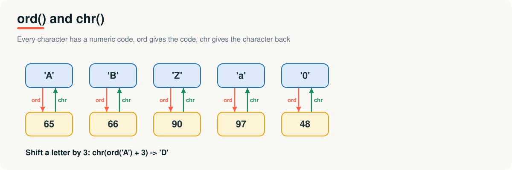

# 10 · Strings-II: Problem Solving with Strings

> **Module 03 · Topic 10 of 19** &nbsp;|&nbsp; Reading time: ~50 min &nbsp;|&nbsp; Level: Beginner to Intermediate

[Module home](README.md) &nbsp;·&nbsp; [← Previous: While Loops](09-while-loops.md) &nbsp;·&nbsp; [Next: For-else, While-else and Comprehensions →](11-for-else-while-else-and-comprehensions.md)



## What you will learn

- How to combine **string methods, loops and conditionals** to solve real problems
- How `ord()` and `chr()` convert between characters and their numeric codes
- How to build classic solutions: character counting, **palindromes**, **Caesar cipher**, validation
- How to clean **IDs and emails**, the string work found in every ingestion job

[Topic 07](07-strings-i.md) taught the tools. This topic uses them, together with the loops and conditions you learned since.

---

## 1. The business problem

Text fields are the messiest part of any data feed. Asha's partner file has these problems.

| Field | Problem | What she must do |
|---|---|---|
| `customer_id` | Mixed case, spaces, stray symbols: `" ab-1042 "` | Normalise to `AB1042` |
| `email` | Some are invalid or have the wrong case | Validate and lowercase |
| `phone` | Letters and punctuation mixed with digits | Keep digits only |
| `code` | A reference that must be masked before sharing | Shift characters or mask them |

Built-in methods handle part of this. The rest needs a **loop over the characters with a decision on each one**, which is the pattern of this whole topic.

---

## 2. Tools you will combine

| Tool | Purpose |
|---|---|
| `for ch in text` | Visit each character |
| `ch.isalpha()`, `isdigit()`, `isalnum()`, `isspace()` | Classify a character |
| `ch.isupper()`, `islower()`, `upper()`, `lower()` | Test and change case |
| `text[::-1]` | Reverse a string |
| `ord(ch)` | Character to its integer code |
| `chr(n)` | Integer code to a character |
| `"".join(list)` | Build one string from pieces |

Strings are **immutable**, so you do not change one in place. You build a **new** string from the pieces you keep, usually by collecting them in a list and joining.

---

## 3. `ord()` and `chr()`

Every character has a numeric **code point** in the Unicode standard. `ord` gives the number and `chr` turns a number back into the character.

```python
print(ord("A"), ord("Z"), ord("a"), ord("z"), ord("0"))
print(chr(65), chr(97), chr(48))
```

```text
65 90 97 122 48
A a 0
```

Letters are in consecutive order, so arithmetic works:

```python
print(ord("a") - ord("A"))          # distance between lower and upper case
print(chr(ord("A") + 2))            # two letters after A
print(ord("d") - ord("a"))          # position of d in the alphabet (a = 0)
```

```text
32
C
3
```

| Range | Characters | Codes |
|---|---|---|
| Digits | `0`-`9` | 48 to 57 |
| Uppercase | `A`-`Z` | 65 to 90 |
| Lowercase | `a`-`z` | 97 to 122 |

---

## 4. Counting characters

### Vowels and consonants

```python
text = "Data Engineering at XYZ Company"

vowels = 0
consonants = 0
for ch in text.lower():
    if ch.isalpha():
        if ch in "aeiou":
            vowels += 1
        else:
            consonants += 1

print("Vowels:", vowels, " Consonants:", consonants)
```

```text
Vowels: 10  Consonants: 17
```

### Frequency of each character

A dictionary (Topic 06) is the natural tool for counting:

```python
text = "banana split"

freq = {}
for ch in text:
    if ch != " ":
        freq[ch] = freq.get(ch, 0) + 1

for ch, n in sorted(freq.items()):
    print(ch, n)
```

```text
a 3
b 1
i 1
l 1
n 2
p 1
s 1
t 1
```

### Classifying every character

```python
sample = "Order#4521 for Meera, Pune!"

letters = digits = spaces = others = 0
for ch in sample:
    if ch.isalpha():
        letters += 1
    elif ch.isdigit():
        digits += 1
    elif ch.isspace():
        spaces += 1
    else:
        others += 1

print(f"letters={letters} digits={digits} spaces={spaces} others={others}")
```

```text
letters=17 digits=4 spaces=3 others=3
```

---

## 5. Reversing and palindromes

A **palindrome** reads the same forwards and backwards. Slicing reverses a string, and a clean comparison ignores case, spaces and punctuation.

```python
def is_palindrome(text):
    cleaned = ""
    for ch in text:
        if ch.isalnum():
            cleaned += ch.lower()
    return cleaned == cleaned[::-1]

for phrase in ["Madam", "A man, a plan, a canal: Panama", "Data Engineer", "12321"]:
    print(f"{phrase!r:<35} {is_palindrome(phrase)}")
```

```text
'Madam'                             True
'A man, a plan, a canal: Panama'    True
'Data Engineer'                     False
'12321'                             True
```

### Reversing words, and reversing each word

```python
sentence = "load clean validate publish"

words = sentence.split()
print(" ".join(reversed(words)))                  # reverse the word order
print(" ".join(w[::-1] for w in words))           # reverse each word
```

```text
publish validate clean load
daol naelc etadilav hsilbup
```

### Anagrams

Two words are anagrams if they use the same letters in the same quantities.

```python
def is_anagram(a, b):
    return sorted(a.lower()) == sorted(b.lower())

print(is_anagram("Listen", "Silent"))
print(is_anagram("Order", "Rodeo"))
print(is_anagram("Data", "Dart"))
```

```text
True
False
False
```

---

## 6. Caesar cipher with `ord` and `chr`

The Caesar cipher shifts each letter by a fixed number of places: with a shift of 3, `A` becomes `D`. It is not secure encryption, but it is the standard exercise for `ord` and `chr`, and the same idea (convert, compute, convert back) is behind many masking and encoding tasks.

The trick is the **wrap-around**: after `Z` comes `A` again. Convert the letter to a position from 0 to 25, shift it, take the remainder with `% 26`, and convert back.

```python
def caesar(text, shift):
    result = []
    for ch in text:
        if ch.isupper():
            position = ord(ch) - ord("A")
            result.append(chr((position + shift) % 26 + ord("A")))
        elif ch.islower():
            position = ord(ch) - ord("a")
            result.append(chr((position + shift) % 26 + ord("a")))
        else:
            result.append(ch)              # digits, spaces, punctuation stay unchanged
    return "".join(result)

secret = caesar("Order XYZ-1042 ships to Pune", 3)
print(secret)
print(caesar(secret, -3))                  # shifting back decodes it
```

```text
Rughu ABC-1042 vklsv wr Sxqh
Order XYZ-1042 ships to Pune
```

Note the wrap: `X`, `Y`, `Z` became `A`, `B`, `C`. Python's `%` always returns a non-negative result for a positive divisor, so negative shifts also work.

---

## 7. Cleaning identifiers and contact data

### A customer ID

Rule: keep letters and digits, uppercase them.

```python
def clean_id(raw):
    kept = [ch for ch in raw if ch.isalnum()]
    return "".join(kept).upper()

for raw in [" ab-1042 ", "AB 1042", "ab_1042!", "ab1042"]:
    print(f"{raw!r:<14} -> {clean_id(raw)}")
```

```text
' ab-1042 '    -> AB1042
'AB 1042'      -> AB1042
'ab_1042!'     -> AB1042
'ab1042'       -> AB1042
```

### A phone number

```python
def clean_phone(raw):
    digits = ""
    for ch in raw:
        if ch.isdigit():
            digits += ch
    return digits

print(clean_phone("+91 (98765) 43210"))
print(clean_phone("98765-43210"))
```

```text
919876543210
9876543210
```

### Email validation

A full email check is complex. A practical first screen has a few rules: exactly one `@`, something before it, and a domain with a dot that is not at the edges.

```python
def validate_email(raw):
    email = raw.strip().lower()
    if email.count("@") != 1:
        return None, "needs exactly one @"
    local, domain = email.split("@")
    if not local:
        return None, "nothing before @"
    if "." not in domain:
        return None, "domain has no dot"
    if domain.startswith(".") or domain.endswith("."):
        return None, "domain starts or ends with a dot"
    if " " in email:
        return None, "contains a space"
    return email, "ok"

for raw in ["  Meera.Iyer@XYZ.com ", "rahul@@xyz.com", "@xyz.com", "anika@xyz", "ok user@xyz.com"]:
    cleaned, reason = validate_email(raw)
    print(f"{raw!r:<26} {cleaned!s:<20} {reason}")
```

```text
'  Meera.Iyer@XYZ.com '    meera.iyer@xyz.com   ok
'rahul@@xyz.com'           None                 needs exactly one @
'@xyz.com'                 None                 nothing before @
'anika@xyz'                None                 domain has no dot
'ok user@xyz.com'          None                 contains a space
```

Notice that the function returns a **reason** for each rejection. In a pipeline you store the reason with the rejected record, as in the reject pattern from [Module 02, Topic 07](../02_SQL_for_Data_Engineers/07-cleaning-and-validating-data.md).

### Masking sensitive values

```python
def mask_card(number):
    digits = "".join(ch for ch in number if ch.isdigit())
    return "*" * (len(digits) - 4) + digits[-4:]

print(mask_card("4111 1111 1111 1234"))
```

```text
************1234
```

---

## 8. A small project: cleaning a customer batch

```python
raw_rows = [
    "  ab-1042 , Meera Iyer , MEERA.IYER@XYZ.COM ",
    "cd 2210,rahul sharma,rahul@@xyz.com",
    "EF_3301 ,  anika  gupta , anika.gupta@xyz.com",
]

clean, rejected = [], []
for row in raw_rows:
    cid, name, email = [part.strip() for part in row.split(",")]
    cid = "".join(ch for ch in cid if ch.isalnum()).upper()
    name = " ".join(name.split()).title()
    valid_email, reason = validate_email(email)
    if valid_email:
        clean.append((cid, name, valid_email))
    else:
        rejected.append((cid, name, reason))

print("clean:")
for r in clean:
    print("  ", r)
print("rejected:")
for r in rejected:
    print("  ", r)
```

```text
clean:
   ('AB1042', 'Meera Iyer', 'meera.iyer@xyz.com')
   ('EF3301', 'Anika Gupta', 'anika.gupta@xyz.com')
rejected:
   ('CD2210', 'Rahul Sharma', 'needs exactly one @')
```

(The function `validate_email` comes from the previous example.) Each field goes through its own small cleaning rule, and invalid rows are kept with a reason instead of being dropped.

---

## 9. Limitations and engineering considerations

| Issue | Detail |
|---|---|
| **Immutability** | Strings cannot change in place. Building by `+=` in a loop is fine for small text but slow for large text. Collect pieces in a list and `join` |
| **Unicode** | `ord` and `chr` work on Unicode code points. Accents, other scripts and emoji exceed the 65-90 and 97-122 ranges, and `isalpha()` is true for them too |
| **Case rules** | `lower()` is not enough for all languages. Use `casefold()` for case-insensitive comparison |
| **Email validation** | The checks above catch common mistakes only. Real validation uses a tested library or confirms by sending mail |
| **Regular expressions** | Complex patterns are better written with the `re` module than with manual loops |
| **Caesar cipher** | Educational only. Never use it to protect data. Use proper encryption libraries |
| **Performance** | Character loops are fine for fields. For millions of rows use vectorised string methods (pandas) or SQL |

## 10. Real-world applications

- **Key normalisation:** matching customers across systems requires identical, cleaned keys.
- **Validation:** emails, phone numbers, postcodes and IDs checked before loading.
- **Masking and tokenising:** hiding card numbers and personal data in lower environments.
- **Parsing:** pulling fields out of log lines and file names.
- **Encoding checks:** detecting non-ASCII characters that break downstream systems.

---

## Key takeaways

1. Most text problems follow one pattern: **loop over characters, decide with a condition, build a new string**.
2. `ord()` gives a character's code and `chr()` converts a code back. Letters are consecutive, so arithmetic works.
3. Use `%` for **wrap-around**, as in the Caesar cipher.
4. Slicing `[::-1]` reverses a string, and `sorted()` compares letters for anagrams.
5. Strings are immutable: build a **list of pieces** and `"".join(...)`.
6. A validation function should return a **reason** for rejection, not only true or false.
7. Normalise (strip, case, remove symbols) **before** comparing or joining on text.

## Interview questions

<details><summary><b>1.</b> What do <code>ord()</code> and <code>chr()</code> do?</summary>

`ord(ch)` returns the Unicode code point of a single character, and `chr(n)` returns the character for a code point. They are inverses of each other.
</details>

<details><summary><b>2.</b> How do you check whether a string is a palindrome?</summary>

Clean it (keep alphanumeric characters, lower case) and compare it to its reverse, `cleaned == cleaned[::-1]`.
</details>

<details><summary><b>3.</b> How do you check whether two words are anagrams?</summary>

Compare their sorted letters (after normalising case), or compare character-frequency dictionaries. Equal results mean they are anagrams.
</details>

<details><summary><b>4.</b> How does a Caesar cipher handle wrap-around after <code>Z</code>?</summary>

Convert the letter to a position 0-25 with `ord(ch) - ord("A")`, add the shift, take `% 26`, then convert back with `chr(position + ord("A"))`.
</details>

<details><summary><b>5.</b> Why is building a string with <code>+=</code> in a large loop discouraged?</summary>

Strings are immutable, so each `+=` creates a new string and copies the old one. Appending pieces to a list and joining once is more efficient.
</details>

<details><summary><b>6.</b> How would you count the frequency of each character?</summary>

Loop over the characters and update a dictionary with `freq[ch] = freq.get(ch, 0) + 1`, or use `collections.Counter`.
</details>

<details><summary><b>7.</b> Why return a reason when validation fails?</summary>

So rejected records can be stored with the cause, which makes problems traceable, lets the source be corrected, and avoids silent data loss.
</details>

## Official documentation

- [Built-in functions: `ord`](https://docs.python.org/3/library/functions.html#ord) · [`chr`](https://docs.python.org/3/library/functions.html#chr)
- [String methods](https://docs.python.org/3/library/stdtypes.html#string-methods)
- [`str.isalnum`, `isalpha`, `isdigit`](https://docs.python.org/3/library/stdtypes.html#str.isalnum)
- [Unicode HOWTO](https://docs.python.org/3/howto/unicode.html)
- [`re` module (regular expressions)](https://docs.python.org/3/library/re.html)

---

| Previous | Contents | Next |
|:---|:---:|:---|
| [← While Loops](09-while-loops.md) | [Module home](README.md#topics-covered) | [For-else, While-else and Comprehensions →](11-for-else-while-else-and-comprehensions.md) |
