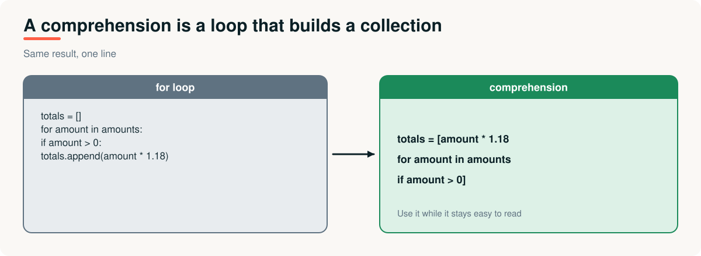
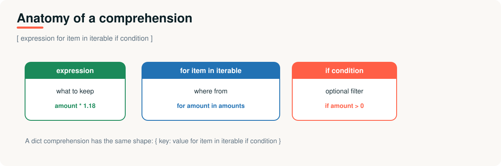

# 11 · For-else, While-else and Comprehensions

> **Module 03 · Topic 11 of 19** &nbsp;|&nbsp; Reading time: ~55 min &nbsp;|&nbsp; Level: Intermediate

[Module home](README.md) &nbsp;·&nbsp; [← Previous: Strings-II](10-strings-ii.md) &nbsp;·&nbsp; [Next: Functions-I →](12-functions-i.md)



## What you will learn

- What **`for-else`** and **`while-else`** mean, and the search pattern they solve
- How to write **list comprehensions**, with conditions and transformations
- How to write **dictionary comprehensions** (and set comprehensions briefly)
- How to solve **data-shaping problems** with comprehensions
- When a plain loop is the better choice

---

## 1. The business problem

Asha's validation code is full of loops that build collections. Two kinds of task keep appearing.

| Task | The loop shape |
|---|---|
| Is there **any** invalid record in this batch? If none, mark the batch clean | Search a collection and act on **not finding** |
| Build a list of amounts after converting and filtering | Loop, test, transform, append |
| Build a lookup `customer_id -> name` | Loop and fill a dictionary |
| Find the regions with total above a threshold | Loop, aggregate, filter |

Python has compact forms for both. `else` on a loop handles the "not found" case, and **comprehensions** build collections in one expression.

---

## 2. `for-else`

A loop can have an `else` block. It runs **only if the loop finished without hitting `break`**. In other words: "if the search came up empty, do this."

```python
files = ["orders_1.csv", "orders_2.csv", "orders_3.csv"]

for name in files:
    if name.startswith("corrupt"):
        print("Found a corrupt file:", name)
        break
else:
    print("No corrupt files, batch is clean")
```

```text
No corrupt files, batch is clean
```

With a bad file, `break` skips the `else`:

```python
files = ["orders_1.csv", "corrupt_2.csv", "orders_3.csv"]

for name in files:
    if name.startswith("corrupt"):
        print("Found a corrupt file:", name)
        break
else:
    print("No corrupt files, batch is clean")
```

```text
Found a corrupt file: corrupt_2.csv
```

Without `for-else` you would need a flag variable (`found = False`, set to `True`, then tested after the loop). The `else` makes the intent direct. Read it as **"no break"**, not as "otherwise".

### A classic use: search for a prime

```python
def is_prime(n):
    if n < 2:
        return False
    for divisor in range(2, int(n ** 0.5) + 1):
        if n % divisor == 0:
            return False          # a divisor was found
    else:
        return True               # no divisor found

print([n for n in range(2, 30) if is_prime(n)])
```

```text
[2, 3, 5, 7, 11, 13, 17, 19, 23, 29]
```

---

## 3. `while-else`

`while` can have the same `else`: it runs when the loop ends because the **condition became false**, and is skipped when `break` ends it.

```python
attempts = 0
max_attempts = 3
done = False

while attempts < max_attempts:
    attempts += 1
    print("Attempt", attempts)
    if attempts == 2:             # pretend the service answered
        done = True
        break
else:
    print("All attempts used, giving up")

print("done:", done)
```

```text
Attempt 1
Attempt 2
done: True
```

Change `attempts == 2` to a value that never happens, and the `else` runs. This is a tidy way to say "retry, and if every attempt failed, alert".

| Loop ends because | `else` block |
|---|---|
| Items exhausted / condition false | **Runs** |
| `break` was executed | **Skipped** |
| `return` or an exception | Skipped (the loop is left entirely) |

---

## 4. List comprehensions

A **list comprehension** builds a list in one expression.

```text
[ expression  for item in iterable  if condition ]
```

Start with the loop you already know:

```python
amounts = [1200, -50, 800, 0, 300]

valid = []
for a in amounts:
    if a > 0:
        valid.append(a)

print(valid)
```

```text
[1200, 800, 300]
```

The same result as a comprehension:

```python
valid = [a for a in amounts if a > 0]
print(valid)
```

```text
[1200, 800, 300]
```



| Part | Meaning | In the example |
|---|---|---|
| `expression` | What goes into the new list | `a` |
| `for item in iterable` | Where the items come from | `for a in amounts` |
| `if condition` | **Optional** filter: keep only items where it is true | `if a > 0` |

### Transforming

```python
prices = [100, 250, 499, 999]

with_tax = [round(p * 1.18, 2) for p in prices]
labels = [f"INR {p}" for p in prices]

print(with_tax)
print(labels)
```

```text
[118.0, 295.0, 588.82, 1178.82]
['INR 100', 'INR 250', 'INR 499', 'INR 999']
```

### Transforming and filtering

```python
names = ["  meera iyer ", "RAHUL SHARMA", "", "anika gupta"]

clean = [n.strip().title() for n in names if n.strip()]
print(clean)
```

```text
['Meera Iyer', 'Rahul Sharma', 'Anika Gupta']
```

### A conditional expression in the output

When the **output** depends on a test, the `if-else` goes in the expression at the front (not at the end):

```python
amounts = [1200, -50, 800, 0, 300]

flags = ["ok" if a > 0 else "invalid" for a in amounts]
print(flags)
```

```text
['ok', 'invalid', 'ok', 'invalid', 'ok']
```

| Placement | Purpose | Form |
|---|---|---|
| `if` at the **end** | **Filter**: skip some items | `[x for x in data if cond]` |
| `if-else` at the **front** | **Choose** the value for every item | `[a if cond else b for x in data]` |

### Nested loops

```python
regions = ["West", "East"]
quarters = ["Q3", "Q4"]

pairs = [(r, q) for r in regions for q in quarters]
print(pairs)
```

```text
[('West', 'Q3'), ('West', 'Q4'), ('East', 'Q3'), ('East', 'Q4')]
```

The `for` clauses read in the same order as the nested loops you would write by hand: the first is the outer loop.

---

## 5. Dictionary comprehensions

A **dictionary comprehension** builds a dictionary, with `key: value` as the expression.

```text
{ key_expression : value_expression  for item in iterable  if condition }
```

```python
customers = [(1, "Meera Iyer"), (2, "Rahul Sharma"), (3, "Anika Gupta")]

by_id = {cid: name for cid, name in customers}
print(by_id)
```

```text
{1: 'Meera Iyer', 2: 'Rahul Sharma', 3: 'Anika Gupta'}
```

### Filtering and transforming a dictionary

```python
revenue = {"West": 1500, "East": 1050, "North": 500, "South": 900}

large = {region: total for region, total in revenue.items() if total >= 900}
in_thousands = {region: total / 1000 for region, total in revenue.items()}

print(large)
print(in_thousands)
```

```text
{'West': 1500, 'East': 1050, 'South': 900}
{'West': 1.5, 'East': 1.05, 'North': 0.5, 'South': 0.9}
```

### Inverting a dictionary

```python
status_codes = {"completed": 1, "cancelled": 2, "pending": 3}
by_code = {code: status for status, code in status_codes.items()}
print(by_code)
```

```text
{1: 'completed', 2: 'cancelled', 3: 'pending'}
```

### Counting with a comprehension

```python
words = ["load", "clean", "load", "publish", "clean", "load"]

counts = {w: words.count(w) for w in set(words)}
print(dict(sorted(counts.items())))
```

```text
{'clean': 2, 'load': 3, 'publish': 1}
```

(`words.count` scans the list for every word. Fine for small data, and `collections.Counter` is better for large data.)

### Set comprehensions

A **set comprehension** uses curly braces without a `key: value` pair, and keeps only unique results.

```python
emails = ["a@xyz.com", "b@abc.org", "c@xyz.com", "d@abc.org"]

domains = {e.split("@")[1] for e in emails}
print(sorted(domains))
```

```text
['abc.org', 'xyz.com']
```

---

## 6. Problem solving with comprehensions

### Problem 1: flatten rows

```python
batches = [[1200, 800], [300], [500, 250, 100]]

all_amounts = [amount for batch in batches for amount in batch]
print(all_amounts)
```

```text
[1200, 800, 300, 500, 250, 100]
```

### Problem 2: revenue per region from records

Build the totals with a loop, then use a comprehension to shape the result:

```python
orders = [
    {"region": "West",  "amount": 1200, "status": "completed"},
    {"region": "East",  "amount": 800,  "status": "completed"},
    {"region": "West",  "amount": 300,  "status": "cancelled"},
    {"region": "North", "amount": 500,  "status": "completed"},
    {"region": "West",  "amount": 250,  "status": "completed"},
]

regions = {o["region"] for o in orders}
revenue = {
    r: sum(o["amount"] for o in orders if o["region"] == r and o["status"] == "completed")
    for r in regions
}

for region, total in sorted(revenue.items(), key=lambda kv: kv[1], reverse=True):
    print(region, total)
```

```text
West 1450
East 800
North 500
```

This is `SUM ... GROUP BY region` with a `WHERE status = 'completed'` from Module 02. The generator expression inside `sum(...)` (no brackets) produces values one at a time and never builds a list.

### Problem 3: a lookup table and a join

```python
customers = {1: "Meera Iyer", 2: "Rahul Sharma", 3: "Anika Gupta"}
orders = [(1001, 1, 1200), (1002, 3, 800), (1003, 9, 300)]

joined = [(oid, customers[cid], amt) for oid, cid, amt in orders if cid in customers]
orphans = [oid for oid, cid, _ in orders if cid not in customers]

print(joined)
print("orders with unknown customer:", orphans)
```

```text
[(1001, 'Meera Iyer', 1200), (1002, 'Anika Gupta', 800)]
orders with unknown customer: [1003]
```

The `orphans` list is the anti-join check from SQL: orders whose customer is missing.

### Problem 4: a two-dimensional table

```python
quarters = ["Q3", "Q4"]
regions = ["West", "East"]

grid = [[f"{r}-{q}" for q in quarters] for r in regions]
for row in grid:
    print(row)
```

```text
['West-Q3', 'West-Q4']
['East-Q3', 'East-Q4']
```

---

## 7. When not to use a comprehension

Comprehensions are for **building a collection from another**. Prefer a plain loop when:

| Situation | Why |
|---|---|
| You need several statements per item | A comprehension holds one expression |
| It has two or more `for` clauses plus conditions | It becomes harder to read than a loop |
| You want side effects (printing, writing) | A comprehension should only build a value |
| You must stop early or use `break` | Comprehensions cannot `break` |

```python
# Hard to read: a loop would be clearer
result = [f(x) for x in data if x > 0 and g(x) for y in other if y != x]
```

A readable comprehension fits on one or two lines. If you need to explain it, write the loop.

---

## 8. Limitations and engineering considerations

| Issue | Detail |
|---|---|
| **Memory** | A list comprehension builds the whole list at once. For very large or streamed data use a generator expression `( ... )` |
| **Readability** | Dense comprehensions hurt maintainability. Name intermediate steps |
| **`else` on loops is rarely seen** | Many readers are unfamiliar with it. Add a short comment: `# no break` |
| **Variable scope** | The loop variable of a comprehension does not leak out of it in Python 3 |
| **Dictionary keys** | In a dictionary comprehension, duplicate keys silently overwrite earlier ones |
| **Not a performance tool for big data** | Faster than an equivalent loop in plain Python, but still far slower than SQL or vectorised engines on large tables |

## 9. Real-world applications

- **Cleaning:** strip, convert and filter a column of values in one line.
- **Lookups:** build `id -> record` dictionaries for fast joins in memory.
- **Validation:** collect all rejected records, or find whether any rule failed (`for-else`).
- **Reshaping:** flatten nested API responses into rows.
- **Config handling:** filter and rename dictionary keys.

---

## Key takeaways

1. A loop's `else` runs only when the loop ends **without `break`**. Read it as "no break", the "not found" case of a search.
2. `while-else` works the same way, and avoids a separate flag variable.
3. A **list comprehension** is `[expression for item in iterable if condition]`.
4. `if` at the end **filters**. `if-else` at the front **chooses a value**.
5. A **dictionary comprehension** is `{key: value for ...}`, and a **set comprehension** is `{value for ...}`.
6. Use a comprehension to **build a collection from another**. Use a loop for anything more complex.
7. For large data, use a **generator expression** or a proper engine.

## Interview questions

<details><summary><b>1.</b> When does the <code>else</code> block of a <code>for</code> loop run?</summary>

When the loop finishes all its iterations without being ended by `break`. If `break` runs, the `else` is skipped.
</details>

<details><summary><b>2.</b> Give a use case for <code>for-else</code>.</summary>

Searching: loop over items and `break` when one matches, and use `else` for the "not found" case, such as a prime test or checking that no record in a batch is invalid.
</details>

<details><summary><b>3.</b> What is the difference between <code>[x for x in data if cond]</code> and <code>[a if cond else b for x in data]</code>?</summary>

The first filters, so the result may be shorter. The second keeps every item and chooses a value for each, so the result has the same length as the input.
</details>

<details><summary><b>4.</b> Write a dictionary comprehension that squares numbers 1 to 5.</summary>

`{n: n ** 2 for n in range(1, 6)}` returns `{1: 1, 2: 4, 3: 9, 4: 16, 5: 25}`.
</details>

<details><summary><b>5.</b> How does a set comprehension differ from a dictionary comprehension?</summary>

Both use curly braces. A dictionary comprehension has `key: value`, and a set comprehension has a single expression and keeps unique values only.
</details>

<details><summary><b>6.</b> When should you not use a comprehension?</summary>

When the logic needs multiple statements, side effects, early exit with `break`, or several nested `for` clauses that make it hard to read. Use a normal loop.
</details>

<details><summary><b>7.</b> What is the difference between a list comprehension and a generator expression?</summary>

A list comprehension (square brackets) builds the whole list in memory. A generator expression (round brackets) produces items lazily, one at a time, so it uses little memory and suits large or streamed data.
</details>

## Official documentation

- [`break`, `continue` and `else` clauses on loops](https://docs.python.org/3/tutorial/controlflow.html#break-and-continue-statements-and-else-clauses-on-loops)
- [List comprehensions (tutorial)](https://docs.python.org/3/tutorial/datastructures.html#list-comprehensions)
- [Dictionaries and comprehensions](https://docs.python.org/3/tutorial/datastructures.html#dictionaries)
- [Displays for lists, sets and dictionaries (reference)](https://docs.python.org/3/reference/expressions.html#displays-for-lists-sets-and-dictionaries)
- [Generator expressions](https://docs.python.org/3/reference/expressions.html#generator-expressions)

---

| Previous | Contents | Next |
|:---|:---:|:---|
| [← Strings-II](10-strings-ii.md) | [Module home](README.md#topics-covered) | [Functions-I →](12-functions-i.md) |
