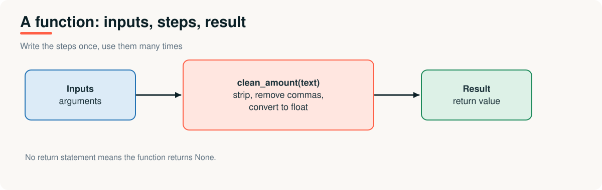
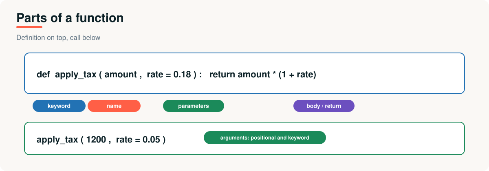

# 12 · Functions-I

> **Module 03 · Topic 12 of 19** &nbsp;|&nbsp; Reading time: ~50 min &nbsp;|&nbsp; Level: Beginner to Intermediate

[Module home](README.md) &nbsp;·&nbsp; [← Previous: For-else, While-else and Comprehensions](11-for-else-while-else-and-comprehensions.md) &nbsp;·&nbsp; [Next: Functions-II →](13-functions-ii.md)



## What you will learn

- What a **function** is, and why every real program is built from them
- The **terminology**: definition, call, parameter, argument, body, docstring
- How to **define** and **call** a function
- **Positional** and **keyword** arguments, and **default** values
- How to choose good names and write a useful docstring

---

## 1. The business problem

Asha's cleaning code works, but she keeps pasting the same block into every script.

| Problem | Consequence |
|---|---|
| The ID-cleaning loop is copied into six scripts | A fix in one script is missed in the other five |
| Nobody can tell what a 40-line block is for | Reviews are slow and mistakes are common |
| The same tax calculation exists with two different rates | Two reports disagree |
| A new teammate cannot reuse the logic without reading it all | Knowledge stays in one person's head |

The solution is the **function**: write the logic once, give it a name, and call it wherever it is needed.

---

## 2. What is a function, and why use one?

A **function** is a named, reusable block of code. It can take **inputs**, does some work, and can give back an **output**.

| Benefit | What it means |
|---|---|
| **Reuse** | Write once, call many times |
| **One place to fix** | A bug is corrected in one place |
| **Readability** | `clean_id(raw)` says more than ten lines of loops |
| **Testing** | A small function can be tested on its own |
| **Abstraction** | Callers need to know *what* it does, not *how* |
| **Organisation** | Big programs are built from small named pieces |

You have already used functions: `print()`, `len()`, `type()`, `sum()`, `sorted()`. Those are **built-in**. This topic is about writing your own.

---

## 3. Terminology



```python
def add_tax(price, rate):        # definition: header
    """Return the price including tax."""   # docstring
    total = price * (1 + rate)   # body: indented
    return total                 # return value

result = add_tax(100, 0.18)      # call
```

| Term | Meaning | In the example |
|---|---|---|
| **Definition** | The code that creates the function, starting with `def` | `def add_tax(price, rate):` and its body |
| **Name** | How you refer to it | `add_tax` |
| **Parameter** | A variable in the definition that receives an input | `price`, `rate` |
| **Argument** | The actual value passed in a call | `100`, `0.18` |
| **Body** | The indented block that runs when the function is called | The lines under `def` |
| **Docstring** | A string at the top of the body that documents the function | `"""Return the price..."""` |
| **Return value** | What the function gives back to the caller | `total` |
| **Call** | Running the function | `add_tax(100, 0.18)` |

Parameters are the *placeholders*. Arguments are the *values*. People often mix the two words, and the difference rarely matters, but it appears in interviews.

---

## 4. Defining and calling a function

```text
def function_name(parameters):
    """Docstring."""
    body
    return value
```

Defining a function **does not run it**. It only stores it. The body runs each time the function is called.

```python
def greet():
    print("Hello from a function")

print("Before the call")
greet()
greet()
```

```text
Before the call
Hello from a function
Hello from a function
```

### With parameters and a return value

```python
def add_tax(price, rate):
    """Return the price including tax."""
    return price * (1 + rate)

print(add_tax(100, 0.18))
print(add_tax(250, 0.05))

amount = add_tax(1000, 0.18)
print("Stored result:", amount)
```

```text
118.0
262.5
Stored result: 1180.0
```

`return` sends a value back to the caller and **ends the function immediately**. A function with no `return` gives back `None`. Return values are covered fully in [Topic 13](13-functions-ii.md).

### A function must be defined before it is called

```python
show_total(500)          # NameError: name 'show_total' is not defined

def show_total(x):
    print(x)
```

Python reads the file from top to bottom, so the `def` must run first.

### Calling a function from another function

```python
def clean_id(raw):
    """Keep letters and digits, in upper case."""
    return "".join(ch for ch in raw if ch.isalnum()).upper()

def clean_batch(raw_ids):
    """Clean every ID in a list."""
    return [clean_id(r) for r in raw_ids]

print(clean_batch([" ab-1042 ", "cd 2210", "ef_3301"]))
```

```text
['AB1042', 'CD2210', 'EF3301']
```

Small functions that do one job can be combined into larger ones. This is how pipelines are built.

---

## 5. Arguments

There are several ways to pass arguments. They all fill the parameters of the function.

### Positional arguments

Matched to parameters **by position**, left to right. Order matters.

```python
def describe_order(order_id, region, amount):
    return f"Order {order_id} from {region}: {amount}"

print(describe_order(1001, "West", 1200))
print(describe_order("West", 1001, 1200))       # wrong order: Python cannot tell
```

```text
Order 1001 from West: 1200
Order West from 1001: 1200
```

The second call is valid Python and produces nonsense. Nothing checks that the values make sense.

### Keyword arguments

Matched **by name**. Order no longer matters, and the call explains itself.

```python
print(describe_order(amount=1200, region="West", order_id=1001))
```

```text
Order 1001 from West: 1200
```

You can mix both, with the positional ones **first**:

```python
print(describe_order(1001, amount=1200, region="West"))
```

```text
Order 1001 from West: 1200
```

```python
describe_order(order_id=1001, "West", 1200)
# SyntaxError: positional argument follows keyword argument
```

### Default values

A parameter can have a **default**, used when the caller does not supply that argument. Parameters with defaults must come **after** those without.

```python
def add_tax(price, rate=0.18):
    return round(price * (1 + rate), 2)

print(add_tax(100))               # uses the default rate
print(add_tax(100, 0.05))         # overrides it
print(add_tax(100, rate=0.28))    # overrides it by name
```

```text
118.0
105.0
128.0
```

```python
def load_orders(path, delimiter=",", has_header=True, encoding="utf-8"):
    return f"read {path} sep={delimiter!r} header={has_header} enc={encoding}"

print(load_orders("orders.csv"))
print(load_orders("orders.tsv", delimiter="\t"))
print(load_orders("legacy.csv", encoding="latin-1", has_header=False))
```

```text
read orders.csv sep=',' header=True enc=utf-8
read orders.tsv sep='\t' header=True enc=utf-8
read legacy.csv sep=',' header=False enc=latin-1
```

Defaults and keyword arguments work together: a function can have many options, and each call states only the ones that differ from the usual. This is how data libraries such as pandas are designed.

### The mutable default trap

Never use a list, dictionary or set as a default value. The default is created **once**, when the function is defined, and is shared by every call.

```python
def add_record(record, batch=[]):          # shared list!
    batch.append(record)
    return batch

print(add_record("a"))
print(add_record("b"))                     # surprise: "a" is still there
```

```text
['a']
['a', 'b']
```

The standard fix is `None` as the default:

```python
def add_record(record, batch=None):
    if batch is None:
        batch = []
    batch.append(record)
    return batch

print(add_record("a"))
print(add_record("b"))
```

```text
['a']
['b']
```

### Argument errors

| Mistake | Error |
|---|---|
| Too few arguments | `TypeError: missing 1 required positional argument` |
| Too many arguments | `TypeError: takes 2 positional arguments but 3 were given` |
| Unknown keyword | `TypeError: got an unexpected keyword argument` |
| The same parameter given twice | `TypeError: got multiple values for argument` |

---

## 6. Docstrings and naming

A **docstring** is the first statement in the body. It says what the function does. Tools, editors and the `help()` function display it.

```python
def revenue_share(part, total):
    """Return `part` as a percentage of `total`, rounded to 1 decimal place.

    Returns 0.0 when `total` is zero, to avoid a division error.
    """
    if total == 0:
        return 0.0
    return round(part / total * 100, 1)

print(revenue_share(1500, 3050))
print(revenue_share(10, 0))
print(revenue_share.__doc__.splitlines()[0])
```

```text
49.2
0.0
Return `part` as a percentage of `total`, rounded to 1 decimal place.
```

Naming conventions:

| Do | Avoid |
|---|---|
| Lowercase with underscores: `clean_id` | `CleanID`, `cleanId` (those are for classes and other languages) |
| A verb that says what it does: `load_orders`, `validate_email` | Vague names: `process`, `do_it`, `func1` |
| One job per function | Functions that clean, load and email in one block |
| Keep it short enough to read on one screen | 200-line functions |

---

## 7. A worked example: a reusable validation step

```python
def validate_order(order, max_amount=100000):
    """Return a list of problems found in an order. An empty list means valid."""
    problems = []
    if order.get("amount") is None or order["amount"] <= 0:
        problems.append("amount must be positive")
    elif order["amount"] > max_amount:
        problems.append("amount above limit")
    if not order.get("region"):
        problems.append("region missing")
    return problems

orders = [
    {"order_id": 1001, "amount": 1200, "region": "West"},
    {"order_id": 1002, "amount": -50,  "region": "East"},
    {"order_id": 1003, "amount": 900,  "region": ""},
    {"order_id": 1004, "amount": 250000, "region": "North"},
]

for order in orders:
    issues = validate_order(order)
    print(order["order_id"], "OK" if not issues else issues)

print("with a higher limit:", validate_order(orders[3], max_amount=500000))
```

```text
1001 OK
1002 ['amount must be positive']
1003 ['region missing']
1004 ['amount above limit']
with a higher limit: []
```

One function holds the rules. Every script calls it, and a change to a rule happens in one place. The `max_amount` default shows how to make a rule configurable without breaking existing callers.

---

## 8. Limitations and engineering considerations

| Issue | Detail |
|---|---|
| **Mutable defaults** | `def f(x, items=[])` shares one list across calls. Use `None` |
| **Positional confusion** | Functions with many positional parameters invite wrong-order bugs. Prefer keyword arguments for clarity |
| **Silent wrong types** | Python does not check argument types. Validate inputs or use type hints and tests |
| **Defined before called** | A call before the `def` runs raises `NameError` |
| **Side effects** | A function that changes its inputs or prints and returns is hard to test. Keep functions focused |
| **Too many parameters** | More than five or six suggests the function does too much, or that the inputs belong in one dictionary or object |
| **No docstring** | Others, and your future self, must read the code to learn the contract |

## 9. Real-world applications

- **Cleaning and validation steps** reused by every ingestion script.
- **Pipeline stages:** `extract()`, `transform()`, `load()` as separate functions.
- **Configurable readers:** one `read_file(path, delimiter=..., encoding=...)` for many sources.
- **Unit tests:** each small function gets its own test.
- **Orchestrators** such as Airflow treat each task as a Python function.

---

## Key takeaways

1. A **function** is a named, reusable block: write once, call anywhere.
2. **Parameters** are in the definition, **arguments** are the values in the call.
3. `def` stores a function, and the body only runs when it is **called**.
4. **Positional** arguments match by order, **keyword** arguments by name. Positional ones come first.
5. **Defaults** make parameters optional. Never use a mutable object as a default: use `None`.
6. A function without `return` gives back `None`.
7. Write a **docstring**, use a **verb name**, and give each function **one job**.

## Interview questions

<details><summary><b>1.</b> What is the difference between a parameter and an argument?</summary>

A parameter is the variable named in the function definition. An argument is the actual value passed when the function is called.
</details>

<details><summary><b>2.</b> What is the difference between positional and keyword arguments?</summary>

Positional arguments are matched to parameters by their order. Keyword arguments are matched by name (`f(rate=0.18)`), so order does not matter. Positional arguments must come before keyword arguments in a call.
</details>

<details><summary><b>3.</b> What happens if a function has no <code>return</code> statement?</summary>

It returns `None` after its body finishes.
</details>

<details><summary><b>4.</b> Why is <code>def f(x, items=[])</code> a bug waiting to happen?</summary>

The default list is created once when the function is defined and reused by every call, so changes persist between calls. Use `items=None` and create a new list inside the function.
</details>

<details><summary><b>5.</b> Can a function be called before it is defined?</summary>

Not at module level in a script: Python runs top to bottom, so the `def` must execute first. Inside another function the call can come earlier in the file, as long as the definition has run before the call happens.
</details>

<details><summary><b>6.</b> What is a docstring, and how do you read one?</summary>

A string literal as the first statement of a function body that documents it. It is available as `function.__doc__` and is displayed by `help(function)`.
</details>

<details><summary><b>7.</b> Why use default parameter values?</summary>

They make arguments optional with a sensible standard value, so callers specify only what differs, and new options can be added later without breaking existing calls.
</details>

## Official documentation

- [Defining functions (tutorial)](https://docs.python.org/3/tutorial/controlflow.html#defining-functions)
- [More on defining functions: defaults and keywords](https://docs.python.org/3/tutorial/controlflow.html#more-on-defining-functions)
- [Function definitions (reference)](https://docs.python.org/3/reference/compound_stmts.html#function-definitions)
- [Docstring conventions, PEP 257](https://peps.python.org/pep-0257/)
- [Style guide, PEP 8](https://peps.python.org/pep-0008/)

---

| Previous | Contents | Next |
|:---|:---:|:---|
| [← For-else, While-else and Comprehensions](11-for-else-while-else-and-comprehensions.md) | [Module home](README.md#topics-covered) | [Functions-II →](13-functions-ii.md) |
