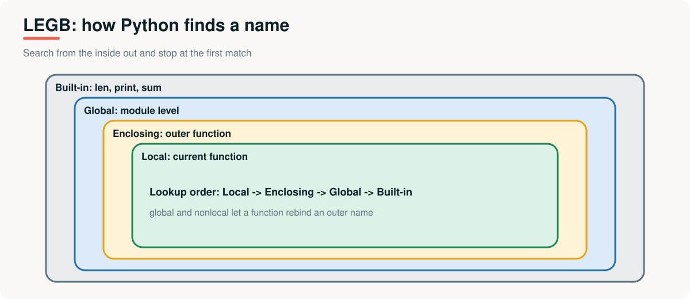
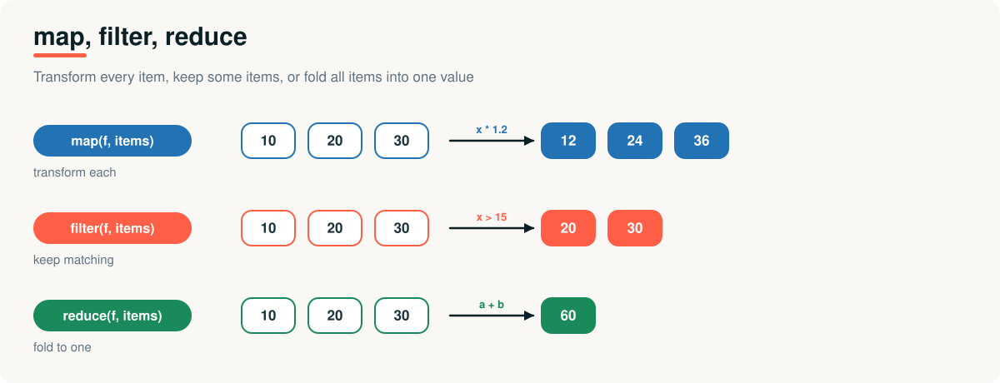

# 13 · Functions-II

> **Module 03 · Topic 13 of 19** &nbsp;|&nbsp; Reading time: ~55 min &nbsp;|&nbsp; Level: Intermediate

[Module home](README.md) &nbsp;·&nbsp; [← Previous: Functions-I](12-functions-i.md) &nbsp;·&nbsp; [Next: OOP: Classes and Objects →](14-oop-classes-and-objects.md)



## What you will learn

- How functions **return** values, including several values, and what happens when they do not
- How to write **lambda** (anonymous) functions
- How **`map`, `filter` and `reduce`** apply functions to collections
- How **namespaces and scope** work (LEGB), and `global` and `nonlocal`
- How **`*args` and `**kwargs`** accept a flexible number of arguments

---

## 1. The business problem

Asha's cleaning functions work, but four new needs appear.

| Need | What it requires |
|---|---|
| A function should hand back both a result **and** a list of errors | Return several values |
| Sort records by a computed key, with a one-off rule | A tiny function without a name |
| Apply one cleaning rule to a whole column | Pass a function to another function |
| A counter changes inside a function, and the result looks wrong | Understand **scope** |
| A logging helper must accept any number of options | Variable arguments |

All of these come from one idea: **functions are values**. You can return them, pass them and store them, like any other object.

---

## 2. Functions with and without return values

### Without `return`

A function with no `return` does its work, and gives back `None`. This is a **procedure** that acts instead of computing.

```python
def log_event(message):
    print("[LOG]", message)

result = log_event("load started")
print("returned:", result)
```

```text
[LOG] load started
returned: None
```

### With `return`

`return` sends a value back and **ends the function immediately**. Code after it does not run.

```python
def net_amount(amount, discount=0.0):
    if amount <= 0:
        return 0.0                  # early exit
    return round(amount * (1 - discount), 2)
    print("never reached")          # unreachable

print(net_amount(1000, 0.1))
print(net_amount(-5))
```

```text
900.0
0.0
```

### Returning several values

A function can return several values separated by commas. Python packs them into a **tuple**, and the caller can **unpack** them.

```python
def summarise(amounts):
    return min(amounts), max(amounts), sum(amounts) / len(amounts)

low, high, average = summarise([1200, 800, 300, 500])
print(low, high, average)

print(summarise([10, 20]))          # the raw tuple
```

```text
300 1200 700.0
(10, 20, 15.0)
```

### Returning a result and its problems

A practical pattern in pipelines: return the cleaned value **and** the reason it failed.

```python
def parse_amount(text):
    cleaned = text.replace(",", "").strip()
    if not cleaned.replace(".", "", 1).isdigit():
        return None, f"not a number: {text!r}"
    return float(cleaned), None

for raw in ["1,200.50", "abc", " 300 "]:
    value, error = parse_amount(raw)
    print(raw.ljust(10), value, error)
```

```text
1,200.50   1200.5 None
abc        None not a number: 'abc'
 300       300.0 None
```

### Returning a function

Because functions are values, one function can build another:

```python
def make_tax_calculator(rate):
    def calculate(price):
        return round(price * (1 + rate), 2)
    return calculate

gst18 = make_tax_calculator(0.18)
gst5 = make_tax_calculator(0.05)
print(gst18(1000), gst5(1000))
```

```text
1180.0 1050.0
```

The inner function **remembers** `rate` even after `make_tax_calculator` has finished. This is called a **closure**.

---

## 3. Lambda functions

A **lambda** is a small function written in one expression, without a name.

```text
lambda parameters: expression
```

```python
square = lambda x: x * x
add_tax = lambda price, rate=0.18: round(price * (1 + rate), 2)

print(square(7))
print(add_tax(1000))
```

```text
49
1180.0
```

The expression is returned automatically, and there is no `return` keyword. A lambda can hold only **one expression**, no statements.

Naming a lambda, as above, is for demonstration. If a function needs a name, use `def`. Lambdas are for the places where a **short function is needed once**, usually as an argument.

### Sorting by a key

```python
orders = [("O-3", 800), ("O-1", 1200), ("O-2", 300)]

print(sorted(orders, key=lambda o: o[1]))                 # by amount, ascending
print(sorted(orders, key=lambda o: o[1], reverse=True))   # descending
print(max(orders, key=lambda o: o[1]))                    # the largest
```

```text
[('O-2', 300), ('O-3', 800), ('O-1', 1200)]
[('O-1', 1200), ('O-3', 800), ('O-2', 300)]
('O-1', 1200)
```

### A record sorted by two fields

```python
customers = [
    {"name": "Meera", "region": "West",  "spend": 5000},
    {"name": "Rahul", "region": "East",  "spend": 1200},
    {"name": "Anika", "region": "West",  "spend": 7000},
]

by_region_then_spend = sorted(customers, key=lambda c: (c["region"], -c["spend"]))
for c in by_region_then_spend:
    print(c["region"], c["name"], c["spend"])
```

```text
East Rahul 1200
West Anika 7000
West Meera 5000
```

---

## 4. `map`, `filter` and `reduce`

These apply a function across a collection. They take the function as their **first argument**.



| Function | Does | Returns |
|---|---|---|
| `map(f, items)` | Applies `f` to **every** item | A lazy iterator of results |
| `filter(f, items)` | Keeps the items for which `f` is **true** | A lazy iterator of kept items |
| `reduce(f, items, start)` | Combines items **pairwise** into one value | A single value |

`map` and `filter` are built in and return lazy iterators, so wrap them in `list()` to see the values. `reduce` lives in the `functools` module.

### `map`

```python
prices = [100, 250, 499, 999]

with_tax = list(map(lambda p: round(p * 1.18, 2), prices))
print(with_tax)

names = ["  meera ", "RAHUL", " anika"]
print(list(map(str.strip, names)))              # an existing function works too
print(list(map(lambda n: n.strip().title(), names)))
```

```text
[118.0, 295.0, 588.82, 1178.82]
['meera', 'RAHUL', 'anika']
['Meera', 'Rahul', 'Anika']
```

`map` can take several sequences when the function takes several parameters:

```python
quantities = [2, 1, 3]
unit_prices = [100, 250, 400]
print(list(map(lambda q, p: q * p, quantities, unit_prices)))
```

```text
[200, 250, 1200]
```

### `filter`

```python
amounts = [1200, -50, 800, 0, 300]

positive = list(filter(lambda a: a > 0, amounts))
print(positive)

print(list(filter(None, ["West", "", "East", ""])))      # None keeps truthy items
```

```text
[1200, 800, 300]
['West', 'East']
```

### `reduce`

`reduce` takes the first two items, applies the function, takes the result with the third item, and so on.

```python
from functools import reduce

amounts = [1200, 800, 300, 500]

total = reduce(lambda acc, x: acc + x, amounts)
print(total)

largest = reduce(lambda a, b: a if a > b else b, amounts)
print(largest)

print(reduce(lambda acc, x: acc + x, amounts, 1000))      # with a starting value
```

```text
2800
1200
3800
```

For simple totals `sum()`, `max()` and `min()` are clearer. `reduce` is for combining that has no built-in, such as merging a list of dictionaries:

```python
batches = [{"West": 100, "East": 50}, {"West": 30, "North": 20}, {"East": 5}]

def merge(acc, batch):
    result = dict(acc)
    for region, value in batch.items():
        result[region] = result.get(region, 0) + value
    return result

print(reduce(merge, batches, {}))
```

```text
{'West': 130, 'East': 55, 'North': 20}
```

### Comprehension or `map` and `filter`?

```python
amounts = [1200, -50, 800, 0, 300]

print(list(map(lambda a: a * 2, filter(lambda a: a > 0, amounts))))
print([a * 2 for a in amounts if a > 0])               # the same, as a comprehension
```

```text
[2400, 1600, 600]
[2400, 1600, 600]
```

Most Python programmers prefer the comprehension for readability. `map` and `filter` are useful when you already have a named function to pass in, and you will meet the same ideas again in PySpark (`map`, `filter`, `reduceByKey`).

---

## 5. Namespaces and scope

A **namespace** is a mapping from **names to objects**. A **scope** is the region of code where a name can be used. When Python meets a name, it looks it up through four scopes in a fixed order, **LEGB**.

| Letter | Scope | Where |
|---|---|---|
| **L** | **Local** | Inside the current function |
| **E** | **Enclosing** | Inside any outer function that contains this one |
| **G** | **Global** | At the top level of the file (module) |
| **B** | **Built-in** | Names Python provides: `len`, `print`, `sum` |

Python uses the **first** match it finds, going from L to B.

```python
rate = 0.18                        # global

def show():
    local_note = "inside the function"   # local
    print(rate, local_note)

show()
```

```text
0.18 inside the function
```

### Local variables stay local

```python
def compute():
    total = 500
    return total

compute()
try:
    print(total)
except NameError as e:
    print("NameError:", e)
```

```text
2800
```

### Shadowing

A local name with the same name as a global one **hides** it inside the function. The global is not changed.

```python
count = 10

def reset():
    count = 0                      # a new local variable, not the global one
    print("inside:", count)

reset()
print("outside:", count)
```

```text
inside: 0
outside: 10
```

### The `UnboundLocalError` trap

Assigning to a name anywhere in a function makes it local for the **whole** function:

```python
counter = 0

def increment():
    counter += 1                   # tries to read a local that has no value yet

try:
    increment()
except UnboundLocalError as e:
    print("UnboundLocalError:", e)
```

```text
UnboundLocalError: cannot access local variable 'counter' where it is not associated with a value
```

### `global`

The `global` keyword says that a name inside the function refers to the global one.

```python
processed = 0

def mark_processed():
    global processed
    processed += 1

mark_processed()
mark_processed()
print(processed)
```

```text
2
```

Global state makes code hard to test and reason about. A better design passes values in and returns results:

```python
def mark_processed(count):
    return count + 1

processed = 0
processed = mark_processed(processed)
processed = mark_processed(processed)
print(processed)
```

```text
2
```

### Enclosing scope and `nonlocal`

`nonlocal` lets an inner function **change** a variable of the enclosing function.

```python
def make_counter():
    count = 0
    def next_value():
        nonlocal count
        count += 1
        return count
    return next_value

counter = make_counter()
print(counter(), counter(), counter())

another = make_counter()          # its own separate count
print(another())
```

```text
1 2 3
1
```

### Seeing the namespaces

```python
value = "global"

def outer():
    value = "enclosing"
    def inner():
        value = "local"
        return value
    return inner(), value

print(outer(), value)
```

```text
('local', 'enclosing') global
```

| Keyword | Meaning |
|---|---|
| `global name` | Use the module-level variable |
| `nonlocal name` | Use the variable of the nearest enclosing function |
| (neither) | Assignment creates a **local** variable |

---

## 6. `*args` and `**kwargs`

Sometimes a function must accept **any number** of arguments.

| Syntax | Collects | Type inside the function |
|---|---|---|
| `*args` | Extra **positional** arguments | `tuple` |
| `**kwargs` | Extra **keyword** arguments | `dict` |

```python
def total_amount(*amounts):
    print("received:", amounts)
    return sum(amounts)

print(total_amount(1200, 800))
print(total_amount(1200, 800, 300, 500))
```

```text
received: (1200, 800)
2000
received: (1200, 800, 300, 500)
2800
```

```python
def describe(order_id, **details):
    print("order", order_id, details)

describe(1001, region="West", amount=1200)
describe(1002)
```

```text
order 1001 {'region': 'West', 'amount': 1200}
order 1002 {}
```

### Together, and unpacking at the call

```python
def log(level, *messages, **context):
    print(level, "|", " ".join(messages), "|", context)

log("INFO", "load", "finished", rows=916, seconds=4)

values = [1200, 800, 300]
options = {"level": "WARN"}
print(total_amount(*values))              # * unpacks a list into positional arguments
log(*["INFO", "from", "list"], **{"source": "api"})   # ** unpacks a dict into keywords
```

```text
INFO | load finished | {'rows': 916, 'seconds': 4}
received: (1200, 800, 300)
2300
INFO | from list | {'source': 'api'}
```

The order in a definition is always: normal parameters, `*args`, then `**kwargs`. This is how wrapper functions and many library APIs forward their arguments without knowing them in advance.

---

## 7. A worked example: a configurable cleaning pipeline

Functions as values let a pipeline be built from small steps listed in a collection.

```python
from functools import reduce

def strip_text(value):
    return value.strip()

def collapse_spaces(value):
    return " ".join(value.split())

def title_case(value):
    return value.title()

def apply_steps(value, steps):
    return reduce(lambda acc, step: step(acc), steps, value)

name_steps = [strip_text, collapse_spaces, title_case]

raw_names = ["  meera    iyer ", "RAHUL  sharma", " anika gupta"]
print([apply_steps(n, name_steps) for n in raw_names])

print(apply_steps("  ab  cd ", [strip_text, collapse_spaces]))     # a different recipe, same engine
```

```text
['Meera Iyer', 'Rahul Sharma', 'Anika Gupta']
ab cd
```

The steps are data. Adding a rule means adding one function to the list, and a different column can use a different list. The same pattern powers pipeline frameworks that chain transformations.

---

## 8. Limitations and engineering considerations

| Issue | Detail |
|---|---|
| **Lambda limits** | One expression only. Anything longer should be a `def` with a name and a docstring |
| **Readability** | Nested `map`/`filter`/lambda chains are hard to read. Prefer comprehensions or named functions |
| **Lazy iterators** | `map` and `filter` return iterators that can be consumed only once. Convert with `list()` if you need to reuse them |
| **Global state** | `global` makes functions depend on hidden state, which hurts testing. Pass values in, return values out |
| **Shadowing** | A local name can hide a global or built-in one (`list = [...]` hides `list()`). Avoid built-in names |
| **Closures hold variables, not values** | Closures created in a loop can all see the final value of the loop variable. Pass it as a default or a parameter |
| **`*args` hides the contract** | A function taking `*args, **kwargs` documents nothing. Use them for wrappers, and name parameters otherwise |
| **Multiple returns** | Returning many values is convenient, and beyond three or four a dictionary or object is clearer |

## 9. Real-world applications

- **Sorting and ranking** with `key=lambda ...`.
- **Column transformations:** `map` or comprehensions over a column's values.
- **PySpark:** `map`, `filter`, `reduce` and lambdas are the core of its RDD API, and user-defined functions follow the same idea.
- **Retry and logging decorators** are built on closures and `*args, **kwargs`.
- **Configurable pipelines:** a list of step functions applied in order.
- **Callbacks:** passing a function to be called when an event happens.

---

## Key takeaways

1. A function without `return` gives back `None`, and **returning several values** gives a tuple you can unpack.
2. **Functions are values:** you can pass them, return them and store them.
3. A **lambda** is a one-expression anonymous function, best as a short argument such as `key=`.
4. `map` **transforms**, `filter` **selects**, `reduce` **combines**. Comprehensions are usually more readable.
5. Names resolve through **LEGB**: Local, Enclosing, Global, Built-in.
6. Assignment inside a function creates a **local** variable. `global` and `nonlocal` change that, and are best avoided.
7. `*args` collects extra positional arguments into a tuple, and `**kwargs` collects extra keyword arguments into a dictionary.

## Interview questions

<details><summary><b>1.</b> What does a function return if it has no <code>return</code> statement?</summary>

`None`. The caller can still call it for its side effects, such as printing or writing a file.
</details>

<details><summary><b>2.</b> How can a function return multiple values?</summary>

By returning them separated by commas. Python packs them into a tuple, which the caller can unpack, for example `low, high = f(data)`.
</details>

<details><summary><b>3.</b> What is a lambda function, and when would you use one?</summary>

An anonymous function with a single expression, written `lambda args: expression`. It is useful for short, one-off functions passed as arguments, such as `sorted(items, key=lambda x: x[1])`.
</details>

<details><summary><b>4.</b> Explain <code>map</code>, <code>filter</code> and <code>reduce</code>.</summary>

`map` applies a function to each item, `filter` keeps items for which a function is true, and `reduce` (from `functools`) combines items pairwise into one value. `map` and `filter` return lazy iterators.
</details>

<details><summary><b>5.</b> What is LEGB?</summary>

The order in which Python searches for a name: Local, Enclosing, Global, Built-in. The first scope that contains the name is used.
</details>

<details><summary><b>6.</b> Why does <code>count += 1</code> inside a function raise <code>UnboundLocalError</code>?</summary>

Assigning to a name anywhere in a function makes it local for the entire function, so reading it before it has a local value fails. Use `global count`, or better, pass the value in and return the new one.
</details>

<details><summary><b>7.</b> What is the difference between <code>global</code> and <code>nonlocal</code>?</summary>

`global` binds a name to the module-level variable. `nonlocal` binds it to a variable in the nearest enclosing function scope, so an inner function can modify it.
</details>

<details><summary><b>8.</b> What are <code>*args</code> and <code>**kwargs</code>?</summary>

`*args` collects extra positional arguments into a tuple, and `**kwargs` collects extra keyword arguments into a dictionary. They allow functions to accept a variable number of arguments and to forward them.
</details>

## Official documentation

- [Lambda expressions](https://docs.python.org/3/tutorial/controlflow.html#lambda-expressions)
- [`map`](https://docs.python.org/3/library/functions.html#map) · [`filter`](https://docs.python.org/3/library/functions.html#filter) · [`functools.reduce`](https://docs.python.org/3/library/functools.html#functools.reduce)
- [Python scopes and namespaces](https://docs.python.org/3/tutorial/classes.html#python-scopes-and-namespaces)
- [Naming and binding (execution model)](https://docs.python.org/3/reference/executionmodel.html#naming-and-binding)
- [Arbitrary argument lists and unpacking](https://docs.python.org/3/tutorial/controlflow.html#arbitrary-argument-lists)
- [Sorting HOWTO (key functions)](https://docs.python.org/3/howto/sorting.html)

---

| Previous | Contents | Next |
|:---|:---:|:---|
| [← Functions-I](12-functions-i.md) | [Module home](README.md#topics-covered) | [OOP: Classes and Objects →](14-oop-classes-and-objects.md) |
