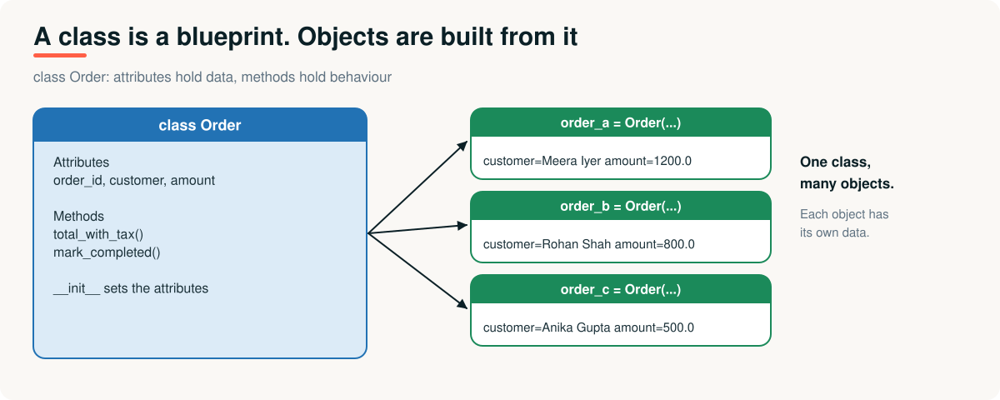

# 14 · OOP: Classes and Objects

> **Module 03 · Topic 14 of 19** &nbsp;|&nbsp; Reading time: ~50 min &nbsp;|&nbsp; Level: Intermediate

[Module home](README.md) &nbsp;·&nbsp; [← Previous: Functions II](13-functions-ii.md) &nbsp;·&nbsp; [Next: Inheritance and Abstraction →](15-oop-inheritance-and-abstraction.md)



## What you will learn

- What a **class** and an **object** are, and why data engineers use them
- How to create a class, its **properties** (attributes) and **methods**
- The **constructor** `__init__`, and what `self` means
- The **types of variables**: instance, class and local
- The **types of methods**: instance, class and static
- **Access modifiers** in Python: public, protected and private by convention

---

## 1. The business problem

Asha's pipeline now handles orders in plain dictionaries. As the code grows, three problems appear.

| Problem | What happens | Why |
|---|---|---|
| Every function re-checks the same fields | `if order["amount"] < 0` appears in five places | The rules for an order live nowhere in particular |
| A typo creates a silent bug | `order["ammount"]` raises an error only when that line runs | A dictionary accepts any key |
| Behaviour is separate from data | `calculate_tax(order)` is in one file, `order` is built in another | Nothing ties the data to what you can do with it |

**Object-oriented programming (OOP)** bundles data and the behaviour that belongs with it into one unit. Instead of passing loose dictionaries to loose functions, you define an `Order` once, with its fields and rules, and create as many orders as you need.

---

## 2. What is a class? What is an object?

| Term | Meaning | Analogy | XYZ example |
|---|---|---|---|
| **Class** | A blueprint that defines what data and behaviour something has | A form template | `Order` |
| **Object** (instance) | One concrete thing built from the class | One filled-in form | The order `1001` |
| **Property** (attribute) | A variable that belongs to an object | A field on the form | `amount`, `region` |
| **Method** | A function that belongs to an object | An action the form supports | `total_with_tax()` |

One class, many objects. Each object has its **own** values for the properties.

### Create a class

```python
class Order:
    pass                       # an empty class: valid, and a starting point


first = Order()                # create an object: call the class like a function
second = Order()

print(type(first).__name__)
print(first is second)         # two different objects
```

```text
Order
False
```

### Add properties and methods

```python
class Order:
    def __init__(self, order_id, region, amount):
        self.order_id = order_id         # properties
        self.region = region
        self.amount = amount

    def total_with_tax(self, rate=0.18):   # a method
        return round(self.amount * (1 + rate), 2)

    def describe(self):
        return f"Order {self.order_id} ({self.region}): {self.amount}"


o1 = Order(1001, "West", 1200.0)
o2 = Order(1002, "East", 800.0)

print(o1.describe())
print(o2.describe())
print(o1.total_with_tax())
print(o2.total_with_tax(rate=0.05))
```

```text
Order 1001 (West): 1200.0
Order 1002 (East): 800.0
1416.0
840.0
```

Reading the code:

- `class Order:` starts the blueprint. By convention class names use **CapitalizedWords**.
- `__init__` is the **constructor**: Python calls it automatically when you create an object (`Order(1001, "West", 1200.0)`).
- `self` is the object being worked on. Python passes it automatically as the first argument of every method. You never pass it yourself.
- `self.amount = amount` stores a value **on the object**. That is how a property is created.

### Access properties and methods through the object

Use the dot: `object.property` and `object.method()`.

```python
print(o1.region)                # read a property
o1.region = "North"             # change a property
print(o1.describe())

o1.coupon = "FIRST10"           # Python also lets you add new properties at any time
print(o1.coupon)
print(hasattr(o2, "coupon"))    # o2 was not affected
```

```text
West
Order 1001 (North): 1200.0
FIRST10
False
```

Adding properties on the fly is flexible, and also the reason typos become silent bugs. Define all properties in `__init__` so every object has the same shape.

### What `self` really is

Calling `o1.describe()` is shorthand for passing the object explicitly:

```python
print(o1.describe())
print(Order.describe(o1))       # the same call, written out: self is o1
```

```text
Order 1001 (North): 1200.0
Order 1001 (North): 1200.0
```

---

## 3. The constructor

`__init__` runs once, when an object is created. Use it to **set up valid initial state**, including defaults and checks.

```python
class Order:
    def __init__(self, order_id, region, amount, status="pending"):
        if amount < 0:
            raise ValueError(f"amount cannot be negative: {amount}")
        self.order_id = order_id
        self.region = region.strip().title()     # clean on the way in
        self.amount = amount
        self.status = status                     # default value


good = Order(1003, " east ", 450.0)
print(good.region, good.status)

try:
    Order(1004, "West", -10.0)
except ValueError as err:
    print("Rejected:", err)
```

```text
East pending
Rejected: amount cannot be negative: -10.0
```

This is the answer to the business problem: the rules for a valid order now live in **one** place, and an invalid order cannot be created.

> [!NOTE]
> `__init__` is an **initialiser**: it sets up an object that Python has already created. The method that actually creates the object is `__new__`, which you almost never write.

---

## 4. Types of variables

Where a variable is defined decides who can see it and how long it lives.

| Type | Defined | Belongs to | Lives while | Access |
|---|---|---|---|---|
| **Instance variable** | Inside a method, as `self.name` | One object | The object exists | `obj.name` |
| **Class variable** | In the class body, outside any method | The class, shared by all objects | The class exists | `Class.name` or `obj.name` |
| **Local variable** | Inside a method, without `self` | That one method call | The method runs | Inside the method only |

```python
class Order:
    tax_rate = 0.18                     # class variable: shared by every order
    orders_created = 0                  # class variable used as a counter

    def __init__(self, order_id, amount):
        self.order_id = order_id        # instance variables: one copy per object
        self.amount = amount
        Order.orders_created += 1       # update the shared counter through the class

    def total(self):
        tax = self.amount * Order.tax_rate     # 'tax' is a local variable
        return round(self.amount + tax, 2)


a = Order(1, 1000.0)
b = Order(2, 2000.0)

print(a.total(), b.total())
print(Order.orders_created)
print(Order.tax_rate, a.tax_rate, b.tax_rate)   # the same value everywhere
```

```text
1180.0 2360.0
2
0.18 0.18 0.18
```

A trap: assigning to `a.tax_rate` creates a new **instance** variable that hides the class variable for `a` only.

```python
a.tax_rate = 0.05                       # creates an instance variable on a only
print(a.tax_rate, b.tax_rate, Order.tax_rate)
```

```text
0.05 0.18 0.18
```

To change a value for everyone, assign through the class: `Order.tax_rate = 0.12`.

---

## 5. Types of methods

| Type | First parameter | Decorator | Can use | Typical use |
|---|---|---|---|---|
| **Instance method** | `self` (the object) | none | Object data and class data | Behaviour of one object |
| **Class method** | `cls` (the class) | `@classmethod` | Class data only | Alternative constructors, class-wide settings |
| **Static method** | none | `@staticmethod` | Neither, it is a plain function | A helper that belongs with the class |

```python
class Order:
    tax_rate = 0.18

    def __init__(self, order_id, region, amount):
        self.order_id = order_id
        self.region = region
        self.amount = amount

    def total(self):                                 # instance method
        return round(self.amount * (1 + self.tax_rate), 2)

    @classmethod
    def from_csv_line(cls, line):                    # class method: builds an Order from a text line
        order_id, region, amount = line.split(",")
        return cls(int(order_id), region, float(amount))

    @classmethod
    def set_tax_rate(cls, rate):                     # class method: changes class-wide data
        cls.tax_rate = rate

    @staticmethod
    def is_valid_region(region):                     # static method: needs neither object nor class
        return region in {"North", "South", "East", "West"}


order = Order.from_csv_line("1005,West,1500.0")
print(order.order_id, order.region, order.amount)
print(order.total())

Order.set_tax_rate(0.12)
print(order.total())

print(Order.is_valid_region("West"), Order.is_valid_region("Mars"))
```

```text
1005 West 1500.0
1770.0
1680.0
True False
```

`from_csv_line` is the classic use of a class method: an **alternative constructor**. A data engineer often needs to build the same object from a CSV line, a JSON record or a database row.

---

## 6. Access modifiers

Languages such as Java enforce `public`, `protected` and `private`. Python does **not enforce** access. It relies on naming **conventions** that tell other programmers what they may touch.

| Convention | Meaning | Example | Enforced? |
|---|---|---|---|
| `name` | **Public**: part of the interface, use freely | `order.amount` | n/a |
| `_name` | **Protected**: internal, for the class and its subclasses | `order._raw_row` | No, a convention only |
| `__name` | **Private**: name mangled so it is hard to reach by accident | `order.__secret` | Partly: renamed to `_Class__name` |

```python
class Customer:
    def __init__(self, name, email, card_token):
        self.name = name                    # public
        self._email = email                 # protected by convention: "please do not touch"
        self.__card_token = card_token      # private: name mangled

    def masked_token(self):
        return "****" + self.__card_token[-4:]


c = Customer("Meera Iyer", "meera@example.com", "tok_9f3a21c7")

print(c.name)
print(c._email)                  # works, but the underscore says "internal"
print(c.masked_token())

try:
    print(c.__card_token)
except AttributeError as err:
    print("AttributeError:", err)

print(c._Customer__card_token)   # the mangled name still works, so it is not real security
```

```text
Meera Iyer
meera@example.com
****21c7
AttributeError: 'Customer' object has no attribute '__card_token'
tok_9f3a21c7
```

Double underscores prevent *accidents*, not *access*. For secrets, do not store them on objects at all: read them from the environment or a secrets manager. How to control access properly with getters and setters is in [Topic 16](16-oop-polymorphism-and-encapsulation.md).

---

## 7. Putting it together: a small data object

A useful class also controls how it prints, so logs and debugging are readable. `__repr__` defines the text shown for an object.

```python
class Order:
    VALID_STATUS = {"pending", "shipped", "completed", "cancelled"}   # class variable (constant by convention)

    def __init__(self, order_id, region, amount, status="pending"):
        if status not in Order.VALID_STATUS:
            raise ValueError(f"invalid status: {status}")
        self.order_id = order_id
        self.region = region
        self.amount = amount
        self.status = status

    def __repr__(self):
        return f"Order(id={self.order_id}, region={self.region!r}, amount={self.amount}, status={self.status!r})"

    def is_revenue(self):
        return self.status == "completed"


rows = [(1001, "West", 1200.0, "completed"), (1002, "East", 800.0, "cancelled"),
        (1003, "West", 300.0, "completed"), (1004, "North", 500.0, "pending")]
orders = [Order(*row) for row in rows]

print(orders[0])
print(sum(o.amount for o in orders if o.is_revenue()))
```

```text
Order(id=1001, region='West', amount=1200.0, status='completed')
1500.0
```

The same task with dictionaries needed the status check repeated wherever an order was read. Now the rule exists once.

---

## 8. Limitations and engineering considerations

| Issue | Detail |
|---|---|
| **Not everything needs a class** | A function or a dictionary is often simpler. Use a class when data and behaviour belong together |
| **No enforced privacy** | `_name` and `__name` are conventions. Never rely on them for security |
| **Class variable surprises** | Assigning through an object creates an instance variable and hides the class one. Mutable class variables (a list) are shared by all objects |
| **Objects cost memory** | Millions of small objects use far more memory than arrays or table columns. For bulk data, use pandas, Spark or plain tuples |
| **Dynamic attributes** | Adding attributes freely allows typos. Set all of them in `__init__` |
| **Classes grow** | A class doing too much is hard to test. Keep each class focused on one job |

## 9. Real-world applications

- **Connectors and clients:** a `PostgresConnection` or `S3Client` object holds settings and offers `read()` and `write()` methods.
- **Records and models:** `Order`, `Customer` with built-in validation.
- **Pipeline steps:** each step is an object with a `run()` method (the pattern used by Airflow operators).
- **Configuration:** a settings object loaded once and passed around.
- **Libraries:** pandas `DataFrame`, `datetime`, file objects, and database cursors are all classes you use through objects.

---

## Key takeaways

1. A **class** is a blueprint. An **object** is one thing built from it, with its own data.
2. `__init__` is the **constructor**. It sets up the object's properties and can validate them.
3. `self` is the object itself. Python passes it automatically to instance methods.
4. **Instance variables** belong to one object, **class variables** are shared, **local variables** live only inside a method.
5. **Instance methods** use `self`. **Class methods** use `cls` and make good alternative constructors. **Static methods** are plain functions kept with the class.
6. Python has **no enforced access control**: `_name` means "internal", `__name` is name-mangled to avoid accidents.
7. Put validation rules in one place, the constructor, instead of repeating them everywhere.

## Interview questions

<details><summary><b>1.</b> What is the difference between a class and an object?</summary>

A class is a blueprint that defines properties and methods. An object is an instance of that class, with its own values for the properties.
</details>

<details><summary><b>2.</b> What is <code>self</code>?</summary>

A reference to the current object, passed automatically as the first parameter of instance methods. It is how a method reads and changes that object's own data. The name is a convention, but universal.
</details>

<details><summary><b>3.</b> What does <code>__init__</code> do? Is it the method that creates the object?</summary>

It is the initialiser (commonly called the constructor): it runs after the object is created and sets its initial state. The object itself is created by `__new__`, which is rarely overridden.
</details>

<details><summary><b>4.</b> Explain instance, class and local variables.</summary>

An instance variable (`self.x`) belongs to one object. A class variable is defined in the class body and shared by all objects. A local variable exists only during one method call.
</details>

<details><summary><b>5.</b> What happens if you assign <code>obj.tax_rate = 0.05</code> when <code>tax_rate</code> is a class variable?</summary>

It creates a new instance variable on that object, which hides the class variable for that object only. Other objects and the class are unchanged. Assign through the class to change it for all.
</details>

<details><summary><b>6.</b> Difference between instance, class and static methods?</summary>

Instance methods receive the object (`self`). Class methods receive the class (`cls`) and are marked `@classmethod`, often used as alternative constructors. Static methods receive neither (`@staticmethod`) and are ordinary functions grouped in the class.
</details>

<details><summary><b>7.</b> Does Python have private attributes?</summary>

Not enforced ones. A single underscore means internal by convention. A double underscore triggers name mangling (`_Class__name`), which avoids accidental clashes but does not prevent access.
</details>

<details><summary><b>8.</b> Why would a data engineer define a class instead of using a dictionary?</summary>

To keep data, validation and behaviour together in one place, catch invalid state at creation, make typos fail loudly, and give code a clear, reusable interface, as with connectors and pipeline steps.
</details>

## Official documentation

- [Python Tutorial: Classes](https://docs.python.org/3/tutorial/classes.html)
- [Data model: special method names](https://docs.python.org/3/reference/datamodel.html#special-method-names)
- [Built-in functions: `classmethod`, `staticmethod`](https://docs.python.org/3/library/functions.html#classmethod)
- [Private variables and name mangling](https://docs.python.org/3/tutorial/classes.html#private-variables)

---

| Previous | Contents | Next |
|:---|:---:|:---|
| [← Functions II](13-functions-ii.md) | [Module home](README.md#topics-covered) | [Inheritance and Abstraction →](15-oop-inheritance-and-abstraction.md) |
