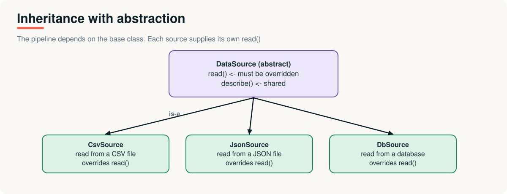
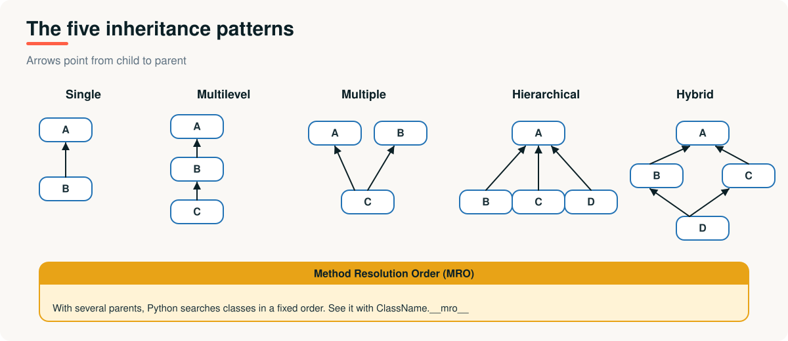

# 15 · OOP: Inheritance and Abstraction

> **Module 03 · Topic 15 of 19** &nbsp;|&nbsp; Reading time: ~55 min &nbsp;|&nbsp; Level: Intermediate

[Module home](README.md) &nbsp;·&nbsp; [← Previous: Classes and Objects](14-oop-classes-and-objects.md) &nbsp;·&nbsp; [Next: Polymorphism and Encapsulation →](16-oop-polymorphism-and-encapsulation.md)



## What you will learn

- What **inheritance** is, and why it removes duplicated code
- The five patterns: **single, multilevel, multiple, hierarchical and hybrid**
- `super()`, and the **method resolution order (MRO)** that decides which method runs
- **Abstraction**: defining what every subclass must provide, with `abc`
- A realistic pattern: a family of **data source connectors**

---

## 1. The business problem

XYZ Company receives orders from three sources: a partner CSV file, a web shop JSON export, and an internal database. Asha writes one reader class per source.

| Problem | What happens | Why |
|---|---|---|
| The three readers share 80% of their code | A fix to the logging is made in one reader and forgotten in the others | The same code is copied three times |
| A new source arrives | A developer copies the nearest reader and edits it, leaving leftovers | There is no definition of what a reader **must** do |
| The pipeline calls `reader.read()` | One reader names it `load()` and crashes the job | Nothing enforces a common interface |

**Inheritance** lets a new class reuse an existing one. **Abstraction** states what every reader must provide, and refuses to run if one does not.

---

## 2. Inheritance

A **child class** (subclass) inherits the properties and methods of a **parent class** (base class, superclass). It can use them as they are, add new ones, or replace them.

| Term | Meaning |
|---|---|
| **Parent / base class** | The class being inherited from |
| **Child / derived class** | The class that inherits |
| **`super()`** | Gives access to the parent's version of a method |
| **Override** | A child redefines a method the parent already has |

### Single inheritance

One child, one parent.

```python
class Source:
    def __init__(self, name):
        self.name = name

    def log(self, message):
        print(f"[{self.name}] {message}")


class CsvSource(Source):                 # CsvSource inherits from Source
    def read(self):
        self.log("reading csv")          # uses the inherited method
        return ["row1", "row2"]


csv_source = CsvSource("partner_csv")
rows = csv_source.read()
print(rows)
print(isinstance(csv_source, CsvSource), isinstance(csv_source, Source))
print(issubclass(CsvSource, Source))
```

```text
[partner_csv] reading csv
['row1', 'row2']
True True
True
```

`CsvSource` never defined `__init__` or `log`, and has both. An object of the child **is also** an object of the parent (`isinstance` is true for both).

### `super()`: extending the parent, not replacing it

When a child defines its own `__init__`, it should call the parent's so the parent's setup still happens.

```python
class JsonSource(Source):
    def __init__(self, name, path):
        super().__init__(name)           # run the parent's constructor first
        self.path = path                 # then add what is specific to JSON

    def read(self):
        self.log(f"reading json from {self.path}")
        return [{"order_id": 1}]


js = JsonSource("webshop_json", "/data/orders.json")
print(js.read())
print(js.name, js.path)
```

```text
[webshop_json] reading json from /data/orders.json
[{'order_id': 1}]
webshop_json /data/orders.json
```

---

## 3. Types of inheritance



| Type | Shape | Example idea |
|---|---|---|
| **Single** | One child inherits from one parent | `CsvSource(Source)` |
| **Multilevel** | A chain: grandparent, parent, child | `Source`, `FileSource`, `CsvSource` |
| **Multiple** | One child inherits from several parents | `CsvSource(FileSource, Loggable)` |
| **Hierarchical** | Several children share one parent | `CsvSource`, `JsonSource` both from `Source` |
| **Hybrid** | A mixture of the above | Hierarchical plus multiple in one design |

### Multilevel inheritance

```python
class Source:
    def __init__(self, name):
        self.name = name

    def describe(self):
        return f"source {self.name}"


class FileSource(Source):                       # level 2
    def __init__(self, name, path):
        super().__init__(name)
        self.path = path

    def describe(self):
        return super().describe() + f" at {self.path}"


class CsvSource(FileSource):                    # level 3
    def __init__(self, name, path, delimiter=","):
        super().__init__(name, path)
        self.delimiter = delimiter

    def describe(self):
        return super().describe() + f" (csv, delimiter {self.delimiter!r})"


print(CsvSource("partner", "/data/orders.csv", ";").describe())
```

```text
source partner at /data/orders.csv (csv, delimiter ';')
```

Each level adds one piece, and `super()` passes the call up the chain.

### Multiple inheritance

A class can inherit from several parents. A common, clean use is a **mixin**: a small class that adds one capability and is not meant to stand alone.

```python
class Loggable:                                  # a mixin: only adds logging
    def log(self, message):
        print(f"[{type(self).__name__}] {message}")


class Retryable:                                 # another mixin: adds retry behaviour
    max_retries = 3

    def describe_retry(self):
        return f"up to {self.max_retries} retries"


class FileSource(Source):
    pass


class CsvSource(FileSource, Loggable, Retryable):   # inherits from three classes
    pass


s = CsvSource("partner")
s.log("started")
print(s.describe(), "|", s.describe_retry())
```

```text
[CsvSource] started
source partner | up to 3 retries
```

### Hierarchical inheritance

Several children from one parent, as in the business problem: they share the common parts, and each adds only what is different.

```python
class Source:
    def __init__(self, name):
        self.name = name

    def read(self):
        raise NotImplementedError("subclasses must implement read()")


class CsvSource(Source):
    def read(self):
        return [("1001", "West", "1200.0")]


class JsonSource(Source):
    def read(self):
        return [{"order_id": 1001, "region": "West", "amount": 1200.0}]


for source in (CsvSource("csv"), JsonSource("json")):
    print(source.name, source.read())
```

```text
csv [('1001', 'West', '1200.0')]
json [{'order_id': 1001, 'region': 'West', 'amount': 1200.0}]
```

### Hybrid inheritance and the diamond

A **hybrid** design combines patterns. The classic case is the **diamond**: two children share a parent, and a fourth class inherits from both.

```python
class A:
    def who(self):
        return "A"


class B(A):
    def who(self):
        return "B"


class C(A):
    def who(self):
        return "C"


class D(B, C):                  # diamond: D inherits from B and C, which both inherit from A
    pass


print(D().who())
```

```text
B
```

Which `who` ran, `B`, `C` or `A`? Python answers with the MRO.

---

## 4. Method resolution order (MRO)

When you call a method, Python searches the classes in a fixed order, the **MRO**, and uses the first match. The order follows the **C3 linearisation** rules, which in simple terms mean:

1. A class comes **before its parents**.
2. Parents are kept **in the order you listed them** in the class line.
3. A shared parent comes **after all the classes that inherit from it**.

```python
print([cls.__name__ for cls in D.__mro__])
print(D.mro() == list(D.__mro__))
```

```text
['D', 'B', 'C', 'A', 'object']
True
```

For `D(B, C)`: search `D`, then `B`, then `C`, then `A`, then `object` (the parent of every class). So `who()` returns `"B"`. Swap the order to `class D(C, B)` and it returns `"C"`.

### `super()` follows the MRO

`super()` does not mean "my parent". It means "the next class in the MRO". That is what makes cooperative multiple inheritance work, and why every class in a diamond should call `super()`.

```python
class A:
    def setup(self):
        print("A setup")


class B(A):
    def setup(self):
        print("B setup")
        super().setup()


class C(A):
    def setup(self):
        print("C setup")
        super().setup()


class D(B, C):
    def setup(self):
        print("D setup")
        super().setup()


D().setup()
```

```text
D setup
B setup
C setup
A setup
```

Each class runs once, in MRO order, and `A` runs exactly once even though both `B` and `C` inherit from it.

---

## 5. Abstraction

### The idea

**Abstraction** means defining **what** a thing must do without saying **how**. The base class declares the required methods. Each subclass supplies the details. Code that uses the objects depends only on the promised methods.

In the business problem, the pipeline needs every source to have `read()`. An **abstract base class** (ABC) makes that a rule rather than a hope.

### Abstract classes in Python

Use the `abc` module. A method marked `@abstractmethod` **must** be implemented by every concrete subclass, and you cannot create an object of a class that still has abstract methods.

```python
from abc import ABC, abstractmethod


class DataSource(ABC):
    def __init__(self, name):
        self.name = name

    @abstractmethod
    def read(self):
        """Return a list of order dictionaries."""

    def run(self):                              # a concrete method shared by all subclasses
        rows = self.read()
        print(f"[{self.name}] read {len(rows)} rows")
        return rows


class CsvSource(DataSource):
    def read(self):
        raw = ["1001,West,1200.0", "1002,East,800.0"]
        return [dict(zip(("order_id", "region", "amount"), line.split(","))) for line in raw]


class BrokenSource(DataSource):
    pass                                        # forgot to implement read()


print(CsvSource("partner_csv").run())

try:
    BrokenSource("oops")
except TypeError as err:
    print("TypeError:", err)

try:
    DataSource("abstract")
except TypeError as err:
    print("TypeError:", err)
```

```text
[partner_csv] read 2 rows
[{'order_id': '1001', 'region': 'West', 'amount': '1200.0'}, {'order_id': '1002', 'region': 'East', 'amount': '800.0'}]
TypeError: Can't instantiate abstract class BrokenSource without an implementation for abstract method 'read'
TypeError: Can't instantiate abstract class DataSource without an implementation for abstract method 'read'
```

The mistake is caught **when the object is created**, not later in the middle of a nightly run. Compare it with the earlier `raise NotImplementedError` approach, which only fails when `read()` is finally called.

### A complete connector family

```python
class JsonSource(DataSource):
    def read(self):
        return [{"order_id": "1003", "region": "North", "amount": "500.0"}]


class DatabaseSource(DataSource):
    def __init__(self, name, query):
        super().__init__(name)
        self.query = query

    def read(self):
        return [{"order_id": "1004", "region": "South", "amount": "250.0"}]


def load_all(sources):
    """Works with any DataSource, whatever its type."""
    rows = []
    for source in sources:
        rows.extend(source.run())
    return rows


all_rows = load_all([CsvSource("partner_csv"), JsonSource("webshop_json"),
                     DatabaseSource("orders_db", "SELECT * FROM orders")])
print(len(all_rows), "rows in total")
```

```text
[partner_csv] read 2 rows
[webshop_json] read 1 rows
[orders_db] read 1 rows
4 rows in total
```

`load_all` does not know or care which class each source is. Adding a `ParquetSource` later means writing one class, with no change to `load_all`. That is the benefit of abstraction.

### Abstract properties and partial abstraction

An ABC can mix abstract and concrete methods, and can require properties too:

```python
class Sink(ABC):
    @property
    @abstractmethod
    def destination(self):
        """Where this sink writes."""

    @abstractmethod
    def write(self, rows):
        """Write the rows."""


class ConsoleSink(Sink):
    destination = "console"

    def write(self, rows):
        for row in rows:
            print("->", row)


sink = ConsoleSink()
print(sink.destination)
sink.write(all_rows[:2])
```

```text
console
-> {'order_id': '1001', 'region': 'West', 'amount': '1200.0'}
-> {'order_id': '1002', 'region': 'East', 'amount': '800.0'}
```

---

## 6. Inheritance or composition?

Inheritance models **"is a"**: a `CsvSource` *is a* `DataSource`. If the relationship is **"has a"**, use **composition**: store the other object as a property.

```python
class Logger:
    def info(self, message):
        print("INFO", message)


class Pipeline:
    def __init__(self, source, logger):
        self.source = source              # a Pipeline HAS a source and HAS a logger
        self.logger = logger

    def run(self):
        rows = self.source.read()
        self.logger.info(f"loaded {len(rows)} rows")


Pipeline(CsvSource("partner_csv"), Logger()).run()
```

```text
INFO loaded 2 rows
```

A `Pipeline` is not a kind of `Logger`, so it should not inherit from one. Deep inheritance chains are hard to follow. A common guideline is to prefer composition, and inherit only for a clear "is a" relationship.

---

## 7. Limitations and engineering considerations

| Issue | Detail |
|---|---|
| **Deep hierarchies** | Four or five levels make it hard to see where a behaviour comes from. Keep hierarchies shallow |
| **Tight coupling** | A change in a parent affects every child. Keep base classes small and stable |
| **Diamond confusion** | Multiple inheritance depends on the MRO. Use it for mixins, and check `__mro__` when unsure |
| **Wrong relationship** | Inheriting just to reuse code, when the relationship is not "is a", leads to odd designs. Use composition |
| **`super()` forgotten** | A child `__init__` that skips `super().__init__()` leaves the parent's setup undone |
| **ABC only checks names** | An abstract method check confirms the method exists, not that it behaves correctly. Test each subclass |

## 8. Real-world applications

- **Connectors:** a common interface over files, databases, APIs and queues.
- **Pipeline steps:** Airflow operators inherit from a `BaseOperator` and override `execute()`.
- **Test fakes:** a `FakeSource` subclass returns fixed data so pipelines can be tested without real systems.
- **Frameworks:** extending library classes, such as writing a custom operator, hook or exception, is inheritance.
- **Plugins:** an ABC defines the contract that third-party extensions follow.

---

## Key takeaways

1. **Inheritance** lets a child class reuse and extend a parent. A child object is also an instance of the parent.
2. The five patterns are **single, multilevel, multiple, hierarchical and hybrid**.
3. **`super()`** calls the next class in the **MRO**, not simply "the parent". Always call `super().__init__()` in a child constructor.
4. The **MRO** puts a class before its parents, keeps the listed parent order, and puts a shared parent last. Inspect it with `Class.__mro__`.
5. **Abstraction** states what subclasses must provide. Use `ABC` and `@abstractmethod`. An incomplete subclass cannot be instantiated.
6. Code written against the abstract class works with every present and future subclass.
7. Use inheritance for **"is a"** relationships, and **composition** for **"has a"**.

## Interview questions

<details><summary><b>1.</b> What is inheritance, and what are its benefits?</summary>

A mechanism where a child class acquires the properties and methods of a parent. It removes duplicated code, lets you extend or specialise behaviour, and supports a common interface across related classes.
</details>

<details><summary><b>2.</b> List the types of inheritance with an example of each.</summary>

Single (one parent), multilevel (a chain of classes), multiple (several parents), hierarchical (several children of one parent), and hybrid (a combination, such as a diamond).
</details>

<details><summary><b>3.</b> What does <code>super()</code> do?</summary>

It returns a proxy to the next class in the method resolution order, so you can call the parent's version of a method. It is used mainly to run the parent's `__init__` and to extend rather than replace behaviour.
</details>

<details><summary><b>4.</b> What is the MRO, and how do you see it?</summary>

The method resolution order is the sequence of classes Python searches for a method, computed with the C3 linearisation algorithm. View it with `ClassName.__mro__` or `ClassName.mro()`.
</details>

<details><summary><b>5.</b> What is the diamond problem, and how does Python handle it?</summary>

When a class inherits from two classes that share a parent, it is ambiguous which version of a method to use. Python resolves it deterministically through the MRO, and `super()` ensures the shared parent runs only once.
</details>

<details><summary><b>6.</b> What is abstraction, and how do you implement it in Python?</summary>

Defining what an object must do without specifying how. Use `abc.ABC` and `@abstractmethod`: subclasses must implement every abstract method, and a class with unimplemented abstract methods cannot be instantiated.
</details>

<details><summary><b>7.</b> What is the difference between abstraction and inheritance?</summary>

Inheritance is a mechanism for reuse: a child gets the parent's code. Abstraction is a design idea about hiding implementation behind a contract. Abstract base classes use inheritance to enforce that contract.
</details>

<details><summary><b>8.</b> When would you use composition instead of inheritance?</summary>

When the relationship is "has a" rather than "is a", for example a pipeline that has a logger. Composition keeps classes loosely coupled and avoids deep hierarchies.
</details>

## Official documentation

- [Python Tutorial: Inheritance](https://docs.python.org/3/tutorial/classes.html#inheritance) · [Multiple inheritance](https://docs.python.org/3/tutorial/classes.html#multiple-inheritance)
- [`super()`](https://docs.python.org/3/library/functions.html#super) · [The Python 2.3 Method Resolution Order (C3)](https://docs.python.org/3/howto/mro.html)
- [`abc`: Abstract Base Classes](https://docs.python.org/3/library/abc.html)

---

| Previous | Contents | Next |
|:---|:---:|:---|
| [← Classes and Objects](14-oop-classes-and-objects.md) | [Module home](README.md#topics-covered) | [Polymorphism and Encapsulation →](16-oop-polymorphism-and-encapsulation.md) |
