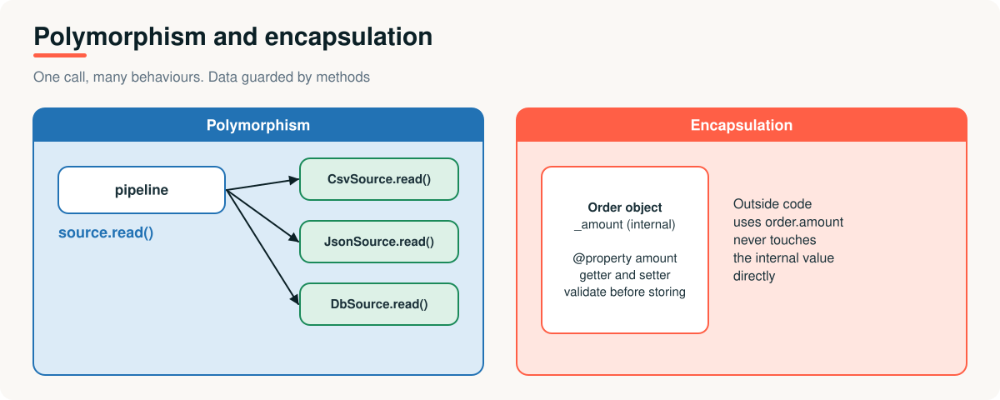

# 16 · OOP: Polymorphism and Encapsulation

> **Module 03 · Topic 16 of 19** &nbsp;|&nbsp; Reading time: ~55 min &nbsp;|&nbsp; Level: Intermediate

[Module home](README.md) &nbsp;·&nbsp; [← Previous: Inheritance and Abstraction](15-oop-inheritance-and-abstraction.md) &nbsp;·&nbsp; [Next: File Handling and Exception Handling →](17-file-handling-and-exception-handling.md)



## What you will learn

- **Polymorphism**: one interface, many behaviours
- **Duck typing**, Python's dynamic form of polymorphism
- **Overloading** in Python terms: operators, methods and constructors (and what Python does *not* have)
- **Overriding** methods and constructors in subclasses
- **Encapsulation**: protecting an object's data
- **Getters and setters** with `@property`

---

## 1. The business problem

Asha's pipeline now has `Money` amounts, several sinks that write results, and validated orders.

| Problem | What happens | Why |
|---|---|---|
| Amounts in two currencies are added with `+` | `100 INR + 100 USD` silently gives `200` | A plain number carries no currency |
| The report code has an `if` for every sink type | Adding a new sink means editing the report code | The caller checks types instead of just calling `write()` |
| Someone sets `order.discount = 5.0` | A discount of 500% is accepted | Anything can overwrite the data directly |

**Polymorphism** removes the type checks: you call the same method on different objects and each does the right thing. **Encapsulation** puts a guard in front of the data, so invalid values are refused.

---

## 2. Polymorphism

**Polymorphism** means "many forms": the same operation, written once, works on objects of different types. You already use it:

```python
print(len("West"), len([1, 2, 3]), len({"a": 1}))     # len() works on many types
print(3 + 4, "a" + "b", [1] + [2])                    # + means something different for each
```

```text
4 3 1
7 ab [1, 2]
```

In your own code, polymorphism usually comes from **overriding**: subclasses give their own version of the same method.

### Method overriding

A child class **redefines** a method it inherited. When you call the method on a child object, the child's version runs.

```python
class Sink:
    def write(self, rows):
        raise NotImplementedError

    def report(self, rows):
        self.write(rows)
        print(f"{type(self).__name__}: wrote {len(rows)} rows")


class ConsoleSink(Sink):
    def write(self, rows):                      # overrides Sink.write
        for row in rows:
            print("  ->", row)


class ListSink(Sink):
    def __init__(self):
        self.stored = []

    def write(self, rows):                      # overrides Sink.write differently
        self.stored.extend(rows)


rows = [{"order_id": 1001, "amount": 1200.0}, {"order_id": 1002, "amount": 800.0}]

for sink in (ConsoleSink(), ListSink()):        # the loop does not check types
    sink.report(rows)
```

```text
  -> {'order_id': 1001, 'amount': 1200.0}
  -> {'order_id': 1002, 'amount': 800.0}
ConsoleSink: wrote 2 rows
ListSink: wrote 2 rows
```

`report` calls `self.write(rows)` and never asks which sink it has. A new `S3Sink` needs only its own `write`, and `report` is untouched. That removes the `if sink_type == ...` chain from the business problem.

### Overriding the constructor

A child can override `__init__` too. Call `super().__init__()` to keep the parent's setup, as in [Topic 15](15-oop-inheritance-and-abstraction.md).

```python
class Order:
    def __init__(self, order_id, amount):
        self.order_id = order_id
        self.amount = amount

    def total(self):
        return self.amount


class ExportOrder(Order):
    def __init__(self, order_id, amount, duty_rate):
        super().__init__(order_id, amount)          # parent's setup
        self.duty_rate = duty_rate                  # extra data for the child

    def total(self):                                # overridden method
        return round(self.amount * (1 + self.duty_rate), 2)


orders = [Order(1, 1000.0), ExportOrder(2, 1000.0, 0.10)]
for o in orders:
    print(type(o).__name__, o.total())
```

```text
Order 1000.0
ExportOrder 1100.0
```

---

## 3. Duck typing

Python does not check an object's **class**. It only checks that the object has the **methods you call**. This is **duck typing**: *"If it walks like a duck and quacks like a duck, it is a duck."*

```python
class CsvWriter:
    def write(self, rows):
        print(f"csv: {len(rows)} rows")


class ApiClient:                                  # unrelated to CsvWriter: no common parent
    def write(self, rows):
        print(f"api: posted {len(rows)} rows")


def publish(target, rows):
    target.write(rows)                            # needs only a .write() method


for target in (CsvWriter(), ApiClient()):
    publish(target, rows)
```

```text
csv: 2 rows
api: posted 2 rows
```

No shared base class, no declaration. This is why Python code is flexible: file objects, string buffers and your own classes can all be passed where something with `write()` is expected.

The cost is that mistakes appear at run time, and only when the code path runs:

```python
try:
    publish("not a writer", rows)
except AttributeError as err:
    print("AttributeError:", err)
```

```text
AttributeError: 'str' object has no attribute 'write'
```

Use `ABC` ([Topic 15](15-oop-inheritance-and-abstraction.md)) when you want the contract **enforced up front**, and duck typing when flexibility matters more.

---

## 4. Overloading

**Overloading** means giving one name several meanings depending on the arguments. Python handles it differently from languages like Java, so be precise about each kind.

| Kind | Does Python have it? | How you get the effect |
|---|---|---|
| **Operator overloading** | Yes | Special (dunder) methods: `__add__`, `__eq__`, `__lt__`, `__len__`... |
| **Method overloading** (same name, different parameter lists) | **No.** The last definition replaces the earlier ones | Default arguments, `*args`, `**kwargs`, or `functools.singledispatch` |
| **Constructor overloading** | **No**, only one `__init__` | Default arguments and `@classmethod` alternative constructors |

### Operator overloading

Special methods let your classes work with Python's operators and built-ins. Back to the currency problem:

```python
class Money:
    def __init__(self, amount, currency):
        self.amount = amount
        self.currency = currency

    def __add__(self, other):                       # defines +
        if self.currency != other.currency:
            raise ValueError(f"cannot add {self.currency} and {other.currency}")
        return Money(self.amount + other.amount, self.currency)

    def __eq__(self, other):                        # defines ==
        return (self.amount, self.currency) == (other.amount, other.currency)

    def __lt__(self, other):                        # defines <
        return self.amount < other.amount

    def __repr__(self):                             # how the object prints
        return f"Money({self.amount}, {self.currency!r})"


a = Money(100, "INR")
b = Money(250, "INR")
print(a + b)
print(a == Money(100, "INR"), a < b)
print(sorted([b, a]))

try:
    a + Money(5, "USD")
except ValueError as err:
    print("ValueError:", err)
```

```text
Money(350, 'INR')
True True
[Money(100, 'INR'), Money(250, 'INR')]
ValueError: cannot add INR and USD
```

`a + b` really calls `a.__add__(b)`. The silent `INR + USD` bug is now an error.

| Operator or built-in | Special method |
|---|---|
| `+`, `-`, `*`, `/` | `__add__`, `__sub__`, `__mul__`, `__truediv__` |
| `==`, `!=`, `<`, `>` | `__eq__`, `__ne__`, `__lt__`, `__gt__` |
| `len(x)` | `__len__` |
| `x[i]` | `__getitem__` |
| `for item in x` | `__iter__` |
| `str(x)`, `repr(x)` | `__str__`, `__repr__` |

### Method "overloading"

Python keeps only the last definition of a name:

```python
class Calculator:
    def total(self, a, b):
        return a + b

    def total(self, a, b, c):            # replaces the first definition
        return a + b + c


calc = Calculator()
try:
    calc.total(1, 2)
except TypeError as err:
    print("TypeError:", err)
print(calc.total(1, 2, 3))
```

```text
TypeError: Calculator.total() missing 1 required positional argument: 'c'
6
```

The usual solution is **default arguments** or `*args`:

```python
class Calculator:
    def total(self, *values):            # accepts any number of arguments
        return sum(values)

    def price(self, amount, tax_rate=0.18, discount=0.0):    # optional parameters
        return round(amount * (1 + tax_rate) * (1 - discount), 2)


calc = Calculator()
print(calc.total(1, 2), calc.total(1, 2, 3, 4))
print(calc.price(1000), calc.price(1000, discount=0.1))
```

```text
3 10
1180.0 1062.0
```

For behaviour that depends on the **type** of the argument, `functools.singledispatch` chooses a function by type:

```python
from functools import singledispatch


@singledispatch
def to_amount(value):
    raise TypeError(f"cannot convert {type(value).__name__}")


@to_amount.register
def _(value: int):
    return float(value)


@to_amount.register
def _(value: str):
    return float(value.replace(",", ""))


print(to_amount(1200), to_amount("1,200.50"))
```

```text
1200.0 1200.5
```

### Constructor "overloading"

One `__init__`, made flexible with defaults, and `@classmethod` constructors for different input shapes (see [Topic 14](14-oop-classes-and-objects.md)):

```python
class Order:
    def __init__(self, order_id, region="Unknown", amount=0.0):    # defaults: several ways to call
        self.order_id = order_id
        self.region = region
        self.amount = amount

    @classmethod
    def from_dict(cls, record):                                      # build from a dictionary
        return cls(record["order_id"], record["region"], record["amount"])

    @classmethod
    def from_csv_line(cls, line):                                    # build from a CSV line
        order_id, region, amount = line.split(",")
        return cls(int(order_id), region, float(amount))

    def __repr__(self):
        return f"Order({self.order_id}, {self.region!r}, {self.amount})"


print(Order(1))
print(Order(2, "West", 300.0))
print(Order.from_dict({"order_id": 3, "region": "East", "amount": 450.0}))
print(Order.from_csv_line("4,North,980.5"))
```

```text
Order(1, 'Unknown', 0.0)
Order(2, 'West', 300.0)
Order(3, 'East', 450.0)
Order(4, 'North', 980.5)
```

---

## 5. Encapsulation

**Encapsulation** means bundling data with the methods that work on it, and **controlling access** to that data so it cannot be put into an invalid state. The class decides what is allowed.

The problem, first:

```python
class Order:
    def __init__(self, order_id, amount, discount=0.0):
        self.order_id = order_id
        self.amount = amount
        self.discount = discount

    def payable(self):
        return round(self.amount * (1 - self.discount), 2)


o = Order(1, 1000.0)
o.discount = 5.0                 # nothing stops this
print(o.payable())
```

```text
-4000.0
```

A discount of 500% gives a negative payable amount. Direct access let invalid data in. The fix is to hide the raw value behind a **getter** and a **setter** that validates.

### Getters and setters with `@property`

In Python you do not write `get_discount()` and `set_discount()`. You use `@property`, which keeps the clean `obj.discount` syntax while running your code underneath.

```python
class Order:
    def __init__(self, order_id, amount, discount=0.0):
        self.order_id = order_id
        self.amount = amount
        self.discount = discount            # goes through the setter below

    @property
    def discount(self):                     # getter: runs on  order.discount
        return self._discount

    @discount.setter
    def discount(self, value):              # setter: runs on  order.discount = value
        if not 0 <= value <= 0.5:
            raise ValueError(f"discount must be between 0 and 0.5, got {value}")
        self._discount = value

    def payable(self):
        return round(self.amount * (1 - self._discount), 2)


o = Order(1, 1000.0)
o.discount = 0.2
print(o.discount, o.payable())

try:
    o.discount = 5.0
except ValueError as err:
    print("ValueError:", err)

try:
    Order(2, 500.0, discount=0.9)
except ValueError as err:
    print("ValueError:", err)
```

```text
0.2 800.0
ValueError: discount must be between 0 and 0.5, got 5.0
ValueError: discount must be between 0 and 0.5, got 0.9
```

The attribute `_discount` holds the real value. Code outside uses `order.discount`, and every read and write passes through your methods. The constructor uses the setter too, so a bad value cannot sneak in at creation.

### Read-only and calculated properties

A property **without** a setter is read-only. A property can also be **calculated**, so it never goes out of date:

```python
class Order:
    def __init__(self, order_id, quantity, unit_price):
        self._order_id = order_id
        self.quantity = quantity
        self.unit_price = unit_price

    @property
    def order_id(self):                      # read-only: no setter
        return self._order_id

    @property
    def amount(self):                        # calculated from other data
        return self.quantity * self.unit_price


o = Order(7, 3, 250.0)
print(o.order_id, o.amount)

o.quantity = 4
print(o.amount)                              # recalculated automatically

try:
    o.order_id = 8
except AttributeError as err:
    print("AttributeError:", err)
```

```text
7 750.0
1000.0
AttributeError: property 'order_id' of 'Order' object has no setter
```

### Private attributes revisited

`_name` (protected) and `__name` (private, name-mangled) were introduced in [Topic 14](14-oop-classes-and-objects.md). Together with properties they give Python encapsulation: the underscore says **do not touch**, and the property provides the **supported way in**.

| Tool | Role in encapsulation |
|---|---|
| `_name` | Marks data as internal |
| `__name` | Avoids accidental overriding in subclasses |
| `@property` getter | Controlled reading, calculated values |
| `@name.setter` | Validation on writing |
| No setter | Read-only data |

Encapsulation is about **keeping the object valid**, not about secrecy. A determined programmer can still reach `_discount`. The design relies on convention and review, as is usual in Python.

---

## 6. Putting it together

A small, realistic design: sinks (polymorphism), `Money` (operator overloading) and validated orders (encapsulation) in one flow.

```python
class Order:
    def __init__(self, order_id, amount, currency="INR"):
        self.order_id = order_id
        self.price = Money(amount, currency)

    @property
    def amount(self):
        return self.price.amount


orders = [Order(1001, 1200.0), Order(1002, 800.0), Order(1003, 300.0)]

total = Money(0, "INR")
for order in orders:
    total = total + order.price                 # operator overloading

print("Total:", total)

for sink in (ConsoleSink(), ListSink()):         # polymorphism
    sink.report([{"order_id": o.order_id, "amount": o.amount} for o in orders])
```

```text
Total: Money(2300.0, 'INR')
  -> {'order_id': 1001, 'amount': 1200.0}
  -> {'order_id': 1002, 'amount': 800.0}
  -> {'order_id': 1003, 'amount': 300.0}
ConsoleSink: wrote 3 rows
ListSink: wrote 3 rows
```

---

## 7. Limitations and engineering considerations

| Issue | Detail |
|---|---|
| **Duck typing errors appear late** | A wrong object fails only when the line runs. Test, use type hints, or an ABC |
| **No real overloading** | A second `def` with the same name silently replaces the first |
| **Operator overloading abuse** | Define operators only when the meaning is obvious (`Money + Money`). Surprising operators make code hard to read |
| **Properties hide work** | A property looks like a field. Keep them cheap. Move slow work (a database call) into a method |
| **Encapsulation is by convention** | Nothing prevents access to `_discount`. Do not use it for security |
| **Over-engineering** | Do not add getters and setters for every field. Use plain attributes until a rule needs enforcing |
| **Overriding changes behaviour** | A child that breaks the parent's promises (returns a different type) surprises callers |

## 8. Real-world applications

- **Pluggable sinks and sources:** one `write()` or `read()`, many implementations (files, APIs, warehouses).
- **Library objects:** pandas `DataFrame` overloads `+`, `[]` and `==`. `datetime` supports subtraction. All through special methods.
- **Value objects:** `Money`, `Percentage` and `Interval` types that refuse invalid combinations.
- **Validated configuration:** properties check ranges (a batch size above zero, a retry count at most 10).
- **Test doubles:** any object with the right methods can stand in for a real database client.

---

## Key takeaways

1. **Polymorphism** is one call, many behaviours. In Python it comes mainly from **overriding** and **duck typing**.
2. **Duck typing** checks capability, not class. It is flexible, and mistakes surface at run time.
3. Python **has operator overloading** through special methods (`__add__`, `__eq__`, `__len__`...).
4. Python **does not have method or constructor overloading**: the last definition wins. Use default arguments, `*args`, `singledispatch` and `@classmethod` constructors.
5. **Overriding** replaces a parent method in a child. Use `super()` to extend rather than replace.
6. **Encapsulation** keeps data valid by controlling access. Use `_name` for internals and `@property` for the supported way in.
7. A **setter** validates, a property **without** a setter is read-only, and a **calculated** property never goes stale.

## Interview questions

<details><summary><b>1.</b> What is polymorphism? Give a Python example.</summary>

The ability to use the same interface on objects of different types, each behaving appropriately. For example, a loop calling `sink.write(rows)` on a console sink, a file sink and an API sink, each with its own `write`.
</details>

<details><summary><b>2.</b> What is duck typing?</summary>

Python judges an object by the methods and attributes it has, not by its class. If an object has the `write()` method you call, it works. It allows flexible code, but type errors appear only at run time.
</details>

<details><summary><b>3.</b> Does Python support method overloading?</summary>

Not in the Java sense. If you define a method twice with the same name, the second definition replaces the first. You get the effect with default arguments, `*args` and `**kwargs`, or `functools.singledispatch`.
</details>

<details><summary><b>4.</b> How do you overload an operator in Python?</summary>

Implement the matching special method in the class: `__add__` for `+`, `__eq__` for `==`, `__lt__` for `<`, `__len__` for `len()`, and so on.
</details>

<details><summary><b>5.</b> How do you provide multiple ways to construct an object?</summary>

Python allows only one `__init__`. Use default and keyword arguments for variation, and `@classmethod` alternative constructors such as `from_dict` and `from_csv_line`.
</details>

<details><summary><b>6.</b> What is method overriding, and how is it different from overloading?</summary>

Overriding is a child class redefining a method inherited from its parent, so the child's version runs for child objects. Overloading is one name with different signatures in the same class, which Python does not support directly.
</details>

<details><summary><b>7.</b> What is encapsulation, and how is it achieved in Python?</summary>

Bundling data with methods and controlling access so objects stay valid. Python uses naming conventions (`_name`, `__name`) and `@property` getters and setters rather than enforced access modifiers.
</details>

<details><summary><b>8.</b> Why use <code>@property</code> instead of <code>get_x()</code> and <code>set_x()</code> methods?</summary>

It keeps the simple attribute syntax (`obj.x`) while still running validation or calculation. You can start with a plain attribute and add a property later without changing any code that uses it.
</details>

## Official documentation

- [Data model: special method names](https://docs.python.org/3/reference/datamodel.html#special-method-names) · [Emulating numeric types](https://docs.python.org/3/reference/datamodel.html#emulating-numeric-types)
- [Built-in functions: `property`](https://docs.python.org/3/library/functions.html#property)
- [`functools.singledispatch`](https://docs.python.org/3/library/functools.html#functools.singledispatch)
- [Python Tutorial: Classes](https://docs.python.org/3/tutorial/classes.html) · [Glossary: duck-typing](https://docs.python.org/3/glossary.html#term-duck-typing)

---

| Previous | Contents | Next |
|:---|:---:|:---|
| [← Inheritance and Abstraction](15-oop-inheritance-and-abstraction.md) | [Module home](README.md#topics-covered) | [File Handling and Exception Handling →](17-file-handling-and-exception-handling.md) |
