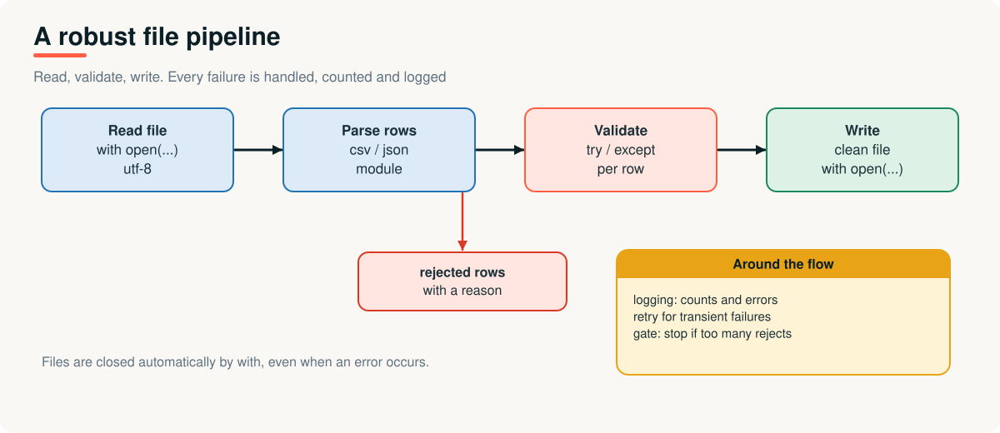

# 17 · File Handling and Exception Handling

> **Module 03 · Topic 17 of 19** &nbsp;|&nbsp; Reading time: ~70 min &nbsp;|&nbsp; Level: Intermediate

[Module home](README.md) &nbsp;·&nbsp; [← Previous: Polymorphism and Encapsulation](16-oop-polymorphism-and-encapsulation.md) &nbsp;·&nbsp; [Next: Streamlit →](18-streamlit.md)



## What you will learn

- How to **open, read, write and append** files, and why to always use `with`
- Reading and writing **CSV** and **JSON**, the two most common data file formats
- `pathlib` for building and checking **paths**
- **Exceptions**: `try`, `except`, `else`, `finally`, `raise`, and your own exception classes
- **Retries** for transient failures, and **logging** instead of `print`
- A complete, **robust file pipeline** that puts it all together

---

## 1. The business problem

Every night a partner uploads `partner_orders.csv`. Asha's script reads it, and one night it fails.

| What happened | What the script did | What it should have done |
|---|---|---|
| The network share was busy for 20 seconds | Crashed with a traceback | Wait and try again |
| One row had `abc` as the amount | Crashed, so no orders loaded at all | Set the row aside with a reason and load the rest |
| The file was missing | Crashed, same as a busy share | Fail fast with a clear message, because waiting will not help |
| 80% of the rows were bad | Loaded the 20% silently | Refuse the file and raise an alert |
| Nobody saw any of this | `print` output went nowhere | Write timestamped log lines |

A pipeline that only works when everything goes right is a demo. **File handling** lets the script read and write data. **Exception handling** lets it survive and report the bad cases.

---

## 2. File handling

### Opening files

`open(path, mode)` returns a **file object**. The **mode** says what you will do.

| Mode | Meaning | If the file exists | If it does not |
|---|---|---|---|
| `"r"` | Read text (default) | Reads it | `FileNotFoundError` |
| `"w"` | Write text | **Erases it** first | Creates it |
| `"a"` | Append text | Adds to the end | Creates it |
| `"x"` | Create only | `FileExistsError` | Creates it |
| `"r+"` | Read and write | Reads and writes | `FileNotFoundError` |
| add `"b"` | Binary (`"rb"`, `"wb"`) | For images, Parquet, zip | |

Always pass `encoding="utf-8"` for text files. The default depends on the operating system, and a file written on one machine can then be unreadable on another.

### Always use `with`

A file must be **closed** after use, or data may not be saved and the operating system keeps the file locked. The `with` statement closes it automatically, **even if an error occurs**.

```python
import json
import tempfile
from pathlib import Path

workdir = Path(tempfile.mkdtemp())          # a temporary folder, so this runs anywhere
path = workdir / "orders.txt"

with open(path, "w", encoding="utf-8") as f:        # write: creates or erases the file
    f.write("1001,West,1200.0\n")
    f.write("1002,East,800.0\n")

with open(path, "a", encoding="utf-8") as f:        # append: adds to the end
    f.write("1003,North,500.0\n")

print(f.closed)       # True: 'with' closed it for us
```

```text
True
```

### Reading

```python
with open(path, encoding="utf-8") as f:
    whole = f.read()                     # the entire file as one string
print(repr(whole))

with open(path, encoding="utf-8") as f:
    first = f.readline()                 # one line
    rest = f.readlines()                 # the remaining lines, as a list
print(repr(first), len(rest))

with open(path, encoding="utf-8") as f:
    for line in f:                       # best for large files: one line at a time, little memory
        order_id, region, amount = line.strip().split(",")
        print(order_id, region, float(amount))
```

```text
'1001,West,1200.0\n1002,East,800.0\n1003,North,500.0\n'
'1001,West,1200.0\n' 2
1001 West 1200.0
1002 East 800.0
1003 North 500.0
```

Iterating over the file (`for line in f`) reads one line at a time. `read()` loads everything into memory, which is fine for a small file and a problem for a 20 GB one.

### Writing many lines

```python
rows = ["1004,South,250.0", "1005,West,980.5"]

with open(path, "a", encoding="utf-8") as f:
    f.writelines(line + "\n" for line in rows)

with open(path, encoding="utf-8") as f:
    print(sum(1 for _ in f), "lines")
```

```text
5 lines
```

---

## 3. Paths with `pathlib`

Building paths with string joins breaks between Windows (`\`) and Linux (`/`). `pathlib.Path` handles both.

```python
base = Path("data") / "raw" / "orders_2025-12-01.csv"      # the / operator joins path parts

print(base.name)              # file name
print(base.stem)              # name without extension
print(base.suffix)            # extension
print(base.parent)            # folder
print(base.with_suffix(".parquet"))

print(path.exists(), path.is_file(), path.stat().st_size > 0)
print([p.name for p in workdir.glob("*.txt")])             # find files by pattern
```

```text
orders_2025-12-01.csv
orders_2025-12-01
.csv
data/raw
data/raw/orders_2025-12-01.parquet
True True True
['orders.txt']
```

Useful operations:

| Task | Code |
|---|---|
| Create a folder (and parents) | `Path("out").mkdir(parents=True, exist_ok=True)` |
| Read a small file as text | `path.read_text(encoding="utf-8")` |
| Write a small file | `path.write_text(text, encoding="utf-8")` |
| List files | `folder.iterdir()`, `folder.glob("*.csv")` |
| Rename / delete | `path.rename(new)`, `path.unlink()` |

---

## 4. CSV files

CSV looks simple, but it has quoting rules: a value may contain a comma, a quote or a line break. **Do not split lines on commas by hand**: use the `csv` module.

```python
import csv

csv_path = workdir / "partner_orders.csv"

with open(csv_path, "w", newline="", encoding="utf-8") as f:       # newline="" is required with csv
    writer = csv.writer(f)
    writer.writerow(["order_id", "region", "amount", "note"])
    writer.writerow([1001, "West", 1200.0, "gift, wrapped"])        # the comma inside is handled
    writer.writerow([1002, "East", 800.0, 'said "urgent"'])

print(csv_path.read_text(encoding="utf-8"))
```

```text
order_id,region,amount,note
1001,West,1200.0,"gift, wrapped"
1002,East,800.0,"said ""urgent"""
```

`DictReader` returns each row as a dictionary keyed by the header, which is easier to read and survives column reordering.

```python
with open(csv_path, newline="", encoding="utf-8") as f:
    for row in csv.DictReader(f):
        print(row["order_id"], row["region"], float(row["amount"]), "|", row["note"])
```

```text
1001 West 1200.0 | gift, wrapped
1002 East 800.0 | said "urgent"
```

Everything read from a CSV is a **string**. Convert it (`float(row["amount"])`) and expect conversions to fail on bad data, which is the next section's topic. `csv.DictWriter` is the matching writer for dictionaries.

---

## 5. JSON files

JSON is the standard format for APIs and nested records. It maps naturally onto Python: objects to `dict`, arrays to `list`, strings, numbers, `true`/`false`/`null` to `str`, `int`/`float`, `True`/`False`/`None`.

```python
orders = [
    {"order_id": 1001, "region": "West", "amount": 1200.0, "items": ["Shoes", "Socks"], "coupon": None},
    {"order_id": 1002, "region": "East", "amount": 800.0, "items": ["Backpack"], "coupon": "FIRST10"},
]

json_path = workdir / "orders.json"
with open(json_path, "w", encoding="utf-8") as f:
    json.dump(orders, f, indent=2)                      # object to file

with open(json_path, encoding="utf-8") as f:
    loaded = json.load(f)                               # file to object

print(loaded == orders)
print(json.dumps(orders[1]))                            # object to string
print(json.loads('{"order_id": 7, "paid": true, "coupon": null}'))   # string to object
```

```text
True
{"order_id": 1002, "region": "East", "amount": 800.0, "items": ["Backpack"], "coupon": "FIRST10"}
{'order_id': 7, 'paid': True, 'coupon': None}
```

| Function | Direction |
|---|---|
| `json.dump(obj, file)` | Python object to a file |
| `json.load(file)` | File to a Python object |
| `json.dumps(obj)` | Python object to a string |
| `json.loads(text)` | String to a Python object |

For large datasets, formats such as Parquet are better. CSV and JSON are the right tools for configuration, small extracts and API payloads.

---

## 6. Exception handling

### Errors and exceptions

A **syntax error** means Python cannot even read the code. An **exception** happens **while the code runs**, when an operation fails. Without handling, an exception stops the program with a traceback.

```python
try:
    amount = float("abc")
except ValueError as err:
    print("Caught:", err)
print("The program carries on")
```

```text
Caught: could not convert string to float: 'abc'
The program carries on
```

### `try`, `except`, `else`, `finally`

| Block | Runs when |
|---|---|
| `try` | Always first. Holds the code that might fail |
| `except` | An exception of the named type occurred in `try` |
| `else` | `try` finished **without** any exception |
| `finally` | **Always**, whether or not there was an error. Used for cleanup |

```python
def load_amount(text):
    try:
        amount = float(text)
    except ValueError:
        print(f"  {text!r}: not a number")
        return None
    else:
        print(f"  {text!r}: parsed")             # only when no exception happened
        return amount
    finally:
        print("  (done with this value)")        # always runs


for value in ["1200.50", "abc"]:
    print(load_amount(value))
```

```text
  '1200.50': parsed
  (done with this value)
1200.5
  'abc': not a number
  (done with this value)
None
```

### Several exception types

Handle the specific cases you can do something about, one `except` each. The first match wins.

```python
def read_first_line(file_path):
    try:
        with open(file_path, encoding="utf-8") as f:
            return f.readline().strip()
    except FileNotFoundError:
        return "file not found"
    except PermissionError:
        return "no permission"
    except (UnicodeDecodeError, OSError) as err:         # a tuple handles several types the same way
        return f"cannot read: {type(err).__name__}"


print(read_first_line(workdir / "orders.txt"))
print(read_first_line(workdir / "missing.txt"))
```

```text
1001,West,1200.0
file not found
```

Common exceptions in data work:

| Exception | Typical cause |
|---|---|
| `FileNotFoundError` | The path does not exist |
| `PermissionError` | No right to read or write |
| `ValueError` | Right type, wrong value: `int("abc")` |
| `TypeError` | Wrong type: `"a" + 1` |
| `KeyError` | Missing dictionary key |
| `IndexError` | List index out of range |
| `ZeroDivisionError` | Division by zero |
| `AttributeError` | Object has no such attribute |
| `json.JSONDecodeError` | Invalid JSON text (a subclass of `ValueError`) |
| `ConnectionError`, `TimeoutError` | Network problems, often temporary |

All exceptions inherit from `Exception`, which is the same hierarchy idea as [Topic 15](15-oop-inheritance-and-abstraction.md): catching a parent catches every child.

> [!WARNING]
> Never write a bare `except:` or `except Exception: pass`. It hides real bugs, including your own typos. Catch only what you expect and can handle, and log anything else.

### Raising exceptions

Use `raise` to signal that **your** code found a problem:

```python
def check_order(order):
    if order["amount"] < 0:
        raise ValueError(f"order {order['order_id']}: negative amount {order['amount']}")
    return order


try:
    check_order({"order_id": 1005, "amount": -50.0})
except ValueError as err:
    print("Rejected:", err)
```

```text
Rejected: order 1005: negative amount -50.0
```

### Custom exceptions

Define your own exception class when a failure has a meaning in your domain. Callers can then catch it specifically.

```python
class DataQualityError(Exception):
    """Raised when a file has too many bad rows to trust."""


def gate(rejected, total, limit=0.5):
    ratio = rejected / total
    if ratio > limit:
        raise DataQualityError(f"{ratio:.0%} of rows rejected, limit is {limit:.0%}")


try:
    gate(rejected=4, total=5)
except DataQualityError as err:
    print("Stopping the run:", err)
```

```text
Stopping the run: 80% of rows rejected, limit is 50%
```

### Passing information up: `raise ... from`

When you catch one error and raise another, keep the original as the cause:

```python
def parse_amount(text):
    try:
        return float(text)
    except ValueError as err:
        raise DataQualityError(f"bad amount {text!r}") from err


try:
    parse_amount("12,5")
except DataQualityError as err:
    print(err, "| caused by:", repr(err.__cause__))
```

```text
bad amount '12,5' | caused by: ValueError("could not convert string to float: '12,5'")
```

---

## 7. Retries: transient and permanent failures

Not every failure should be handled the same way.

| Failure | Example | Right response |
|---|---|---|
| **Transient** | Network timeout, busy server | **Retry**, with a short wait that grows each time (backoff) |
| **Permanent** | File missing, bad password, invalid data | **Fail fast**. Retrying only delays the alert |

```python
import time

calls = {"count": 0}


def flaky_read():
    calls["count"] += 1
    if calls["count"] < 3:
        raise ConnectionError("share temporarily unavailable")
    return "file contents"


def retry(func, attempts=4, delay=0.01):
    for attempt in range(1, attempts + 1):
        try:
            return func()
        except (ConnectionError, TimeoutError) as err:       # transient errors only
            print(f"attempt {attempt} failed: {err}")
            if attempt == attempts:
                raise                                         # out of attempts: let the caller know
            time.sleep(delay * 2 ** (attempt - 1))            # exponential backoff: 0.01, 0.02, 0.04 ...


print(retry(flaky_read))
```

```text
attempt 1 failed: share temporarily unavailable
attempt 2 failed: share temporarily unavailable
file contents
```

Real pipelines use the same idea, often through a library or the scheduler's retry setting. Retries are safe only when the operation is **idempotent** (running it twice is harmless), as covered in [Module 02, Topic 08](../02_SQL_for_Data_Engineers/08-modelling-and-loading-with-sql.md).

---

## 8. Logging

`print` goes to the screen and disappears. **Logging** records events with a **level**, a **time** and a **name**, and can write to files or monitoring systems.

| Level | Use it for |
|---|---|
| `DEBUG` | Detail for developers |
| `INFO` | Normal progress: "read 6 rows" |
| `WARNING` | Something unexpected, but the run continues |
| `ERROR` | An operation failed |
| `CRITICAL` | The whole run cannot continue |

```python
import logging
import sys

logging.basicConfig(stream=sys.stdout, level=logging.INFO, format="%(levelname)-7s %(name)s: %(message)s")
log = logging.getLogger("orders")

log.debug("not shown: below the INFO level")
log.info("read %d rows", 6)
log.warning("%d rows rejected", 3)

try:
    float("abc")
except ValueError:
    log.exception("conversion failed")       # logs at ERROR level and includes the traceback
```

```text
INFO    orders: read 6 rows
WARNING orders: 3 rows rejected
ERROR   orders: conversion failed
Traceback (most recent call last):
  File "<block>", line 12, in <module>
ValueError: could not convert string to float: 'abc'
```

In real use you add `%(asctime)s` to the format, so each line has a time. The examples here leave it out so the output stays the same on every run. Pass values as arguments (`log.info("read %d rows", n)`) rather than building the string yourself, because the formatting only happens if that level is enabled.

---

## 9. A robust file pipeline

Everything above in one script: [`examples/17_robust_file_pipeline.py`](examples/17_robust_file_pipeline.py). It reads a partner CSV, validates each row, writes clean rows to JSON and rejected rows (with a reason) to CSV, retries a transient failure, fails fast on a missing file, and refuses a file that is mostly bad.

```text
Run 1: normal run, with a transient failure on the way
INFO    reading partner_orders.csv
WARNING attempt 1 of 3 failed: share temporarily unavailable
WARNING attempt 2 of 3 failed: share temporarily unavailable
INFO    read 6 rows
INFO    wrote 3 clean rows to orders_clean.json and 3 rejected rows to orders_rejected.csv

orders_clean.json
[
  {
    "order_id": 1001,
    "region": "West",
    "amount": 1200.0,
    "status": "completed"
  },
  {
    "order_id": 1002,
    "region": "East",
    "amount": 800.0,
    "status": "completed"
  },
  {
    "order_id": 1006,
    "region": "North",
    "amount": 500.0,
    "status": "cancelled"
  }
]
orders_rejected.csv
order_id,region,amount,status,reject_reason
1003,,450.00,completed,region missing
1004,North,abc,pending,amount not a number
1005,South,-50.00,completed,amount negative

Run 2: a permanent failure (file missing) is not retried
ERROR   giving up, file not found: does_not_exist.csv

Run 3: a file that is mostly bad is refused, not loaded
INFO    reading partner_orders.csv
INFO    read 6 rows
ERROR   quality gate failed: 50% of rows rejected, limit is 20%
cleanup done
```

Read the output top to bottom:

- **Run 1:** two transient failures are logged as warnings and retried, the third attempt succeeds. Three bad rows go to the rejects file **with a reason** each, and the three good rows go to JSON.
- **Run 2:** a missing file is a permanent failure. It is not retried: it is logged as an error immediately.
- **Run 3:** with a stricter limit, a file with 50% rejected rows triggers `DataQualityError`. The run stops before anything is written, and the `finally` block still runs.

This is the same pattern as the SQL pipeline in Module 02: **reject with reasons, gate on quality, never fail silently**.

Clean up the temporary folder from the earlier examples:

```python
import shutil

shutil.rmtree(workdir)
print(workdir.exists())
```

```text
False
```

---

## 10. Limitations and engineering considerations

| Issue | Detail |
|---|---|
| **Memory** | `read()` and `json.load()` load everything. For big files, iterate line by line or use chunked readers and columnar formats |
| **Encoding** | Always set `encoding="utf-8"`. Files from other systems may use other encodings, such as `utf-8-sig` for Excel CSV exports |
| **`"w"` erases** | Opening an existing file in write mode destroys its content. Write to a temporary name and rename for safety |
| **CSV has no types** | Every value is a string. Validate and convert explicitly |
| **Bare `except`** | Hides bugs and also catches `KeyboardInterrupt` in its bare form. Catch specific exceptions |
| **Blind retries** | Retrying a non-idempotent operation can duplicate data. Retry only transient errors, a few times, with backoff |
| **Swallowed errors** | Catching an error and carrying on without logging makes failures invisible |
| **Paths** | Never hard-code `C:\...` paths. Use `pathlib` and configuration |

## 11. Real-world applications

- **Ingestion:** reading partner files, exports and API dumps into a landing area.
- **Reject files:** keeping bad rows with reasons for later review, instead of dropping them.
- **Configuration:** JSON or YAML files that control a pipeline.
- **Scheduler behaviour:** Airflow and similar tools retry tasks and mark them failed based on exceptions.
- **Monitoring:** logs feed alerting, so a failed run raises a message instead of going unnoticed.
- **Audit trails:** logs show what was loaded, when, and how many rows were rejected.

---

## Key takeaways

1. Open files with **`with`**: it closes the file even when an error occurs. Always set `encoding="utf-8"`.
2. Modes: `"r"` reads, `"w"` **erases and writes**, `"a"` appends, add `"b"` for binary.
3. Iterate over a file line by line for large data. `read()` loads it all.
4. Use **`pathlib`** for paths, and the **`csv`** and **`json`** modules instead of hand-parsing.
5. **`try / except / else / finally`**: `else` runs on success, `finally` always runs.
6. Catch **specific** exceptions. Never use a bare `except:` or swallow errors silently.
7. Use `raise` to signal problems, and **custom exceptions** for domain failures.
8. **Retry transient** failures with backoff. **Fail fast** on permanent ones.
9. Use **logging**, not `print`, and **reject bad rows with reasons** instead of dropping them.

## Interview questions

<details><summary><b>1.</b> Why should you use <code>with open(...)</code>?</summary>

It guarantees the file is closed when the block ends, even if an exception occurs, which prevents resource leaks, locked files and unflushed data.
</details>

<details><summary><b>2.</b> What is the difference between the file modes <code>"r"</code>, <code>"w"</code> and <code>"a"</code>?</summary>

`"r"` reads an existing file. `"w"` creates the file or erases an existing one before writing. `"a"` creates the file or appends to the end of an existing one.
</details>

<details><summary><b>3.</b> How do you read a very large file without running out of memory?</summary>

Iterate over the file object (`for line in f`) or read in chunks, processing one piece at a time instead of calling `read()` or `readlines()`.
</details>

<details><summary><b>4.</b> Why use the <code>csv</code> module instead of <code>line.split(",")</code>?</summary>

CSV fields can contain commas, quotes and line breaks inside quoted values. The `csv` module follows the quoting rules, and `DictReader` gives header-based access.
</details>

<details><summary><b>5.</b> Explain <code>try</code>, <code>except</code>, <code>else</code> and <code>finally</code>.</summary>

`try` holds the risky code, `except` handles a matching exception, `else` runs only if no exception occurred, and `finally` always runs, typically for cleanup.
</details>

<details><summary><b>6.</b> Why is a bare <code>except:</code> bad practice?</summary>

It catches every exception, including programming mistakes and `KeyboardInterrupt`, hiding the real cause of failures. Catch specific exceptions and log anything unexpected.
</details>

<details><summary><b>7.</b> How and why would you define a custom exception?</summary>

Subclass `Exception`, for example `class DataQualityError(Exception)`. It names a domain-specific failure so callers can handle it separately from generic errors.
</details>

<details><summary><b>8.</b> Which failures should be retried, and how?</summary>

Transient ones such as timeouts and busy servers, with a limited number of attempts and exponential backoff, and only for idempotent operations. Permanent failures, such as a missing file or bad data, should fail immediately.
</details>

<details><summary><b>9.</b> Why use <code>logging</code> instead of <code>print</code> in a pipeline?</summary>

Logging provides severity levels, timestamps, named sources and configurable destinations, and it integrates with monitoring and alerting. `print` output is unstructured and is often lost.
</details>

## Official documentation

- [Python Tutorial: Reading and Writing Files](https://docs.python.org/3/tutorial/inputoutput.html#reading-and-writing-files) · [`open()`](https://docs.python.org/3/library/functions.html#open)
- [`pathlib`](https://docs.python.org/3/library/pathlib.html) · [`csv`](https://docs.python.org/3/library/csv.html) · [`json`](https://docs.python.org/3/library/json.html)
- [Python Tutorial: Errors and Exceptions](https://docs.python.org/3/tutorial/errors.html) · [Built-in Exceptions](https://docs.python.org/3/library/exceptions.html)
- [`logging`](https://docs.python.org/3/library/logging.html) · [Logging HOWTO](https://docs.python.org/3/howto/logging.html)

---

| Previous | Contents | Next |
|:---|:---:|:---|
| [← Polymorphism and Encapsulation](16-oop-polymorphism-and-encapsulation.md) | [Module home](README.md#topics-covered) | [Streamlit →](18-streamlit.md) |
