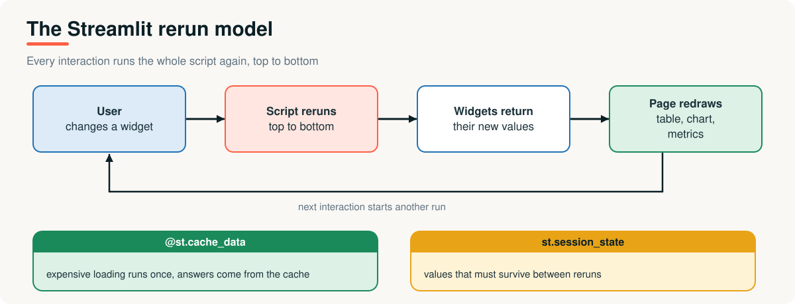

# 18 · Streamlit

> **Module 03 · Topic 18 of 19** &nbsp;|&nbsp; Reading time: ~45 min &nbsp;|&nbsp; Level: Intermediate

[Module home](README.md) &nbsp;·&nbsp; [← Previous: File Handling and Exception Handling](17-file-handling-and-exception-handling.md) &nbsp;·&nbsp; [Next: Module Review and Interview Prep →](19-module-review-and-interview-prep.md)



## What you will learn

- What **Streamlit** is, and where a data engineer uses it
- The main **components**: text, widgets, layout, data and charts
- How the **rerun model** works, which explains every Streamlit behaviour
- How to build and test a small **orders app** over cleaned data

---

## 1. The business problem

The pipeline from [Topic 17](17-file-handling-and-exception-handling.md) produces clean order files every night. Now the business wants to look at them.

| Request | Today | The problem |
|---|---|---|
| "Show me last night's revenue by region" | Asha sends a CSV by email | Stale the moment it is sent |
| "Only completed orders, please" | She edits the file by hand | Every question is a new manual task |
| "Can the team check the data themselves?" | They cannot run Python | No self-service |
| Prove the pipeline output is sensible | A screenshot of a notebook | Not repeatable |

The team needs a small **web page** that reads the data and lets people filter it. Building that normally means learning HTML, JavaScript and a web framework. **Streamlit** lets a Python programmer build it in one Python file.

---

## 2. What is Streamlit?

**Streamlit** is an open-source Python library that turns a script into an interactive web app. You write top-to-bottom Python. Each call such as `st.title()` or `st.dataframe()` adds an element to the page.

| Property | Meaning |
|---|---|
| **Pure Python** | No HTML, CSS or JavaScript to write |
| **Interactive** | Widgets (sliders, checkboxes, select boxes) are one function call each |
| **Script-based** | The app is an ordinary `.py` file |
| **Data-friendly** | Displays pandas tables and charts directly |

### Where it fits

| Use it for | Do not use it for |
|---|---|
| Internal data apps, pipeline monitors, quick dashboards | Public, high-traffic websites |
| Data quality review screens | Complex multi-page business applications |
| Demos of models and analyses | Replacing a BI tool for the whole company |

For a data engineer, Streamlit is a fast way to put a **window** on a pipeline: show what was loaded, what was rejected, and what the numbers say.

### Setup

```bash
pip install streamlit
streamlit run 18_orders_app.py       # opens the app in your browser
```

---

## 3. Components

Everything below is a function in the `st` module.

| Group | Functions | Purpose |
|---|---|---|
| **Text** | `st.title`, `st.header`, `st.subheader`, `st.write`, `st.markdown`, `st.caption`, `st.code` | Headings and explanations |
| **Input widgets** | `st.text_input`, `st.number_input`, `st.slider`, `st.selectbox`, `st.multiselect`, `st.checkbox`, `st.radio`, `st.button`, `st.date_input`, `st.file_uploader` | Let the user choose |
| **Layout** | `st.sidebar`, `st.columns`, `st.tabs`, `st.expander`, `st.container` | Arrange the page |
| **Data** | `st.dataframe`, `st.table`, `st.metric`, `st.json` | Show tables and key numbers |
| **Charts** | `st.bar_chart`, `st.line_chart`, `st.area_chart`, `st.pyplot` | Visualise data |
| **Status** | `st.success`, `st.info`, `st.warning`, `st.error`, `st.spinner` | Tell the user what is happening |

### Widgets return values

An input widget returns the user's current choice, so you use it like any other variable:

```python
only_completed = st.sidebar.checkbox("Completed orders only", value=True)    # True or False
regions = st.sidebar.multiselect("Region", ["East", "North", "South", "West"])   # a list
```

---

## 4. The rerun model

This is the one idea you must understand.

> **Every time the user interacts with a widget, Streamlit runs your whole script again from top to bottom.**

| Step | What happens |
|---|---|
| 1 | The page loads and the script runs once |
| 2 | The user ticks a checkbox |
| 3 | Streamlit reruns the script. The checkbox now returns `False` |
| 4 | The page is redrawn with the new result |

That explains the rules that follow:

| Consequence | Meaning |
|---|---|
| Normal variables are **reset** on every rerun | Use `st.session_state` to remember something between reruns |
| Expensive work **repeats** | Wrap loading and heavy calculations in `@st.cache_data` so they run once |
| The script must be **fast and safe to repeat** | The same idempotency habit as in pipelines |

```python
@st.cache_data
def load_orders():
    return pd.read_csv("clean_orders.csv")      # runs once, then answers from the cache

if "clicks" not in st.session_state:
    st.session_state.clicks = 0                  # survives reruns
if st.button("Count"):
    st.session_state.clicks += 1
```

---

## 5. Building the orders app

The complete app is [`examples/18_orders_app.py`](examples/18_orders_app.py). The data is a small table built in the file, standing in for the pipeline's output.

```python
import pandas as pd
import streamlit as st

ORDERS = pd.DataFrame(
    {
        "order_id": [1001, 1002, 1003, 1004, 1005, 1006, 1007, 1008],
        "region": ["West", "East", "West", "North", "South", "West", "East", "North"],
        "status": ["completed", "completed", "cancelled", "completed", "completed", "pending", "completed", "completed"],
        "amount": [1200.0, 800.0, 300.0, 500.0, 950.0, 400.0, 650.0, 720.0],
    }
)

st.set_page_config(page_title="XYZ Orders", layout="centered")
st.title("XYZ Company: Orders")
st.write("Cleaned orders from the nightly pipeline.")

regions = st.sidebar.multiselect("Region", sorted(ORDERS["region"].unique()), default=sorted(ORDERS["region"].unique()))
only_completed = st.sidebar.checkbox("Completed orders only", value=True)

view = ORDERS[ORDERS["region"].isin(regions)]
if only_completed:
    view = view[view["status"] == "completed"]

left, right = st.columns(2)
left.metric("Orders", len(view))
right.metric("Revenue", f"{view['amount'].sum():,.2f}")

if view.empty:
    st.warning("No orders match the selected filters.")
else:
    st.subheader("Revenue by region")
    st.bar_chart(view.groupby("region")["amount"].sum())
    st.subheader("Orders")
    st.dataframe(view, hide_index=True)
```

Read it as a pipeline:

| Part | What it does |
|---|---|
| `ORDERS = ...` | Load data. In a real app, read the pipeline's clean file here, inside a cached function |
| `st.set_page_config`, `st.title` | Page settings and heading |
| `st.sidebar...` | Widgets that return the user's choices |
| `view = ...` | Filter with plain pandas, the same logic as `WHERE` |
| `st.columns`, `st.metric` | Two key numbers side by side |
| `if view.empty` | Handle the **no data** case, as a pipeline would |
| `st.bar_chart`, `st.dataframe` | Chart and table |

The pandas lines are only filtering and grouping. pandas is the library for table work in Python, and it is the natural next step after this module.

### Testing it

You do not need a browser to test an app. Streamlit's `AppTest` runs the script headlessly, changes widgets, and lets you read what was drawn. This is [`examples/18_test_orders_app.py`](examples/18_test_orders_app.py), run for real:

```text
Title: XYZ Company: Orders
Default view (completed orders, all regions)  Orders=6, Revenue=4,820.00
Untick 'Completed orders only'                Orders=8, Revenue=5,520.00
Region = West, all statuses                   Orders=3, Revenue=1,900.00
No region selected -> No orders match the selected filters.
```

The numbers match the data: six completed orders total 4,820.00, all eight total 5,520.00, and West alone has 3 orders worth 1,900.00. The last case checks the **empty state**: with no region selected the app shows a warning instead of an empty chart. Testing the awkward inputs is the habit that matters most.

### Running and sharing

| Task | How |
|---|---|
| Run locally | `streamlit run 18_orders_app.py` |
| Choose a port | `streamlit run 18_orders_app.py --server.port 8502` |
| Share with a team | Deploy to Streamlit Community Cloud, a company server or a container. The app needs the same environment, so record dependencies in `requirements.txt` |
| Secrets (passwords, keys) | Use `st.secrets` or environment variables, never the source code |

---

## 6. Limitations and engineering considerations

| Issue | Detail |
|---|---|
| **Whole-script reruns** | Heavy code runs on every click unless cached |
| **State is not automatic** | Variables reset each run. Use `st.session_state` |
| **Concurrency** | Each user session runs its own script. Large data loaded per session uses a lot of memory |
| **Not a data platform** | Streamlit shows data. Transforming large data belongs in the warehouse or pipeline |
| **Layout control** | Limited compared with a web framework |
| **Security** | The app has no login by default. Place it behind your company's authentication, and never put credentials in code |
| **Dependencies** | Pin library versions so the app runs the same everywhere |

## 7. Real-world applications

- **Pipeline monitors:** counts loaded, rejected and failed per night.
- **Data quality review:** show rejected rows with reasons for a human to fix.
- **Self-service reports:** filters on top of the gold tables.
- **Model demos:** upload a file, run a model, show predictions.
- **Internal tools:** simple forms that trigger a backfill or a refresh.

---

## Key takeaways

1. **Streamlit** turns a Python script into a web app with no web development.
2. Each `st.` call adds an element. **Widgets return the user's choice** as a normal value.
3. **Every interaction reruns the whole script.** That one rule explains caching and state.
4. Use `@st.cache_data` for loading and heavy work, and `st.session_state` for memory between reruns.
5. Handle the **empty case** and bad input, as you would in a pipeline.
6. Test with `AppTest`, no browser needed.
7. Streamlit is a **window on your data**, not a replacement for the pipeline or the warehouse.

## Interview questions

<details><summary><b>1.</b> What is Streamlit, and when would a data engineer use it?</summary>

An open-source Python library that builds interactive web apps from scripts. A data engineer uses it for internal tools: pipeline monitors, data quality review screens, self-service filters over clean tables and quick demos.
</details>

<details><summary><b>2.</b> Explain Streamlit's execution model.</summary>

The script runs from top to bottom on page load and again, in full, every time the user changes a widget. Widgets return their current value during each run.
</details>

<details><summary><b>3.</b> How do you keep a value between reruns?</summary>

Store it in `st.session_state`. Ordinary variables are recreated on each run.
</details>

<details><summary><b>4.</b> How do you stop an expensive data load from running on every click?</summary>

Put it in a function decorated with `@st.cache_data`. The first call computes and stores the result, and later calls with the same arguments return the cached value.
</details>

<details><summary><b>5.</b> Name a few input widgets, and what they return.</summary>

`checkbox` returns a bool, `selectbox` the chosen item, `multiselect` a list, `slider` a number, `text_input` a string, and `button` returns `True` on the run triggered by the click.
</details>

<details><summary><b>6.</b> How would you test a Streamlit app without a browser?</summary>

Use `streamlit.testing.v1.AppTest`: load the script, set widget values, call `run()`, and assert on the elements it produced, such as metrics and warnings.
</details>

<details><summary><b>7.</b> What are the main limitations of Streamlit for production use?</summary>

Whole-script reruns need caching, per-session memory use, limited layout control, no built-in authentication, and it should present data rather than do heavy transformation.
</details>

## Official documentation

- [Streamlit documentation](https://docs.streamlit.io/) · [API reference](https://docs.streamlit.io/develop/api-reference)
- [Basic concepts of Streamlit](https://docs.streamlit.io/get-started/fundamentals/main-concepts) · [Advanced concepts](https://docs.streamlit.io/get-started/fundamentals/advanced-concepts)
- [Working with Streamlit's execution model](https://docs.streamlit.io/develop/concepts/architecture)
- [App testing](https://docs.streamlit.io/develop/concepts/app-testing)

---

| Previous | Contents | Next |
|:---|:---:|:---|
| [← File Handling and Exception Handling](17-file-handling-and-exception-handling.md) | [Module home](README.md#topics-covered) | [Module Review and Interview Prep →](19-module-review-and-interview-prep.md) |
