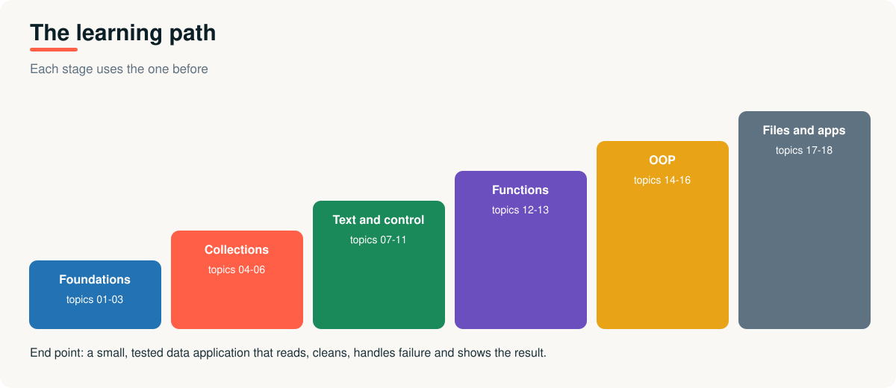

# 19 · Module Review and Interview Preparation

> **Module 03 · Topic 19 of 19** &nbsp;|&nbsp; Reading time: ~60 min &nbsp;|&nbsp; Level: Review

[Module home](README.md) &nbsp;·&nbsp; [← Previous: Streamlit](18-streamlit.md)



## What you will do

- Review the whole module on one page
- Put the main ideas together in a **small capstone**
- Keep a **cheat sheet** of the patterns you will use every week
- Practise **rapid-fire** and **scenario** interview questions
- Work through **exercises**, and check yourself against a **self-assessment list**

---

## 1. The module on one page

Asha started with four jobs SQL cannot do: fetching files, calling APIs, retrying and logging. She finished able to write a small, safe, tested program that reads data, cleans it, handles failure and shows the result.

| Topic | The problem it solved | The key idea |
|---|---|---|
| [01 Introduction](01-introduction-to-python-for-data-engineering.md) | A need for glue around SQL | Python is high-level, interpreted and dynamically typed. One environment per project |
| [02 Literals, keywords, data types](02-literals-keywords-and-data-types.md) | Naming and storing values | Identifier rules, keywords, variables, `print()` and `input()` |
| [03 Operators and conditions](03-operators-and-intro-conditions.md) | Calculating and comparing | Arithmetic, comparison, logical and identity operators. `==` versus `is` |
| [04 Lists and for loops](04-lists-and-intro-to-for-loops.md) | Handling many values | Indexing, slicing, methods, `for`, `enumerate` |
| [05 Tuples and sets](05-tuples-and-sets.md) | Fixed records and unique values | Tuples are immutable. Sets remove duplicates and support set operations |
| [06 Dictionary](06-dictionary.md) | Named fields and lookups | Key-value pairs, and mutable versus immutable types |
| [07 Strings I](07-strings-i.md) | Messy text | Slicing, methods, f-strings, `input()`, type-casting |
| [08 Conditional statements](08-conditional-statements.md) | Different action for different cases | `if`, `elif`, `else`, nesting |
| [09 While loops](09-while-loops.md) | Repeating until a condition changes | `while`, `break`, `continue`, retry loops |
| [10 Strings II](10-strings-ii.md) | Real text problems | Strings with loops, conditions, `chr` and `ord` |
| [11 For-else, while-else, comprehensions](11-for-else-while-else-and-comprehensions.md) | Search and transform in one line | `else` on loops, list and dict comprehensions |
| [12 Functions I](12-functions-i.md) | Repeated code | `def`, parameters, arguments, keyword arguments |
| [13 Functions II](13-functions-ii.md) | Reusable and functional code | `return`, lambda, `map`, `filter`, `reduce`, scope |
| [14 OOP: classes and objects](14-oop-classes-and-objects.md) | Modelling real things | Class, object, constructor, variable and method types |
| [15 OOP: inheritance and abstraction](15-oop-inheritance-and-abstraction.md) | Many similar sources | Inheritance kinds, MRO, abstract classes |
| [16 OOP: polymorphism and encapsulation](16-oop-polymorphism-and-encapsulation.md) | Same call, different behaviour | Duck typing, overriding, `property` |
| [17 File handling and exceptions](17-file-handling-and-exception-handling.md) | Real files and real failure | `with open`, CSV, JSON, `try/except`, logging |
| [18 Streamlit](18-streamlit.md) | Letting others see the data | Widgets, rerun model, caching |

---

## 2. Capstone: a tiny pipeline

This small program uses most of the module: strings, a function, a dictionary, a comprehension, `try/except`, a counter and formatted output. The input is a handful of messy lines like those in the partner feed.

```python
raw_lines = [
    "1001, Meera Iyer , west , 1,200.50 , completed",
    "1002,Rohan Shah,EAST,800,completed",
    "1003,Anika Gupta,North,,completed",
    "1004,Dev Patel,south,abc,completed",
    "1005,Isha Nair, West ,300,cancelled",
    "1006,Karan Mehta,East,650,Completed",
]


def parse_line(line):
    """Return a clean record, or raise ValueError with the reason."""
    parts = [part.strip() for part in line.split(",")]
    order_id, customer, region, status = parts[0], parts[1], parts[2], parts[-1]
    amount_text = ",".join(parts[3:-1])      # rejoin: "1,200.50" was split at its thousands comma
    if amount_text == "":
        raise ValueError("amount missing")
    try:
        amount = float(amount_text.replace(",", ""))
    except ValueError:
        raise ValueError("amount not a number")
    return {"order_id": int(order_id), "customer": customer, "region": region.capitalize(),
            "amount": amount, "status": status.lower()}


clean, rejected = [], []
for line in raw_lines:
    try:
        clean.append(parse_line(line))
    except ValueError as reason:
        rejected.append((line.split(",")[0], str(reason)))

print(f"clean: {len(clean)}   rejected: {len(rejected)}")
for order_id, reason in rejected:
    print(f"  rejected {order_id}: {reason}")

revenue = {}
for record in clean:
    if record["status"] == "completed":
        revenue[record["region"]] = revenue.get(record["region"], 0) + record["amount"]

print()
for region, total in sorted(revenue.items(), key=lambda item: item[1], reverse=True):
    print(f"{region:<6} {total:>10,.2f}")
```

```text
clean: 4   rejected: 2
  rejected 1003: amount missing
  rejected 1004: amount not a number

East     1,450.00
West     1,200.50
```

What to notice:

| Idea | Where it appears | Topic |
|---|---|---|
| Cleaning text with `strip`, `capitalize`, `lower` | `parse_line` | 07 |
| A function that does one job | `parse_line` | 12 |
| A rejected row **keeps its reason**, not silently dropped | the `rejected` list | 17 and Module 02, Topic 07 |
| `try/except` around a conversion that can fail | `float(...)` | 17 |
| A dictionary used as a counter | `revenue.get(...)` | 06 |
| A `lambda` as a sort key | `sorted(..., key=lambda ...)` | 13 |
| Formatted output | f-string with alignment | 07 |

The same pattern, **clean, reject with a reason, aggregate**, is what Module 02 did in SQL. The difference is where it runs: Python before the data reaches the database, SQL inside it.

> [!NOTE]
> `parse_line` splits the thousands separator in `"1,200.50"` by rejoining the middle fields. Real feeds should use the `csv` module, which handles quoted commas properly ([Topic 17](17-file-handling-and-exception-handling.md)).

---

## 3. Cheat sheet

### Types and mutability

| Type | Literal | Mutable | Ordered | Duplicates |
|---|---|---|---|---|
| `int`, `float`, `bool`, `None` | `3`, `2.5`, `True`, `None` | No | n/a | n/a |
| `str` | `"West"` | No | Yes | Yes |
| `list` | `[1, 2]` | **Yes** | Yes | Yes |
| `tuple` | `(1, 2)` | No | Yes | Yes |
| `set` | `{1, 2}` | **Yes** | No | No |
| `dict` | `{"a": 1}` | **Yes** | Insertion order | Keys unique |

### Patterns

| Task | Pattern |
|---|---|
| Loop with position | `for i, x in enumerate(items):` |
| Loop over a dict | `for key, value in d.items():` |
| Safe dict read | `d.get("key", default)` |
| Count by key | `counts[k] = counts.get(k, 0) + 1` |
| Remove duplicates, keep order | `list(dict.fromkeys(items))` |
| Transform a list | `[f(x) for x in items if cond(x)]` |
| Build a dict | `{k: v for k, v in pairs}` |
| Sort by a field | `sorted(rows, key=lambda r: r["amount"], reverse=True)` |
| Clean text | `text.strip().lower().replace(",", "")` |
| Parse a line | `line.split(",")` and `",".join(parts)` |
| Format output | `f"{x:,.2f}"`, `f"{name:<10}"` |
| Open a file safely | `with open(path, encoding="utf-8") as f:` |
| Handle failure | `try: ... except ValueError as e: ... finally: ...` |
| Search with a loop | `for ... else:` (else runs if no `break`) |
| Default arguments | `def f(x, retries=3):` |

### Traps

| Trap | Remember |
|---|---|
| `==` versus `is` | `==` compares values, `is` compares identity. Use `is` only for `None` |
| Mutable default argument | `def f(x, items=[])` shares one list across calls. Use `None` |
| Copying a list or dict | `b = a` shares one object. Use `.copy()` or `copy.deepcopy()` |
| Modifying a list while looping over it | Skips items. Loop over a copy or build a new list |
| `input()` returns text | Cast it, and handle `ValueError` |
| Integer division | `/` always gives a float, `//` floors |
| `int("12.5")` | Fails. Use `float()` first |
| Float arithmetic | `0.1 + 0.2 != 0.3`. Round for display, and use `decimal` for money |
| Bare `except:` | Hides bugs. Catch specific exceptions |
| Forgetting `with open` | Files stay open. Use a context manager |
| Streamlit rerun | The script reruns on every interaction. Cache heavy work |

---

## 4. Rapid-fire questions

Answer each in one or two sentences before opening the answer.

<details><summary><b>R1.</b> What type of language is Python?</summary>

High-level, interpreted and dynamically typed.
</details>

<details><summary><b>R2.</b> How does Python mark blocks of code?</summary>

By indentation after a colon, four spaces by convention.
</details>

<details><summary><b>R3.</b> Which are mutable: list, tuple, set, dict, str?</summary>

List, set and dict. Tuple and str are immutable.
</details>

<details><summary><b>R4.</b> <code>==</code> versus <code>is</code>?</summary>

`==` tests equal values. `is` tests whether two names refer to the same object.
</details>

<details><summary><b>R5.</b> What does <code>input()</code> return?</summary>

Always a string.
</details>

<details><summary><b>R6.</b> What does <code>"West"[1:3]</code> return?</summary>

`"es"`. The stop position is excluded.
</details>

<details><summary><b>R7.</b> How do you loop with index and value?</summary>

`for i, value in enumerate(items):`.
</details>

<details><summary><b>R8.</b> How do you remove duplicates from a list?</summary>

`list(set(items))` loses order. `list(dict.fromkeys(items))` keeps the first occurrences in order.
</details>

<details><summary><b>R9.</b> List versus tuple?</summary>

A list is mutable. A tuple is immutable, so it can be a dictionary key and signals a fixed record.
</details>

<details><summary><b>R10.</b> What can be a dictionary key?</summary>

Any hashable (immutable) value: strings, numbers, tuples of those. Not lists or dicts.
</details>

<details><summary><b>R11.</b> <code>d["x"]</code> versus <code>d.get("x")</code>?</summary>

The first raises `KeyError` when missing. The second returns `None`, or a default you give.
</details>

<details><summary><b>R12.</b> What does a set do that a list does not?</summary>

Keeps unique values only and supports union, intersection and difference with fast membership tests.
</details>

<details><summary><b>R13.</b> <code>break</code> versus <code>continue</code>?</summary>

`break` leaves the loop. `continue` skips to the next iteration.
</details>

<details><summary><b>R14.</b> When does a loop's <code>else</code> run?</summary>

When the loop finishes without hitting `break`.
</details>

<details><summary><b>R15.</b> What is a list comprehension?</summary>

A compact expression that builds a list: `[x * 2 for x in items if x > 0]`.
</details>

<details><summary><b>R16.</b> Parameter versus argument?</summary>

A parameter is the name in the function definition. An argument is the value passed in the call.
</details>

<details><summary><b>R17.</b> What does a function return if there is no <code>return</code>?</summary>

`None`.
</details>

<details><summary><b>R18.</b> What is a lambda?</summary>

A small anonymous function written as one expression: `lambda x: x * 2`.
</details>

<details><summary><b>R19.</b> What do <code>map</code>, <code>filter</code> and <code>reduce</code> do?</summary>

`map` applies a function to each item, `filter` keeps items for which it is true, and `reduce` (from `functools`) folds the items into one value.
</details>

<details><summary><b>R20.</b> What is LEGB?</summary>

The order Python looks up a name: Local, Enclosing, Global, Built-in.
</details>

<details><summary><b>R21.</b> Class versus object?</summary>

A class is the blueprint. An object is one instance created from it.
</details>

<details><summary><b>R22.</b> What is <code>self</code>?</summary>

The first parameter of an instance method, referring to the object the method was called on.
</details>

<details><summary><b>R23.</b> What is MRO?</summary>

Method Resolution Order: the sequence Python searches classes for an attribute, which matters in multiple inheritance. See it with `ClassName.__mro__`.
</details>

<details><summary><b>R24.</b> What is duck typing?</summary>

Using an object by what it can do, not by its class: if it has the method you call, it works.
</details>

<details><summary><b>R25.</b> Why use <code>with open(...)</code>?</summary>

The file is closed automatically, even if an error occurs.
</details>

<details><summary><b>R26.</b> What do <code>else</code> and <code>finally</code> do in <code>try</code>?</summary>

`else` runs if no exception happened. `finally` always runs, for clean-up.
</details>

---

## 5. Scenario questions

<details><summary><b>S1.</b> A script processes a daily file and crashes on row 40,000 with a <code>ValueError</code>. What do you change?</summary>

Parse each row inside `try/except`, send bad rows to a rejected list with the row number and reason, and continue. After the loop, report counts of clean and rejected rows, and fail the run only if the rejected share is above a threshold. Log the details.
</details>

<details><summary><b>S2.</b> An API call fails intermittently. How do you handle it?</summary>

Wrap it in a retry loop with a limited number of attempts, a growing wait between them, and a specific exception type. Log each failure, and raise an error after the last attempt so the scheduler sees the failure and can alert.
</details>

<details><summary><b>S3.</b> A function that adds items to a list gives wrong results after several calls. What is the likely cause?</summary>

A mutable default argument such as `def add(x, items=[])`, which shares one list across calls. Use `items=None` and create a new list inside the function.
</details>

<details><summary><b>S4.</b> You changed a copied dictionary and the original changed too. Why?</summary>

Assignment and shallow copies share nested objects. Use `copy.deepcopy()` for nested structures.
</details>

<details><summary><b>S5.</b> The team needs to read from CSV, an API and a database with the same pipeline code. How do you design it?</summary>

Define an abstract base class with a `read()` method, and one subclass per source. The pipeline calls `source.read()` without caring which kind it is (polymorphism), and a new source is a new subclass with no change to the pipeline.
</details>

<details><summary><b>S6.</b> A notebook works on your machine but not for a colleague. What do you check?</summary>

Python and package versions (record them in `requirements.txt` or an environment file), cell execution order and hidden state (Restart and Run All), file paths that are specific to your computer, and secrets stored in the notebook.
</details>

<details><summary><b>S7.</b> You must remove duplicate customer IDs but keep the first occurrence in order. Show how.</summary>

`list(dict.fromkeys(ids))`, or a loop with a `seen` set: append an ID only if it is not in `seen`, then add it. State why: sets alone lose the order.
</details>

<details><summary><b>S8.</b> Should this work be Python or SQL: count orders per region for 200 million rows?</summary>

SQL (or Spark), run where the data lives. Pulling 200 million rows into a Python loop is slow and memory-heavy. Use Python to submit the query, check the result and handle failure around it.
</details>

---

## 6. Exercises

Write each as a small `.py` file or notebook cell, and run it.

| # | Exercise | Skills |
|---|---|---|
| 1 | Read a customer name and region from `input()`, clean them, and print a greeting | Strings, `input()`, casting |
| 2 | Given a list of order amounts, print the total, the average, and those above the average | Lists, loops, conditions |
| 3 | Given order records as dicts, count orders per status | Dictionaries |
| 4 | Remove duplicate order IDs, keeping the first, and print how many were removed | Sets, lists |
| 5 | Check whether an email is valid using string methods: one `@`, a dot after it, no spaces | Strings, conditions |
| 6 | Write `clean_amount(text)` that returns a float or `None`, with tests for five inputs | Functions, `try/except` |
| 7 | Rewrite exercise 2 using list comprehensions and `sum`, `max` | Comprehensions |
| 8 | Print a right-angled triangle pattern of `*` for a height typed by the user | `while` loops, patterns |
| 9 | Build an `Order` class with `amount` as a validated property that rejects negatives | OOP, `property` |
| 10 | Create `CsvSource` and `JsonSource` classes with a common `read()` method and an abstract base class | Inheritance, abstraction |
| 11 | Write a script that reads a CSV, writes clean rows to one file and rejected rows (with a reason column) to another, and logs the counts | Files, exceptions, logging |
| 12 | Add a region filter and a revenue metric to the Streamlit app, and test it with `AppTest` | Streamlit |

---

## 7. Self-assessment

You are ready for the next module when you can do each of these without notes.

- [ ] Explain why Python is used with SQL in a data platform
- [ ] Create and use an environment, and run a notebook and a script
- [ ] Choose the right collection (list, tuple, set, dict) and say why
- [ ] Index and slice lists and strings
- [ ] Predict what a mutable object does when copied or passed to a function
- [ ] Write `if/elif/else`, `for` and `while` loops, with `break` and `continue`
- [ ] Write a list or dict comprehension
- [ ] Write a function with default and keyword arguments, and explain scope
- [ ] Define a class with a constructor, methods and a property
- [ ] Explain inheritance, polymorphism and abstraction with a data example
- [ ] Read and write a CSV and a JSON file safely
- [ ] Handle errors with `try/except/else/finally`, and log what happened
- [ ] Explain the Streamlit rerun model

## 8. What comes next

This module taught the language. A natural next module puts it to work on real data pipelines:

- **pandas and NumPy:** tables and arrays, and the DataFrame equivalent of the SQL you wrote in Module 02
- **Working with APIs:** `requests`, pagination, authentication and retries
- **Databases from Python:** `sqlite3` and SQLAlchemy, connecting back to the XYZ database
- **Testing:** `pytest`, and tests for pipeline functions
- **Generators, decorators and `datetime`:** processing large files lazily, reusable wrappers, time zones
- **Orchestration:** scheduling the pipeline with a tool such as Airflow

---

## Official documentation

- [The Python Tutorial](https://docs.python.org/3/tutorial/index.html) · [Python Standard Library](https://docs.python.org/3/library/index.html)
- [Built-in types](https://docs.python.org/3/library/stdtypes.html) · [Built-in functions](https://docs.python.org/3/library/functions.html)
- [Errors and exceptions](https://docs.python.org/3/tutorial/errors.html) · [csv](https://docs.python.org/3/library/csv.html) · [json](https://docs.python.org/3/library/json.html) · [logging](https://docs.python.org/3/library/logging.html)

---

| Previous | Contents | Next |
|:---|:---:|:---|
| [← Streamlit](18-streamlit.md) | [Module home](README.md#topics-covered) | Next module (coming) |
