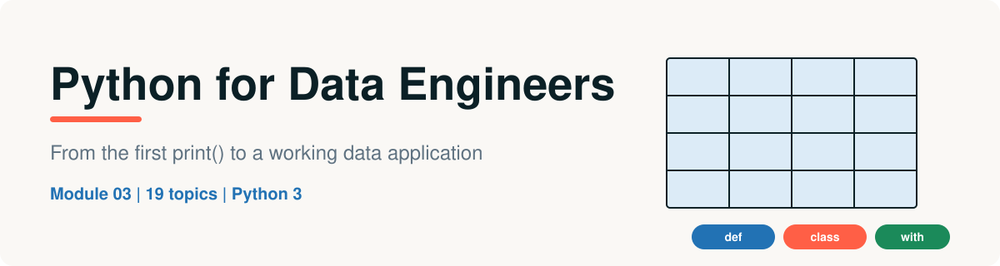
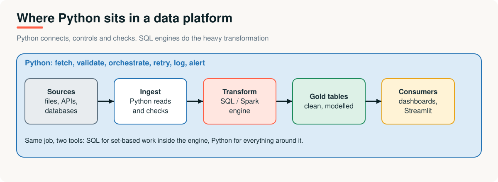
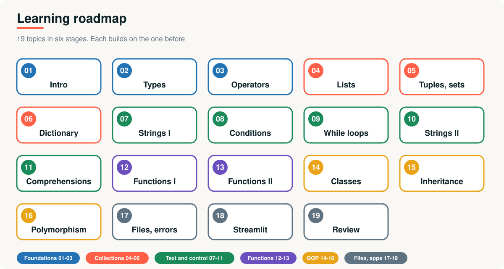

<div align="center">




</div>

# Python for Data Engineers

**Module 03 of the Data Engineering learning path.**

[Module 02](../02_SQL_for_Data_Engineers/README.md) taught the language that transforms data inside an engine. This module teaches the language that runs **around** it: fetching files, calling services, controlling the flow, retrying, logging, and showing the result. It starts from the first `print()` and ends with a tested data application.

The running story is the same. Asha at XYZ Company is asked to do four things SQL cannot: fetch a daily partner file, pull data from an API, retry a failed load, and check a file before loading it. Each topic opens with a data problem Asha faces and teaches exactly the Python needed to solve it.



---

## Introduction

Every topic follows the structure used in Modules 01 and 02:

1. **The business problem:** a realistic scenario that motivates the idea
2. **The concept:** what it is and why it works that way
3. **How it works:** rules, internal behaviour, diagrams
4. **Examples:** Python you can run, with the real output beneath it
5. **Limitations and engineering considerations**
6. **Real-world applications, key takeaways and interview questions**

## Who is this for?

| Audience | What you get |
|---|---|
| **Students and career changers** | Python from zero, with the reasoning behind each rule |
| **Analysts moving to engineering** | The language of pipelines: files, errors, logging, reusable code |
| **Interview candidates** | Questions with answers in every topic, plus rapid-fire and scenario practice in Topic 19 |
| **Trainers** | A lecture-by-lecture sequence with examples ready to run in class |

**Prerequisites:** none. Modules 01 and 02 give useful context, especially the SQL comparisons, but are not required.

## Learning objectives

After completing this module you will be able to:

- **Set up** Python with Anaconda or `venv`, and work in notebooks and scripts
- **Use** Python's data types and choose the right collection: list, tuple, set or dictionary
- **Control flow** with conditions, `for` and `while` loops, and comprehensions
- **Clean text** with string methods, formatting and type-casting
- **Write functions** with default, keyword and variable arguments, and explain scope
- **Model data** with classes, inheritance, abstraction, polymorphism and encapsulation
- **Read and write** CSV and JSON files safely, and handle errors with `try/except` and `logging`
- **Build** a small interactive data application with Streamlit

---

## Topics covered

| # | Topic | Key concepts | Time |
|---|---|---|---|
| 01 | [Introduction to Python for Data Engineering](01-introduction-to-python-for-data-engineering.md) | Why Python, Anaconda, Jupyter, syntax, data types overview | 45 min |
| 02 | [Literals, Keywords and Data Types](02-literals-keywords-and-data-types.md) | Identifiers, keywords, variables, `print()`, `input()` | 50 min |
| 03 | [Operators and Intro to Conditions](03-operators-and-intro-conditions.md) | Arithmetic, assignment, comparison, logical, identity operators | 50 min |
| 04 | [Lists and Intro to For Loops](04-lists-and-intro-to-for-loops.md) | Indexing, slicing, methods, `for`, `enumerate` | 60 min |
| 05 | [Tuples and Sets](05-tuples-and-sets.md) | Immutability, set operations, list vs tuple | 60 min |
| 06 | [Dictionary](06-dictionary.md) | Key-value pairs, methods, mutable vs immutable, copying | 60 min |
| 07 | [Strings I](07-strings-i.md) | Slicing, methods, f-strings, `.format()`, type-casting | 55 min |
| 08 | [Conditional Statements](08-conditional-statements.md) | `if`, `elif`, `else`, nesting | 45 min |
| 09 | [While Loops](09-while-loops.md) | `while`, `break`, `continue`, retry loops, patterns | 50 min |
| 10 | [Strings II](10-strings-ii.md) | Problem solving with loops, conditions, `chr` and `ord` | 50 min |
| 11 | [For-else, While-else and Comprehensions](11-for-else-while-else-and-comprehensions.md) | Loop `else`, list and dict comprehensions | 55 min |
| 12 | [Functions I](12-functions-i.md) | `def`, parameters, arguments, keyword arguments | 50 min |
| 13 | [Functions II](13-functions-ii.md) | `return`, lambda, `map`, `filter`, `reduce`, scope | 55 min |
| 14 | [OOP: Classes and Objects](14-oop-classes-and-objects.md) | Constructor, variable and method types, access modifiers | 50 min |
| 15 | [OOP: Inheritance and Abstraction](15-oop-inheritance-and-abstraction.md) | Five inheritance kinds, MRO, abstract classes | 55 min |
| 16 | [OOP: Polymorphism and Encapsulation](16-oop-polymorphism-and-encapsulation.md) | Duck typing, overloading, overriding, `property` | 55 min |
| 17 | [File Handling and Exception Handling](17-file-handling-and-exception-handling.md) | `with open`, CSV, JSON, `try/except`, logging | 70 min |
| 18 | [Streamlit](18-streamlit.md) | Components, rerun model, caching, testing | 45 min |
| 19 | [Module Review and Interview Prep](19-module-review-and-interview-prep.md) | Capstone, cheat sheet, rapid-fire and scenario questions | 60 min |

**Reference:** [Glossary](resources/glossary.md) · [Further reading](resources/further-reading.md) · [Examples guide](examples/README.md)

## Learning roadmap



### Choose your path

| Path | Time | Do this |
|---|---|---|
| **Express** | ~6 hours | Topics 01, 02, 04, 06, 12, 17 and the cheat sheet in 19, for learners who know another language |
| **Standard** | ~15-18 hours | All 19 topics in order, running the examples as you go |
| **Deep dive** | ~22+ hours | Standard path, plus the exercises in Topic 19 and the pipeline script in Topic 17 |

---

## Repository structure

```text
03_Python_for_Data_Engineers/
├── README.md                                  <- you are here
├── 01-introduction-to-python-for-data-engineering.md
├── 02-literals-keywords-and-data-types.md
│   ...
├── 18-streamlit.md
├── 19-module-review-and-interview-prep.md
├── examples/                                  runnable Python, one file per topic
├── resources/                                 glossary, further reading
└── assets/diagrams/
    ├── svg/                                   29 diagrams (used in the docs)
    ├── png/                                   same diagrams for slides
    └── src/                                   Python that draws them
```

## Running the examples

You need Python 3.8 or newer. Topic 18 also needs `pip install streamlit`.

```bash
cd examples
python 06_dictionary.py                 # every example from Topic 06, in order
python 17_robust_file_pipeline.py       # the pipeline from Topic 17
python 18_test_orders_app.py            # tests the Streamlit app headlessly
streamlit run 18_orders_app.py          # runs the app in a browser
```

Files for topics that use `input()` (02, 07, 09 and a few others) wait for you to type the answers. The documents show the output for fixed sample answers.

## Conventions used in these documents

| Element | Meaning |
|---|---|
| **Business problem** section | Every topic opens with a realistic scenario |
| Python block followed by a `text` block | The code was **executed**, and the output shown is real |
| Blocks without output | Syntax shown for reference, or an error shown on purpose |
| Collapsible **Interview questions** | Try answering before expanding |
| Diagram colours | Blue = foundations, orange = logic and engines, green = results, red = problems |

> [!NOTE]
> Blocks within one document share a namespace, like cells in a notebook, so a later block can use names defined in an earlier one. The extracted example files keep the same order.

## Using the diagrams in your own material

All diagrams are in [`assets/diagrams/png`](assets/diagrams/png) (slides) and [`assets/diagrams/svg`](assets/diagrams/svg) (sharp at any size). To edit one, change the Python in [`assets/diagrams/src`](assets/diagrams/src) and run `python build.py` (needs `pip install cairosvg`).

---

## Navigation

[Start with Topic 01: Introduction to Python for Data Engineering →](01-introduction-to-python-for-data-engineering.md)
