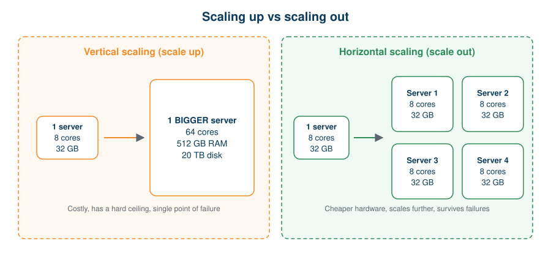

# 01 · The Big Data Problem

[🏠 Home](../README.md) · **Next →** [02 · Distributed Computing](02-distributed-computing.md)

> **In this chapter:** why one computer eventually isn't enough, and the two ways of fixing that.
> ⏱️ 10 minutes · 🎯 Level: beginner · 📋 Prerequisites: none

## Table of contents

- [A business scenario](#a-business-scenario)
- [What happens on a single computer](#what-happens-on-a-single-computer)
- [Option A: vertical scaling](#option-a-vertical-scaling)
- [Option B: horizontal scaling](#option-b-horizontal-scaling)
- [Comparison](#comparison)
- [Key takeaways](#key-takeaways)

---

## A business scenario

You are a data engineer at an e-commerce company. Every second, new data arrives from:

| Source | Example records |
| --- | --- |
| Customer registrations | New accounts, profile changes |
| Website activity | Clicks, searches, page views |
| Purchases | Orders, items, discounts |
| Payments | Transactions, refunds |
| Logistics | Shipments, delivery events |
| Mobile app | Sessions, notifications |
| Feedback | Ratings, reviews |

Assume the company produces **10 TB of data per day**. Management wants answers to five questions:

1. What are the top 10 selling products?
2. Which city generates the highest revenue?
3. What is the customer purchase trend?
4. Which products have declining sales?
5. How many orders are delivered late?

> 💡 We will answer these exact questions with PySpark in [Chapter 09](09-real-world-use-cases.md) and [`notebooks/03_retail_sales_analysis.py`](../notebooks/03_retail_sales_analysis.py).

## What happens on a single computer

Suppose one server stores the data, runs the calculations and generates the reports:

| Resource | Capacity |
| --- | --- |
| Processor | 8 cores |
| RAM | 32 GB |
| Storage | 1 TB |
| **Incoming data** | **10 TB per day** |

The workload does not fit. You will see:

- storage running out,
- memory becoming the bottleneck,
- the CPU saturated and jobs taking hours,
- applications crashing from resource limits.

## Option A: vertical scaling

**Vertical scaling (scale up)** means upgrading the one machine.

| Resource | Before | After |
| --- | --- | --- |
| Processor | 8 cores | 64 cores |
| RAM | 32 GB | 512 GB |
| Storage | 1 TB | 20 TB |

It works for a while, then fails because:

1. high-end hardware becomes very expensive,
2. every machine has a physical ceiling,
3. upgrades often require downtime,
4. it is still **one machine**, a *single point of failure*.

## Option B: horizontal scaling

**Horizontal scaling (scale out)** means adding more ordinary machines and sharing the work.

> 🍳 **Analogy:** one superhuman chef cooking for 10,000 people (vertical) versus 100 ordinary chefs each cooking a share (horizontal). The second is cheaper, scales further, and survives one chef being absent.

## Comparison

| | Vertical scaling | Horizontal scaling |
| --- | --- | --- |
| Approach | Bigger machine | More machines |
| Cost curve | Rises steeply | Roughly linear |
| Upper limit | Hard physical limit | Add machines as needed |
| Failure impact | Everything stops | Others keep working |
| Complexity | Simple | Needs coordination software |
| Typical fit | Small to medium workloads | Big Data workloads |

The price of horizontal scaling is **coordination**: splitting work, tracking data and handling failures. That is the subject of the next chapter.

## Key takeaways

- One machine hits storage, memory and CPU limits as data grows.
- Vertical scaling is simple but expensive and limited.
- Horizontal scaling spreads the load across many machines and is the foundation of distributed computing.

---

[🏠 Home](../README.md) · **Next →** [02 · Distributed Computing](02-distributed-computing.md)
