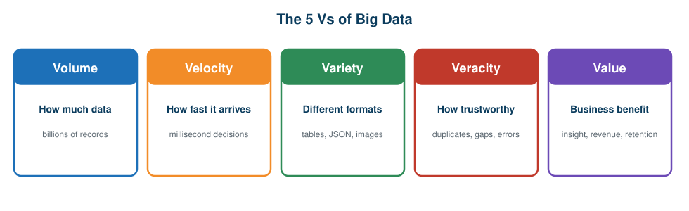

# 01 · Introduction to Big Data and Data Engineering

[🏠 Home](../README.md) · **Next →** [02 · Traditional vs Modern Approach](02-traditional-vs-modern-approach.md)

> **In this chapter:** why organisations generate so much data, what “Big Data” really means, and the five characteristics (the 5 Vs) that shape every design decision.
> ⏱️ 15 minutes · 🎯 Level: beginner · 💻 No code in this chapter

## Learning objectives

By the end of this chapter you can:

1. explain why modern organisations generate data at massive scale,
2. define Big Data in your own words,
3. describe the five Vs: Volume, Velocity, Variety, Veracity and Value,
4. explain what a data engineer is responsible for.

## Table of contents

- [The growth of data](#the-growth-of-data)
- [A business scenario](#a-business-scenario)
- [What is Big Data](#what-is-big-data)
- [The five Vs](#the-five-vs)
- [What a data engineer does](#what-a-data-engineer-does)
- [Key takeaways](#key-takeaways)

---

## The growth of data

Imagine you are a data engineer at a large e-commerce company. Every day, millions of customers use its apps and websites, and **every action creates data**:

- a customer registers an account,
- searches for a product,
- clicks on a product,
- adds an item to the cart,
- completes a payment,
- a delivery partner updates an order status,
- a customer submits a review.

Each event can be captured, stored and analysed later.

## A business scenario

Consider this (illustrative) company:

| Data source | Example data | Daily volume |
| --- | --- | --- |
| Website | Page views, clicks | 2 TB |
| Mobile application | User activities | 1 TB |
| Transactions | Orders and payments | 3 TB |
| Logistics | Delivery updates | 2 TB |
| Customer reviews | Text and ratings | 1 TB |
| **Total** | | **9 TB per day** |

At 9 TB a day, the data grows to hundreds of terabytes within weeks and to **petabytes** within a few years.

The business then asks questions such as:

1. What is the total revenue every day?
2. Which products sell the most?
3. Which cities place the most orders?
4. What is the customer purchasing pattern?
5. Which deliveries are delayed?
6. Which customers are likely to stop buying?

To answer them, the company must **store, process, transform and analyse** enormous amounts of data. That need is why Big Data technologies and the discipline of data engineering exist.

## What is Big Data

> **Definition:** Big Data refers to datasets whose size, complexity, speed of generation or diversity makes traditional data management and processing approaches insufficient or impractical without specialised technologies and architectures.

In simple terms: **Big Data is not just a lot of data.** It is the set of challenges you face when storing, processing, managing and analysing data that is too large, too fast or too varied for ordinary tools.

## The five Vs

### 1. Volume: the amount of data

Volume is the quantity of data an organisation generates and stores. A bank stores billions of transactions; an e-commerce company millions of orders; a social platform enormous numbers of images and videos.

| Unit | Approximate size |
| --- | --- |
| KB (kilobyte) | 1,024 bytes |
| MB (megabyte) | 1,024 KB |
| GB (gigabyte) | 1,024 MB |
| TB (terabyte) | 1,024 GB |
| PB (petabyte) | 1,024 TB |
| EB (exabyte) | 1,024 PB |

### 2. Velocity: the speed of data

Velocity is how quickly data is generated, transmitted and processed. Examples: stock-market trades, online payment notifications, GPS tracking updates and IoT sensor readings. A modern payment platform may need to evaluate a transaction within **milliseconds**.

### 3. Variety: different types of data

| Data type | Examples |
| --- | --- |
| **Structured** | SQL tables, Excel files |
| **Semi-structured** | JSON, XML |
| **Unstructured** | Images, videos, audio, documents |

### 4. Veracity: quality and trust

Veracity is the accuracy, consistency, completeness and trustworthiness of data. A customer database may contain missing email addresses, duplicate customers, incorrect phone numbers and inconsistent city names (“Mumbai”, “mumbai”, “MUMBAI”). A data engineer must find and fix such problems **before** reports are generated.

### 5. Value: the business benefit

Value is what the organisation gains from data. An e-commerce company that analyses purchase history can recommend products, improve retention, identify profitable products, optimise inventory and increase revenue. Data that produces no decisions has no value.

## What a data engineer does

A data engineer builds and maintains the systems that make data usable:

| Responsibility | Meaning |
| --- | --- |
| **Ingest** | Bring data in from many sources |
| **Store** | Keep it reliably and economically |
| **Process** | Clean, transform and combine it at scale |
| **Serve** | Deliver trusted datasets to analysts, dashboards and machine-learning teams |
| **Operate** | Schedule, monitor and fix pipelines |

The rest of this course follows the technologies data engineers have used to do this as data outgrew a single computer.

## Key takeaways

- Every user action generates data; at scale this becomes terabytes per day.
- Big Data is defined by the **challenges** of volume, velocity, variety, veracity and value, not by size alone.
- Data engineers turn raw, messy, fast-moving data into reliable, business-ready datasets.

---

[🏠 Home](../README.md) · **Next →** [02 · Traditional vs Modern Approach](02-traditional-vs-modern-approach.md)
