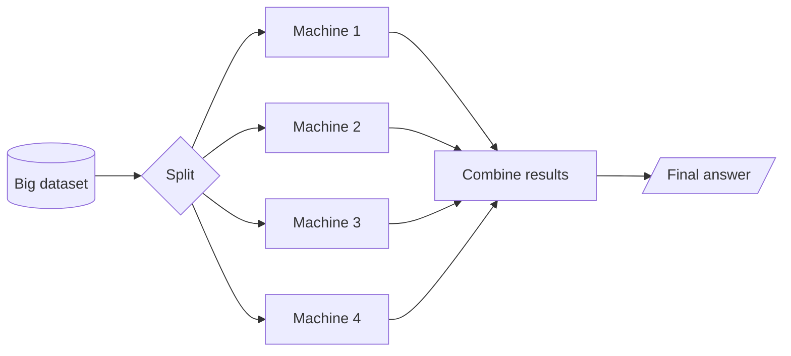

# 02 · Distributed Computing

**← Previous** [01 · The Big Data Problem](01-big-data-problem.md) · [🏠 Home](../README.md) · **Next →** [03 · Apache Hadoop](03-hadoop.md)

> **In this chapter:** how many machines cooperate on one job, and the new problems that creates.
> ⏱️ 10 minutes · 🎯 Level: beginner

## Table of contents

- [Splitting the work](#splitting-the-work)
- [Two capabilities](#two-capabilities)
- [The new problems](#the-new-problems)
- [Key takeaways](#key-takeaways)

---

## Splitting the work

Take the 10 TB of sales data. Instead of one machine reading everything, we divide it among four machines. Each processes its own slice **at the same time**, then the partial results are combined.

| Machine | Responsibility | Orders processed | Revenue |
| --- | --- | --- | --- |
| Machine 1 | Part 1 | 1 million | ₹10 crore |
| Machine 2 | Part 2 | 1 million | ₹15 crore |
| Machine 3 | Part 3 | 1 million | ₹12 crore |
| Machine 4 | Part 4 | 1 million | ₹13 crore |
| **Combined** | | **4 million** | **₹50 crore** |

## Two capabilities

| Capability | Meaning | Benefit |
| --- | --- | --- |
| **Parallel processing** | Many machines compute different parts simultaneously | Faster results |
| **Distributed storage** | Data is spread across many disks | Capacity beyond one machine, plus resilience |

## The new problems

Distribution is powerful but it raises questions that a single computer never had to answer:

| Question | Who answers it? |
| --- | --- |
| Which machine stores which data? | A storage system → **HDFS** |
| How do machines communicate? | A cluster framework |
| Who decides which machine does what? | A scheduler → **MapReduce / Spark driver** |
| What if a machine fails? | Replication and task retries |
| How do we combine the results? | A shuffle / reduce step |

These are exactly the problems **Apache Hadoop** set out to solve.

## Key takeaways

- Distributed computing = parallel processing + distributed storage.
- It needs software to handle placement, scheduling, failures and merging.
- Hadoop was the first widely adopted solution.

---

**← Previous** [01 · The Big Data Problem](01-big-data-problem.md) · [🏠 Home](../README.md) · **Next →** [03 · Apache Hadoop](03-hadoop.md)
