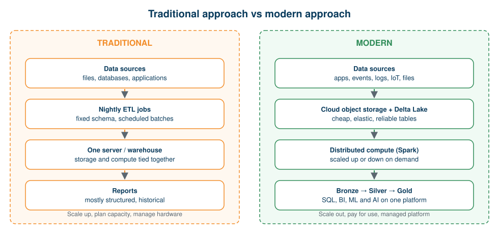
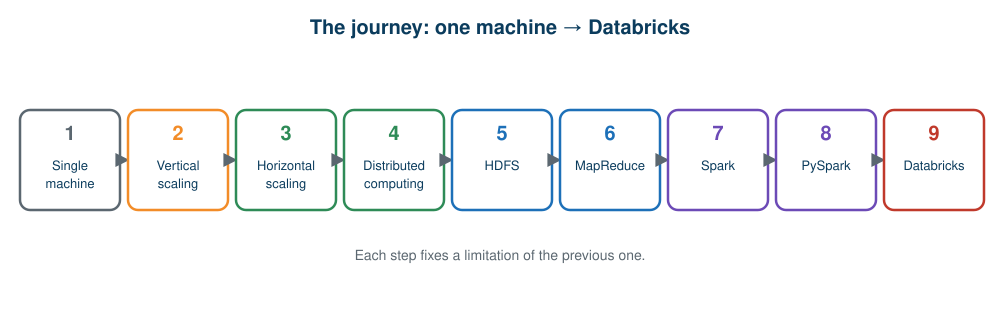

# 02 · Traditional vs Modern Approach

**← Previous** [01 · Introduction to Big Data](01-introduction-to-big-data.md) · [🏠 Home](../README.md) · **Next →** [03 · Scaling and Distributed Computing](03-scaling-and-distributed-computing.md)

> **In this chapter:** how data architecture evolved, and a side-by-side comparison of the traditional and modern approaches. Every later chapter zooms into one part of this picture.
> ⏱️ 15 minutes · 🎯 Level: beginner · 💻 No code in this chapter

## Learning objectives

By the end of this chapter you can:

1. describe the traditional approach to storing and processing data and why it struggles at scale,
2. describe the modern approach and what changed,
3. place Hadoop, Spark, PySpark, Databricks and the lakehouse on one timeline.

## Table of contents

- [The big picture](#the-big-picture)
- [The traditional approach](#the-traditional-approach)
- [The modern approach](#the-modern-approach)
- [Side-by-side comparison](#side-by-side-comparison)
- [How the architecture evolved](#how-the-architecture-evolved)
- [Is traditional always wrong](#is-traditional-always-wrong)
- [Key takeaways](#key-takeaways)

---

## The big picture

## The traditional approach

In the traditional approach, one machine (or one tightly managed server environment) stores the data, runs the calculations and answers the users.

**How it works**

1. Applications write data into a central database.
2. Scheduled jobs (usually nightly) extract the data, transform it and load it into a warehouse.
3. Analysts run reports against the warehouse.

**Why it was a good fit:** data was modest in size, mostly structured, updated in batches and used for historical reporting.

**Where it breaks as data grows**

- Processing capacity is limited by that machine’s CPU, RAM and disk.
- Storage and compute are bundled, so adding one means buying both.
- Queries and jobs slow down as data and users grow.
- One failure can stop everything (a single point of failure).
- Semi-structured and unstructured data (JSON, logs, images) fit poorly.
- Results arrive hours or a day late; there is little room for real-time use.

## The modern approach

The modern approach spreads data and work across **many machines**, keeps data in **inexpensive, elastic cloud storage**, and manages the whole workflow on a **unified platform**.

**Key ideas**

| Idea | What it means |
| --- | --- |
| **Distributed computing** | Many machines share the work in parallel |
| **Decoupled storage and compute** | Data sits in cloud object storage; compute is started, resized and stopped independently |
| **Open table formats (Delta Lake)** | Plain files gain reliability: transactions, schema control, time travel |
| **Unified engine (Spark)** | Batch, SQL, streaming and machine learning in one engine |
| **Layered pipelines (Medallion)** | Raw → cleaned → business-ready data in Bronze, Silver and Gold layers |
| **Managed platform (Databricks)** | Notebooks, compute, governance, scheduling and monitoring in one place |

## Side-by-side comparison

> The table describes general tendencies. Real organisations often run a mix of both.

| Dimension | Traditional approach | Modern approach |
| --- | --- | --- |
| **Compute** | One server or a fixed on-premises cluster | Elastic clusters or serverless compute that scale up and down |
| **Storage** | Local disks, SAN, warehouse storage, or on-premises HDFS | Cloud object storage (Amazon S3, Azure Data Lake Storage, Google Cloud Storage) |
| **Storage and compute** | Tightly coupled | Decoupled: scale each independently |
| **Scaling** | Mostly vertical (bigger machine) | Mostly horizontal (more machines) |
| **Processing engine** | Database engine, or MapReduce (disk-heavy batch) | Spark (in-memory caching, optimised execution plans) |
| **Workloads** | Scheduled batch reports | Batch, streaming, SQL analytics, machine learning and AI |
| **Data types** | Mainly structured tables | Structured, semi-structured and unstructured |
| **Data organisation** | Fixed schema before loading | Medallion layers with schema enforcement and controlled schema evolution |
| **Reliability** | Backups; single points of failure | Replication, task retries, transactional tables |
| **Languages** | SQL; Java for MapReduce | SQL, Python (PySpark), Scala, R |
| **Governance** | Ad-hoc permissions per system | Central governance (for example Unity Catalog) |
| **Operations** | Buy hardware, plan capacity, patch and tune | Managed platform, autoscaling |
| **Cost model** | Large upfront hardware spend | Pay for what you use |
| **Freshness** | Often next-day | Minutes to near-real-time where needed |

## How the architecture evolved

| Era | Approach | Strength | Limitation that led to the next era |
| --- | --- | --- | --- |
| 1 | **Single server + relational database** | Simple, familiar | Hits CPU, memory and disk limits |
| 2 | **Bigger server (vertical scaling)** | Easy upgrade path | Expensive, hard ceiling, single point of failure |
| 3 | **Cluster of machines (horizontal scaling, distributed computing)** | Capacity grows by adding machines | Needs software to place data and coordinate work |
| 4 | **Hadoop: HDFS + MapReduce** | Distributed storage and batch processing on commodity hardware | Disk-heavy, awkward for multi-step and interactive work; cluster to administer |
| 5 | **Apache Spark** | Faster, flexible engine with DataFrame and SQL APIs | Still need a place to run it, store data and govern it |
| 6 | **PySpark** | Python developers can drive Spark | Needs infrastructure, scheduling, governance |
| 7 | **Databricks + Delta Lake + Lakehouse + Medallion** | Managed platform, reliable tables on cheap storage, one architecture for analytics and AI | Today’s mainstream approach |

This is a **learning sequence, not a strict timeline**: Hadoop and Spark coexist in many companies, and Spark can use Hadoop storage and infrastructure.

## Is traditional always wrong

No. A single database server remains the right choice when data fits comfortably on one machine, workloads are simple, and the team is small. The modern approach adds coordination complexity, so it pays off when **scale, variety, speed or reliability** demand it. Good engineers choose by the problem, not by fashion.

## Key takeaways

- The traditional approach centralises storage and compute on one machine; it is simple but limited.
- The modern approach distributes data and processing, separates storage from compute, and uses managed platforms and layered pipelines.
- Hadoop → Spark → PySpark → Databricks/Lakehouse is a chain in which each step fixes the limits of the previous one.

---

**← Previous** [01 · Introduction to Big Data](01-introduction-to-big-data.md) · [🏠 Home](../README.md) · **Next →** [03 · Scaling and Distributed Computing](03-scaling-and-distributed-computing.md)
