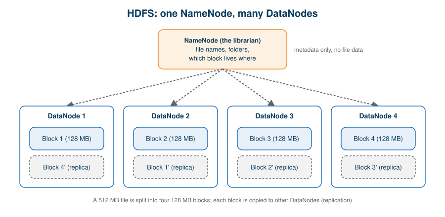
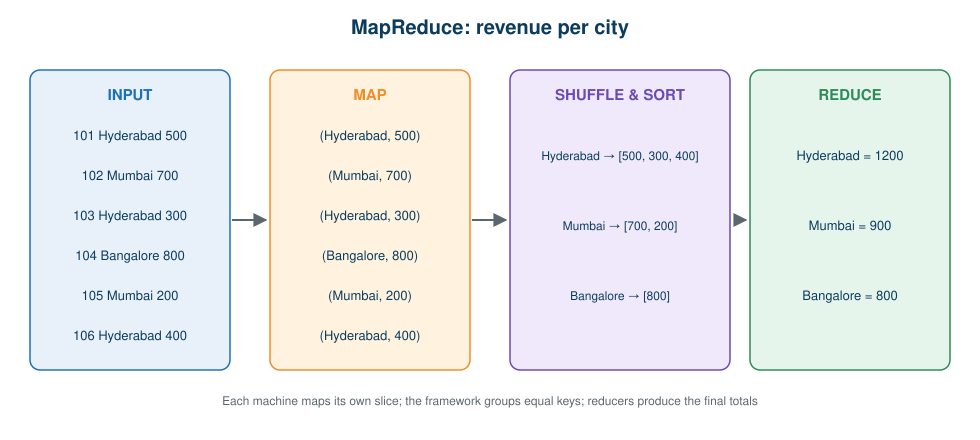
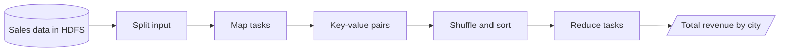

# 03 · Apache Hadoop: HDFS and MapReduce

**← Previous** [02 · Distributed Computing](02-distributed-computing.md) · [🏠 Home](../README.md) · **Next →** [04 · Apache Spark](04-apache-spark.md)

> **In this chapter:** how Hadoop stores data (HDFS) and processes it (MapReduce), and why that wasn't the end of the story.
> ⏱️ 20 minutes · 🎯 Level: beginner · 🧪 Code: [`mapreduce_simulation.py`](../examples/local/mapreduce_simulation.py)

## Table of contents

- [What Hadoop gives you](#what-hadoop-gives-you)
- [HDFS: distributed storage](#hdfs-distributed-storage)
- [MapReduce: distributed processing](#mapreduce-distributed-processing)
- [Try it yourself](#try-it-yourself)
- [Limitations of MapReduce](#limitations-of-mapreduce)
- [Key takeaways](#key-takeaways)

---

## What Hadoop gives you

Hadoop lets many inexpensive machines behave like one large system. It introduced two pillars:

| Component | Responsibility | Memory aid |
| --- | --- | --- |
| **HDFS** (Hadoop Distributed File System) | Stores data across machines | *HDFS distributes the data* |
| **MapReduce** | Processes data across machines | *MapReduce distributes the computation* |

They work together but have different jobs.

## HDFS: distributed storage

HDFS cuts a large file into **blocks** and spreads the blocks across machines.



| Role | Analogy | Responsibilities |
| --- | --- | --- |
| **NameNode** | The librarian | Keeps metadata: file names, folder structure, which blocks exist, which DataNodes hold them. Stores no file data. |
| **DataNode** | The shelves | Stores the actual blocks, serves read/write requests, takes part in replication. |

**Example:** a 512 MB file with 128 MB blocks becomes four blocks.

| Block | Size | Stored on |
| --- | --- | --- |
| Block 1 | 128 MB | DataNode 1 |
| Block 2 | 128 MB | DataNode 2 |
| Block 3 | 128 MB | DataNode 3 |
| Block 4 | 128 MB | DataNode 4 |

**Replication:** with a replication factor of 3, every block exists on three different DataNodes. If DataNode 2 fails, the system reads another replica, so no data is lost.

> ⚙️ Block size and replication factor are configurable. 128 MB and 3 are common teaching values, not universal rules.

## MapReduce: distributed processing

MapReduce processes huge datasets in parallel in three stages: **Map → Shuffle & Sort → Reduce**.

**Goal:** total revenue per city from these orders.

| Order ID | City | Revenue |
| --- | --- | --- |
| 101 | Hyderabad | 500 |
| 102 | Mumbai | 700 |
| 103 | Hyderabad | 300 |
| 104 | Bangalore | 800 |
| 105 | Mumbai | 200 |
| 106 | Hyderabad | 400 |



| Stage | What happens | Output for our data |
| --- | --- | --- |
| **Map** | Each record becomes a key-value pair | `(Hyderabad, 500)`, `(Mumbai, 700)`, … |
| **Shuffle & Sort** | The framework groups values by key | `Hyderabad → [500, 300, 400]` |
| **Reduce** | Each group is combined into one result | `Hyderabad = 1200` |



> 🔑 **Key idea:** no single machine calculates the whole answer. Each handles a slice, and the results are merged.

## Try it yourself

[`examples/local/mapreduce_simulation.py`](../examples/local/mapreduce_simulation.py) simulates the three stages in plain Python:

```bash
python examples/local/mapreduce_simulation.py
```

**Output:**

```text
MAP output:
   ('Hyderabad', 500)
   ('Mumbai', 700)
   ('Hyderabad', 300)
   ('Bangalore', 800)
   ('Mumbai', 200)
   ('Hyderabad', 400)

SHUFFLE & SORT output:
   Bangalore  -> [800]
   Hyderabad  -> [500, 300, 400]
   Mumbai     -> [700, 200]

REDUCE output:
   Bangalore  = 800
   Hyderabad  = 1200
   Mumbai     = 900
```

**How it works:** `map_stage` emits one `(city, revenue)` pair per row; `shuffle_and_sort` groups values with a `defaultdict`; `reduce_stage` sums each group. In a real cluster each stage runs on many machines, but the logic is identical.

## Limitations of MapReduce

MapReduce solved the storage and scale problem, but:

- intermediate results are typically **written to disk** between stages,
- multi-step pipelines mean repeated disk reads and writes,
- iterative algorithms (e.g. machine learning) are inefficient,
- interactive and near-real-time analysis is awkward,
- complex logic requires a lot of code.

```text
Read → Remove duplicates → Filter → Join → Aggregate → Report
   ↑ intermediate disk I/O between almost every step ↑
```

This created the opportunity for a new engine: **Apache Spark**.

## Key takeaways

- HDFS stores (NameNode = catalogue, DataNodes = blocks); MapReduce processes.
- Replication gives fault tolerance.
- MapReduce is simple and robust but disk-heavy and cumbersome for multi-step work.

---

**← Previous** [02 · Distributed Computing](02-distributed-computing.md) · [🏠 Home](../README.md) · **Next →** [04 · Apache Spark](04-apache-spark.md)
