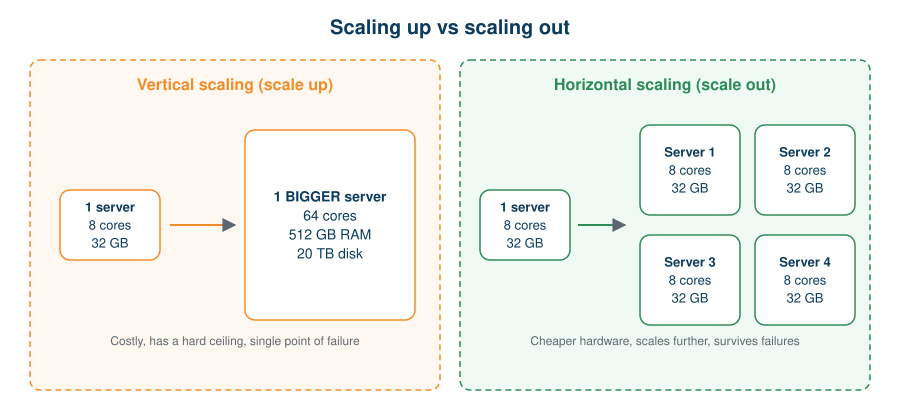
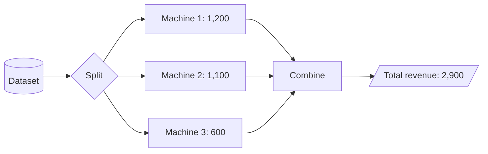

# 03 · Scaling and Distributed Computing

**← Previous** [02 · Traditional vs Modern Approach](02-traditional-vs-modern-approach.md) · [🏠 Home](../README.md) · **Next →** [04 · Apache Hadoop](04-apache-hadoop.md)

> **In this chapter:** what happens on a single computer, the two ways to scale, and how many computers cooperate on one job.
> ⏱️ 25 minutes · 🎯 Level: beginner · 💻 No code in this chapter

## Learning objectives

By the end of this chapter you can:

1. explain the limits of traditional (centralised) computing,
2. differentiate vertical and horizontal scaling,
3. define distributed computing, nodes, clusters and fault tolerance,
4. differentiate parallel processing from distributed processing.

## Table of contents

- [Traditional computing](#traditional-computing)
- [Vertical scaling](#vertical-scaling)
- [Horizontal scaling](#horizontal-scaling)
- [Vertical vs horizontal scaling](#vertical-vs-horizontal-scaling)
- [Distributed computing](#distributed-computing)
- [Parallel vs distributed processing](#parallel-vs-distributed-processing)
- [Limitations of distributed computing](#limitations-of-distributed-computing)
- [Key takeaways](#key-takeaways)

---

## Traditional computing

> **Definition:** traditional (centralised) computing is an architecture in which data storage, processing and application execution are handled primarily by one computer or server. The machine’s CPU, RAM and storage set its capacity.

**Working mechanism**

1. Users submit requests to the application.
2. The application reads data from the database.
3. The server performs the calculations.
4. The result is returned to the user.

All of this depends on the resources of the **same machine**.

**Practical example.** A retail company runs on this server:

| Resource | Available capacity |
| --- | --- |
| CPU | 8 cores |
| RAM | 32 GB |
| Storage | 1 TB |
| Daily data | 100 GB |

At first it performs well. As the business grows, data and users increase, and the server slows down.

**Limitations**

- limited processing capacity,
- limited storage,
- memory constraints,
- ever-longer processing times,
- trouble with growing workloads,
- a potential single point of failure.

## Vertical scaling

> **Definition:** vertical scaling (scale up) increases the resources of an existing machine by upgrading its CPU, RAM, storage or other hardware.

**Scenario.** The e-commerce company processes 5 million records a day and the server is struggling, so it buys a stronger one.

| Resource | Before upgrade | After upgrade |
| --- | --- | --- |
| CPU | 8 cores | 64 cores |
| RAM | 32 GB | 512 GB |
| Storage | 1 TB | 20 TB |

**Steps:** identify the bottleneck → upgrade the hardware → run the workload on the stronger machine → monitor performance.

| Advantages | Limitations |
| --- | --- |
| Easy to understand and implement | High-end hardware is expensive |
| Centralised management | Physical hardware limits exist |
| No coordination between machines | Upgrades may need downtime |
| Good for workloads that fit one big machine | Still a single point of failure |

## Horizontal scaling

> **Definition:** horizontal scaling (scale out) increases capacity by adding more machines (nodes) to the system.

**Scenario.** The company must process 10 TB a day. Instead of one huge server it builds a cluster of four:

| Machine | CPU cores | RAM |
| --- | --- | --- |
| Machine 1 | 8 | 32 GB |
| Machine 2 | 8 | 32 GB |
| Machine 3 | 8 | 32 GB |
| Machine 4 | 8 | 32 GB |
| **Total** | **32** | **128 GB** |

**Steps:** connect machines over a network → divide the workload into smaller tasks → give each machine a share → process at the same time → combine the results.

| Advantages | Limitations |
| --- | --- |
| Capacity grows by adding machines | Machines must be coordinated |
| Work is spread out | Network communication adds overhead |
| Supports very large-scale processing | Data distribution and synchronisation matter |
| Can improve fault tolerance when designed well | More to manage |

> 🍳 **Analogy:** one superhuman chef cooking for 10,000 people (vertical) versus 100 ordinary chefs each cooking a share (horizontal).

## Vertical vs horizontal scaling

| Parameter | Vertical scaling | Horizontal scaling |
| --- | --- | --- |
| Approach | Upgrade the existing machine | Add more machines |
| Resources | Increase CPU, RAM, storage | Combine resources across nodes |
| Architecture | Centralised | Distributed |
| Scalability | Limited by one machine’s capacity | Grows by adding nodes |
| Complexity | Generally lower | Generally higher |
| Example | 8-core server → 64-core server | 1 server → 10 servers |

## Distributed computing

> **Definition:** distributed computing is a model in which multiple independent computers communicate and coordinate to perform a common task, sharing processing and, where applicable, storage.

Horizontal scaling explains **how we add capacity**. Distributed computing explains **how those machines cooperate**.

**Practical example: total revenue.** A company wants the total revenue from its sales records. Six sample records:

| Order ID | City | Revenue |
| --- | --- | --- |
| 101 | Hyderabad | 500 |
| 102 | Mumbai | 700 |
| 103 | Hyderabad | 300 |
| 104 | Bangalore | 800 |
| 105 | Mumbai | 200 |
| 106 | Hyderabad | 400 |

They are shared across three machines:

| Machine | Assigned records | Local revenue |
| --- | --- | --- |
| Machine 1 | 101, 102 | 1,200 |
| Machine 2 | 103, 104 | 1,100 |
| Machine 3 | 105, 106 | 600 |

The company total is the sum of the local results: **1,200 + 1,100 + 600 = 2,900**.

**Working mechanism**

1. Input data is divided into smaller portions.
2. Each machine receives its portion.
3. Machines process independently where possible.
4. Intermediate results are exchanged when required.
5. The final result is combined.

**Important concepts**

| Term | Meaning |
| --- | --- |
| **Node** | An individual machine in a distributed system |
| **Cluster** | A group of connected machines working together |
| **Distributed storage** | Different portions or replicas of data stored across machines |
| **Parallel processing** | Performing multiple operations at the same time |
| **Fault tolerance** | The ability to keep working or recover when components fail |

## Parallel vs distributed processing

The two ideas are related but not identical.

| Parallel processing | Distributed processing |
| --- | --- |
| Multiple operations execute at the same time | Multiple computers cooperate over a network |
| Can happen on a single multi-core machine | Involves independent computing nodes |
| Focuses on simultaneous execution | Focuses on coordination across systems |
| Example: several CPU cores processing tasks | Example: several Spark worker nodes processing partitions |

## Limitations of distributed computing

- network communication overhead,
- machine failures,
- data consistency challenges,
- task coordination,
- data movement and synchronisation.

These are the problems that **Hadoop** and **Spark** were built to hide from developers.

## Key takeaways

- A single machine has hard limits on CPU, memory and storage.
- Vertical scaling grows one machine; horizontal scaling adds machines.
- Distributed computing makes the machines act as one system, at the price of coordination.
- Hadoop and Spark exist to make distributed computing manageable.

---

**← Previous** [02 · Traditional vs Modern Approach](02-traditional-vs-modern-approach.md) · [🏠 Home](../README.md) · **Next →** [04 · Apache Hadoop](04-apache-hadoop.md)
