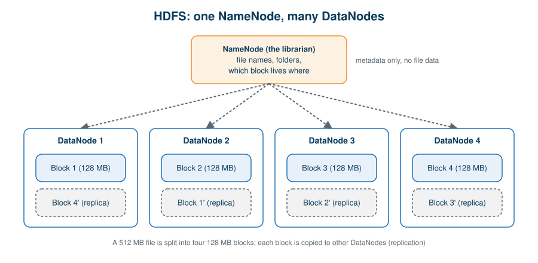
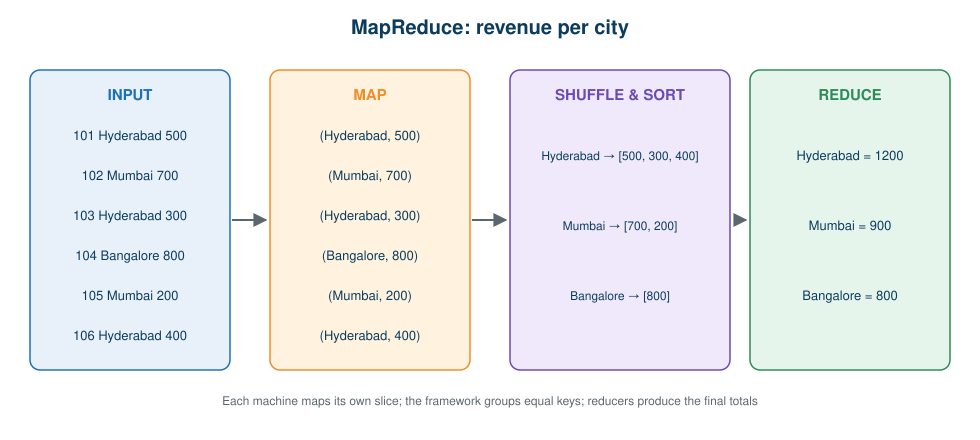
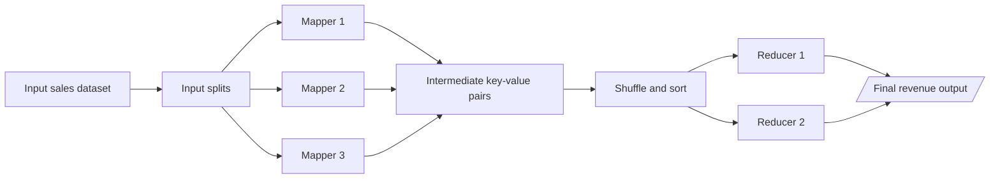

# 04 · Apache Hadoop

**← Previous** [03 · Scaling and Distributed Computing](03-scaling-and-distributed-computing.md) · [🏠 Home](../README.md) · **Next →** [05 · Apache Spark](05-apache-spark.md)

> **In this chapter:** the framework that made distributed storage and processing practical: HDFS, MapReduce and the Hadoop ecosystem.
> ⏱️ 30 minutes · 🎯 Level: beginner · 💻 No code in this chapter (a runnable MapReduce simulation is in [Hands-On](11-hands-on-guide.md#mapreduce-in-plain-python))

## Learning objectives

By the end of this chapter you can:

1. explain what Hadoop is and which problems it solves,
2. describe HDFS: blocks, NameNode, DataNode, replication,
3. walk through Map → Shuffle & Sort → Reduce with an example,
4. list the main Hadoop ecosystem tools and Hadoop’s limitations.

## Table of contents

- [What is Hadoop](#what-is-hadoop)
- [HDFS](#hdfs)
- [MapReduce](#mapreduce)
- [Hadoop ecosystem](#hadoop-ecosystem)
- [Limitations](#limitations)
- [Key takeaways](#key-takeaways)

---

## What is Hadoop

> **Definition:** Apache Hadoop is an open-source framework for distributed storage and processing of large datasets across clusters of computers, using scalable and fault-tolerant mechanisms.

Distributing work across machines is powerful, but managing many machines by hand is complex. An organisation needs a framework that can:

- distribute data across machines,
- manage storage resources,
- distribute processing tasks,
- handle machine failures,
- coordinate distributed execution.

Hadoop was designed to do exactly that, on clusters of relatively inexpensive machines.

**Core components**

| Component | Responsibility |
| --- | --- |
| **HDFS** | Distributed data storage |
| **MapReduce** | Distributed batch processing |
| **YARN** | Cluster resource management and scheduling |
| **Hadoop Common** | Shared libraries and utilities |

**How Hadoop works:** large files are stored in HDFS → HDFS spreads file blocks across DataNodes → a processing job is submitted → tasks run against the distributed data → intermediate results are combined → final results are written to storage.

> 🔑 **Remember:** *HDFS distributes the data; MapReduce distributes the computation.*

## HDFS

> **Definition:** HDFS (Hadoop Distributed File System) is a distributed file system designed to store very large files across multiple machines. It divides files into **blocks** and spreads them over different DataNodes.

**Why we need it.** If a 500 GB file lived on one machine, that machine would need the capacity and would handle every read and write. HDFS spreads the file over many machines instead.



### Components

| Component | Analogy | Responsibilities |
| --- | --- | --- |
| **NameNode** | The librarian | Holds metadata only: file-system namespace, directory and file information, block locations, the file-to-block mapping, and DataNode information. It does **not** normally store file contents. |
| **DataNode** | The shelves | Stores the actual blocks, serves read and write requests, creates and deletes blocks as instructed, and reports its status to the NameNode. |
| **Secondary NameNode** | The note-taker | Periodically creates **checkpoints** by merging file-system metadata. It is **not** a standby NameNode and not an automatic failover server. |

### How HDFS stores a file

Suppose a 512 MB file is uploaded. For teaching, assume a block size of 128 MB, so it becomes four blocks.

| Block | Size | Example storage location |
| --- | --- | --- |
| Block 1 | 128 MB | DataNode 1 |
| Block 2 | 128 MB | DataNode 2 |
| Block 3 | 128 MB | DataNode 3 |
| Block 4 | 128 MB | DataNode 4 |

### Block replication

HDFS can keep several copies of every block on different DataNodes. With a **replication factor of 3**, each block exists in three copies.

**What if a DataNode fails?** If DataNode 2 becomes unavailable and another DataNode holds a valid replica of the needed block, HDFS reads the replica instead. The NameNode watches DataNode health through **heartbeats** and arranges new replicas when copies are missing.

> ⚙️ Block size and replication factor are configurable. 128 MB and 3 are teaching values, not universal rules.

| Advantages | Limitations |
| --- | --- |
| Distributed storage | Not designed for low-latency access to individual records |
| Fault tolerance through replication | Many small files create metadata overhead |
| High-throughput access to large datasets | Requires cluster administration |
| Scales horizontally | Not the default storage in many modern cloud-native platforms |

## MapReduce

> **Definition:** MapReduce is a programming model and processing framework that processes large datasets across a cluster through parallel **Map** and **Reduce** operations.

HDFS spreads the data, but that doesn’t say how to process it. MapReduce provides the model: read the distributed data, divide the work, run it in parallel, group intermediate results and produce the final output.

### Worked example: revenue per city

**Requirement:** total sales revenue for each city.

| Order ID | City | Revenue |
| --- | --- | --- |
| 101 | Hyderabad | 500 |
| 102 | Mumbai | 700 |
| 103 | Hyderabad | 300 |
| 104 | Bangalore | 800 |
| 105 | Mumbai | 200 |
| 106 | Hyderabad | 400 |

**Expected result:**

| City | Total revenue |
| --- | --- |
| Hyderabad | 1,200 |
| Mumbai | 900 |
| Bangalore | 800 |



| Stage | Definition | Result for our data |
| --- | --- | --- |
| **1 · Map** | Process input records and emit intermediate **key-value pairs** (key = city, value = revenue) | (Hyderabad, 500), (Mumbai, 700), (Hyderabad, 300), (Bangalore, 800), (Mumbai, 200), (Hyderabad, 400) |
| **2 · Shuffle & Sort** | Transfer and group the pairs so values with the same key come together | Hyderabad → [500, 300, 400]; Mumbai → [700, 200]; Bangalore → [800] |
| **3 · Reduce** | Process each group and produce the final aggregated result | Hyderabad = 1,200; Mumbai = 900; Bangalore = 800 |



> 🔑 **Key idea:** no single machine calculates the whole answer. Each handles a slice, and the results are merged.

| Advantages | Limitations |
| --- | --- |
| Distributed batch processing | Intermediate disk I/O can be expensive |
| Parallel execution | Iterative algorithms may need repeated jobs |
| Scalable processing model | Complex workflows can need several MapReduce jobs |
| Works with distributed storage such as HDFS | Less convenient for interactive or low-latency analytics |

## Hadoop ecosystem

Hadoop is not one tool; it is an ecosystem for storing, processing, ingesting, querying and managing data.

| Technology | Purpose |
| --- | --- |
| HDFS | Distributed file storage |
| MapReduce | Distributed batch processing |
| YARN | Resource management and scheduling |
| Hive | SQL-based data warehousing and querying |
| HBase | Distributed NoSQL database |
| Sqoop | Historical tool for moving data between relational databases and Hadoop |
| Flume | Historical tool for collecting and moving log and event data |

## Limitations

Hadoop solved the storage and scale problem, but traditional MapReduce:

- often writes intermediate results to **disk** between stages,
- is inefficient for **iterative** processing such as machine learning,
- is less convenient for **interactive** analytics,
- needs substantial development effort for complex, multi-step workflows.

Picture a typical pipeline, with disk reads and writes between nearly every step:

```text
Read sales → Remove duplicates → Filter invalid records → Join customers → Calculate revenue → Report
```

That gap created the opportunity for **Apache Spark**.

## Key takeaways

- Hadoop = HDFS (storage) + MapReduce (processing) + YARN (resources) + Common (utilities).
- NameNode keeps the catalogue, DataNodes keep the blocks, and replication protects against failure.
- MapReduce works in three stages: Map → Shuffle & Sort → Reduce.
- Its disk-heavy design motivated Spark.

---

**← Previous** [03 · Scaling and Distributed Computing](03-scaling-and-distributed-computing.md) · [🏠 Home](../README.md) · **Next →** [05 · Apache Spark](05-apache-spark.md)
