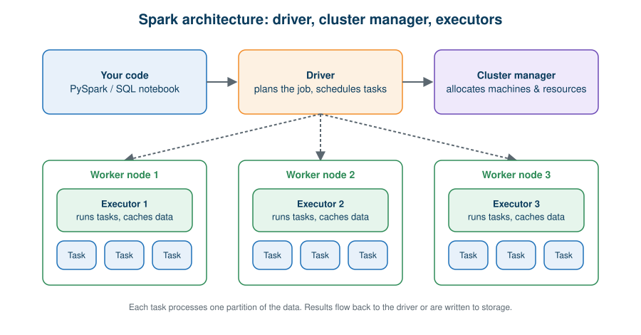
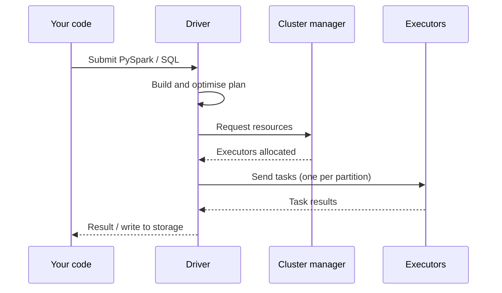

# 04 · Apache Spark

**← Previous** [03 · Apache Hadoop](03-hadoop.md) · [🏠 Home](../README.md) · **Next →** [05 · PySpark](05-pyspark.md)

> **In this chapter:** what Spark improves over MapReduce, and the three roles in its architecture.
> ⏱️ 15 minutes · 🎯 Level: beginner

## Table of contents

- [Why Spark became important](#why-spark-became-important)
- [Hadoop MapReduce vs Spark](#hadoop-mapreduce-vs-spark)
- [Partitions and tasks](#partitions-and-tasks)
- [Architecture](#architecture)
- [One engine, many workloads](#one-engine-many-workloads)
- [Key takeaways](#key-takeaways)

---

## Why Spark became important

Spark is a unified engine for large-scale data processing. Two ideas make it different:

1. It can **keep reusable intermediate data in memory** instead of writing it to disk after every step.
2. It **plans the whole job first** and optimises it before running anything.

## Hadoop MapReduce vs Spark

| Aspect | Hadoop MapReduce | Apache Spark |
| --- | --- | --- |
| Intermediate data | Disk-oriented between stages | In-memory caching, optimised execution |
| Programming model | Map and Reduce functions | Multiple high-level APIs |
| Workloads | Mostly batch | Batch, streaming, SQL, machine learning |
| Iterative work | Awkward | Well suited |
| Style | You program each stage | You describe *what* you want (DataFrames, SQL) |

> ⚠️ **Important:** Spark is *not* always in-memory. It uses memory **and** disk depending on the workload, plan and resources. And Spark did not simply replace Hadoop: it can run on Hadoop-compatible storage and cluster infrastructure.

## Partitions and tasks

Spark divides a dataset into **partitions**. Each partition is processed by one **task**.

| Partition | Data inside |
| --- | --- |
| Partition 1 | Hyderabad, Mumbai |
| Partition 2 | Hyderabad, Bangalore |
| Partition 3 | Mumbai, Hyderabad |

Spark runs tasks on available executors and combines results when needed.

## Architecture

| Role | Responsibility | Analogy |
| --- | --- | --- |
| **Driver** | Plans the application, builds the execution plan, schedules tasks | Project manager |
| **Executors** | Run tasks and can store (cache) data for the application | Team members |
| **Cluster manager** | Allocates machines and resources; the implementation depends on the environment | Office manager |

Related terms: a **task** is one assigned piece of work, a **partition** is one slice of the workload, and the **cluster** is the whole team.

## One engine, many workloads

| Component | Use it for |
| --- | --- |
| **Spark SQL** | SQL queries on structured data |
| **DataFrames** | Distributed data transformations |
| **Structured Streaming** | Data that keeps arriving |
| **MLlib** | Machine learning at scale |

## Key takeaways

- Spark plans first, executes later, and can cache data in memory.
- Driver = coordinator; executors = workers; cluster manager = resource allocator.
- One engine handles batch, SQL, streaming and ML.

---

**← Previous** [03 · Apache Hadoop](03-hadoop.md) · [🏠 Home](../README.md) · **Next →** [05 · PySpark](05-pyspark.md)
