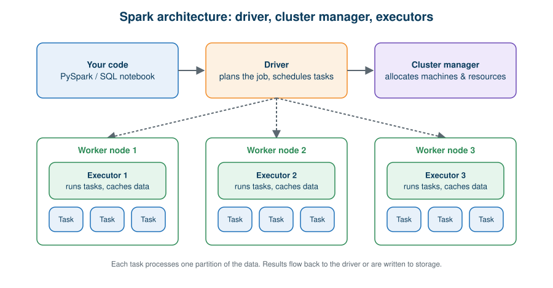
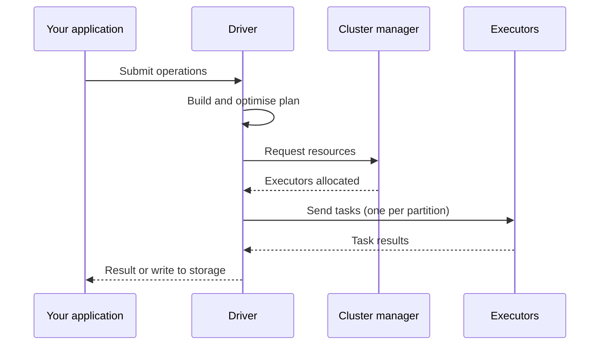
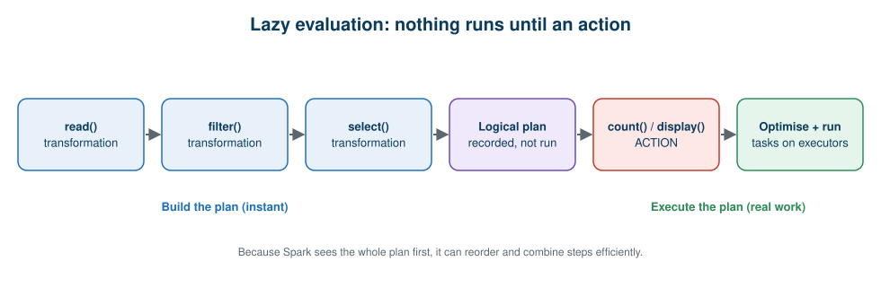

# 05 · Apache Spark

**← Previous** [04 · Apache Hadoop](04-apache-hadoop.md) · [🏠 Home](../README.md) · **Next →** [06 · PySpark](06-pyspark.md)

> **In this chapter:** why Spark was created, how its architecture works, and the ideas of DataFrames, partitions and lazy evaluation.
> ⏱️ 30 minutes · 🎯 Level: beginner · 💻 No code in this chapter (practice is in [Hands-On](11-hands-on-guide.md))

## Learning objectives

By the end of this chapter you can:

1. explain why Spark was introduced and how it differs from MapReduce,
2. describe the Driver, Cluster Manager, Worker Nodes, Executors and Tasks,
3. explain DataFrames and partitions,
4. distinguish transformations from actions and explain lazy evaluation.

## Table of contents

- [What is Spark](#what-is-spark)
- [Hadoop MapReduce vs Spark](#hadoop-mapreduce-vs-spark)
- [Spark architecture](#spark-architecture)
- [DataFrames and partitions](#dataframes-and-partitions)
- [Transformations, actions and lazy evaluation](#transformations-actions-and-lazy-evaluation)
- [One engine, many workloads](#one-engine-many-workloads)
- [Key takeaways](#key-takeaways)

---

## What is Spark

> **Definition:** Apache Spark is an open-source, distributed computing engine for large-scale data processing. It supports batch processing, SQL analytics, streaming and machine learning.

Hadoop MapReduce made distributed batch processing possible, but in a multi-stage workflow intermediate results are repeatedly written to and read from disk:

```text
Read sales → Remove duplicates → Filter invalid → Join customers → Calculate revenue → Report
```

For iterative workloads that overhead is substantial. Spark offers a more flexible engine with **optimised execution** and **in-memory caching**.

**Spark provides:** distributed DataFrame processing, in-memory caching for reusable datasets, SQL analytics, Structured Streaming, machine learning, and integration with many storage systems.

## Hadoop MapReduce vs Spark

| Parameter | Hadoop MapReduce | Apache Spark |
| --- | --- | --- |
| Processing model | Map and Reduce | DAG-based execution |
| Intermediate data | Commonly materialised to disk | Can use memory and disk |
| Workloads | Primarily batch | Batch, streaming and interactive |
| APIs | Lower-level programming model | Higher-level DataFrame and SQL APIs |
| Iterative workloads | Can be expensive | Caching and optimised iterative processing |
| Optimisation | Traditional MapReduce execution | Catalyst optimiser and other optimisations for Spark SQL |

> ⚠️ **Important:** Spark is **not** guaranteed to be faster for every workload, and it is **not** always in-memory. Performance depends on data volume, workload design, partitioning, hardware, storage and configuration. Spark also did not simply replace Hadoop: it can run on Hadoop-compatible storage and clusters.

## Spark architecture

> **Definition:** Spark architecture describes how a Spark application gets resources, distributes tasks and executes operations across available computing resources.



| Component | Responsibilities | Analogy |
| --- | --- | --- |
| **Driver** | Creates the SparkSession, builds execution plans, coordinates job execution, schedules tasks, collects results when requested | Project manager |
| **Cluster manager** | Allocates resources to Spark applications. Examples: Standalone, YARN, Kubernetes, managed compute environments | Resource allocation manager |
| **Worker nodes** | Provide the computing resources for distributed workloads | Team members’ workstations |
| **Executors** | Application-specific processes that run tasks and can store data in memory or on disk | Processing teams |
| **Tasks** | Individual units of work sent to executors to process data partitions | Assigned activities |
| **Partitions** | Logical slices of the dataset | Divided work units |



> 🔑 The Driver coordinates; the executors do the distributed work.

## DataFrames and partitions

> **DataFrame:** a distributed collection of data organised into named columns, conceptually similar to a relational table.
>
> **Partition:** a logical division of a dataset that lets Spark process data in parallel.

**Example.** A dataset of 12 million sales records is divided into four partitions:

| Partition | Number of records |
| --- | --- |
| Partition 1 | 3 million |
| Partition 2 | 3 million |
| Partition 3 | 3 million |
| Partition 4 | 3 million |

Spark schedules tasks to process these partitions across the available executors.

| Term | Meaning |
| --- | --- |
| DataFrame | Logical, structured representation of the data |
| Partition | Division of the data for processing |
| Task | Unit of execution for a partition or stage |
| Executor | Process that runs tasks |

> ⚠️ **Do not assume one partition equals one machine.** Partitions are logical; Spark decides where their tasks run.

## Transformations, actions and lazy evaluation

| Concept | Definition | Examples |
| --- | --- | --- |
| **Transformation** | An operation that creates a new DataFrame from an existing one; it only *describes* work | select, filter, withColumn, drop, groupBy |
| **Action** | An operation that triggers execution and returns a result or writes data | count, collect, show, write, display (in Databricks) |

> **Lazy evaluation:** Spark delays executing transformations until an action requires a result. Meanwhile it records what you asked for as an execution plan.



**Why it matters:** because Spark sees the entire plan before running anything, it can combine and reorder steps, skip unneeded columns and push filters toward the data source.

## One engine, many workloads

| Component | Use it for |
| --- | --- |
| **Spark SQL** | SQL queries and structured data processing |
| **DataFrames** | Distributed data transformations |
| **Structured Streaming** | Processing continuously arriving data |
| **MLlib** | Scalable machine learning |

## Key takeaways

- Spark plans first, executes later, and can cache data in memory.
- Driver = coordinator, executors = workers, cluster manager = resource allocator.
- DataFrames are split into partitions; tasks process partitions.
- Transformations are lazy; actions trigger execution.

---

**← Previous** [04 · Apache Hadoop](04-apache-hadoop.md) · [🏠 Home](../README.md) · **Next →** [06 · PySpark](06-pyspark.md)
